# 🗿 Especificación de Modelos 3D & Texturas — The Light in the Darkness

Esta guía técnica define los requerimientos para la integración de modelos tridimensionales en el motor **Three.js** de *The Light in the Darkness*. Su objetivo es mantener un estilo visual gótico estilizado (estética *Retro PSX / Dark Fantasy Indie*) con altísimo rendimiento en navegadores WebGL.

---

## 📐 Estándares Técnicos para Modelado 3D

- **Formato Estándar**: **GLTF 2.0** (`.gltf` + `.bin` o binario autocontenido `.glb`).
- **Escala de Unidades**: 1 unidad de Three.js = 1 metro en el mundo real.
  - Altura aproximada de Thomas: `1.8 m`.
  - Altura aproximada de Khaterine: `1.75 m`.
  - Altura aproximada de Morwenna: `2.1 m` (con tocado ceremonial).
  - Altura de barriles: `0.9 m`.
- **Presupuesto de Polígonos (Low-Poly Optimizado)**:
  - Personajes principales: **1,200 a 2,500 triángulos**.
  - Enemigos comunes (Sabuesos, Cultistas): **800 a 1,500 triángulos**.
  - Jefes (Madre Morwenna): **2,500 a 4,000 triángulos**.
  - Props del escenario (barriles, farolas, cajas): **150 a 400 triángulos**.
- **Orientación**: Eje `+Y` hacia arriba, Eje `-Z` hacia adelante (estándar glTF/Three.js).
- **Pivote / Origen**: En la base de los pies (`y = 0.0`) y centrado en `x = 0, z = 0`.

---

## 🎨 Mapas de Texturas & Shaders

### 1. Resolución & Formato de Texturas
- **Resolución**: **512 × 512 px** (props y enemigos) o **1024 × 1024 px** (personajes principales y jefes).
- **Filtro de Textura**: `THREE.NearestFilter` para estética *pixel-texture* retro o `THREE.LinearMipmapLinearFilter` para aspecto estilizado suave.
- **Canales Requeridos**:
  1. **Albedo / Base Color (`map`)**: Color difuso con sombras horneadas sutiles en la textura (*hand-painted*).
  2. **Emissive Map (`emissiveMap`)**: Esencial para runas moradas de Khaterine, ojos rojos del Sabueso, fuego del Crisol de Morwenna y sello de ceniza de Thomas.
  3. **Roughness / Metalness (PBR)**: Control de brillo mate en telas y brillo metálico en hojas de espada y crisoles de bronce.

---

## 🧍‍♂️ 1. Personajes Jugables Requeridos

### A. Thomas el Acólito (`thomas_hero.glb`)

  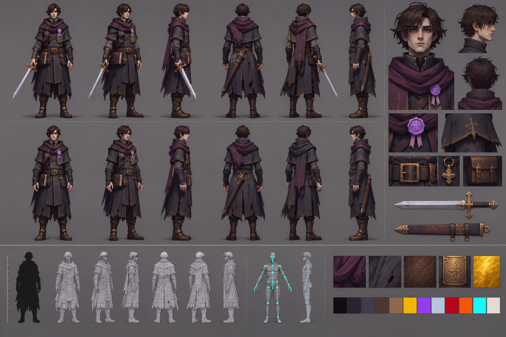

- **Malla**:
  - Túnica clerical gris oscura/púrpura desgastada con pliegues en la parte baja.
  - Bufanda/capucha alrededor del cuello en tono ciruela oscuro.
  - Sello de ceniza en el pecho con textura emisiva púrpura (`#73299e`).
  - Rostro juvenil pálido con cabello castaño oscuro alborotado.
  - **Malla de Espada Desmontable**: Nodo secundario `weapon_sword` vinculable al hueso de la mano derecha (`hand.R`), que pueda ocultarse cuando se arroje.
- **Clips de Animación en el GLTF**:
  - `Idle`: Respiración lenta, balanceo suave de la espada.
  - `Walk`: Marcha cautelosa a 4.8 m/s.
  - `Run`: Trote rápido a 6.0 m/s.
  - `Slash_Light`: Tajo diagonal en 280 ms.
  - `Slash_Heavy`: Tajo vertical descendente con impacto en 450 ms.
  - `Guard`: Postura con espada frente al torso.
  - `Punch_Light` & `Punch_Heavy`: Para combate desarmado.
  - `Dodge`: Voltereta frontal rápida en 280 ms.

### B. Khaterine la Cazadora (`khaterine_hero.glb`)

  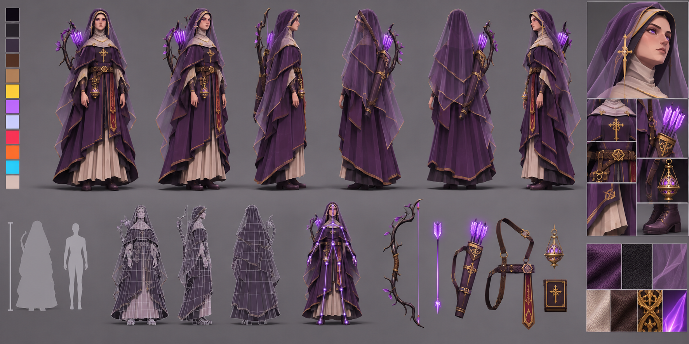

- **Malla**:
  - Túnica estilizada ceñida con manto ceremonial en tono berenjena/negro abisal.
  - Velo translúcido que cae desde la cabeza sobre los hombros (material con `transparent: true`).
  - Ojos con leve brillo amatista.
  - **Malla de Arco Abisal**: Nodo secundario `weapon_bow` en la mano izquierda (`hand.L`), esculpido en madera oscura de sauce con runas emisivas y cuerda de luz.
- **Clips de Animación en el GLTF**:
  - `Idle`: Postura vigilante, velo meciéndose.
  - `Walk` & `Run`: Desplazamiento grácil y bajo.
  - `Aim_Bow`: Tensa la cuerda apuntando al frente.
  - `Shoot_Release`: Retroceso del arco al soltar la flecha.
  - `Ward_Cast`: Levanta la mano derecha al frente mientras la barrera se activa.

---

## 🐾 2. Aliados & NPCs 3D

  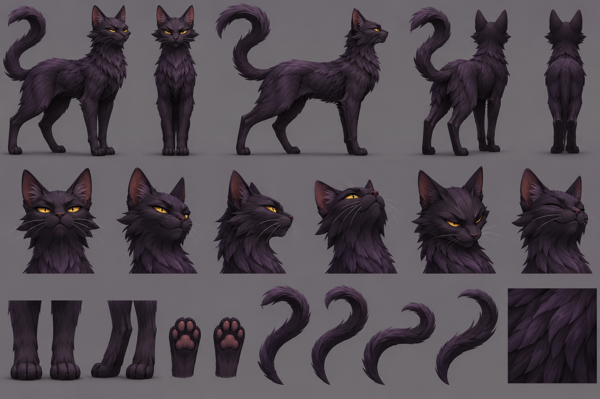
  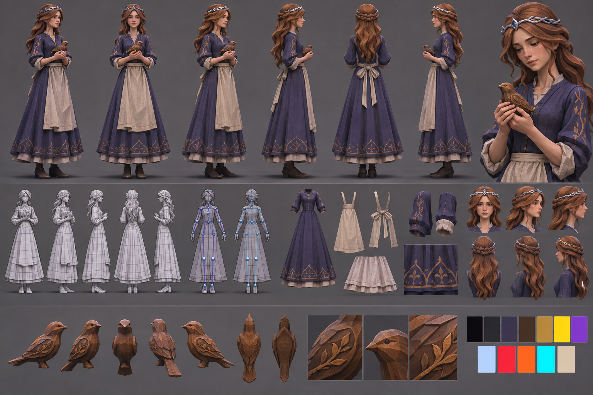
  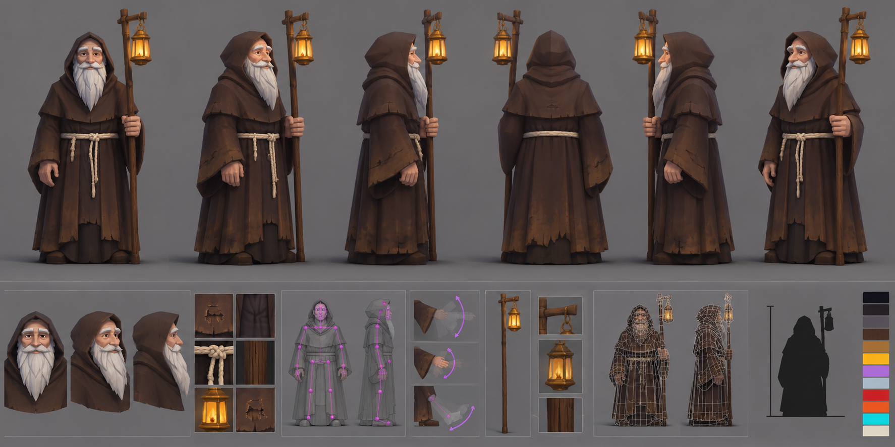

| Modelo | Nombre Archivo | Triángulos | Detalles Clave |
| :--- | :--- | :---: | :--- |
| **Shalem el Gato** | `shalem_cat.glb` | 600 - 900 | Pelaje negro carbón, ojos amarillos/dorados emisivos, cola larga con rig de 4 huesos para movimiento sinuoso. |
| **Elowen de Oakhaven** | `elowen_maiden.glb` | 1,500 - 2,200 | Vestido largo azul noche con delantal de lino blanco, diadema argéntea, pájaro de madera en las manos. |
| **Padre Cedric** | `cedric_priest.glb` | 1,600 - 2,400 | Hábito franciscano marrón con cordón blanco, barba larga blanca, báculo de madera con farol colgante funcional. |

---

## 👑 3. Jefa: Madre Morwenna (`morwenna_boss.glb`)

  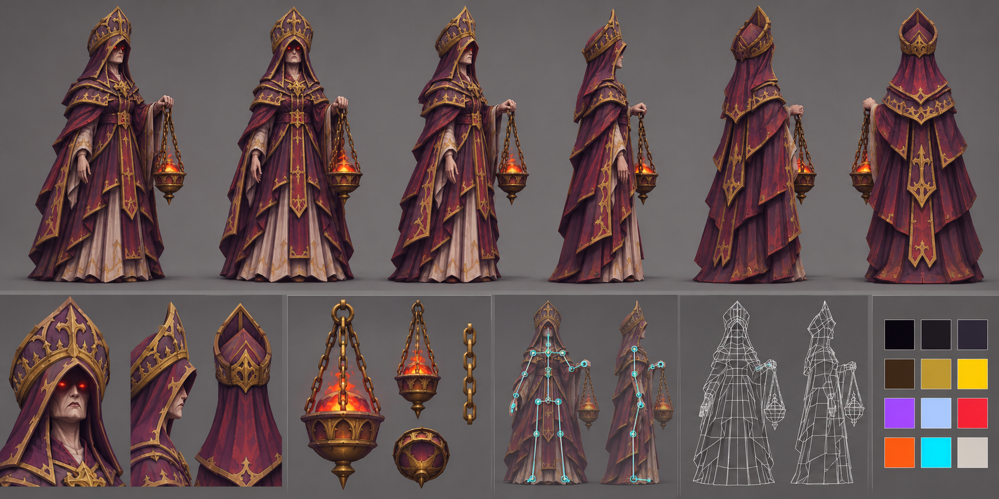
  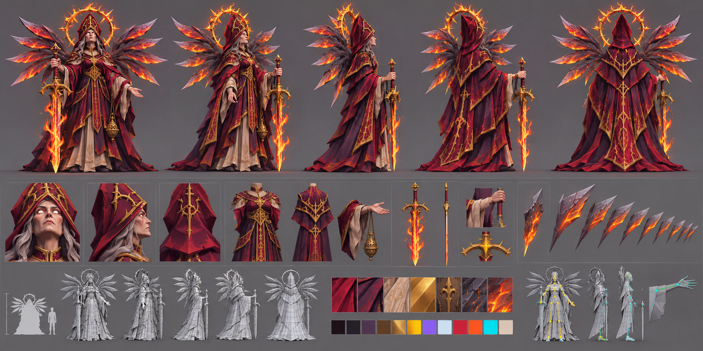

- **Malla Base**:
  - Túnica ceremonial inquisitorial de color vino tinto/carmesí con ribetes de oro envejecido.
  - Alto capirote/tocado ceremonial que oscurece su rostro, dejando ver dos ojos rojos incandescentes (o plasma blanco en Fase 2).
  - Mano izquierda libre con mangas amplias.
  - Mano derecha sosteniendo el **Crisol de Fuego Sagrado** en Fase 1, intercambiable al **Gran Mandoble Flamígero** en Fase 2.
- **Accesorios y Sockets para Fase 2 ("Pira del Abismo Desatada")**:
  - `socket_back`: **Alas de Ceniza y Fuego** (`morwenna_wings.glb`) compuestas por 12 plumas angulares ardientes con rig para aleteo.
  - `hand.R`: **Gran Mandoble de la Pira** (`morwenna_flame_sword.glb`), espada a dos manos de 1.9m con textura emisiva animada de fuego.
  - `socket_head`: **Corona de Espinas de Oro Candente** (`morwenna_thorn_halo.glb`), aro flotante con rotación continua.
- **Clips de Animación Requeridos**:
  - `Float_Idle`: Levitación oscilante arriba y abajo (`y += sin(t)`).
  - `Chase_Glide`: Deslizamiento hacia el jugador a 2.2 m/s (Fase 1) o 3.4 m/s (Fase 2).
  - `Crucible_Windup` & `Crucible_Slam`: Ataques con crisol de Fase 1.
  - `Phase2_Transition`: Bramido cinemático al 50% HP elevándose y desplegando alas con onda de choque.
  - `Whirlwind_360`: Giro letal barriendo con el mandoble y despidiendo proyectiles de fuego.
  - `Geysers_Cast`: Hunde el mandoble en el pavimento invocando 3 erupciones de plasma.
  - `Infernal_Lunge`: Embestida frontal a 7.5 m/s telegrafiada con estocada recta.
  - `Stunned`: Se inclina desestabilizada con postura rota.
  - `Purification`: Cae de rodillas pacíficamente mientras el fuego se disuelve en ceniza blanca.

---

## 👹 4. Enemigos Comunes & Patrullas

  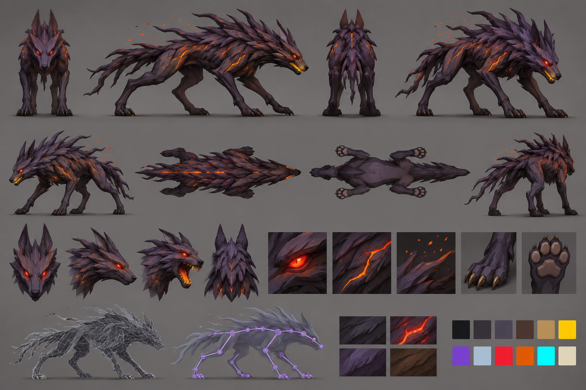
  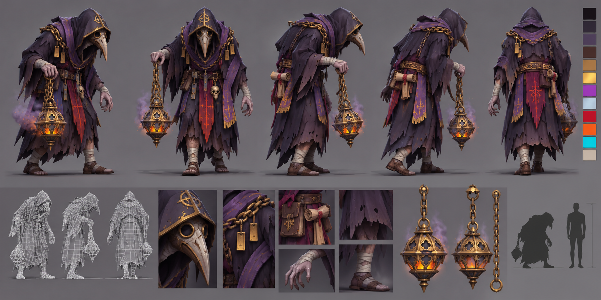
  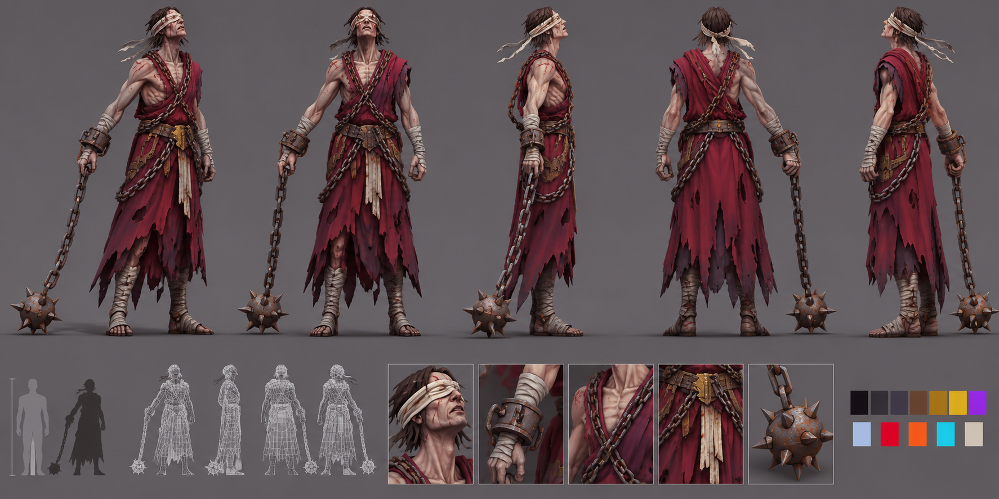
  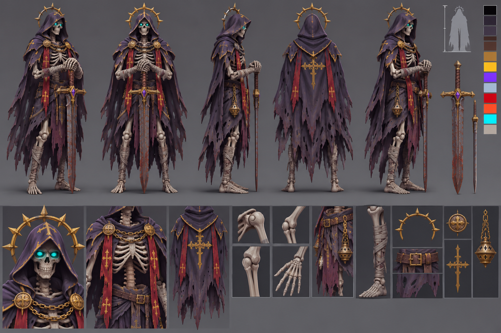

| Modelo | Archivo GLTF | Triángulos | Sockets / Huesos Especiales | Animaciones Requeridas |
| :--- | :--- | :---: | :--- | :--- |
| **Sabueso de Ceniza** | `hound_ash.glb` | 800 - 1,200 | Ojos emisivos rojos, fauces con dientes afilados. | `Patrol_Walk`, `Alert`, `Bite_Windup`, `Bite_Lunge`, `Stagger`, `Death_Ash`. |
| **Cultista con Incensario** | `cultist_censer.glb` | 1,000 - 1,500 | `hand.R` con cadena e incensario oscilante con luz puntual. Máscara de cuervo. | `Patrol_Walk`, `Alert`, `Censer_Swing`, `Stagger`, `Death`. |
| **Flagelante con Cadena** | `chain_zealot.glb` | 1,200 - 1,800 | `hand.R` con mangual de púas y cadena de 3 eslabones independientes. Venda en los ojos. | `Patrol_Walk`, `Alert`, `Whip_Swipe_AoE`, `Overhead_Smash`, `Stagger`, `Death`. |
| **Penitente de la Cripta** | `crypt_penitent.glb` | 1,400 - 2,000 | Cuencas de ojos cian emisivas (`#00e5ff`). Ropajes funerarios harapientos. Claymore a dos manos en `hand.R`/`hand.L`. | `Skeleton_Walk`, `Alert_Draw`, `Claymore_Slash`, `Parried_Recoil`, `Shatter_Death`. |

---

## 🛢️ 5. Props Destructibles, Entorno & Cementerio

  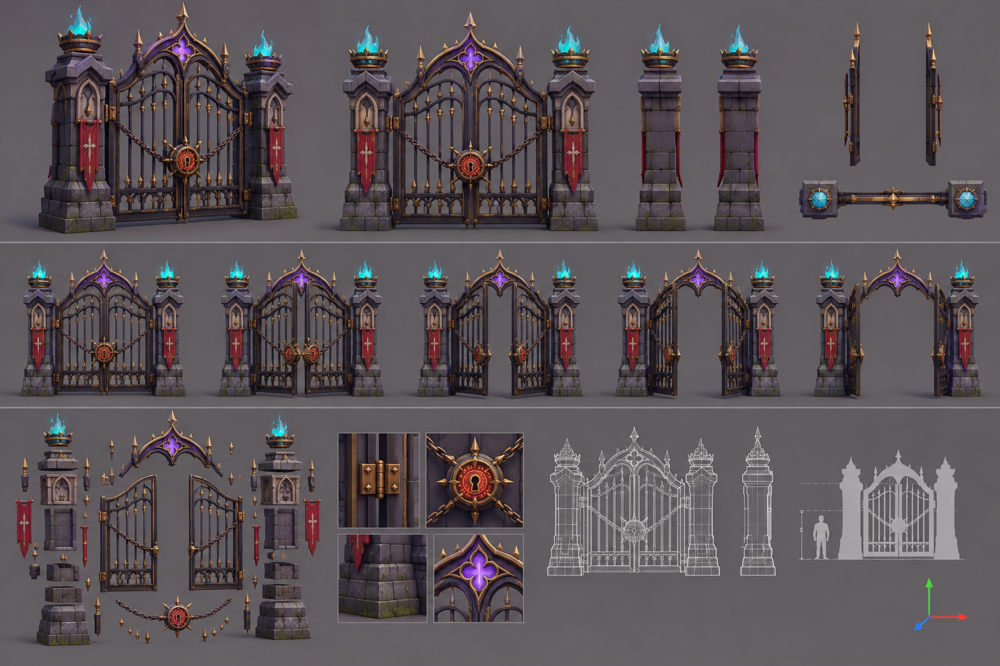
  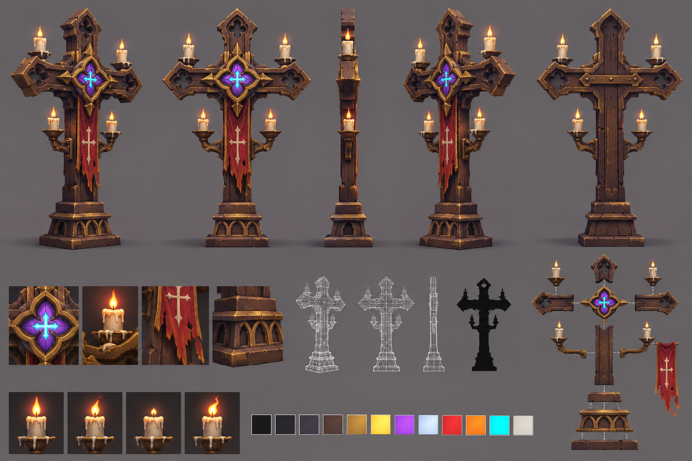
  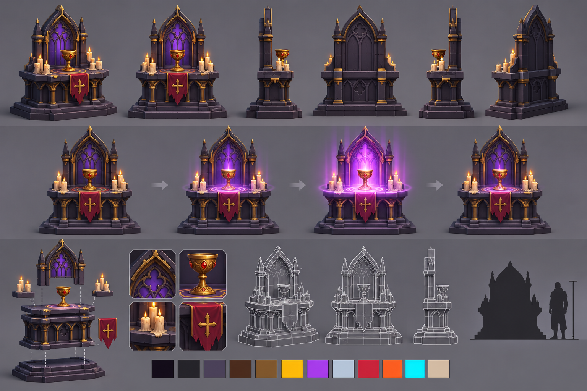
  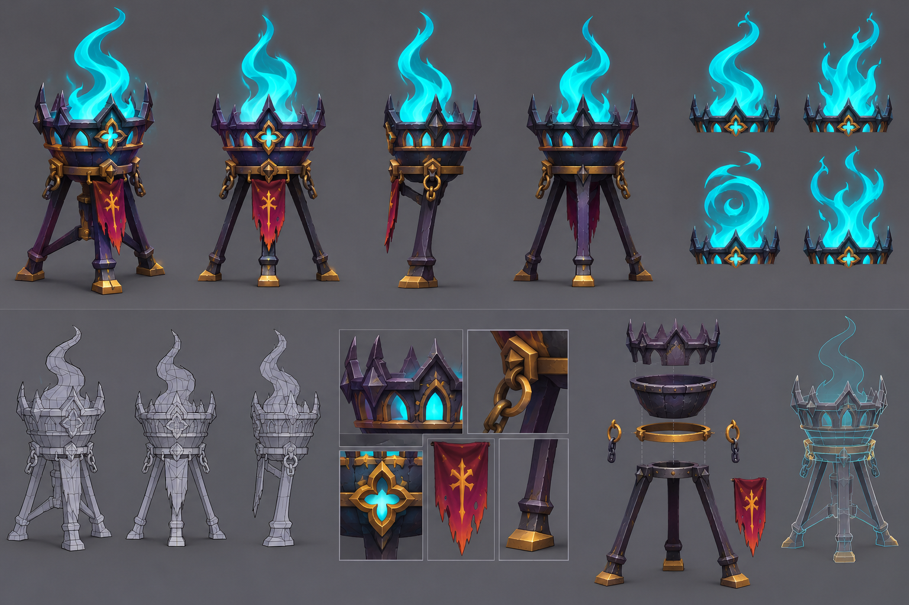
  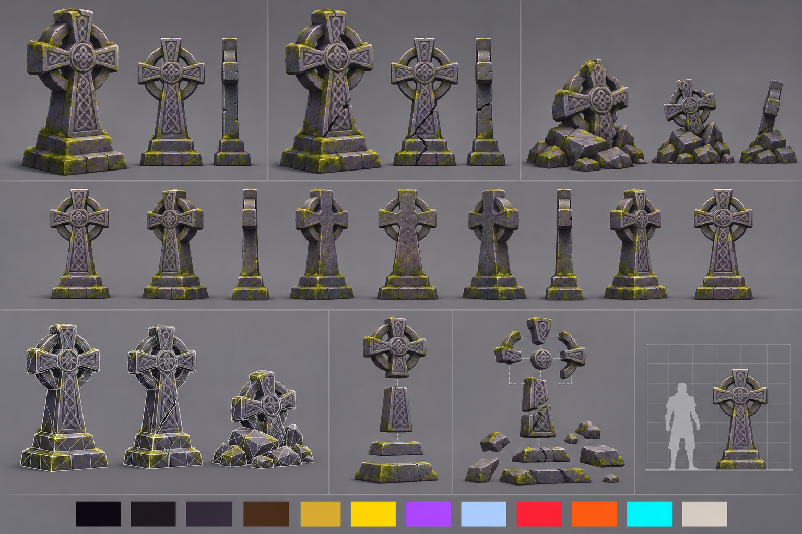
  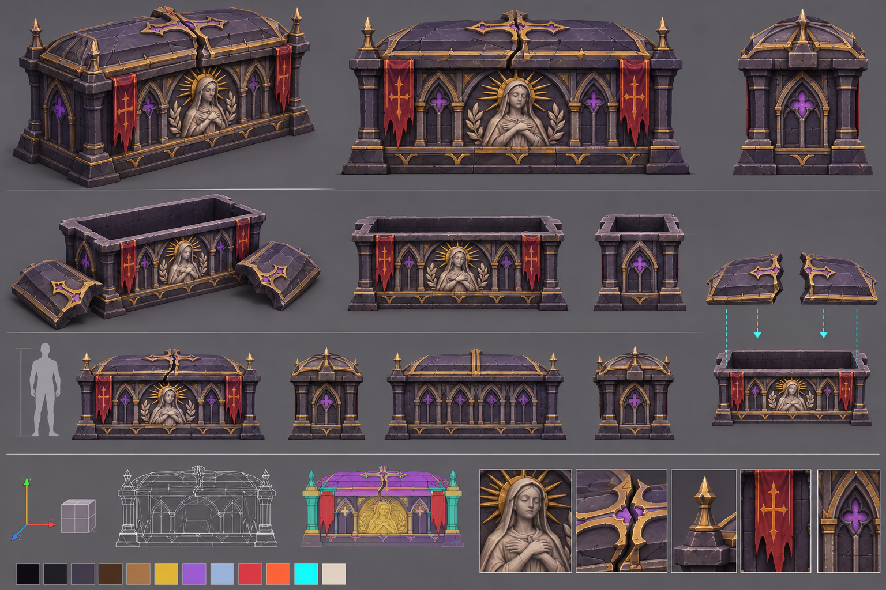

### A. Mallas Fragmentadas Pre-Rotas (*Fracture Meshes*)
Para que la física de destrucción en Three.js sea inmediata y sin lag:
1. **Malla Intacta**: El modelo completo optimizado para la escena en reposo.
2. **Mallas de Fragmentos (`debris_pieces`)**: Submallas individuales con masa y velocidad inicial al romperse:
   - **Barril de Madera**: 4 duelas laterales astilladas, 2 tapas circulares rotas, 2 aros de hierro.
   - **Caja de Madera**: 4 tablas laterales con clavos, 2 tapas astilladas.
   - **Lápida Celta de San Jude**: 1 base de pedestal, 1 cruz superior partida, 4 cascotes de granito grabados.
   - **Gran Sarcófago Monumental**: 1 caja fúnebre inferior intacta, 2 mitades de tapa de piedra partida.

### B. Elementos de Arquitectura & Cementerio
| Prop | Archivo GLTF | Triángulos | Características Técnicas |
| :--- | :--- | :---: | :--- |
| **Verja de Hierro del Cementerio** | `cemetery_gate.glb` | 800 - 1,200 | 2 pilares de piedra laterales y 2 hojas batientes con huesos pivote `door_left_pivot` y `door_right_pivot` para rotación de 80°. |
| **Pebetero de Almas de la Cripta** | `soul_brazier.glb` | 400 - 600 | Trípode de hierro forjado gótico con nodo `flame_socket` para sistema de partículas o shader cian (`#00e5ff`). |
| **Fachada Mausoleo de San Jude** | `mausoleum_crypt.glb` | 1,800 - 2,600 | Fachada gótica con arco ojival, cruces en relieve y plano de portal abisal con textura animada de niebla. |
| **Cruz y Altar de San Jude** | `sanctuary_altar.glb` | 1,000 - 1,500 | Cruz monumental con tallas de oraciones, mesa de altar de piedra y 4 velas con fuego parpadeante. |
| **Farola Victoriana de Oakhaven** | `street_lamp.glb` | 350 - 500 | Poste esbelto de hierro forjado con farol acristalado y bombilla de aceite cálida (`#ffaa33`). |

---

## 🛠️ Exportación Recomendada desde Blender

1. **Modifiers**: Aplicar todos los modificadores (excepto *Armature*).
2. **Transforms**: Aplicar Rotación y Escala (`Ctrl + A` -> *All Transforms*).
3. **Materials**: Usar nodos *Principled BSDF*. Conectar textura a *Base Color* y *Emission*.
4. **glTF Settings**:
   - Formato: `glTF Binary (.glb)`.
   - Incluir: *Selected Objects*, *Custom Properties*, *Cameras: No*, *Punctual Lights: No*.
   - Geometría: *Apply Modifiers: Yes*, *Tangents: No* (si no usa normal maps complejos).
   - Animación: *Group by NLA: Yes*, *Sample Animations: Yes*.
