# 🎨 Especificación de Sprites 2D Requeridos — The Light in the Darkness

Esta guía detalla con precisión técnica cada hoja de sprites (*spritesheet*) necesaria para la versión **2D** de *The Light in the Darkness*. Está pensada para facilitar el flujo de trabajo de ilustración y pixel art de Kevin.

> [!TIP] Visor Web Interactivo de Animaciones
> Abre [catalogo.html](catalogo.html) directamente en tu navegador para ver la galería completa interactiva con reproductor de animaciones, visualización de frames y tiras horizontales para el motor Phaser.

  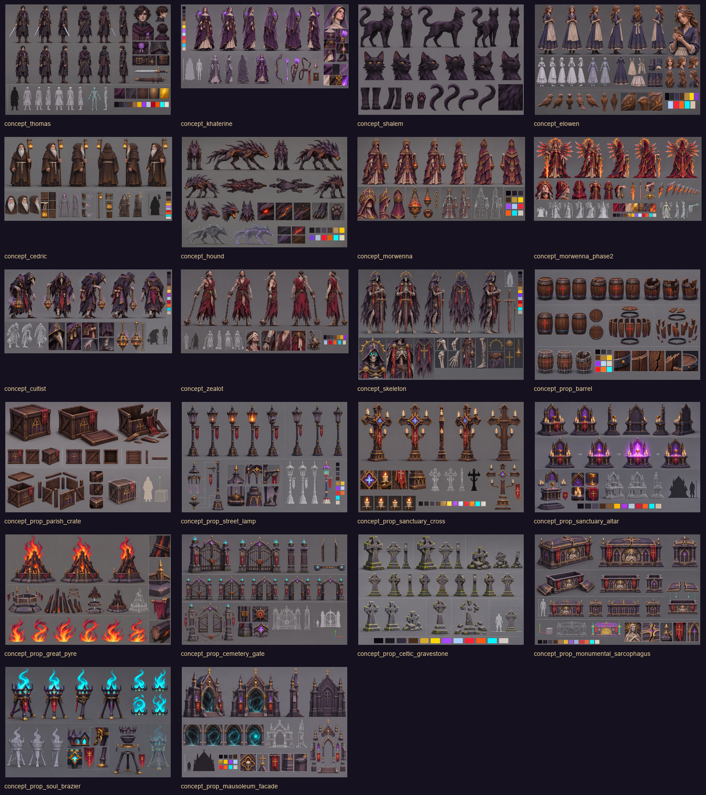

---

## 📐 Estándares Generales de Entrega

- **Formato**: Archivo `.png` con transparencia (canal alfa).
- **Resolución de Celda**:
  - Personajes estándar (Thomas, Khaterine, Cedric, Elowen): **48 × 48 px** (o 64 × 64 px si incluye capa de armas/efectos).
  - Aliados pequeños (Shalem el gato): **32 × 32 px**.
  - Enemigos cuadrúpedos (Sabueso de Ceniza): **64 × 48 px**.
  - Jefes imponentes (Madre Morwenna, Arzobispo): **96 × 96 px** o **128 × 128 px**.
  - Props del escenario (barriles, cajas, farolas): **32 × 32 px** a **64 × 64 px**.
- **Distribución de Frames**: Tira horizontal continua (`frame_0.png`, `frame_1.png`...) o cuadrícula ordenada.
- **Pivote / Origen**: Centro inferior de los pies del personaje (`x: 50%`, `y: 90%`).
- **Frecuencia de Animación Típica**: 8 a 12 FPS para un movimiento fluido y con peso propio.

---

## 🗡️ 1. Héroe 1: Thomas el Acólito (Con Espada & Desarmado)

  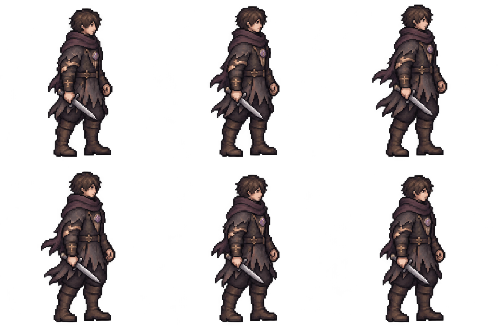
  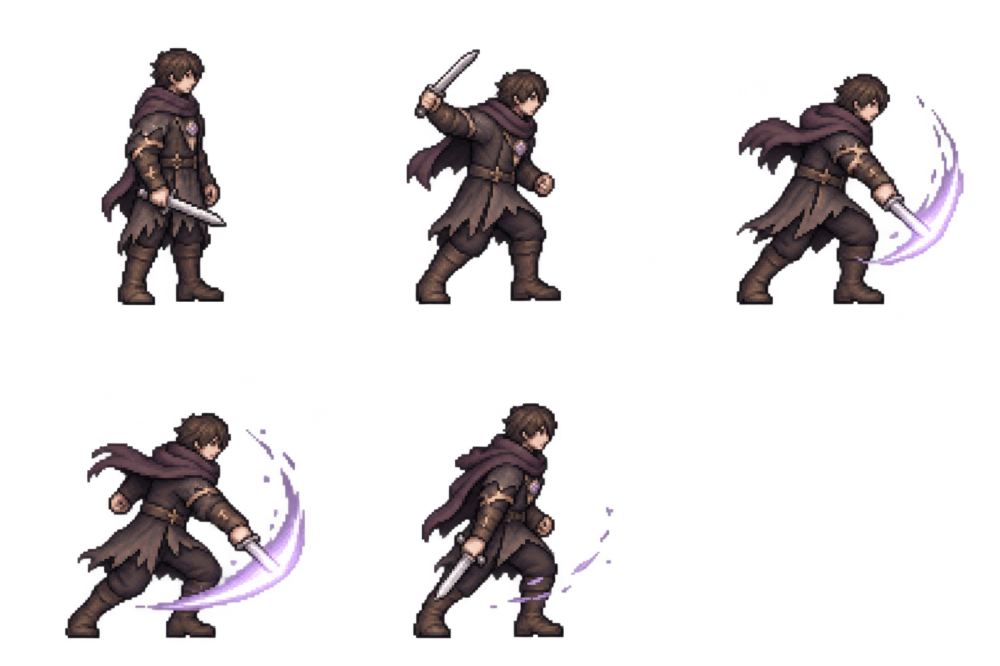
  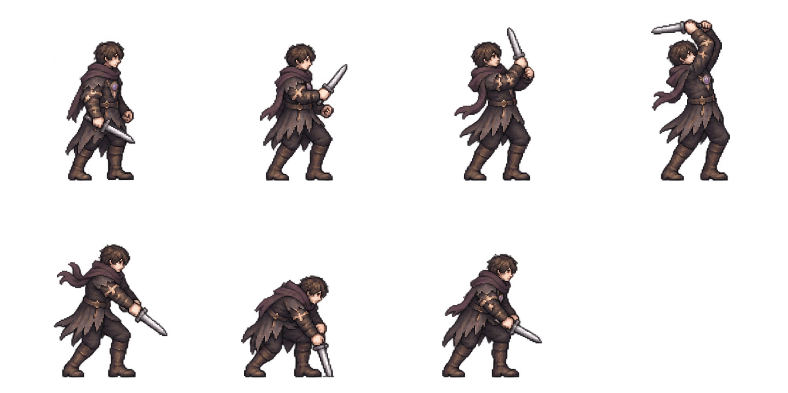
  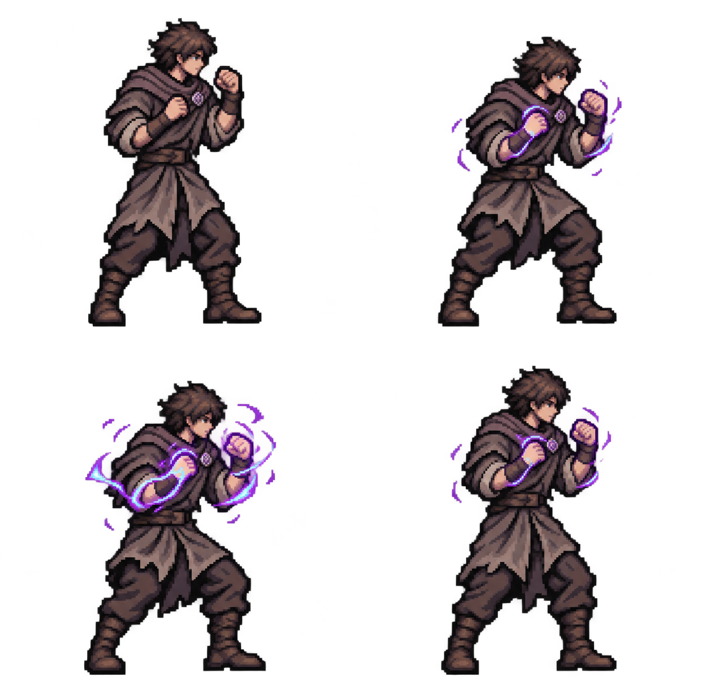

Thomas tiene dos variantes principales: **Armado con Espada Corta** y **Desarmado a Puños**.

### A. Thomas Armado (Espada del Monaguillo)
| Animación | Frames | FPS Sugerido | Descripción de la Acción |
| :--- | :---: | :---: | :--- |
| `thomas_idle` | 4 - 6 | 8 | Respiración lenta en guardia, túnica meciéndose sutilmente, espada baja. |
| `thomas_walk` | 6 - 8 | 10 | Paso firme y cauteloso con la espada en mano. |
| `thomas_run` | 6 - 8 | 12 | Carrera con capa ondeando, túnica levantándose. |
| `thomas_slash_light` | 4 - 5 | 14 | Tajo diagonal rápido de derecha a izquierda con estela luminosa. |
| `thomas_slash_heavy` | 6 - 7 | 12 | Golpe vertical descendente con anticipación (*wind-up*) y choque contra el suelo. |
| `thomas_guard` | 2 - 3 | 10 | Postura defensiva levantando la espada horizontalmente frente al pecho. |
| `thomas_parry` | 4 | 16 | Desvío rápido hacia arriba, chispa metálica dorada en el punto de impacto. |
| `thomas_dodge` | 5 - 6 | 14 | Rodar evasivo sobre el suelo y recuperación en pie. |
| `thomas_throw_sword`| 5 | 12 | Impulso de lanzamiento arrojando la hoja hacia el frente. |
| `thomas_hurt` | 3 | 12 | Retroceso con túnica sacudida y sangre/ceniza saliendo del cuerpo. |
| `thomas_death` | 6 - 8 | 8 | Cae de rodillas al suelo, suelta la espada y se desvanece en ceniza oscura. |
| `thomas_finisher` | 7 - 9 | 14 | Secuencia cinemática: estocada perforante profunda con destello dorado. |

### B. Thomas Desarmado (Pelea a Puños)
| Animación | Frames | FPS Sugerido | Descripción de la Acción |
| :--- | :---: | :---: | :--- |
| `thomas_unarmed_idle` | 4 | 8 | Guardia alta de boxeo/monje penitente con puños cerrados envueltos en energía. |
| `thomas_punch_light` | 3 - 4 | 14 | Jab rápido con la izquierda y cruzado derecho. |
| `thomas_punch_heavy` | 5 | 12 | Gancho demoledor con energía rúnica ascendente. |

---

## 🏹 2. Heroína 2: Khaterine la Cazadora del Sauce Negro

  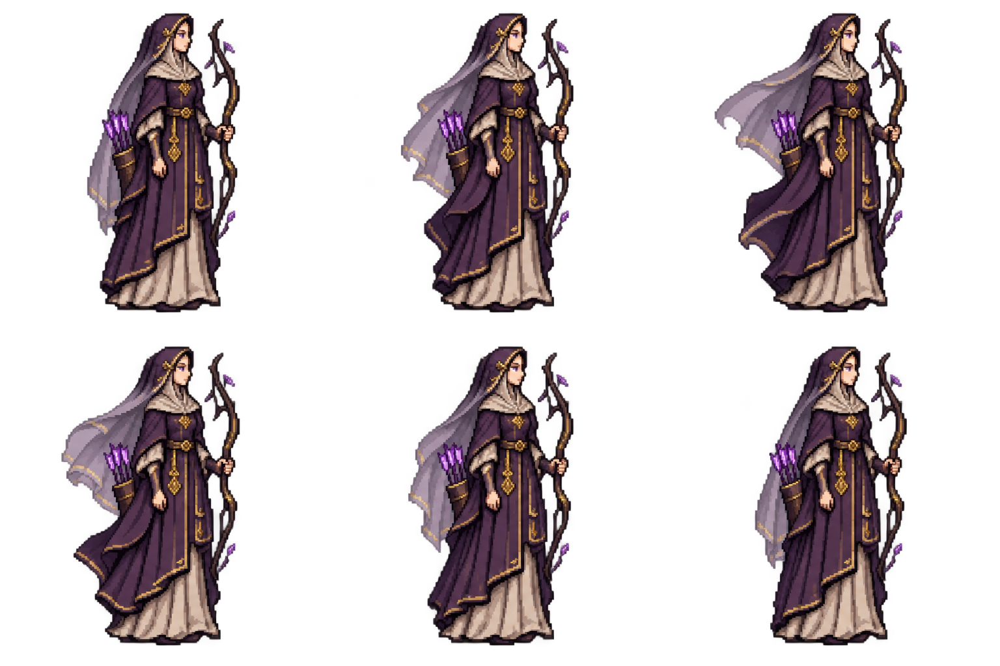
  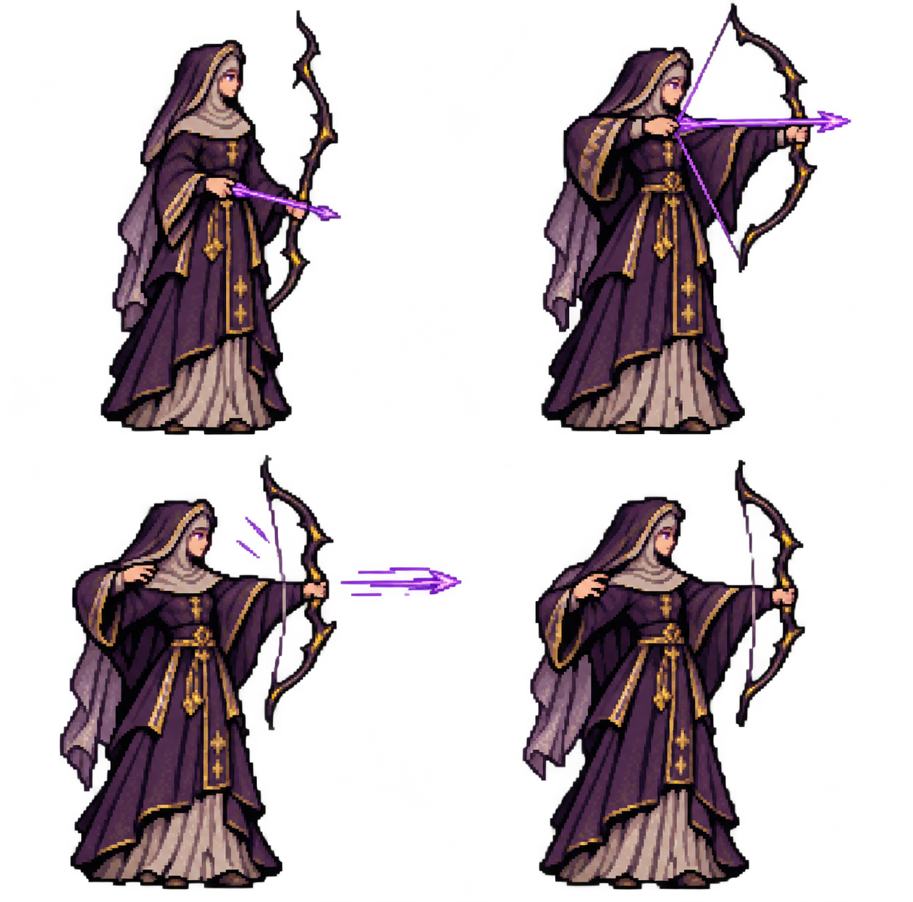
  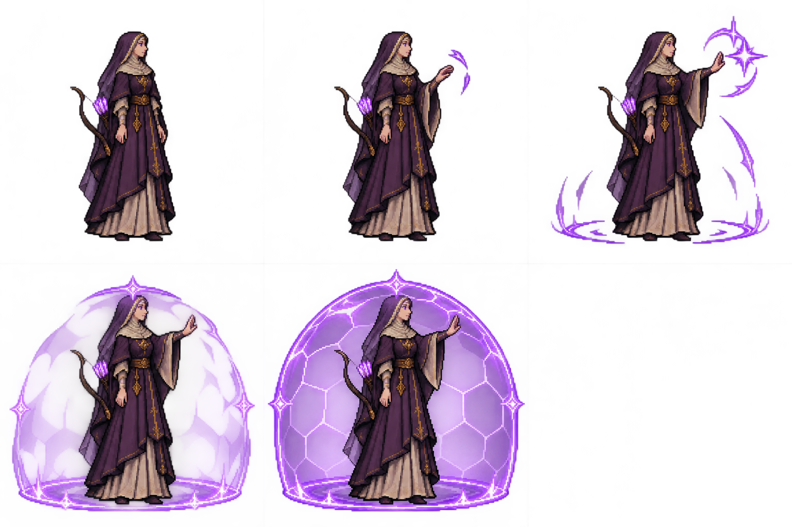

Estilo grácil, túnica oscura, velo ceremonial de gasa que flota en el viento y arco abisal.

| Animación | Frames | FPS Sugerido | Descripción de la Acción |
| :--- | :---: | :---: | :--- |
| `khaterine_idle` | 4 - 6 | 8 | Postura erguida y misteriosa, velo ondeando suavemente, arco apoyado. |
| `khaterine_walk` | 6 | 10 | Pasos silenciosos y felinos sobre el pavimento. |
| `khaterine_run` | 6 - 8 | 12 | Desplazamiento veloz y bajo con túnica extendida hacia atrás. |
| `khaterine_aim` | 3 | 12 | Tensa la cuerda del arco; aparece una flecha brillante de plasma púrpura. |
| `khaterine_shoot_light` | 4 | 14 | Liberación instantánea de flecha rápida con retroceso de hombro. |
| `khaterine_shoot_heavy` | 6 | 12 | Disparo cargado: la flecha se ensancha y emite rayos abisales antes de volar. |
| `khaterine_ward` | 4 - 5 | 10 | Levanta la mano libre y despliega una cúpula protectora púrpura alrededor. |
| `khaterine_dodge` | 5 | 14 | Deslizamiento espectral en sombra dejando estela de pétalos o cenizas. |
| `khaterine_hurt` | 3 | 12 | Retroceso llevándose la mano al costado. |
| `khaterine_death` | 6 | 8 | Se desploma mientras su velo se disuelve en una nube de sombras. |

---

## 🐾 3. Aliados de la Aldea (NPCs)

  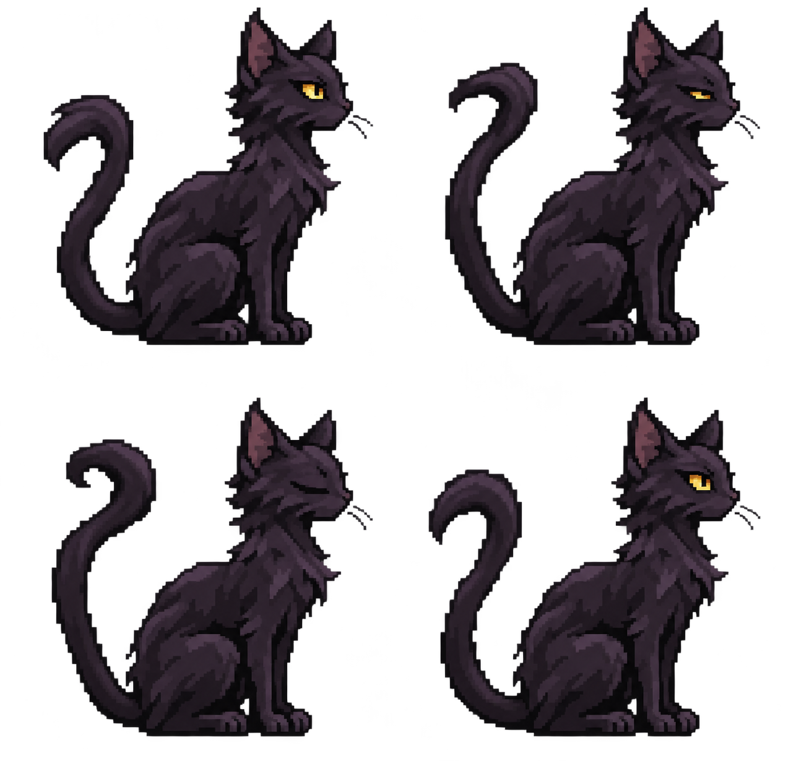
  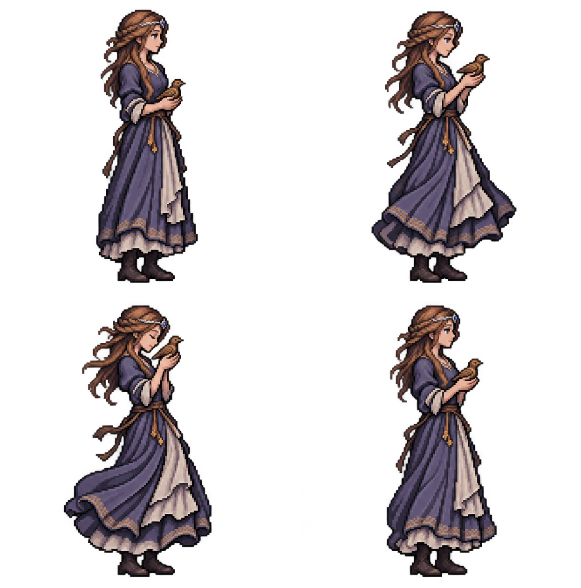
  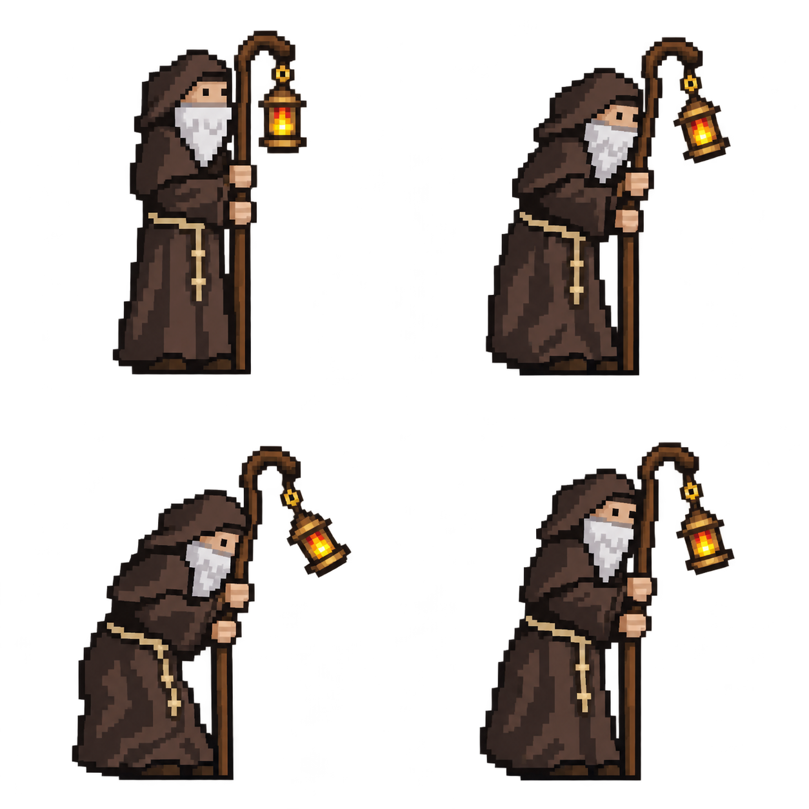

### A. Shalem (Gato Negro Sabio) — Celda: 32 × 32 px
- `shalem_sit_idle`: Sentado, cola moviéndose lentamente, pestañeo de ojos dorados (4 frames).
- `shalem_lick_paw`: Se limpia una pata con la lengua con tranquilidad (6 frames).
- `shalem_stretch`: Bostezo y estiramiento de lomo arqueado (5 frames).
- `shalem_walk`: Trote elegante y sigiloso (6 frames).

### B. Elowen de Oakhaven (Doncella de la Luz Argéntea) — Celda: 48 × 48 px
- `elowen_idle`: Sostiene con delicadeza un pájaro de madera esculpido, vestido ondeando (4 frames).
- `elowen_pray`: Junta las manos frente al pecho; una tenue luz argéntea brilla a su alrededor (6 frames).
- `elowen_speak`: Gesto de consuelo y diálogo con Thomas (4 frames).

### C. Padre Cedric (Párroco de San Jude) — Celda: 48 × 48 px
- `cedric_idle`: Apoyado en su bastón de madera, farol de aceite colgado balanceándose (4 frames).
- `cedric_bless`: Levanta su mano derecha haciendo la señal de la cruz con chispas sagradas (6 frames).

---

## 👹 4. Enemigos & Jefes

  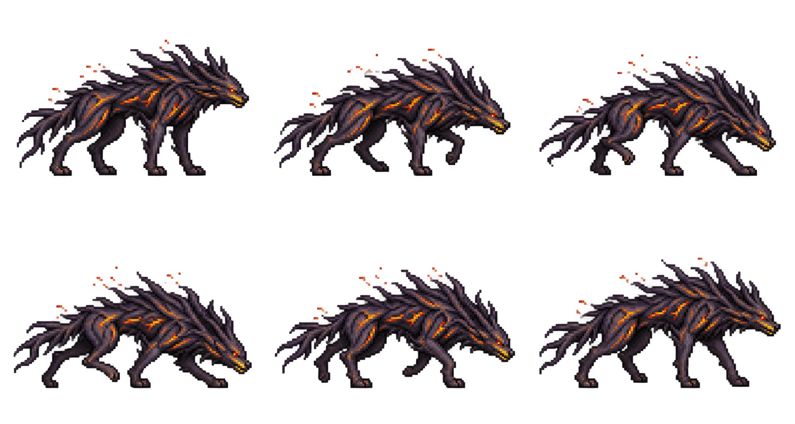
  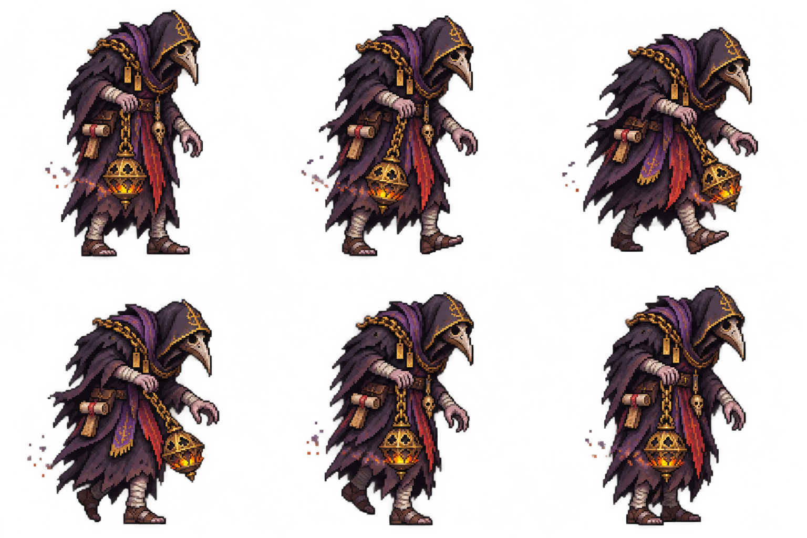
  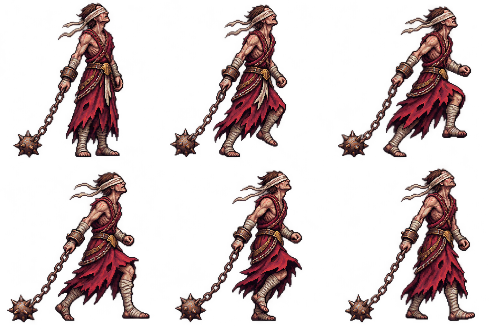
  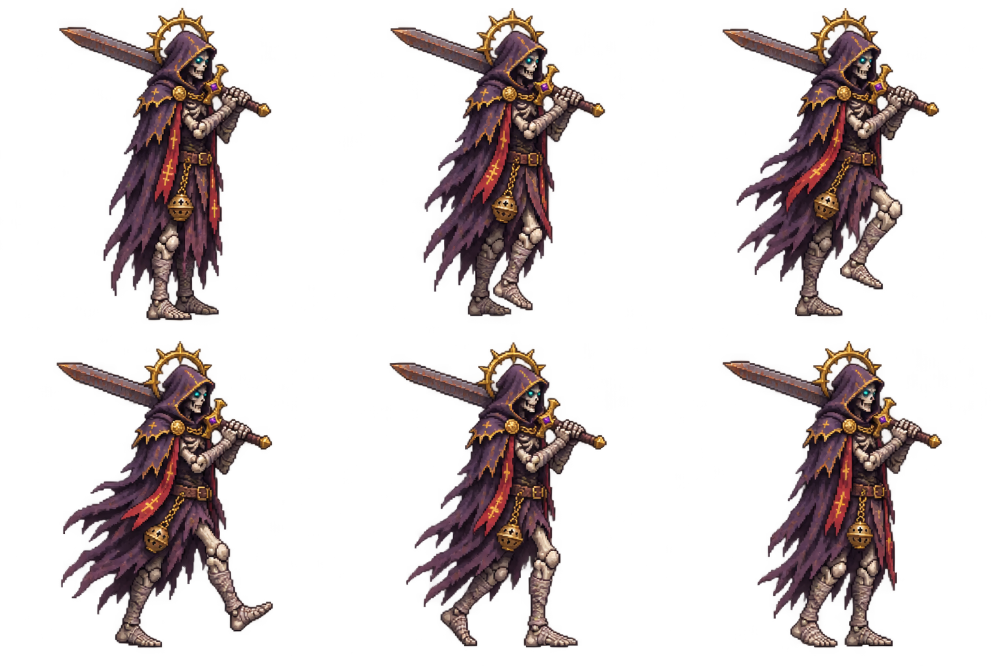

### A. Sabueso de Ceniza (Ash Prowler) — Celda: 64 × 48 px
- `hound_patrol`: Trote cuadrúpedo olfateando el camino (6 frames).
- `hound_alert`: Se detiene, eriza el lomo y sus ojos rojos se encienden (3 frames).
- `hound_windup`: Agazapado retrocediendo para impulsarse (indicador telegrafiado) (4 frames).
- `hound_bite`: Salto hacia adelante con mordisco feroz (4 frames).
- `hound_stagger`: Desorientado, cabeza sacudiéndose por el impacto (4 frames).
- `hound_death`: Colapsa de costado y su cuerpo se desintegra en brasas rojas (6 frames).

### B. Madre Morwenna (Vigía de la Gran Pira) — Celda: 96 × 96 px (Fase 1) / 128 × 128 px (Fase 2)

  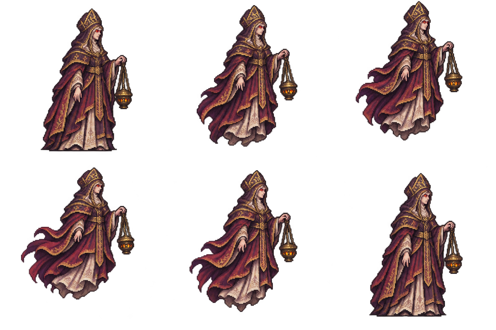
  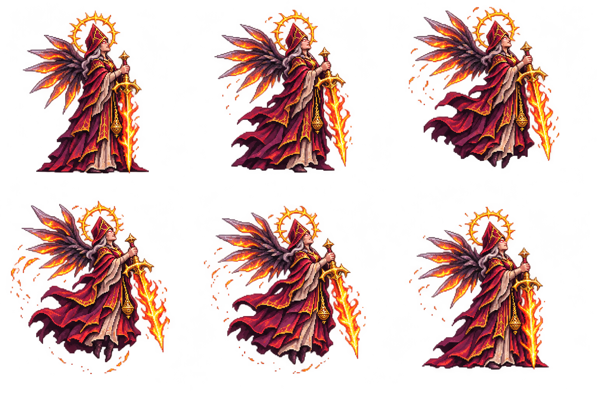
  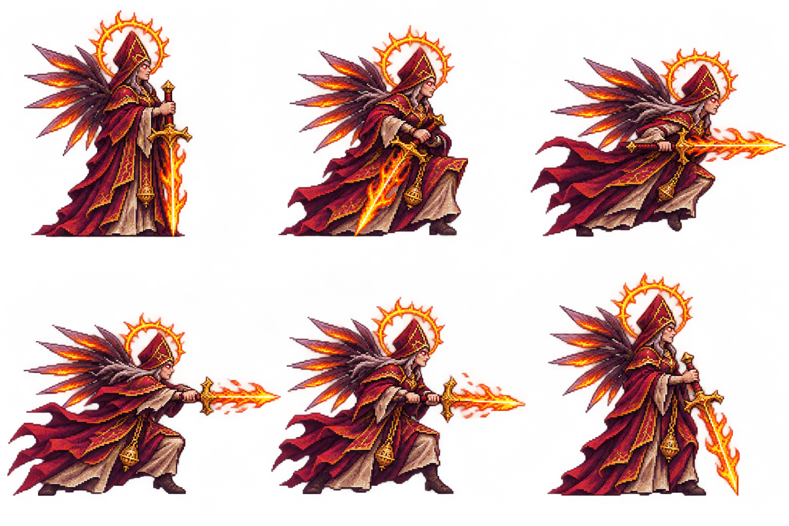

#### Fase 1: La Inquisidora del Crisol (96 × 96 px)
- `morwenna_levitate_idle`: Flota en el aire, túnica inquisitorial carmesí meciéndose, crisol en mano (6 frames).
- `morwenna_cast_flame`: Eleva el crisol sagrado; el fuego se desborda y crea un pilar abrasador (8 frames).
- `morwenna_swing_crucible`: Tajo en arco con el pesado crisol de bronce (6 frames).
- `morwenna_stunned`: Desestabilizada en el suelo, crisol caído, rodeada de chispas de postura rota (4 frames).

#### Transición Cinemática & Fase 2: Pira del Abismo Desatada (128 × 128 px)
- `morwenna_phase2_shockwave`: Explosión radial de fuego a 360°, desgarro de túnica y despliegue de alas (8 frames).
- `morwenna_phase2_idle`: Levitación agresiva; alas de fuego y ceniza batiendo con estela de brasas, corona de espinas dorada rotando, mandoble ígneo en guardia (6 frames).
- `morwenna_phase2_whirlwind`: Giro veloz de 360° con el mandoble despidiendo 4 proyectiles de fuego dispersos (8 frames).
- `morwenna_phase2_geysers_cast`: Hunde el mandoble en el suelo; emergen 3 sellos de brasas incandescentes bajo el héroe (8 frames).
- `morwenna_phase2_lunge`: Acometida horizontal a toda velocidad con estocada de fuego telegrafiada (6 frames).
- `morwenna_purified`: Cae pacíficamente de rodillas mientras las alas de fuego se disuelven en chispas blancas de redención (10 frames).

### C. Cultista Portador de Incensario (Censer Bearer) — Celda: 48 × 48 px
- `cultist_patrol`: Paso lento y sigiloso con hábito oscuro y máscara de cuervo (6 frames).
- `cultist_alert`: Levanta el incensario, humo grisáceo saliendo con vigor (3 frames).
- `cultist_swing`: Barrido en arco con el incensario encadenado soltando brasas (5 frames).
- `cultist_stagger`: Desvío por parry, túnica desordenada (3 frames).
- `cultist_death`: Colapso de rodillas soltando el incensario que rueda en el suelo (6 frames).

### D. Flagelante con Cadena y Mangual (Chain Zealot) — Celda: 64 × 64 px
- `zealot_patrol`: Marcha penitente con túnica carmesí raída, venda en los ojos y mangual arrastrándose (6 frames).
- `zealot_alert`: Hace girar el mangual sobre su cabeza produciendo un zumbido metálico (4 frames).
- `zealot_chain_whip`: Latigazo de largo alcance con la bola de púas en arco horizontal (6 frames).
- `zealot_heavy_slam`: Golpe vertical demoledor estrellando la bola de púas contra el suelo (6 frames).
- `zealot_death`: Cae hacia atrás soltando la cadena, desvaneciéndose en cenizas carmesíes (6 frames).

### E. Penitente de la Cripta (Esqueleto Guardián) — Celda: 64 × 64 px
- `skeleton_patrol`: Marcha esquelética pausada portando una claymore a dos manos apoyada al hombro (6 frames).
- `skeleton_alert`: Cuencas de los ojos se encienden en fuego espectral cian brillante (`#00e5ff`), baja la claymore en guardia (4 frames).
- `skeleton_claymore_slash`: Tajo horizontal demoledor a dos manos con estela cian (6 frames).
- `skeleton_parried`: La claymore rebota hacia atrás dejando al descubierto la caja torácica (4 frames).
- `skeleton_finisher_shatter`: Secuencia de remate donde Thomas o Khaterine quiebran su cráneo y sus huesos se desparraman en el suelo de piedra (8 frames).

---

## 📦 5. Props Destructibles, Entorno & Cementerio

  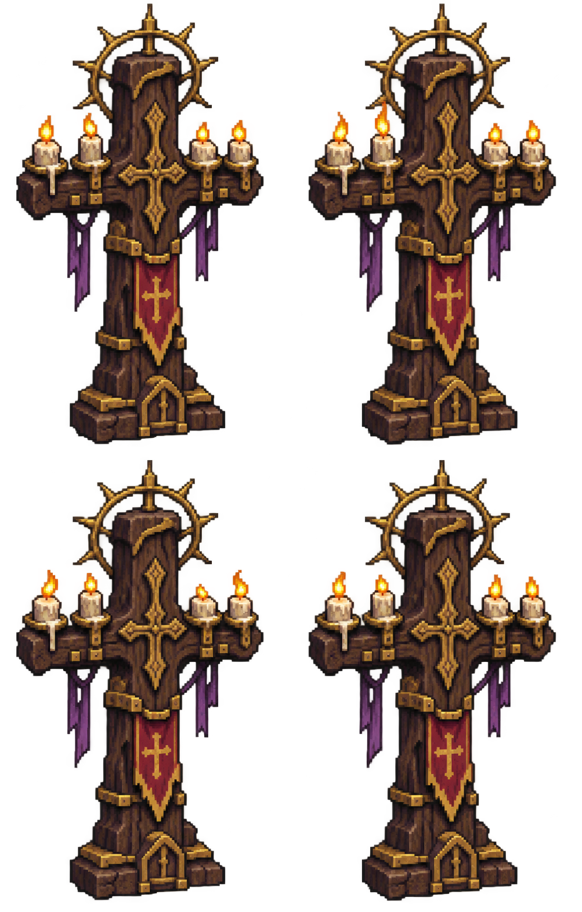
  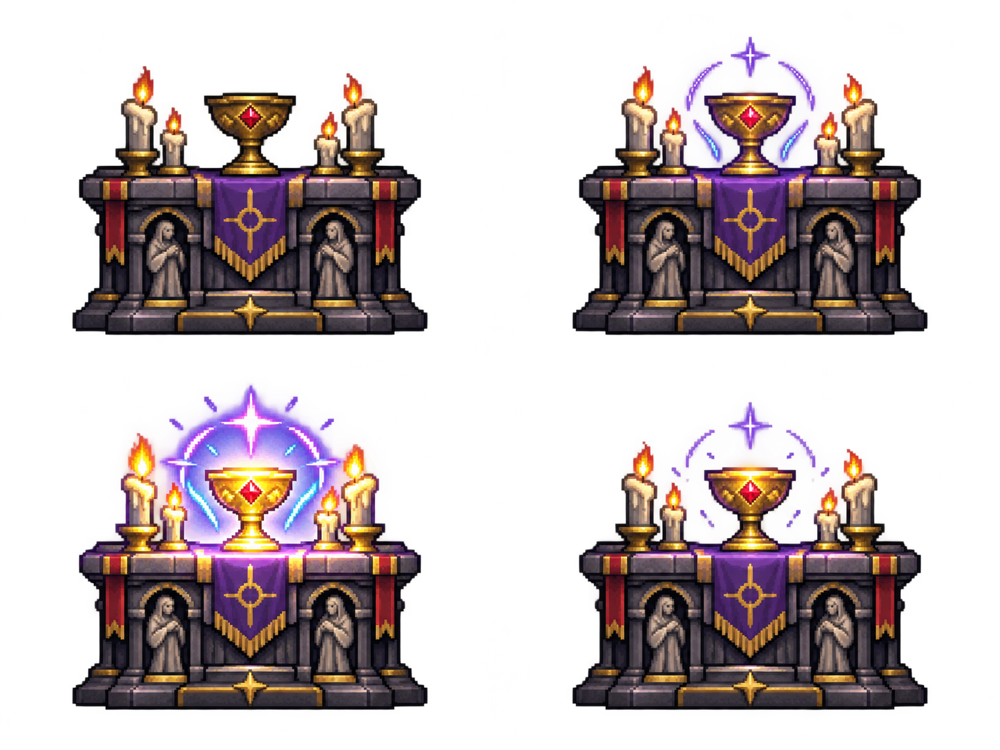
  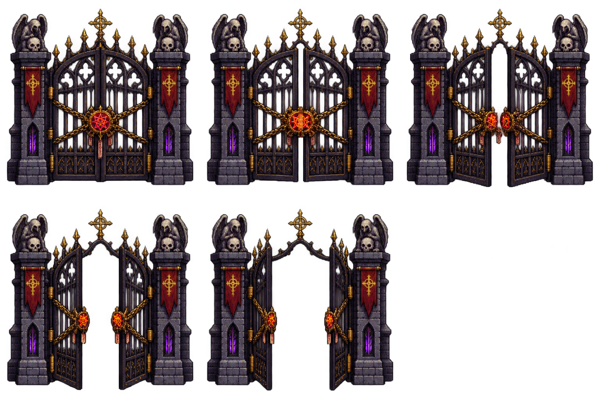
  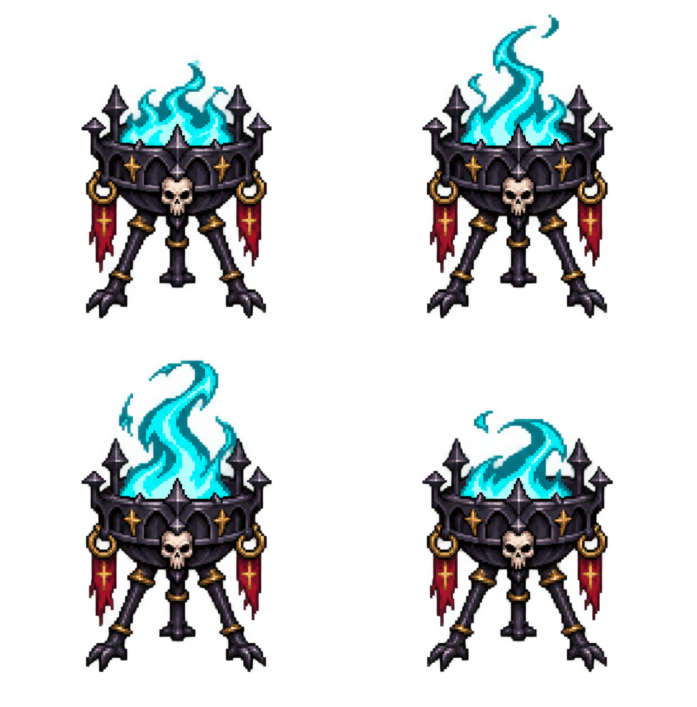
  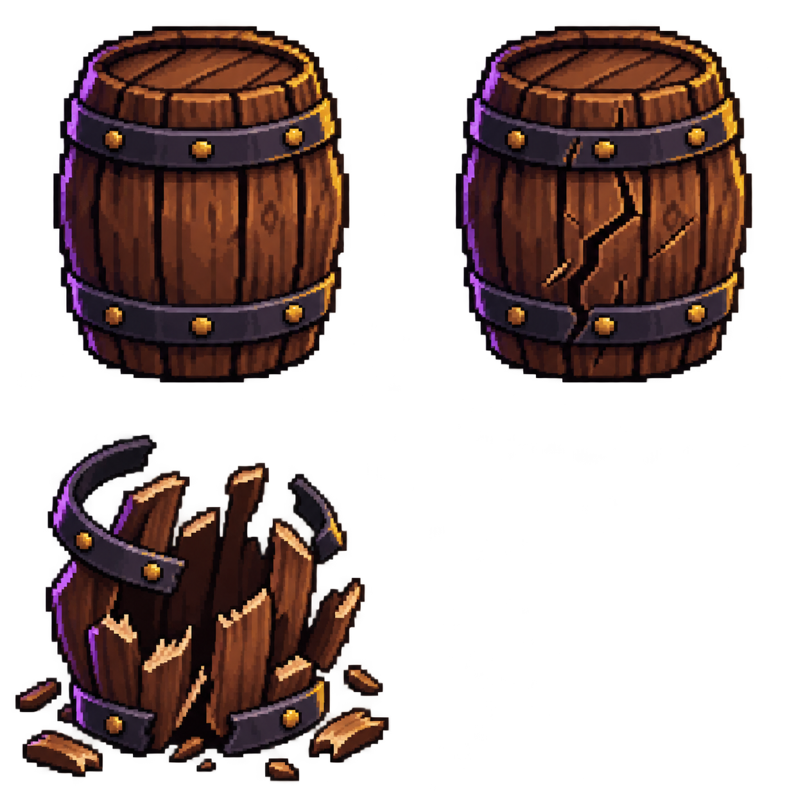

| Elemento | Celda | Estados Requeridos |
| :--- | :---: | :--- |
| **Barriles de Madera** | 32 × 48 px | Intacto, Crujido/Agrietado (1 frame), Roto en 4 pedazos (duelas y aros de hierro). |
| **Cajas Parroquiales** | 32 × 32 px | Intacta, Tapa desprendida, Tablas astilladas esparcidas. |
| **Farola Victoriana** | 32 × 96 px | Poste de hierro, Jaula encendida con llama parpadeante (3 frames), Farola rota/apagada. |
| **Cruz de Madera del Santuario** | 48 × 80 px | Cruz con tallas, velas votivas en la base con flamas animadas (4 frames). |
| **Altar de San Jude** | 64 × 48 px | Altar de piedra labrada con cáliz sagrado y pulso de luz al consagrar (`[G]`). |
| **Gran Pira** | 96 × 96 px | Fogata monumental con troncos quemados y llamas ardientes (6 frames cíclicos). |
| **Verja de Hierro del Cementerio** | 64 × 96 px | Portón gótico cerrado con candado ceremonial, animación de apertura girando 80°, y abierta. |
| **Lápida Celta** | 32 × 48 px | Lápida de piedra grabada intacta, agrietada por impacto, y rota en escombros de granito (+20 EXP). |
| **Gran Sarcófago Monumental** | 64 × 64 px | Sarcófago de piedra gótico con relieve de santo, tapa agrietada, y abierto/profanado (+30 EXP). |
| **Pebetero de Almas de la Cripta** | 32 × 48 px | Trípode de hierro forjado sosteniendo fuego espectral cian animado en bucle (4 frames). |
| **Fachada Mausoleo de San Jude** | 96 × 128 px | Entrada monumental con arco apuntado de piedra y portal abisal con vórtice de niebla. |

---

## 💎 6. Iconografía de Inventario, Reliquias & Códice (32 × 32 px)

Diseño de iconos pixel art con borde gótico estilizado en bronce o plata:

  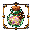
  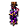
  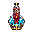
  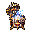
  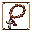
  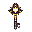
  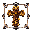
  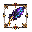
  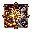
  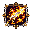
  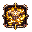
  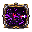
  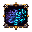
  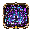

### A. Consumibles & Objetos de Misión
- `icon_maiden_balm`: Frasco de cristal verdoso con ungüento de flores y tapón de corcho (*Bálsamo de la Doncella* - Cura 35 HP).
- `icon_jude_rosary`: Cuentas de madera bendecidas con cruz de plata y borla (*Rosario de San Jude* - Restaura postura al 100%).
- `icon_consecrated_ash`: Relicario de metal con polvo blanco resplandeciente (*Ceniza Consagrada* - +25% daño por 20s).
- `icon_dusk_balm`: Frasco alargado con tintura violeta oscura (*Bálsamo del Ocaso* - Cura 60 HP y quita sangrado).
- `icon_holy_water`: Frasco sagrado con líquido azul celeste y sello papal (*Agua Bendita de Jude*).
- `icon_crypt_key`: Antigua llave gótica de hierro forjado con cruz calada en el pomo (*Llave de las Criptas de San Jude*).

### B. Reliquias Equipables
- `icon_oakhaven_cross`: Cruz tallada en roble centenario con incrustación de oro (+70ms de ventana de parry).
- `icon_black_willow_feather`: Pluma iridiscente de cuervo impregnada de savia del Sauce Negro (-20% fatiga de esquiva).

### C. Nodos del Códice del Alma (Árbol de Habilidades)
- `icon_skill_shield_slam`: Escudo de cruz dorada quebrando una silueta de piedra (*Golpe de Escudo Santo*).
- `icon_skill_holy_edge`: Hoja de espada despidiendo fuego sacro (*Filo Consagrado*).
- `icon_skill_unyielding`: Torso envuelto en luz dorada (*Tenacidad Inquebrantable*).
- `icon_skill_piercing_arrow`: Flecha púrpura atravesando dos siluetas (*Disparo Abisal Perforante*).
- `icon_skill_spectral_step`: Silueta dejando tres estelas de niebla (*Paso Espectral*).
- `icon_skill_willow_sanctuary`: Cúpula de ramas sombrías envolviendo al personaje (*Sagrario del Sauce*).

---

## ✨ 7. Efectos Visuales (VFX) & Textos

- `fx_slash_gold`: Tajo curvo en media luna de luz dorada para Thomas (4 frames).
- `fx_slash_abyss`: Tajo sutil de plasma púrpura/negro (4 frames).
- `fx_parry_spark`: Destello explosivo estrellado al desviar un ataque (3 frames).
- `fx_arrow_abyssal`: Flecha de energía con estela de partículas (3 frames en bucle).
- `fx_pyre_explosion`: Estallido de fuego sagrado expansivo (6 frames).
- `fx_flame_geyser_ground`: Sello rúnico circular en el suelo que pulsa antes de la erupción (4 frames).
- `fx_flame_pillar`: Pilar vertical de fuego sagrado brotando del suelo (6 frames).
- `fx_spectral_soul_flame`: Fuego espectral cian flotante sin humo (4 frames en bucle).
- `fx_bone_shatter`: Fragmentos óseos y polvo de cal proyectados tras un remate (5 frames).
- `fx_wood_splinters`: Conjunto de 4-6 pequeñas astillas volando hacia afuera (4 frames).
- `fx_stone_debris`: 4-8 cascotes de granito saltando tras quebrar lápidas (4 frames).
