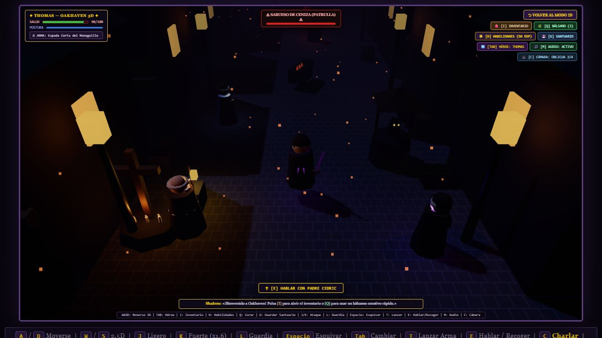
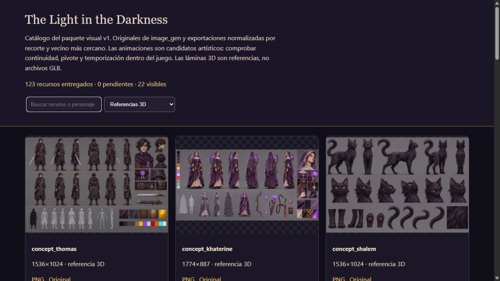

# Documentación técnica completa — The Light in the Darkness

Revisión de 5a5f3ca · 17/11/2026 · Autor de la obra: Kevin

---

# The Light in the Darkness — revisión técnica y plan de mejora

Fecha: 17 de noviembre de 2026. Base revisada: commit 5a5f3ca, rama main de AI-Innovation-op/DEMO-L-D.

Esta entrega responde al pedido de Kevin: feedback crítico con soluciones implementables, documentación técnica del proyecto actual y un paquete de sprites y diseños de referencia basado en la carpeta «Mejoras a futuro/Mejoras visuales».

## Mi dictamen

Hay una base de prototipo aprovechable: identidad narrativa propia, dos héroes de combate distintos, desarme, enemigos con anticipación, Morwenna con dos fases, inventario y una expansión del espacio hacia el cementerio. La siguiente mejora de mayor valor es hacer fiables esos sistemas y darles una presentación coherente. Añadir más contenido sobre un guardado incompleto y un estado de héroes compartido multiplica el trabajo de corrección.

Recomiendo mantener Three.js como implementación de referencia del prototipo 3D mientras se valida una sección de Oakhaven. Una migración a Godot merece una decisión de producción separada, con una prueba comparable y costes de conversión. El motor por sí solo no corrige la lógica duplicada, la dirección de arte o el diseño de encuentros.

La entrega artística conserva los originales y produce exportaciones normalizadas. Las láminas 3D son referencias para modelado: no son archivos GLB, mallas con UV, rigs ni animaciones esqueléticas. Ese alcance fue confirmado por Kevin.

## Cómo leer esta entrega

| Documento | Para qué sirve |
|---|---|
| [01 — Feedback y hallazgos](01-FEEDBACK-Y-HALLAZGOS.md) | Crítica, evidencia, impacto, solución y criterio de aceptación por problema. |
| [02 — Arquitectura DDD propuesta](02-ARQUITECTURA-DDD.md) | Límites de módulos, contratos, flujos y orden seguro de extracción. |
| [03 — Sistemas y contratos](03-SISTEMAS-Y-CONTRATOS.md) | Combate, héroes, guardado, mundo, narrativa y entradas. |
| [04 — Dirección de arte e integración](04-ARTE-E-INTEGRACION.md) | Uso de PNG, referencias 3D, materiales, pivotes y carga en Phaser/Three.js. |
| [05 — Plan de implementación](05-PLAN-DE-IMPLEMENTACION.md) | Entregas ordenadas con dependencias y definición de terminado. |
| [06 — Pruebas y rendimiento](06-PRUEBAS-Y-RENDIMIENTO.md) | Cobertura real, pruebas necesarias, protocolo de juego y medición. |
| [07 — Catálogo y cobertura visual](07-CATALOGO-Y-COBERTURA.md) | Qué pidió la guía y dónde está cada recurso generado. |
| [09 — Mapa del proyecto actual](09-MAPA-DEL-PROYECTO-ACTUAL.md) | Arranque, versiones, módulos, controles, datos y persistencia existentes. |
| [08 — Decisiones y fuentes](08-DECISIONES-Y-FUENTES.md) | Acuerdos, conflictos entre documentos y referencias técnicas. |

## Qué comprobé

- Actualicé la copia local desde 8183950 a 5a5f3ca por avance rápido; los dos commits nuevos añaden fase 2/cementerio y actualizan las especificaciones artísticas.
- Ejecuté las 38 pruebas de Vitest: 8 archivos aprobados.
- Ejecuté TypeScript y la compilación de Vite: completados. El JS principal mide 2.404,50 kB sin comprimir y 574,33 kB con gzip, según la salida de esa compilación.
- Abrí el prototipo 3D del commit actual. Observé la escena, el HUD y el inventario; reproduje la pérdida de salud al cambiar Thomas → Khaterine → Thomas sin combatir. La consola no registró errores durante ese recorrido breve.
- Revisé el código de los sistemas principales y contrasté las dos conversaciones compartidas. No certifico la campaña completa ni el rendimiento de 60 FPS con este recorrido.

## Entregables visuales

Se entregan los 123 recursos previstos: 65 hojas de animación, 14 iconos, 11 hojas de efectos, 11 hojas de props y 22 láminas de referencia 3D. Los recursos 2D suman 463 frames exportados. El validador final no registra recursos pendientes, errores ni avisos automáticos. Esta comprobación mecánica no sustituye la aprobación artística dentro del juego.

Carpeta del paquete: [art/pack-v1](../../). El inventario completo se encuentra en [asset-plan.json](../../plan-recursos.json).

[Abrir el catálogo con animaciones](../../catalogo.html) · [Ver el manifiesto de exportación](../../manifiesto.json) · [Leer los prompts y ediciones](../../prompts.json).

El catálogo fue comprobado en navegador: 123 recursos, búsqueda de khaterine_run con su GIF cargado y filtro de 22 referencias 3D. No se registraron errores de consola durante esa comprobación.

## Regla de lectura de los estados

«Confirmado en ejecución» identifica una observación directa. «Confirmado en código» identifica una ruta concreta revisada. «Riesgo» necesita una prueba adicional. «Propuesta» es una recomendación de diseño o implementación y no cambia el canon de la obra. Pasar pruebas unitarias no convierte una propuesta en una función verificada del juego.

---

# 09 — Mapa técnico del proyecto actual

Esta ficha describe la base 5a5f3ca. Los contratos de los capítulos 02 y 03 describen la arquitectura propuesta. Cuando una cifra difiere entre modos se conserva la diferencia para hacer visible el estado real.

## Entorno y dependencias

| Pieza | Versión instalada desde package-lock.json | Papel |
|---|---|---|
| Phaser | 3.90.0 | Escenas y presentación 2D/2.5D. |
| Three.js | 0.187.0 | Prototipo 3D de Oakhaven. |
| TypeScript | 5.9.3 | Comprobación estática. |
| Vite | 6.4.6 | Desarrollo y build web. |
| Vitest | 2.1.9 | Pruebas automatizadas. |

package.json declara rangos, por ejemplo Phaser ^3.88.2, y su versión de paquete sigue en 0.5.0; la portada del README dice 0.5.2. Para identificar un resultado de esta revisión se utiliza el commit, no esa etiqueta ambigua. Recomiendo acordar un único número de versión y actualizar paquete, interfaz y notas de entrega en el mismo cambio.

TypeScript usa strict, noUnusedLocals, noUnusedParameters, target ES2022 y noEmit. Los alias @domain, @application, @infrastructure y @presentation se declaran tanto en tsconfig.json como en vite.config.ts. El build comprueba tipos y deja a Vite la emisión de los archivos web. El include actual es src: no equivale a una comprobación completa de tipos de todos los tests.

Vite usa el puerto 3000, no abre el navegador automáticamente, apunta a ES2022 y mantiene assetsInlineLimit en cero. El frontend se entrega como archivos estáticos en dist. Esta base no necesita una API de servidor para el recorrido revisado; el progreso reside en el navegador. Una recarga desde otro origen, perfil o navegador no comparte automáticamente la partida.

## Cómo ejecutarlo y reproducir un hallazgo

~~~sh
npm ci
npm test
npm run build
npm run dev -- --host 127.0.0.1
~~~

Abrir http://127.0.0.1:3000/ para el flujo Phaser. Para solicitar el prototipo 3D al arrancar: http://127.0.0.1:3000/#3d o ?mode=3d. Si Vite anuncia otro puerto, usar el que muestra su consola. La revisión manual usó 4173 para aislar su servidor de comprobación.

Para revisar la compilación, ejecutar npm run preview -- --host 127.0.0.1. Servir dist mediante HTTP; abrir index.html directamente desde el disco no reproduce el entorno de módulos y recursos de la aplicación.

No borrar localStorage para reproducir un fallo sin guardar antes los datos que se quieran conservar. Una prueba nueva debe emplear un perfil/origen de ensayo o una exportación de sus claves. Las dos claves actuales están documentadas más abajo.

## Arranque y ciclo de vida

1. index.html crea game-container y el pie de controles.
2. main.ts registra DOMContentLoaded y crea Phaser.Game: resolución lógica 640×360, pixelArt y roundPixels, escalado FIT centrado.
3. BootScene prepara recursos; las escenas de título, introducción y juego coordinan el recorrido 2D.
4. launch3DPrototype oculta el canvas Phaser, pausa sus escenas activas, crea three-wrapper e instancia Oakhaven3DExperience.
5. init construye mundo, personajes, enemigos, interfaz, input y bucle de animación; restaura el guardado 3D disponible.
6. exit3DPrototype destruye la experiencia 3D, oculta su wrapper y devuelve visibilidad/reanudación a Phaser.

launch3DPrototype y exit3DPrototype se exponen en window para los handlers de interfaz. La instancia 3D también se expone durante su vida. Es una comodidad de prototipo; la lógica de aplicación propuesta debe recibir dependencias explícitas en vez de acceder a esas variables globales.

## Responsabilidades por archivo

| Ubicación | Responsabilidad actual |
|---|---|
| src/main.ts | Configura Phaser y alterna la experiencia 3D. |
| src/presentation/scenes/BootScene.ts | Preparación de recursos 2D y respaldos visuales. |
| src/presentation/scenes/TitleScene.ts | Portada, selección y continuación. |
| src/presentation/scenes/GameScene.ts | Simulación/presentación de la campaña 2.5D. |
| src/presentation/scenes/HUDScene.ts | Barras, avisos, objetivos y datos de combate. |
| src/presentation/scenes/CharacterDialogueScene.ts | Presentación de conversaciones. |
| src/presentation/scenes/MenuModalScene.ts / InventoryScene.ts | Consulta y menús del modo Phaser. |
| src/presentation/scenes/ShalemMinigameScene.ts | Interacción de mejora asociada a Shalem. |
| src/presentation/three/Oakhaven3DExperience.ts | Mundo, modelos procedurales, combate, IA, HTML, input, cámara y coordinación del guardado 3D. |
| src/domain/character | Personajes, estadísticas y progreso de nivel del modo 2D. |
| src/domain/combat | Combos, tipos de combate y desarme del dominio 2D. |
| src/domain/boss / enemy | Jefes y enemigos de ese dominio. |
| src/domain/inventory | Pilas de objetos, consumo, reliquias y serialización. |
| src/domain/progression | EXP de talentos, requisitos y modificadores declarados. |
| src/domain/story / mission | Hitos y objetivos narrativos. |
| src/domain/save/SessionStateStore.ts | Snapshot y almacenamiento de la sesión Phaser. |
| src/application/usecases | Orquestación de combate y acciones de Shalem. |
| src/application/ports | Contratos de audio y diálogo. |
| src/infrastructure/audio | Síntesis y reproducción mediante Web Audio. |
| src/infrastructure/dialogue | Datos de conversaciones. |
| src/infrastructure/storage/GameSaveManager.ts | Formato y almacenamiento del prototipo 3D. |
| public/assets | Recursos existentes que sirve Vite. |
| docs/novela | Manuscrito y compendio de Kevin. |
| Mejoras a futuro/Mejoras visuales | Especificación que dirige el nuevo pack. |
| godot_reference | Referencia parcial; no es una segunda implementación completa. |

La ubicación de SessionStateStore dentro de domain no vuelve puro su almacenamiento: accede directamente a window.localStorage. El capítulo 02 propone sacar ese acceso mediante un puerto de aplicación y un adaptador de infraestructura.

## Estadísticas iniciales: distinguir modos

| Entidad | Phaser / SessionStateStore | Oakhaven 3D |
|---|---|---|
| Thomas | Vida 100, postura 60, velocidad 220, defensa 8, ataque 35 | Vida 100, postura 50 antes de modificadores. |
| Khaterine | Vida 140, postura 100, velocidad 160, defensa 18, ataque 30 | Al cambiar: máxima 90, postura máxima 70; comparte playerStats. |
| Sabueso | Perfil del dominio Enemy | Vida 120. |
| Cultista | Perfil del dominio Enemy | Vida 90. |
| Flagelante | Perfil del dominio Enemy | Vida 130. |
| Penitente de cripta | No es la prueba de la rama 3D | Vida 130. |
| Morwenna | Boss usado por BossPhase.test: vida 350 | Vida 280, fase 2 al cruzar el 50%. |

No trasladar 220 de velocidad de Phaser a metros por segundo en Three.js. Son convenciones distintas. Si ambos modos deben compartir balance, definir unidades y perfiles explícitos antes de unificar números.

## Input real del 3D

| Acción | Tecla actual | Observación |
|---|---|---|
| Movimiento | WASD / flechas | La cámara y el plano de movimiento determinan la dirección visual. |
| Ataque ligero / flecha | J | Depende del héroe activo. |
| Ataque pesado / disparo cargado | K | No derivar el daño real del texto del pie HTML. |
| Guardia / barrera | L | keydown abre la ventana y keyup libera. |
| Esquiva | Espacio | Acción discreta. |
| Cambio de héroe | Tab | Se procesa antes de bloquear input por modal. |
| Lanzar espada | T | Solo Thomas. |
| Interacción / recoger / remate | E | Según objetivo de proximidad. |
| Consumible rápido | Q | En el README histórico también aparece como lanzar: hay conflicto. |
| Inventario | I | Escape permite cerrar. |
| Talentos | H | Escape permite cerrar. |
| Guardar / consagrar | G | Cerca de Cedric también restaura; lejos guarda sin esa restauración. |
| Cámara | C | Cambia oblicua/tercera persona; el pie global aún dice «Charlar». |
| Silencio | M | En Phaser se anuncia como minijuego de Shalem. |

No anunciar P como una pausa completa del 3D: su handler actual no la implementa como el menú Phaser. Tampoco asumir gamepad, rebinding o navegación accesible completa porque exista un botón HTML. El capítulo 05 propone resolver estos contextos y actualizar las ayudas desde una definición común.

## Inventario inicial y correspondencia de arte

| ID actual | Cantidad / máximo | Efecto o propiedad | Recurso del pack |
|---|---|---|---|
| maiden_balm | 3 / 10 | Cura 35. | icon_maiden_balm |
| saint_jude_rosary | 2 / 5 | Declara valor 50; la rama 3D repone toda la postura. | icon_jude_rosary |
| consecrated_ash | 1 / 5 | Declara +25% por 20 s; la rama 3D aplica +35%. | icon_consecrated_ash |
| relic_oakhaven_cross | 1 / 1, equipada | +70 ms de parry. | icon_oakhaven_cross |
| relic_willow_feather | 1 / 1 | -20% de fatiga de esquiva al equipar. | icon_black_willow_feather |

Hay dos ranuras de reliquia por defecto. El pack también incluye iconos de bálsamo del ocaso, agua bendita y llave porque los pide la guía. Tener un icono no implementa su objeto, efecto ni obtención. Añadir una tabla de correspondencia explícita evita que los nombres de archivos se confundan con IDs persistentes.

## Talentos actuales

Progression.createDefault inicia con 50 EXP de prueba. Cada rama sigue costes 40 → 70 → 110 y exige el talento anterior. Comprar consume EXP disponible; totalExpEarned se conserva aparte.

| ID | Dato declarado | Estado de integración 3D revisado |
|---|---|---|
| thomas_shield_strike | +35% de impacto de postura | No aparece aplicado en las rutas revisadas; H15. |
| thomas_blade_mastery | +20% de daño | Existe getter por héroe; mantener la prueba de su consumo en el resolver real. |
| thomas_iron_will | +25 de vida máxima | Se consulta al recalcular máximos; resolver con estado propio de héroe. |
| khaterine_piercing_arrow | +25% de daño de flechas | Getter de daño de flecha. El nombre no demuestra perforación física de varios blancos. |
| khaterine_shadow_step | +30% de distancia de esquiva | Consulta explícita en executeDodge para Khaterine. |
| khaterine_abyssal_ward | -50% del daño de guardia | No aparece aplicado en las rutas revisadas; H15. |

Al migrar, guardar IDs desbloqueados y la economía de EXP; resolver valores desde la versión de contenido. El serializador actual conserva las definiciones completas de SkillNode, lo que dificulta actualizar balance de partidas antiguas sin una política explícita.

## Persistencia existente

| Dato | Phaser | Three.js |
|---|---|---|
| Clase | SessionStateStore | GameSaveManager |
| Clave | the_light_in_darkness_save_v1 | the_light_in_the_darkness_save_v1 |
| Versión interna | version: 1.0.0 | La clave dice v1; no hay campo de esquema. |
| Héroes | Registro Thomas/Khaterine | activeHero y un único bloque de vida/postura. |
| Progreso | Acto, nivel/EXP, armas, reliquias de historia, hitos | Inventory, Progression y sanctuaryVisited. |
| Mundo 3D | No representa esa escena | No guarda jefa, puerta, destrucción, posición ni ledger. |
| Error de acceso | Booleano de persistencia | Puede recurrir a memoria temporal; también devuelve booleano. |

Son dos partidas de modos distintos. Su parecido nominal no implica compatibilidad. Los datos se leen con casts de TypeScript y comprobaciones parciales, sin un validador exhaustivo en runtime. No cambiar una clave para apuntar al otro formato sin una migración probada.

## API pública que concentra hoy la clase 3D

| Grupo | Métodos |
|---|---|
| Ciclo de vida | init, exit, destroy |
| Selección y sonido | toggleHero, toggleAudio |
| Mundo | handleContextInteraction, interactWithCemeteryGate, openCemeteryGate, setPlayerPosition |
| NPC | interactWithThomas, interactWithKhaterine, interactWithElowen, interactWithCedric, interactWithShalem |
| Diálogo | showDialogueModal, closeDialogueModal |
| Combate contextual | executeFinisher3D |
| Inventario | toggleInventoryModal, useQuickConsumable, useInventoryItem, toggleRelic |
| Progresión | toggleSkillTreeModal, unlockSkillFromTree |
| Guardado | executeSanctuarySave |

Esta tabla ayuda a localizar puntos de entrada; no recomienda convertirlos en API permanente. La extracción propuesta mueve reglas a aplicación/dominio y deja en la vista solo coordinación visual.

## Godot: límite comprobado

godot_reference contiene project.godot, PlayerController.gd y EnemyAI.gd, junto a su README. Falta la escena de arranque que referencia el proyecto. Importar la carpeta no basta para disponer de un juego ejecutable completo. Si se elige esa vía, hay que crear escenas, nodos, recursos, señales e integración de los scripts y volver a probar el mismo recorrido.

## Mantenimiento del paquete nuevo

El arte vive fuera de public para evitar que la aplicación cargue originales de alta resolución. La herramienta tools/artpack/normalize.py reconstruye exportaciones, GIF, catálogo y manifiesto desde asset-plan.json y sources. Requiere Python y Pillow; no llama a un servicio de generación ni necesita una clave API.

~~~sh
python tools/artpack/normalize.py --require-complete
python tools/artpack/package_delivery.py
~~~

El primer comando comprueba cobertura y reconstruye exportaciones. El segundo genera el dossier consolidado, el catálogo documentado y el ZIP de entrega. Las fuentes permanecen intactas. No ejecutar build_plan.py sobre un plan que se haya editado manualmente sin revisar su diff: sirve para reconstruir el inventario inicial a partir de las guías, no para decidir silenciosamente nuevas direcciones artísticas.

---

# 01 — Feedback crítico y mejoras concretas

## Lo que conservaría

El desarme tiene más identidad que una lista larga de ataques: crea una decisión comprensible, un momento de vulnerabilidad y una recuperación visible. Thomas y Khaterine permiten cambiar el ritmo del combate. Shalem puede conectar tutorial, tono y acompañamiento sin convertir cada avance en un bloque de texto. La transición de la calle al cementerio es una estructura útil para una primera sección terminable.

La dificultad actual está en la consistencia. El juego promete héroes con estados propios, pero comparte sus estadísticas en 3D. Promete progreso persistente, pero solo guarda una parte del mundo. La carpeta de arte define una dirección detallada que todavía no se refleja en los modelos geométricos del prototipo. Son problemas resolubles, y cada uno necesita una prueba que lo haga observable.

## Prioridades

| ID | Prioridad | Hallazgo | Evidencia | Resultado que buscamos |
|---|---|---|---|---|
| H01 | Alta | Cambiar de héroe puede quitar salud y regenerar postura. | Ejecución y código | Estados propios sin curación ni daño implícitos. |
| H02 | Alta | El guardado 3D no representa el estado del mundo. | Código | Recuperar héroes, jefa, puerta, recompensas y checkpoint. |
| H03 | Alta | Cargar salud/postura igual a cero ignora esos valores. | Código | Restauración exacta y validación del esquema. |
| H04 | Alta | Las pruebas de fase 2 verifican otra implementación del jefe. | Código y pruebas | Probar la misma lógica que utiliza el 3D. |
| H05 | Media | La clase 3D reúne reglas, geometría, interfaz y almacenamiento. | Código | Separar reglas comprobables de adaptadores visuales. |
| H06 | Media | El cambio de héroe y la entrada global carecen de un contexto coherente. | Código | Cambio con espera, acciones discretas y control de foco. |
| H07 | Media | Dos guardados y dos modelos de combate divergen. | Código | Contratos explícitos y una fuente de reglas por modo. |
| H08 | Media | La destrucción de la escena no libera todos los recursos que crea. | Código; medición pendiente | Entrar y salir sin crecimiento sostenido de recursos. |
| H09 | Media | La cámara interpola con un factor fijo por frame. | Código | Respuesta equivalente a distintas frecuencias de pantalla. |
| H10 | Media | Algunas ayudas y avisos no representan de forma precisa el efecto real. | Código e interfaz | Una sola definición de controles y efectos. |
| H11 | Media | La legibilidad visual y el HUD no acompañan al alcance de la escena. | Observación | Leer personaje, amenaza y objetivo sin esfuerzo. |
| H12 | Media | El arranque carga ambas implementaciones en el paquete principal. | Código y build | Cargar el 3D al entrar en él. |
| H13 | Diseño | La dirección de arte y los documentos históricos tienen contratos incompatibles. | Documentación | Un contrato vigente, con variantes identificadas. |
| H14 | Diseño | La hoja de ruta añade sistemas antes de cerrar un recorrido completo. | Documentación | Una sección breve, fiable y representativa. |
| H15 | Alta | Dos talentos anuncian efectos que no se consumen en las rutas 3D revisadas. | Código | Comprar una mejora cambia su resultado real. |
| H16 | Alta | El reintento tras una derrota repone estadísticas fijas de otro héroe. | Código | Vida/postura dentro de rangos y política de derrota centralizada. |

## H01 — Cada héroe necesita su propia salud y postura

**Qué sucede.** En una partida nueva Thomas muestra 100/100. Tras pulsar el selector para Khaterine y volver a Thomas, muestra 90/100 sin haber recibido ataques. En el cambio a Khaterine se limita la salud compartida a 90 y se repone la postura a 70. Al volver no se recupera la salud original de Thomas.

**Dónde.** [toggleHero, línea 2035](https://github.com/AI-Innovation-op/DEMO-L-D/blob/5a5f3ca/src/presentation/three/Oakhaven3DExperience.ts#L2035). La propiedad playerStats es una sola instancia para los dos héroes.

**Impacto.** El jugador pierde salud por una acción que parece segura. También puede aprovechar los cambios para recuperar postura. El balance deja de depender solo de su ejecución del combate.

En código hay otra consecuencia: al activar Khaterine se fija isArmed = true; al volver a Thomas no se restaura su valor anterior. Si había una espada caída, la rama vuelve a mostrarla mientras mantiene ese booleano compartido. La ubicación del arma necesita su propio estado para que cambiar de héroe no sustituya la acción de recuperarla. El cambio de postura máxima tampoco limita el valor compartido al volver de 70 a 50.

**Mejora.** Crear un agregado Party con un HeroCombatState por ID. El héroe activo es una referencia a una entrada del registro, no un objeto cuyas estadísticas se reescriben. La vida máxima y sus bonificaciones se calculan por héroe. Cambiar no modifica vida, postura ni el estado de un arma caída.

**Cómo implementarlo.** Extraer primero la selección y los estados a dominio/application. La vista actualiza la visibilidad de los modelos después de un evento HeroSwitched. Bloquear el cambio durante los estados definidos como no interrumpibles y aplicar una espera corta configurable en milisegundos. Conservar la mochila compartida.

**Aceptación.** Thomas 73/100 y Khaterine 41/90 siguen con esos valores después de diez cambios. La postura no se regenera por cambiar. Thomas desarmado sigue desarmado al regresar. Un héroe derrotado no puede convertirse en un héroe vivo por alternar el control.

## H02 — Guardar inventario no equivale a guardar el mundo

**Qué existe.** executeSanctuarySave serializa héroe activo, un bloque de salud/postura, inventario, progresión y una bandera de visita al santuario. No incluye posición/checkpoint, derrota de Morwenna, fase del encuentro, puerta del cementerio, estado de enemigos o props destruidos.

**Dónde.** [Guardado, línea 4640](https://github.com/AI-Innovation-op/DEMO-L-D/blob/5a5f3ca/src/presentation/three/Oakhaven3DExperience.ts#L4640), [GameSaveManager](https://github.com/AI-Innovation-op/DEMO-L-D/blob/5a5f3ca/src/infrastructure/storage/GameSaveManager.ts).

**Impacto.** Puede conservarse la llave mientras el encuentro y el escenario se reconstruyen con sus valores iniciales. Se pierde la correspondencia entre lo que el jugador hizo y lo que encuentra al continuar. La repetición de recompensas es un riesgo que debe comprobarse con un recorrido completo de derrota/guardado/recarga.

**Mejora.** Definir SaveGameV2 con heroes, inventory, progression, narrativeFacts, worldFlags, checkpoint y claimedRewards. Guardar hechos estables, no referencias a mallas ni nombres de nodos generados al azar.

**Cómo implementarlo.** La aplicación crea el snapshot de dominio. El repositorio de guardado lo valida, versiona y persiste. Al cargar, primero se valida/migra, después se restaura el estado y por último se construye la representación. Morwenna derrotada debe producir un estado consistente de la puerta y de su recompensa.

**Aceptación.** Derrotar a Morwenna, recibir la llave, guardar, recargar: la puerta y el checkpoint tienen el estado acordado, la EXP no se duplica y el jefe no reaparece por accidente. Si se decide que los enemigos comunes reaparecen al descansar, esa es una regla explícita y distinta de reiniciar todo el mundo.

## H03 — Cero es un valor válido

**Qué sucede.** loadSavedSanctuaryState comprueba if (save.health) e if (save.posture). Cero es falso en JavaScript, por lo que esos valores no se restauran. El cargador utiliza además una conversión de JSON a tipo sin una validación completa del contenido.

**Dónde.** [Restauración, línea 4684](https://github.com/AI-Innovation-op/DEMO-L-D/blob/5a5f3ca/src/presentation/three/Oakhaven3DExperience.ts#L4684).

**Mejora.** Comprobar presencia y finitud, aceptar cero y limitar los valores al rango válido. Separar «no hay guardado», «guardado incompatible» y «guardado dañado». Utilizar una función pura parseSave(unknown) que devuelva un resultado tipado.

**Aceptación.** Una postura guardada en 0 carga como 0. Una salud de 0 lleva al flujo de derrota/checkpoint definido; no se sustituye silenciosamente por 100. JSON incompleto, NaN representado como otro tipo, IDs desconocidos y cantidades negativas producen una recuperación controlada.

## H04 — Las 38 pruebas no certifican la fase 2 de Three.js

**Qué comprobé.** BossPhase.test.ts importa Boss del dominio, cuya Morwenna tiene 350 HP. La experiencia 3D mantiene su propio estado, con 280 HP y una transición implementada dentro de la clase visual. Las pruebas de la llave añaden el objeto manualmente al inventario; no ejecutan la ruta real de derrota del jefe 3D.

**Dónde.** [Prueba actual](https://github.com/AI-Innovation-op/DEMO-L-D/blob/5a5f3ca/tests/domain/BossPhase.test.ts), [transición 3D, línea 3262](https://github.com/AI-Innovation-op/DEMO-L-D/blob/5a5f3ca/src/presentation/three/Oakhaven3DExperience.ts#L3262), [derrota 3D, línea 3310](https://github.com/AI-Innovation-op/DEMO-L-D/blob/5a5f3ca/src/presentation/three/Oakhaven3DExperience.ts#L3310).

**Mejora.** Extraer MorwennaEncounter y utilizarlo desde el 3D. Si 350 y 280 son balances deliberados para modos distintos, mantener una configuración por modo con la misma máquina de estados. La prueba del encuentro debe consumir comandos reales de daño y producir eventos de transición y recompensa.

**Aceptación.** El mismo módulo importado por la experiencia 3D se prueba en el umbral exacto, por debajo y con un golpe letal que cruza el umbral. La transición ocurre una sola vez. La recompensa se concede una sola vez. Una prueba de aplicación verifica la apertura de la puerta a partir del evento de derrota.

## H05 — DDD necesita límites de responsabilidad, además de carpetas

La experiencia 3D tiene 4.967 líneas en esta base y combina construcción de mallas, daño, movimiento, IA, árboles de habilidades, inventario, persistencia, HTML y cámara. La escena 2D también contiene una gran parte de la orquestación. Esta organización es útil para experimentar, pero hace costoso cambiar o comprobar una regla sin cargar también la presentación.

Recomiendo extraer por casos de uso: PartySession, CombatResolver, MorwennaEncounter, WorldProgress y SaveGameService. Dejar modelos, luces, cámara y animación en presentación. Mantener los adaptadores de almacenamiento y audio detrás de puertos. El objetivo no es crear una clase por cada método ni imponer un límite arbitrario de líneas: es poder ejecutar una decisión del juego sin WebGL ni DOM.

Aceptación: las pruebas de daño, cambios de héroe y guardado no importan Three.js ni Phaser. Un evento de dominio identifica el actor y el resultado; la vista decide cómo mostrarlo. Se conserva el comportamiento antes de extraer la siguiente responsabilidad.

## H06 — Entrada por contexto y acciones discretas

handleKeyDown cambia héroe y cámara antes de comprobar todos los modales. No descarta la repetición automática del teclado para acciones discretas. La tecla Tab también es la navegación habitual entre controles. No aparece una limpieza de teclas al perder foco.

Separar InputRouter de los casos de uso. Definir contextos Gameplay, Dialogue, Inventory, Skills y Paused. Las acciones discretas se activan en el flanco de pulsación; la guardia y el movimiento tienen estado sostenido. En un modal, Tab debe permitir navegar por sus controles. Al perder foco se limpian teclas, se suspende el juego según la política de pausa y se solicita una nueva pulsación al regresar.

Aceptación: mantener Tab no dispara una sucesión de cambios; cerrar un diálogo no produce además una esquiva; perder foco con W pulsada no deja al personaje andando; un usuario puede abrir y cerrar inventario usando solo teclado.

## H07 — Dos implementaciones, dos contratos de progreso

La campaña 2D emplea SessionStateStore y la clave the_light_in_darkness_save_v1. El 3D emplea GameSaveManager y the_light_in_the_darkness_save_v1. Son claves distintas, y el menú de continuar de un modo no representa necesariamente el otro. El nivel de cobertura y los datos guardados también difieren.

No fusionar esos formatos por renombrar la clave. Identificar modeId en la sesión y explicar el modo al continuar. Crear migradores por formato de origen y pruebas de datos históricos. Compartir reglas de inventario/progresión cuando sean realmente iguales y mantener configuraciones distintas cuando el balance sea deliberado.

Aceptación: el menú identifica de qué modo es una partida. Cargar una partida histórica no borra otra. Se puede volver al 2D sin un restablecimiento accidental del 3D.

## H08 — Recursos y cierre de la escena

destroy cancela el bucle, retira listeners y destruye el renderer. Eso es una base correcta. No recorre los geometries, materials y textures creados para liberarlos explícitamente, ni centraliza todos los temporizadores propios de la experiencia. El crecimiento de memoria aún necesita medirse; no lo presento como una fuga cuantificada.

Implementar un ResourceScope que registre recursos y callbacks de limpieza. Compartir geometrías/materiales repetidos y contar referencias cuando se compartan entre escenas. Limpiar timers, detener el audio del modo al salir y liberar cada recurso una vez. Three.js requiere gestionar explícitamente varios recursos de GPU; [guía oficial de disposición](https://threejs.org/manual/pages/how-to-dispose-of-objects.html).

Aceptación: entrar y salir del 3D diez veces no deja bucles activos ni listeners duplicados. Las cuentas de recursos y la memoria se estabilizan después del calentamiento; se documenta qué recursos se conservan por caché.

## H09 — Cámara independiente del refresco

updateCamera recibe delta pero interpola con 0.08 fijo. A más frames por segundo, la cámara ejecuta más pasos de aproximación por segundo. Usar una interpolación exponencial con alpha = 1 - exp(-lambda * dt), con dt en segundos. Separar esta suavidad de la simulación del combate.

Aceptación: una trayectoria reproducida a 30, 60 y 144 Hz conserva un tiempo de seguimiento comparable. No modificar la sensibilidad del jugador para compensar una cámara dependiente de los FPS.

## H10 — La interfaz debe describir la regla real

En 3D la tecla C cambia cámara, mientras el pie de página global sigue mostrando «C Charlar». El daño temporal parte de una Ceniza Consagrada de +25%, pero la rama 3D aplica 1.35 y el HUD usa «ÓLEO (+35%)». Los códigos de efectos y los textos deben salir de la misma definición. El resultado de saveGame debe decidir si se muestra «guardado» o un error: ahora se muestra el aviso favorable antes de comprobar el booleano devuelto.

Crear ActionBindings y EffectDefinition como datos compartidos por interfaz y lógica. Generar el texto del efecto desde su definición. Emitir SaveSucceeded solo después de persistir. Añadir un aviso recuperable si el navegador no permite guardar o se alcanza su cuota.

Aceptación: el control mostrado corresponde al contexto activo, la descripción del consumible coincide con el multiplicador aplicado y un almacenamiento que lanza una excepción no produce un mensaje de guardado exitoso.

## H11 — Lectura visual: primero silueta, después detalle

En la escena observada, los modelos geométricos y la iluminación muy baja dificultan reconocer personajes desde la cámara. El HUD agrupa muchos botones de tipografía pequeña, y el pie del 2D permanece bajo el 3D. La solución no es aclarar todo el cielo: iluminar siluetas y planos de juego, aumentar el tamaño del texto y ordenar la jerarquía.

Usar un HUD mínimo para combate: héroe activo, salud/postura, objetivo y un acceso a menú. Las ayudas completas quedan en una pantalla de controles. Dar a cada héroe una silueta legible y reservar el brillo máximo para peligro e impacto. Separar color, contorno y sonido para distinguir ataques; no depender solo del rojo o del violeta.

Aceptación: a la resolución de juego elegida un tercero reconoce héroe, enemigo y amenaza. Los textos se leen sin ampliar la página. El pack de sprites se compara sobre el fondo nocturno real, además de sobre transparencia.

## H12 — Carga y presupuesto de la web

main.ts importa estáticamente Phaser y Oakhaven3DExperience. Vite agrupa el arranque revisado en un JS de 2,40 MB, 574 kB con gzip. Ese dato no es una medida de FPS, pero sí muestra margen para separar la carga por modo.

Cargar la experiencia 3D mediante importación dinámica cuando el jugador la solicite. Separar recursos por escena y mostrar progreso de carga real. Medir parseo y arranque además del tamaño. No añadir todos los originales de producción a una ruta que se precargue al jugar: entregar el paquete artístico fuera de los assets públicos y copiar solo las exportaciones aprobadas.

Aceptación: el arranque 2D no descarga Three.js ni los recursos del 3D. Entrar por segunda vez reutiliza cachés sin duplicar instancias. La pantalla de carga refleja trabajo pendiente y tiene una salida de error.

## H13 — Contrato de arte vigente

Las conversaciones anteriores fijaron Thomas de 48 píxeles de altura en lienzo 96×80; la guía nueva especifica celdas 48×48 o 64×64 para héroes. También hay diferencias entre medieval anglosajón y gótico victoriano, y entre Cáliz Solar y cruces. Son decisiones artísticas, no errores de TypeScript.

Este paquete toma las celdas de la guía nueva como contrato de exportación; usa 64×64 para los dos héroes con armas. Conserva el diseño nocturno, la diferenciación violeta/argéntea/carmesí/cian y las referencias existentes. Registrar qué símbolos pertenecen a cada facción y qué elementos son licencias estilísticas. Ninguna lámina nueva debe cambiar por sí sola un hecho del manuscrito.

## H14 — Cerrar una sección antes de ampliar sistemas

La próxima prioridad del roadmap es alquimia. Mi propuesta es anteponer estados de héroes, guardado, encuentro de Morwenna y un recorrido corto comprobado. La alquimia será más valiosa cuando sus efectos sobrevivan a recargar y sus ingredientes tengan una economía consistente.

Definir una sección de 5–8 minutos: entrada segura, tutorial breve del desarme, encuentro de patrulla, pausa narrativa, Morwenna, llave, puerta, checkpoint y salida clara. Esto no equivale a terminar la campaña. Su definición de terminado incluye controles, audio, legibilidad, derrota/reintento y recuperación del guardado, además de poder derrotar al jefe.

## H15 — Habilidades con efecto comprobable

Golpe de Escudo Santo declara un bonus de postura, y Sagrario del Sauce declara mitigación de guardia. En las rutas 3D revisadas no aparece una consulta de thomas_shield_strike o khaterine_abyssal_ward ni consumo de sus modifierType. El guardado del desbloqueo y la tarjeta activa no verifican ese efecto. Paso Espectral sí tiene una consulta explícita para Khaterine en executeDodge y no debe incluirse en este hallazgo.

Crear un cálculo de modificadores efectivos por héroe y utilizarlo en HitResolver y GuardResolver. Escribir pruebas antes/después con el mismo ataque y la misma semilla de estado; deben cambiar postura o mitigación en la proporción aprobada. Si una habilidad todavía es una promesa de contenido, mantenerla deshabilitada y describir su estado en el prototipo.

## H16 — Una derrota no debe reconstruir estadísticas a mano

executeEnemyHit y otras ramas de enemigos reviven con health = 100 y posture = 50. Khaterine tiene maxHealth = 90 en el cambio de héroe, por lo que esta ruta puede dejarla con 100/90. Una mejora de máximo de Thomas tampoco está representada por esos valores fijos.

Mover derrota/reintento a un caso de uso con la definición del héroe y el checkpoint. Cada atacante produce daño y un resultado de derrota; no elige valores de resurrección. Aceptación: salud y postura siempre dentro del máximo efectivo, el reinicio conserva las decisiones durables y no crea una nueva recompensa del jefe.

---

# 02 — Arquitectura técnica y DDD propuesto

## Estado actual

La aplicación inicia Phaser desde main.ts. Sus escenas contienen portada, introducción, campaña, HUD, diálogos, inventario, cinemáticas y el minijuego de Shalem. El prototipo Three.js se abre como una experiencia paralela: oculta el canvas de Phaser, pausa escenas y añade su propio renderer y su propia interfaz HTML.

El dominio 2D contiene Character, CharacterStats, Enemy, Boss, DisarmManager, ComboSystem, Inventory, Progression, StoryProgress y SessionStateStore. CombatUseCases y ShalemUseCases coordinan algunas acciones. El 3D reutiliza Inventory y Progression, pero mantiene gran parte del combate y la IA como propiedades y métodos de Oakhaven3DExperience.

~~~mermaid
flowchart LR
  Main[main.ts] --> Phaser[Escenas Phaser]
  Main --> Three[Oakhaven3DExperience]
  Phaser --> Domain[Dominio 2D]
  Phaser --> Application[Casos de uso]
  Three --> Inventory[Inventory / Progression]
  Three --> Inline[Combate / IA / mundo / UI internos]
  Domain --> Session[SessionStateStore]
  Three --> Storage[GameSaveManager]
~~~

La separación de carpetas ya aporta orden. El siguiente paso es convertirla en una dirección de dependencias que se pueda comprobar.

## Principios de implementación

1. Dominio no importa Phaser, Three.js, DOM, almacenamiento, audio ni reloj global.
2. Aplicación coordina acciones, transacciones y puertos. No decide qué geometría o HTML se dibuja.
3. Presentación transforma input en comandos y resultados en imagen, sonido y texto.
4. Infraestructura implementa almacenamiento, carga de recursos, reloj y audio.
5. Los valores de balance viven en configuraciones versionadas; no se copian dentro de cada renderer.
6. Un sistema debe tener un propietario claro. La vista de un héroe no es dueña de su salud.
7. Los adaptadores pueden sustituirse, pero el proyecto no necesita una abstracción para cada operación de una biblioteca.

## Módulos recomendados

~~~text
src/
  domain/
    party/             HeroId, HeroCombatState, Party, SwitchPolicy
    combat/            AttackDefinition, HitResolver, StatusEffects
    encounters/        MorwennaEncounter, EnemyStateMachine
    world/             WorldProgress, EntityId, GateState, RewardLedger
    inventory/         Inventory, ItemDefinition, ItemStack, RelicLoadout
    progression/       SkillDefinition, SkillProgress, Modifiers
    narrative/         NarrativeFact, CharacterKnowledge, ChapterProgress
    save/              SaveSnapshotV2, validators, migrations
  application/
    commands/          SwitchHero, Attack, UseItem, Interact, SaveGame
    services/          AdventureSession, EncounterDirector, SaveGameService
    ports/             SaveRepository, Clock, AudioOutput, EventSink
  infrastructure/
    storage/           LocalStorageSaveRepository
    assets/            AssetCatalog, GltfAssetLoader
    audio/             WebAudioAdapter
  presentation/
    three/             SceneHost, CharacterView, EnemyView, BossView
                       InputRouter, CameraRig, HudView, SceneResourceScope
    phaser/            adaptadores y escenas del modo 2D
~~~

Los nombres son una propuesta. Lo importante es la responsabilidad y la dependencia; no hace falta mover todas las carpetas actuales de una sola vez.

## Contextos y propietarios

| Contexto | Posee | No posee |
|---|---|---|
| Party | Héroes, selección, disponibilidad, estados persistentes | Mallas y teclas físicas |
| Combat | Daño, postura, fases de ataque, bloqueo, esquiva | Números flotantes y shaders |
| Encounter | Estado y reglas de una pelea, condiciones de victoria | Inventario global completo |
| WorldProgress | Puertas, encuentros concluidos, recompensas reclamadas | Instancias de geometrías |
| Inventory | Cantidades, compatibilidad, reliquias, consumo | Curación aplicada por su cuenta al renderer |
| Narrative | Hechos, conocimiento por personaje y acceso a escenas | Texto completo incrustado en cada clase visual |
| Save | Snapshot validado y migración de datos | Reproducción de animaciones o DOM |

## Flujo de una acción

~~~mermaid
sequenceDiagram
  participant I as InputRouter
  participant A as AdventureSession
  participant P as Party
  participant V as CharacterView/HUD
  I->>A: SwitchHeroCommand(target, nowMs)
  A->>P: trySwitch(target, nowMs)
  P-->>A: HeroSwitched o rechazo tipado
  A-->>V: Snapshot + eventos
  V->>V: Cambiar modelo y actualizar HUD
~~~

Un rechazo esperado no necesita lanzar una excepción. Puede devolver un código como cooldown, unavailable o locked_action que la interfaz transforma en una indicación breve.

## Contrato de comandos y eventos

~~~ts
export type HeroId = 'thomas' | 'khaterine' | 'elowen';

export type GameCommand =
  | { type: 'switch-hero'; target: HeroId; issuedAtMs: number }
  | { type: 'attack'; actor: HeroId; attackId: string }
  | { type: 'use-item'; actor: HeroId; itemId: string }
  | { type: 'interact'; actor: HeroId; targetId: string };

export type GameEvent =
  | { type: 'hero-switched'; previous: HeroId; current: HeroId }
  | { type: 'damage-applied'; targetId: string; healthDamage: number; postureDamage: number }
  | { type: 'encounter-completed'; encounterId: string }
  | { type: 'reward-claimed'; rewardId: string };
~~~

Elowen se incluye aquí como contrato futuro acordado en la conversación, no como función presente en el código revisado. Su disponibilidad narrativa debe impedir el cambio hacia ella durante el cautiverio. No basta con añadir un ID al selector.

## Orden de extracción seguro

### Paso 1: Party y cambio de héroe

Copiar el comportamiento observado a pruebas, especificar el comportamiento correcto y extraer solo el estado de los dos héroes. Mantener los modelos y los botones existentes como adaptadores. Es la corrección de mayor impacto con menor alcance visual.

### Paso 2: Snapshot y persistencia

Crear un DTO versionado y validado. Separar crear snapshot, persistir y restaurar. Añadir migración de guardados históricos antes de sustituir el cargador. Mantener una copia recuperable del dato anterior cuando una migración cambie formato.

### Paso 3: Morwenna y progreso de mundo

Extraer fase, temporizadores, transición y resolución de daño a MorwennaEncounter. La presentación escucha eventos para alas, halo, espada, luces y sonidos. La victoria produce un evento único; WorldProgress y RewardLedger resuelven puerta, llave y EXP.

### Paso 4: IA común y variantes

Identificar estados compartidos entre sabueso, cultista, flagelante y penitente. Compartir la máquina de estados y las transiciones realmente comunes; mantener perfiles de ataque y alcance distintos. Evitar una clase base gigante que mezcle todos los casos especiales.

### Paso 5: Vistas y recursos

Extraer CharacterView, BossView, HudView y SceneResourceScope. Cambiar la carga estática del 3D por carga diferida. Al final de este paso, Oakhaven3DExperience debe coordinar la escena, no implementar cada regla.

## Pruebas de límites

Agregar una comprobación de imports que falle si domain depende de presentation, infrastructure, phaser o three. Las pruebas de aplicación pueden usar repositorios y relojes falsos. Las pruebas de presentación validan que un evento activa la animación y la información correctas, sin volver a probar toda la aritmética de daño.

## Decisiones que conviene evitar

- Crear un motor genérico para todas las campañas antes de cerrar Oakhaven.
- Reescribir todo en otro motor para poder separar salud y presentación.
- Duplicar la fuente de verdad en DOM, modelo 3D y dominio.
- Persistir una copia completa de la escena Three.js.
- Guardar definiciones de habilidades mutables como si fueran progreso del usuario.
- Encadenar lógica de recompensas a que haya terminado un efecto visual. La regla debe funcionar aunque se omita la animación.

---

# 03 — Sistemas, datos y contratos de implementación

Los contratos de este documento son propuestas para corregir y extender la base 5a5f3ca. No describen funciones ya implementadas por esta entrega artística.

## 1. Sesión y estados de héroe

Separar identidad, estadísticas persistentes y estado de acción transitorio.

~~~ts
export type HeroId = 'thomas' | 'khaterine' | 'elowen';
export type ActionState = 'idle' | 'moving' | 'windup' | 'active'
  | 'recovery' | 'guarding' | 'dodging' | 'stunned' | 'defeated';

export interface HeroState {
  id: HeroId;
  available: boolean;
  health: number;
  posture: number;
  weaponInstanceId: string | null;
  action: ActionState;
}

export interface HeroDefinition {
  id: HeroId;
  baseMaxHealth: number;
  baseMaxPosture: number;
  moveSpeedMps: number;
  allowedWeaponTags: readonly string[];
}
~~~

Las definiciones no se guardan como progreso mutable del jugador. La sesión guarda el estado de cada personaje y las referencias a equipo adquirido. La vida máxima efectiva se calcula a partir de la definición y de modificadores válidos. El estado de acción se reinicia de forma explícita al cargar un checkpoint; no se restaura un ataque a mitad de un frame.

### Invariantes

- Vida entre cero y vida máxima efectiva; postura entre cero y postura máxima.
- Un ID de arma pertenece a una sola ubicación: inventario, equipo o mundo.
- Cambiar personaje no cura, no daña, no repone postura y no concede armas.
- No se controla a un personaje no disponible o derrotado.
- Un golpe no se cancela mediante el cambio si su definición lo declara no interrumpible.
- Las heridas y mejoras sobreviven al cambio de héroe y a un guardado válido.

### Referencia de caso de uso para cambiar

~~~ts
interface SwitchResult {
  ok: boolean;
  reason?: 'same' | 'unavailable' | 'cooldown' | 'locked-action';
}

function canSwitch(
  current: HeroState,
  target: HeroState,
  nowMs: number,
  nextSwitchAtMs: number
): SwitchResult {
  if (current.id === target.id) return { ok: false, reason: 'same' };
  if (!target.available || target.health <= 0)
    return { ok: false, reason: 'unavailable' };
  if (nowMs < nextSwitchAtMs) return { ok: false, reason: 'cooldown' };
  if (['active', 'stunned', 'defeated'].includes(current.action))
    return { ok: false, reason: 'locked-action' };
  return { ok: true };
}
~~~

La duración de la espera debe ser un dato de balance. Propongo comenzar probando 700 ms; no es un acuerdo narrativo ni una cifra validada. La prueba de usuario decidirá si añade una decisión útil o solo fricción. El reloj se inyecta desde aplicación para poder probar los límites sin esperar tiempo real.

## 2. Combate y animación

El combate debe funcionar con la misma lógica aunque se sustituyan sprites por mallas. Una animación expresa una acción; no debe ser la única fuente de verdad de cuándo se aplica daño.

~~~ts
interface AttackDefinition {
  id: string;
  windupMs: number;
  activeMs: number;
  recoveryMs: number;
  healthDamage: number;
  postureDamage: number;
  rangeMeters: number;
  halfAngleDegrees: number;
  canBeParried: boolean;
  interruptsOnHit: boolean;
}
~~~

### Orden de resolución de un impacto

1. Confirmar que atacante y objetivo están vivos y en el encuentro correcto.
2. Comprobar que el ataque está en su ventana activa.
3. Verificar distancia, ángulo, altura aplicable y obstáculos. En 2.5D se separa la posición en suelo de la altura visual del salto.
4. Descartar un segundo impacto del mismo ataque sobre el mismo objetivo si la definición solo admite uno.
5. Resolver invulnerabilidad de esquiva, parry, bloqueo y modificadores en un orden único.
6. Aplicar daño y postura, limitar rangos y resolver muerte/ruptura.
7. Emitir el resultado una vez. Presentación crea sonido, destello, retroceso y número mostrado a partir del daño realmente aplicado.

La precisión de una colisión no debe depender del ancho transparente de una ilustración. Definir cápsulas, discos o hitboxes de juego aparte del recorte visual. Las mallas del cuerpo y las alas de Morwenna no tienen por qué ser todas partes golpeables.

### Desarme

Modelar WeaponLocation como equipped, ground o inventory, con su propietario y posición cuando esté en suelo. Lanzar crea una instancia de proyectil o acción lanzada y cambia la ubicación; recoger consume esa ubicación del mundo. No generar una espada nueva al alternar a Khaterine y regresar.

Los ataques pesados y la ruptura de postura pueden provocar el desarme según una regla de resistencia. Para recuperar el arma, indicar su posición y permitir recoger dentro de una distancia definida. La interfaz debe aclarar cuándo E hablará y cuándo recogerá.

### Parry y guardia

La ventana se abre en la pulsación inicial de guardia, no en cada evento repetido del teclado. Una guardia mantenida después de esa ventana sigue bloqueando, pero no conserva un parry perfecto indefinidamente. Las reliquias y habilidades modifican una definición efectiva del héroe; no se vuelven a sumar en cada rama de enemigo.

### Esquiva

Separar duración de invulnerabilidad, desplazamiento y recuperación. Usar temporizadores de simulación para que pausa, pérdida de foco y reinicio sean consistentes. La habilidad Paso Espectral ya se consulta por ID para Khaterine en el código actual: conservar ese comportamiento al extraerlo. Revisar por separado los talentos de postura y barrera, cuya integración no aparece en las rutas revisadas.

## 3. Morwenna y máquinas de estado

~~~mermaid
stateDiagram-v2
  [*] --> Dormant
  Dormant --> Chase: comienza el encuentro
  Chase --> Windup: objetivo al alcance
  Windup --> Active: termina anticipación
  Active --> Recovery: termina ataque
  Recovery --> Chase: termina recuperación
  Chase --> PhaseTransition: vida <= 50% y fase 1
  Windup --> PhaseTransition: daño cruza el umbral
  Recovery --> PhaseTransition: daño cruza el umbral
  PhaseTransition --> Chase: fase 2 preparada
  Chase --> Defeated: vida = 0
  Active --> Defeated: vida = 0
  Defeated --> [*]
~~~

El diagrama resume la intención; la implementación debe cubrir también daño durante anticipación, recuperación y transición. Definir de forma expresa si la transición admite daño o concede una breve invulnerabilidad. Un golpe letal que cruza el 50% no debe resucitar al jefe para mostrar una fase.

### Eventos del encuentro

- EncounterStarted: limita el área, presenta nombre y fija el objetivo.
- BossPhaseChanged: cambia patrones y solicita alas/halo/espada a la vista.
- AttackTelegraphed: identifica forma, posición y tiempo de peligro.
- EncounterDefeated: ocurre una sola vez.
- RewardClaimed: concede EXP y llave si su ID no está en RewardLedger.
- GateUnlocked: habilita el acceso al cementerio y actualiza el objetivo.

La fase 1 puede conservar sus valores actuales de prototipo y la fase 2 sus tres familias de ataques. La mejora prioritaria es que el peligro se lea y la recompensa sea fiable. Las columnas necesitan distinguir anticipación, erupción y zona ya segura con forma además de color.

## 4. Estado de mundo y recompensas

~~~ts
interface WorldState {
  completedEncounters: string[];
  openedGates: string[];
  destroyedPersistentProps: string[];
  claimedRewards: string[];
  narrativeFacts: Record<string, boolean | number | string>;
}
~~~

Usar IDs estables definidos en contenido: oakhaven.morwenna, oakhaven.cemetery_gate y reward.morwenna_first_defeat. No usar UUIDs de mallas de Three.js como claves de progreso. Separar props que reaparecen al descansar de objetos irreversibles de misión.

Una recompensa debe ser idempotente. Si el evento de derrota se procesa otra vez por una recarga o por dos vías de daño, el ledger impide concederla de nuevo. La apertura de la puerta tampoco depende de que termine un texto flotante.

## 5. Guardado V2

~~~ts
interface SaveGameV2 {
  schemaVersion: 2;
  modeId: 'phaser-campaign' | 'oakhaven-three';
  contentVersion: string;
  savedAt: string;
  activeHero: HeroId;
  heroes: Partial<Record<HeroId, {
    health: number;
    posture: number;
    weaponInstanceId: string | null;
    available: boolean;
  }>>;
  inventory: { itemId: string; quantity: number }[];
  equippedRelicIds: string[];
  progression: { experience: number; unlockedSkillIds: string[] };
  world: WorldState;
  checkpoint: { id: string; sceneId: string; x: number; z: number };
}
~~~

### Secuencia de guardado

Crear snapshot → validar invariantes → serializar → escribir una copia recuperable del último dato válido → persistir nuevo valor → leer y comprobar → emitir SaveSucceeded. Un error de cuota o permiso produce SaveFailed y mantiene una indicación clara de que no hay persistencia durable.

El fallback en memoria sirve para pruebas o una sesión temporal; no debe anunciarse como equivalente a guardar en el navegador. La aplicación debe conocer si el repositorio es durable o temporal.

### Secuencia de carga

Leer como unknown → identificar modo y versión → validar → migrar si hay migrador probado → resolver referencias a contenido → hidratar dominio → construir escena → colocar al grupo en checkpoint seguro. Si el dato está dañado, ofrecer recuperar la copia anterior o comenzar una partida nueva, preservando el dato defectuoso para exportación local si el usuario lo necesita.

### Política de derrota

Centralizar la derrota en AdventureSession. La ruta actual de varios enemigos repone 100 de salud y 50 de postura directamente; esos valores no son correctos para todos los héroes o mejoras. Proponer una política explícita: cargar checkpoint y aplicar la recuperación de su definición, con límites al máximo efectivo. Nunca producir 100/90 de salud para Khaterine.

## 6. Inventario, efectos y habilidades

Separar ItemDefinition de ItemStack. La definición posee nombre, icono, efecto y máximo. La pila posee ID y cantidad. Una partida guarda pilas y IDs de reliquias, no una copia mutable de todas las descripciones y fórmulas.

UseItem debe validar compatibilidad y aplicar el efecto mediante un servicio antes de confirmar el consumo. Si se rechaza por salud completa, decidir si se permite desperdiciar el objeto o se devuelve una razón sin consumirlo. Esa política debe ser uniforme entre botón del HUD, teclado y menú.

Para Ceniza Consagrada, la definición actual dice +25%, pero la rama 3D establece 1.35. Elegir una cifra y derivar el texto de ese dato. Para los talentos, mapear cada modifierType a una fórmula aplicada y a una prueba de efecto. Comprar un talento no se considera validado solo porque cambia el color de su tarjeta.

## 7. Narrativa, disponibilidad y memoria

Los últimos acuerdos del chat introducen selección inicial Thomas/Khaterine, tramos propios, Elowen desbloqueable durante su cautiverio y cambios cuando los personajes están juntos. Esto supera el estado actual del selector, que solo contempla dos héroes de combate y mantiene a Elowen como NPC.

Modelar por separado:

| Dato | Ejemplo | Función |
|---|---|---|
| Hecho de mundo | refugio_preparado | Decide ayuda o resultado local. |
| Autor de la acción | khaterine | Permite una respuesta coherente. |
| Conocimiento | thomas_knows_letter | Evita transmitir secretos sin una escena de comunicación. |
| Disponibilidad | elowen_in_party | Autoriza cambiar hacia ella. |
| Hito obligatorio | morwenna_defeated | Converge rutas y abre el siguiente bloque. |

Mantener hasta dos decisiones narrativas con memoria por bloque como presupuesto inicial acordado, distinguiéndolas de vida, inventario y progreso obligatorio. Cada decisión necesita al menos un retorno visible. Una variación de frase puede ser suficiente si fue lo prometido; una promesa de rescatar a alguien exige un resultado proporcional.

Separar el orden de revelaciones del dato «personaje activo». Elegir a Khaterine no hace que Thomas conozca automáticamente sus secretos. El mensaje de Elowen conserva a Thomas como destinatario según la recomendación adoptada en la conversación; la perspectiva y los preparativos de Khaterine pueden cambiar sin alterar ese hecho.

## 8. Entradas, pausa y audio

Crear una tabla por contexto para acciones, teclas, textos y gamepad. Mantener separadas Move, AttackLight, AttackHeavy, GuardHeld, DodgePressed, SwitchHero, Interact, Inventory y Pause. Las teclas físicas no llegan al dominio.

La pausa debe detener simulación, temporizadores de daño, buffs y enemigos, pero permitir el menú. El audio debe distinguir música, ambiente, efectos y diálogo. Las pérdidas narrativas previstas deben poder silenciar también avisos de recompensa: el silencio de Shalem necesita apoyo del sistema, no solo una línea de guion.

## 9. API de vistas

CharacterView recibe posición, orientación, estado de animación y visibilidad. HudView recibe un ViewModel serializable. La escena no lee salud desde un elemento HTML. Una barra no ejecuta reglas de daño. Un clip puede omitir frames por rendimiento sin cambiar el número de impactos del ataque.

La sustitución de geometrías por un modelo GLB o por un billboard animado debe afectar al adaptador visual y a su catálogo de recursos, conservando las pruebas de dominio.

---

# 04 — Dirección de arte, producción e integración

## Alcance confirmado

El paquete cubre los sprites PNG y las láminas de referencia 3D de las guías actuales. Kevin autorizó recortar los frames y reducir con vecino más cercano, entregando también los originales. La creación utiliza image_gen integrado. La normalización y las previsualizaciones se realizan con Python/Pillow.

Las hojas generadas son candidatos artísticos. La verificación automática comprueba archivos, dimensiones, transparencia, número de frames y duplicados exactos; no certifica anatomía, continuidad de cada movimiento ni el ajuste final del combate. La revisión dentro del juego sigue siendo una puerta de aprobación necesaria.

## Dirección visual que conservaría

- Fondo nocturno frío y masas de piedra/madera oscuras, con luces cálidas localizadas.
- Thomas: silueta humana ágil, túnica y bufanda ciruela, acero legible, sello violeta.
- Khaterine: silueta triangular por hábito y velo, arco distintivo y magia amatista.
- Elowen: vestido azul, pájaro de madera y luz argéntea contenida.
- Shalem: gato negro de ojos dorados, movimiento y actitud reconocibles sin necesitar texto constante.
- Morwenna: tocado alto y crisol; fase 2 identificable por alas, halo y mandoble.
- Enemigos: ceniza/brasas para sabueso, incensario y máscara para cultista, cadena y venda para flagelante, huesos/cian/claymore para penitente.

La guía nueva usa imaginería gótica con cruces y farolas de aceite. El manuscrito y los acuerdos antiguos también hablan del Cáliz Solar y un entorno medieval anglosajón. Mantener esa diferencia en el registro de decisiones y aprobar el uso de cada símbolo antes de producir una campaña completa.

## Paleta funcional

| Color | Papel |
|---|---|
| #06040b / #141219 | Abismo y fondo de escena |
| #272233 / #3d2716 | Piedra y madera |
| #d4af37 / #ffd700 | Bronce y oro de interacción/parry |
| #aa44ff / #73299e | Energía del Sauce y sello |
| #b5d4ff | Luz argéntea |
| #ff2233 / #ff5511 | Peligro inquisitorial y pira |
| #00e5ff / #d6cfc7 | Fuego de almas y hueso |

El color no sustituye al contorno. La advertencia de un ataque debe tener una forma y una fase temporal distintas de su impacto. Si ambos son círculos brillantes simultáneos, el jugador no sabe cuándo esquivar.

## Contratos de sprites

| Grupo | Celda exportada |
|---|---|
| Thomas / Khaterine con armas | 64×64 |
| Shalem | 32×32 |
| Elowen / Cedric / Cultista | 48×48 |
| Sabueso | 64×48 |
| Flagelante / Penitente | 64×64 |
| Morwenna fase 1 | 96×96 |
| Morwenna fase 2 | 128×128 |
| Iconos | 32×32 |
| Props y VFX | Dimensión específica del manifiesto |

Los dos héroes usan la opción de 64×64 que admite la guía para armas y efectos. La exportación es una tira horizontal: ancho = celda × frames; alto = alto de celda. Los originales pueden tener cuadrícula y resolución distintas. La metadata conserva el orden de lectura para reproducir la exportación.

Origen normalizado de actores/props en suelo: (0.5, 0.9). Los VFX centrados emplean (0.5, 0.5); los pilares se apoyan en suelo. La sombra, la colisión y el punto de interacción se generan aparte del recorte del dibujo.

La normalización aplica una escala uniforme por hoja y una línea de apoyo común a todos los frames del actor. No recentra cada pose por separado: conserva el desplazamiento vertical relativo de la secuencia. La escala entre dos clips diferentes sigue necesitando revisión artística porque el generador puede cambiar proporciones. Las hojas de secuencia en previews permiten detectar ese salto antes de integrar.

El pack lateral representa la dirección derecha. No cuenta como un juego completo de ocho direcciones. El espejo horizontal puede ayudar en la versión lateral, pero necesita revisar espada, manos, símbolos y accesorios asimétricos. La variante 3D requiere su propio rig y clips.

## Estructura de entrega

~~~text
art/pack-v1/
  sources/              originales seleccionados de image_gen
    versions/           variantes sustituidas durante QA
  metadata/             prompt, referencia, acción y parámetros por recurso
  sprites/              tiras PNG normalizadas por grupo
  frames/               PNG individuales numerados desde 00
  concepts/             láminas 3D, sin prometer geometría exportable
  previews/             GIF de revisión y hojas de contacto
  asset-plan.json       inventario pedido por las guías
  manifest.json         archivos entregados y estado
  validation-report.json
  prompts.json
  catalog.html          catálogo local con búsqueda y filtro
~~~

Los originales permanecen además en el directorio de generación de Codex; la entrega copia los archivos al proyecto para no depender de esa ubicación. No es necesario copiar sources a la carpeta pública del juego: se integran solo exportaciones aprobadas.

## Cómo integrar las hojas en Phaser

El siguiente fragmento es una referencia de integración; esta entrega no sustituye la escena de combate.

~~~ts
interface SpriteEntry {
  id: string;
  file: string;
  frameWidth: number;
  frameHeight: number;
  frames: number;
  frameRate: number;
  repeat: number;
  origin: [number, number];
}

function preloadSprite(scene: Phaser.Scene, entry: SpriteEntry): void {
  scene.load.spritesheet('artv1_' + entry.id, '/assets/approved/' + entry.file, {
    frameWidth: entry.frameWidth,
    frameHeight: entry.frameHeight
  });
}

function createAnimation(scene: Phaser.Scene, entry: SpriteEntry): void {
  if (entry.frames <= 1 || entry.frameRate <= 0) return;
  const key = 'artv1_' + entry.id;
  scene.anims.create({
    key,
    frames: scene.anims.generateFrameNumbers(key, { start: 0, end: entry.frames - 1 }),
    frameRate: entry.frameRate,
    repeat: entry.repeat
  });
}
~~~

Copiar el manifiesto y las hojas elegidas a una ruta de recursos aprobados, adaptar el prefijo de URL y mantener claves nuevas para no colisionar con los PNG estáticos anteriores. Crear las animaciones una vez, no en cada update. Llamar play solo cuando cambia la acción para no reiniciar continuamente el clip.

Los props representan estados además de animaciones: no reproducir intacto → roto como un bucle de ambientación. La farola incluye clips separados en el manifiesto: intacta [0], parpadeo [1–3] y rota [4]. Para la verja, reproducir la apertura una vez al recibir GateUnlocked y mantener su estado abierto al restaurar el mundo. Los frames de impacto de combate deben aprobarse con la definición de ataque, no inferirse automáticamente del máximo brillo de una imagen.

El sistema de animaciones de Phaser reproduce secuencias de frames de una hoja o atlas; [documentación oficial](https://docs.phaser.io/phaser/concepts/animations). La temporización de impacto debe seguir el contrato del combate y coincidir visualmente con el frame de contacto.

## Uso opcional en una presentación 2.5D de Three.js

Un sprite lateral se puede colocar en un plano o billboard dentro de una escena con profundidad. Eso sirve para un estilo 2.5D con cámara controlada. No convierte la hoja en una textura UV válida para una malla humanoide.

Para un billboard, mantener la raíz en el suelo, orientar la tarjeta hacia la cámara permitida, elegir filtrado nearest y actualizar la región UV del frame. Definir una política de profundidad/alpha consistente y probar solapamientos de héroes, alas y humo. La colisión permanece en un volumen de juego separado del plano.

Si el objetivo principal sigue siendo personajes completamente modelados y cámara semilibre, usar las láminas como referencia para producir GLB. No forzar la estética lateral a una cámara que pueda rodear una tarjeta plana.

## Contrato de modelado 3D

| Familia | Presupuesto orientativo de la guía | Altura/unidad |
|---|---|---|
| Héroes | 1.200–2.500 triángulos | Thomas 1,80 m; Khaterine 1,75 m |
| Enemigos comunes | 800–1.500; variantes según ficha | Medir contra el héroe |
| Morwenna | 2.500–4.000 | 2,10 m con tocado |
| Props simples | 150–400; arquitectura según ficha | Barril 0,90 m |

Son presupuestos de producción, no conteos medidos de las láminas. Las ilustraciones muestran detalles que se pueden resolver con textura; no implican que cada pliegue deba modelarse.

La guía llama -Z a la dirección de frente. La especificación glTF define +Y hacia arriba y el frente del asset hacia +Z; la cámara es otro objeto con su propia convención. Documentar una conversión en la raíz del adaptador cuando el controlador del proyecto use -Z. No corregirlo a la vez en Blender y en el código. [glTF 2.0, sistema de coordenadas](https://registry.khronos.org/glTF/specs/2.0/glTF-2.0.html#coordinate-system-and-units).

### Nodos y sockets

- Raíz de personaje a nivel de los pies, escala 1 unidad = 1 metro.
- weapon_sword / weapon_bow como nodos sustituibles, con sockets de manos documentados.
- Morwenna: accesorios de alas, halo y espada activables por evento de fase.
- Verja: pivote por hoja, permitiendo apertura sin mover los pilares.
- Props rotos: submallas de fragmentos con presupuesto de vida y cantidad de debris.

Un wireframe dibujado en una lámina no es una topología real ni un rig comprobado. Antes de exportar un modelo, verificar su malla, deformaciones, UV, materiales y nombres de clips en un visor glTF y en la escena real.

## Carga y animación de GLB

~~~ts
import { GLTFLoader } from 'three/addons/loaders/GLTFLoader.js';
import { AnimationMixer } from 'three';

const gltf = await new GLTFLoader().loadAsync('/assets/models/thomas_hero.glb');
const root = gltf.scene;
scene.add(root);
const mixer = new AnimationMixer(root);
const idle = gltf.animations.find(clip => clip.name === 'Idle');
if (idle) mixer.clipAction(idle).play();
// En el bucle visual: mixer.update(deltaSeconds).
~~~

Este ejemplo requiere un GLB producido y validado; las láminas de esta entrega no se cargan con GLTFLoader. El cargador y el mezclador están descritos en las fuentes oficiales: [GLTFLoader](https://threejs.org/docs/pages/GLTFLoader.html) y [AnimationMixer](https://threejs.org/docs/pages/AnimationMixer).

## Texturas, luz y legibilidad

Usar color base y emisivo como color; los datos de roughness/metalness son mapas de datos. Seguir la gestión de color del pipeline glTF y verificar la apariencia en el renderer final. Evitar pintar grandes sombras direccionales sobre la ropa si después se quieren iluminar desde lados distintos. [Gestión de color de Three.js](https://threejs.org/manual/pages/color-management.html).

Las láminas de referencia no son mapas UV ni PBR. Los mapas finales se producen sobre el UV del modelo aprobado. Para el prototipo se pueden mantener roughness y metalness constantes por material hasta que exista una necesidad visual concreta.

## Puerta de aprobación artística

1. Abrir original, exportación y GIF del mismo recurso.
2. Confirmar silueta, ropa, arma, manos y paleta contra su ficha.
3. Verificar número de frames y orden de la acción.
4. Comprobar pie estable, ausencia de recortes y continuidad entre último/primer frame de los loops.
5. Revisar a escala 1× y 2× sobre noche, piedra y luz de antorcha.
6. Ajustar temporización junto al combate; distinguir anticipación, contacto y recuperación.
7. Aprobar una versión y marcarla como integrada solo después de probarla en el juego.

Los avisos del validador son señales para revisar, no una aprobación automática. Las variantes que no superan la revisión se conservan como fuentes/versiones y no se presentan como la selección final.

---

# 05 — Plan de implementación recomendado

## Objetivo de producción

Conseguir una sección de Oakhaven que se pueda jugar, entender, perder, reintentar y continuar sin inconsistencias. El objetivo artístico es que el jugador reconozca a los protagonistas y entienda cada ataque con la cámara y la iluminación reales. Esta entrega documenta el trabajo; no declara corregidos los hallazgos del informe.

## Orden y dependencias

~~~mermaid
flowchart TD
  A[Congelar base y casos de reproducción] --> B[Party y estado de héroes]
  B --> C[Guardado V2 y checkpoints]
  C --> D[Morwenna y recompensas de mundo]
  B --> E[Input por contexto y derrota]
  D --> F[Integrar arte aprobado]
  E --> F
  F --> G[Recorrido completo y pruebas externas]
  G --> H[Alquimia o siguiente tramo narrativo]
~~~

No hace falta detener toda producción artística mientras se corrige el dominio. Se pueden preparar hojas y referencias en paralelo, manteniendo una puerta de aprobación antes de integrarlas al juego.

## Entrega 1 — Estados de héroe fiables

**Problema que resuelve:** pérdida de salud y reposición de postura al cambiar; estadísticas fuera de rango después de una derrota.

**Implementación:** crear Party/HeroState, mover selección y estados persistentes, adaptar toggleHero a un caso de uso y centralizar la derrota. Mantener la mochila compartida y el estado propio del arma de Thomas. Añadir un reloj inyectado y una espera de cambio configurable.

**Archivos principales:** nuevo domain/party; nuevo application/services/AdventureSession; adaptador en Oakhaven3DExperience. Evitar cambiar a la vez geometrías, cámara y balance.

**Pruebas:** diez cambios con vidas diferentes, cambios durante un ataque bloqueado, un héroe desarmado, un héroe derrotado y una mejora de vida máxima. Una prueba de interfaz reproduce el caso 100 → Khaterine → Thomas y espera 100/100.

**Terminado cuando:** los estados se conservan, las entradas repetidas no permiten evadir restricciones y el HUD lee la misma fuente de verdad.

## Entrega 2 — Guardado recuperable y progreso del mundo

**Problema que resuelve:** continuar con una llave pero sin el estado correspondiente del escenario; ignorar valores cero; anunciar éxito sin haber escrito.

**Implementación:** SaveSnapshotV2 validado, repositorio durable/temporal, migradores de los dos formatos existentes y política de checkpoint. Guardar IDs estables de encuentros, puertas, recompensas y hechos narrativos. Escribir copia recuperable y confirmar éxito después de persistir.

**Pruebas:** cero de vida/postura, datos incompletos, versión desconocida, cuota del navegador, copia anterior, llave de Morwenna, puerta abierta, retorno al checkpoint y no duplicación de EXP.

**Terminado cuando:** un recorrido de guardar/cerrar/cargar conserva exactamente el progreso acordado y comunica de forma clara cualquier recuperación.

## Entrega 3 — Encuentro de Morwenna comprobable

**Problema que resuelve:** reglas duplicadas de fase 2 y pruebas que solo cubren el Boss del modo 2D.

**Implementación:** extraer MorwennaEncounter, parametrizar vida y tiempos por modo, producir eventos de fase/ataque/derrota y conectar RewardLedger. Mantener alas, luces y efectos en BossView. Incorporar el mismo modificador de guardia/postura en todas las rutas de daño.

**Pruebas:** umbral exacto del 50%, transición única, golpe letal durante cruce de fase, telegráficos cancelados al morir, segunda llamada de derrota, recompensa única, puerta y autoguardado/checkpoint según política.

**Terminado cuando:** el encuentro que se prueba es el que instancia el 3D. El jugador reconoce columna, torbellino y embestida, y tiene una oportunidad consistente de responder.

## Entrega 4 — Input, HUD y ritmo

**Implementación:** ActionBindings por modo/contexto, descarte de repeat para acciones discretas, limpieza de teclas al perder foco, pausa consistente y navegación de menús con teclado. Unificar textos de consumibles y efectos desde definiciones. Ocultar el pie de controles 2D cuando está activo el 3D.

**Dirección de interfaz:** mostrar lo necesario durante combate y llevar inventario, talentos y controles a paneles con jerarquía clara. El objetivo actual debe ser una frase operativa y cambiar al derrotar al jefe. La puerta abierta necesita una señal en el mundo y una actualización del objetivo, no solo una notificación efímera.

**Terminado cuando:** un jugador nuevo entiende cómo moverse, bloquear, esquivar, lanzar y recuperar sin leer todos los botones al mismo tiempo.

## Entrega 5 — Sustitución gradual del arte

1. Aprobar Thomas idle/walk/ataque/guardia/esquiva/desarme en una escena de prueba.
2. Aprobar Khaterine y el contraste de sus proyectiles con el peligro enemigo.
3. Sustituir una patrulla de cada familia; comprobar anticipación y silueta.
4. Integrar Morwenna fase 1, transición y fase 2 como una misma identidad visual.
5. Incorporar props, iconos y VFX con el catálogo como contrato.
6. Si se eligen mallas completas, producir GLB a partir de las referencias y validar rig/UV/animaciones antes de reemplazar la geometría provisional.

**Terminado cuando:** el recurso fue revisado a tamaño nativo y en la escena real. No basta con que la ilustración sea atractiva ampliada.

## Entrega 6 — Una sección completa de Oakhaven

### Recorrido propuesto

| Tramo | Función | Salida comprobable |
|---|---|---|
| Entrada segura | Moverse y reconocer personajes | El jugador encuentra el objetivo. |
| Conversación breve | Dar motivación y tono | Puede continuar sin un bloque largo de exposición. |
| Patrulla sencilla | Leer anticipación y esquivar/bloquear | Entiende por qué recibió o evitó daño. |
| Desarme | Dar valor a la mecánica distintiva | Recupera un arma y conoce la alternativa a puños. |
| Descanso y checkpoint | Dar pausa y seguridad de progreso | Guardado confirmado y recuperable. |
| Morwenna | Combinar aprendizajes | Victoria/reintento con reglas claras. |
| Llave y cementerio | Mostrar consecuencia y nueva meta | Puerta, objetivo y persistencia consistentes. |
| Salida | Cerrar el bloque | El jugador sabe qué completó y qué queda para después. |

Esta estructura debe adaptarse al guion aprobado. No reemplaza por sí sola el orden del manuscrito ni obliga a mostrar todas las revelaciones en la demo.

## Qué pospondría

- Alquimia con muchas recetas antes de validar consumo, buffs y guardado.
- Otro jefe complejo antes de tener una máquina de encuentro compartida y probada.
- Cámara libre/orbital si el arte aprobado es lateral.
- Cooperativo online o local antes de separar correctamente la sesión y el input por jugador.
- Producción masiva de todas las direcciones antes de medir una muestra consistente.

## Cómo estimar sin inventar una fecha

Usar la primera entrega de cada familia como muestra: registrar implementación, correcciones, revisión de Kevin y herramientas. Diferenciar horas activas de espera de generación/compilación. Registrar una estimación antes de ejecutar, un coste real después y la razón de desviación. Las 14 horas semanales del contexto sirven para planificar dedicación, no para asegurar una fecha de campaña completa.

Una incidencia que rompe progreso se atiende antes que una mejora cosmética. Una decisión de cámara que cambia el coste de todo el reparto se cierra antes de pedir nuevas direcciones de todos los personajes.

## Definición común de terminado

- Requisito y criterio de aceptación escritos.
- Prueba en el módulo que realmente utiliza la escena.
- Compilación correcta y pruebas relevantes aprobadas.
- Reproducción manual documentada cuando la mejora es visual o interactiva.
- Datos históricos/migración comprobados si cambia un formato persistente.
- Captura o vídeo del resultado pertinente, con versión/commit identificado.
- Estado «implementado», «verificado» o «pendiente» actualizado sin mezclar estos términos.

---

# 06 — Validación, cobertura y rendimiento

## Línea base verificada

| Comprobación | Resultado en 5a5f3ca |
|---|---|
| Vitest | 38/38, ocho archivos |
| TypeScript | Sin errores en el comando de compilación |
| Vite | Compilación completada, 47 módulos transformados |
| JS de salida | 2.404,50 kB; gzip 574,33 kB |
| Navegador | Arranque del 3D, selector e inventario observados |
| Consola durante ese recorrido | Sin errores registrados |
| Regresión reproducida | Thomas 100/100 → Khaterine → Thomas 90/100 sin combate |
| Campaña completa | No validada por esta revisión |
| 60 FPS / p95 / p99 | No medidos en esta entrega |

Las pruebas unitarias actuales validan reglas útiles de inventario, progreso, combate, Shalem y almacenamiento. La prueba de fase 2 usa el Boss del dominio 2D, no la implementación de Morwenna embebida en el 3D. Esa diferencia de cobertura es más importante que aumentar el número total de comprobaciones.

## Comandos del proyecto

~~~sh
npm ci
npm test
npm run build
npm run dev -- --host 127.0.0.1
~~~

Usar package-lock.json para repetir la instalación. La sesión de revisión utilizó Node.js 24.22.3 del runtime disponible. No cambiar versiones de dependencias mientras se intenta reproducir un fallo de lógica salvo que la causa lo requiera.

## Pirámide de pruebas propuesta

### Dominio

Pruebas rápidas y deterministas para daño, postura, estados de acción, selección, inventario, habilidades, encuentro, recompensas y datos de guardado. Inyectar tiempo; no esperar con timers reales para probar una ventana de parry.

### Aplicación

Escenarios de varios comandos con repositorios falsos: derrotar al jefe, reclamar recompensa, guardar y cargar. Verificar el resultado de la sesión completa, no solo que se llamó a una función interna.

### Adaptadores

Probar fallo de localStorage, formato dañado, migración de V1, carga de recursos ausentes y resultado de audio desactivado. Para vistas, probar correspondencia de estado → animación/HUD, no duplicar la fórmula de daño.

### Recorrido de usuario

Una suite pequeña para arrancar, abrir una partida, cambiar, combatir, guardar, salir y continuar. Usar controles visibles, sin editar salud desde la consola. Las herramientas de depuración pueden ayudar a preparar un caso, pero deben declararse y no equivalen a completar el recorrido del jugador.

## Casos que faltan y que escribiría primero

| Caso | Preparación | Resultado esperado |
|---|---|---|
| Cambio sin combate | Ambos héroes sanos | Cambiar no altera sus vidas. |
| Heridas independientes | 73/100 y 41/90 | Se conservan en cambios y carga. |
| Cero válido | Postura 0 guardada | Carga como 0. |
| Partida dañada | JSON incompleto o tipos incorrectos | Recuperación controlada sin crash. |
| Recompensa idempotente | Dos eventos de derrota | Una llave y una concesión de EXP. |
| Estado de cementerio | Jefe derrotado, puerta abierta | Sigue consistente después de cargar. |
| Derrota de Khaterine | Su máxima efectiva es 90 | Nunca revive con 100/90. |
| Talento de postura | Ataque antes/después de comprar | Diferencia real y explicable en postura. |
| Talento de barrera | Mismo golpe antes/después | Mitigación definida, solo en su condición válida. |
| Buff de ceniza | Una definición de +25% o el valor aprobado | Texto, daño y duración coinciden. |
| Tecla repetida | Mantener Tab/L | Cambio/parry no se reabren indebidamente. |
| Pérdida de foco | Mantener movimiento y cambiar ventana | Al volver no hay movimiento atascado. |
| Entrada/salida 3D | Diez ciclos | Sin loops/listeners duplicados ni crecimiento indefinido. |

## Pruebas visuales del paquete

Resultado final de esta entrega: 123/123 recursos, 463 frames, cero errores y cero avisos automáticos pendientes. Se revisaron las hojas de secuencia de las once familias de actores, los props, los VFX y las referencias 3D. Se corrigieron variantes de arma, fondo y secuencia durante esa revisión; su trazabilidad queda en metadata/versions y prompts.json.

El catálogo se probó en navegador: búsqueda de Khaterine, GIF cargado, filtro de 22 referencias y consola sin errores durante ese recorrido. La integración de estas animaciones en combate sigue como trabajo propuesto.

El validador del pack comprueba ancho de la tira, alto de celda, archivos por frame, transparencia presente y número de frames distintos exactos. Crea GIF y hoja de contacto. Una advertencia de contacto con el borde invita a revisar recortes de arma/efectos; una animación idéntica en todos sus frames necesita corrección.

Añadir revisión humana de continuidad, manos, identidad entre clips, escala y posición de pies. Un frame distinto no implica una buena animación. Una hoja generada con apariencia de pixel art puede necesitar limpieza artística adicional, aunque la reducción por vecino más cercano sea correcta.

## Protocolo de jugabilidad

1. Dar a tres personas ajenas al desarrollo un objetivo breve y controles básicos.
2. Registrar si reconocen al personaje activo, la salida y un ataque telegrafiado.
3. Observar sin explicar durante el primer intento por qué fallaron o acertaron.
4. Pedir que lancen/recuperen un arma, cambien de héroe y continúen una partida.
5. Anotar puntos de confusión y tiempo hasta realizar cada acción.
6. Corregir señales o controles y repetir con participantes nuevos cuando el aprendizaje anterior sesgue el resultado.

La prueba no necesita medir si «les encanta todo». Debe responder preguntas concretas: ¿entienden el peligro?, ¿ven dónde está el arma?, ¿confían en continuar su progreso?, ¿el cambio de héroe aporta una decisión?

## Protocolo de rendimiento

El objetivo anterior de 60 FPS es una meta por validar. Conservar un escenario y una ruta reproducibles, una cámara fija por prueba y un número de enemigos conocido. Registrar equipo, alimentación, perfil de energía, navegador, resolución, devicePixelRatio, frecuencia y VSync.

Separar calentamiento, tiempo de carga y acción. Medir tres recorridos de cinco minutos con el mismo contenido; informar mediana y percentiles de frame time, pausas y condiciones. Los umbrales acordados anteriormente —p95 ≤18 ms, p99 ≤33,3 ms y ausencia de pausas de acción >100 ms— requieren medición externa o una instrumentación fiable. No deducirlos del límite de FPS del motor.

### Qué medir

- Tiempo de CPU de simulación y de presentación.
- Frame time y variación, además de FPS medio.
- Llamadas de dibujo, triángulos visibles y luces con sombras.
- Transparencias, partículas, resolución y relación con el coste de GPU.
- Recursos asignados antes/después de entrar y salir.
- Tiempo hasta interacción y peso descargado por modo.

### Optimización en orden

1. Medir y reproducir el problema.
2. Eliminar trabajo duplicado y DOM actualizado sin cambios.
3. Reutilizar geometrías/materiales y agrupar elementos repetidos cuando tenga sentido.
4. Reducir luces con sombras y transparencias costosas.
5. Ajustar resolución/efectos por perfil, conservando legibilidad.
6. Volver a medir la misma ruta.

Las ilustraciones de referencia no validan un presupuesto de polígonos ni una tasa de cuadros. El coste final depende de modelos, materiales, luces, pantalla y hardware.

## Cierre y evidencia

Por cada entrega guardar: commit/base, comando o recorrido, resultado esperado, resultado observado y artefacto pertinente. No llamar «integración» a una prueba que solo instancia un objeto del dominio. No afirmar que un sistema está verificado si su evidencia solo muestra el menú donde se anuncia.

---

# 07 — Catálogo y cobertura del paquete visual

Base: 5a5f3ca. Recursos especificados: 123. Entregados: 123. Frames 2D: 463.

[Abrir catálogo local con animaciones](../../catalogo.html). Los PNG de sprites están normalizados; las láminas 3D son referencias de modelado y no contienen geometría GLB.

| Tipo | Recursos |
|---|---:|
| Hojas de personajes/enemigos | 65 |
| Iconos | 14 |
| Hojas de efectos | 11 |
| Hojas de props | 11 |
| Referencias 3D | 22 |

## Criterio de cobertura

Se elige el máximo de cada rango de frames de la guía. Un recurso se contabiliza cuando tiene original seleccionado, metadata y exportación legible. El número de frames se comprueba por celda; las variantes rechazadas se conservan aparte y no incrementan el total.

Todos los frames de cada hoja siguen el orden de lectura del original. El archivo normalizado es una tira horizontal; los PNG individuales están en frames/ID/00.png y siguientes. El manifiesto incluye pivote, origen, velocidad, repetición, hash y avisos.

Los props combinan estados y clips: no deben reproducirse todos automáticamente como ciclos. La farola reserva 0 para intacta, 1–3 para parpadeo y 4 para rota. Las animaciones de ataque son referencias visuales: el momento de daño se define en las reglas del combate.

La cobertura de archivos no certifica limpieza manual de pixel art, anatomía, identidad perfecta entre clips ni continuidad de cada ciclo. Revisar las secuencias completas y probar la muestra aprobada en la escena real.

## Recursos 2D

| ID | Tipo | Frames | Celda | FPS | PNG | Original |
|---|---|---:|---|---:|---|---|
| thomas_idle | animation | 6 | 64×64 | 8 | [PNG](../../personajes/thomas/sprites/thomas_idle.png) | [Fuente](../../personajes/thomas/originales/thomas_idle.png) |
| thomas_walk | animation | 8 | 64×64 | 10 | [PNG](../../personajes/thomas/sprites/thomas_walk.png) | [Fuente](../../personajes/thomas/originales/thomas_walk.png) |
| thomas_run | animation | 8 | 64×64 | 12 | [PNG](../../personajes/thomas/sprites/thomas_run.png) | [Fuente](../../personajes/thomas/originales/thomas_run.png) |
| thomas_slash_light | animation | 5 | 64×64 | 14 | [PNG](../../personajes/thomas/sprites/thomas_slash_light.png) | [Fuente](../../personajes/thomas/originales/thomas_slash_light.png) |
| thomas_slash_heavy | animation | 7 | 64×64 | 12 | [PNG](../../personajes/thomas/sprites/thomas_slash_heavy.png) | [Fuente](../../personajes/thomas/originales/thomas_slash_heavy.png) |
| thomas_guard | animation | 3 | 64×64 | 10 | [PNG](../../personajes/thomas/sprites/thomas_guard.png) | [Fuente](../../personajes/thomas/originales/thomas_guard.png) |
| thomas_parry | animation | 4 | 64×64 | 16 | [PNG](../../personajes/thomas/sprites/thomas_parry.png) | [Fuente](../../personajes/thomas/originales/thomas_parry.png) |
| thomas_dodge | animation | 6 | 64×64 | 14 | [PNG](../../personajes/thomas/sprites/thomas_dodge.png) | [Fuente](../../personajes/thomas/originales/thomas_dodge.png) |
| thomas_throw_sword | animation | 5 | 64×64 | 12 | [PNG](../../personajes/thomas/sprites/thomas_throw_sword.png) | [Fuente](../../personajes/thomas/originales/thomas_throw_sword.png) |
| thomas_hurt | animation | 3 | 64×64 | 12 | [PNG](../../personajes/thomas/sprites/thomas_hurt.png) | [Fuente](../../personajes/thomas/originales/thomas_hurt.png) |
| thomas_death | animation | 8 | 64×64 | 8 | [PNG](../../personajes/thomas/sprites/thomas_death.png) | [Fuente](../../personajes/thomas/originales/thomas_death.png) |
| thomas_finisher | animation | 9 | 64×64 | 14 | [PNG](../../personajes/thomas/sprites/thomas_finisher.png) | [Fuente](../../personajes/thomas/originales/thomas_finisher.png) |
| thomas_unarmed_idle | animation | 4 | 64×64 | 8 | [PNG](../../personajes/thomas/sprites/thomas_unarmed_idle.png) | [Fuente](../../personajes/thomas/originales/thomas_unarmed_idle.png) |
| thomas_punch_light | animation | 4 | 64×64 | 14 | [PNG](../../personajes/thomas/sprites/thomas_punch_light.png) | [Fuente](../../personajes/thomas/originales/thomas_punch_light.png) |
| thomas_punch_heavy | animation | 5 | 64×64 | 12 | [PNG](../../personajes/thomas/sprites/thomas_punch_heavy.png) | [Fuente](../../personajes/thomas/originales/thomas_punch_heavy.png) |
| khaterine_idle | animation | 6 | 64×64 | 8 | [PNG](../../personajes/khaterine/sprites/khaterine_idle.png) | [Fuente](../../personajes/khaterine/originales/khaterine_idle.png) |
| khaterine_walk | animation | 6 | 64×64 | 10 | [PNG](../../personajes/khaterine/sprites/khaterine_walk.png) | [Fuente](../../personajes/khaterine/originales/khaterine_walk.png) |
| khaterine_run | animation | 8 | 64×64 | 12 | [PNG](../../personajes/khaterine/sprites/khaterine_run.png) | [Fuente](../../personajes/khaterine/originales/khaterine_run.png) |
| khaterine_aim | animation | 3 | 64×64 | 12 | [PNG](../../personajes/khaterine/sprites/khaterine_aim.png) | [Fuente](../../personajes/khaterine/originales/khaterine_aim.png) |
| khaterine_shoot_light | animation | 4 | 64×64 | 14 | [PNG](../../personajes/khaterine/sprites/khaterine_shoot_light.png) | [Fuente](../../personajes/khaterine/originales/khaterine_shoot_light.png) |
| khaterine_shoot_heavy | animation | 6 | 64×64 | 12 | [PNG](../../personajes/khaterine/sprites/khaterine_shoot_heavy.png) | [Fuente](../../personajes/khaterine/originales/khaterine_shoot_heavy.png) |
| khaterine_ward | animation | 5 | 64×64 | 10 | [PNG](../../personajes/khaterine/sprites/khaterine_ward.png) | [Fuente](../../personajes/khaterine/originales/khaterine_ward.png) |
| khaterine_dodge | animation | 5 | 64×64 | 14 | [PNG](../../personajes/khaterine/sprites/khaterine_dodge.png) | [Fuente](../../personajes/khaterine/originales/khaterine_dodge.png) |
| khaterine_hurt | animation | 3 | 64×64 | 12 | [PNG](../../personajes/khaterine/sprites/khaterine_hurt.png) | [Fuente](../../personajes/khaterine/originales/khaterine_hurt.png) |
| khaterine_death | animation | 6 | 64×64 | 8 | [PNG](../../personajes/khaterine/sprites/khaterine_death.png) | [Fuente](../../personajes/khaterine/originales/khaterine_death.png) |
| shalem_sit_idle | animation | 4 | 32×32 | 10 | [PNG](../../personajes/shalem/sprites/shalem_sit_idle.png) | [Fuente](../../personajes/shalem/originales/shalem_sit_idle.png) |
| shalem_lick_paw | animation | 6 | 32×32 | 10 | [PNG](../../personajes/shalem/sprites/shalem_lick_paw.png) | [Fuente](../../personajes/shalem/originales/shalem_lick_paw.png) |
| shalem_stretch | animation | 5 | 32×32 | 10 | [PNG](../../personajes/shalem/sprites/shalem_stretch.png) | [Fuente](../../personajes/shalem/originales/shalem_stretch.png) |
| shalem_walk | animation | 6 | 32×32 | 10 | [PNG](../../personajes/shalem/sprites/shalem_walk.png) | [Fuente](../../personajes/shalem/originales/shalem_walk.png) |
| elowen_idle | animation | 4 | 48×48 | 10 | [PNG](../../personajes/elowen/sprites/elowen_idle.png) | [Fuente](../../personajes/elowen/originales/elowen_idle.png) |
| elowen_pray | animation | 6 | 48×48 | 10 | [PNG](../../personajes/elowen/sprites/elowen_pray.png) | [Fuente](../../personajes/elowen/originales/elowen_pray.png) |
| elowen_speak | animation | 4 | 48×48 | 10 | [PNG](../../personajes/elowen/sprites/elowen_speak.png) | [Fuente](../../personajes/elowen/originales/elowen_speak.png) |
| cedric_idle | animation | 4 | 48×48 | 10 | [PNG](../../personajes/cedric/sprites/cedric_idle.png) | [Fuente](../../personajes/cedric/originales/cedric_idle.png) |
| cedric_bless | animation | 6 | 48×48 | 10 | [PNG](../../personajes/cedric/sprites/cedric_bless.png) | [Fuente](../../personajes/cedric/originales/cedric_bless.png) |
| hound_patrol | animation | 6 | 64×48 | 10 | [PNG](../../enemigos/hound/sprites/hound_patrol.png) | [Fuente](../../enemigos/hound/originales/hound_patrol.png) |
| hound_alert | animation | 3 | 64×48 | 10 | [PNG](../../enemigos/hound/sprites/hound_alert.png) | [Fuente](../../enemigos/hound/originales/hound_alert.png) |
| hound_windup | animation | 4 | 64×48 | 10 | [PNG](../../enemigos/hound/sprites/hound_windup.png) | [Fuente](../../enemigos/hound/originales/hound_windup.png) |
| hound_bite | animation | 4 | 64×48 | 10 | [PNG](../../enemigos/hound/sprites/hound_bite.png) | [Fuente](../../enemigos/hound/originales/hound_bite.png) |
| hound_stagger | animation | 4 | 64×48 | 10 | [PNG](../../enemigos/hound/sprites/hound_stagger.png) | [Fuente](../../enemigos/hound/originales/hound_stagger.png) |
| hound_death | animation | 6 | 64×48 | 10 | [PNG](../../enemigos/hound/sprites/hound_death.png) | [Fuente](../../enemigos/hound/originales/hound_death.png) |
| morwenna_levitate_idle | animation | 6 | 96×96 | 10 | [PNG](../../enemigos/morwenna/sprites/morwenna_levitate_idle.png) | [Fuente](../../enemigos/morwenna/originales/morwenna_levitate_idle.png) |
| morwenna_cast_flame | animation | 8 | 96×96 | 10 | [PNG](../../enemigos/morwenna/sprites/morwenna_cast_flame.png) | [Fuente](../../enemigos/morwenna/originales/morwenna_cast_flame.png) |
| morwenna_swing_crucible | animation | 6 | 96×96 | 10 | [PNG](../../enemigos/morwenna/sprites/morwenna_swing_crucible.png) | [Fuente](../../enemigos/morwenna/originales/morwenna_swing_crucible.png) |
| morwenna_stunned | animation | 4 | 96×96 | 10 | [PNG](../../enemigos/morwenna/sprites/morwenna_stunned.png) | [Fuente](../../enemigos/morwenna/originales/morwenna_stunned.png) |
| morwenna_phase2_shockwave | animation | 8 | 128×128 | 10 | [PNG](../../enemigos/morwenna_phase2/sprites/morwenna_phase2_shockwave.png) | [Fuente](../../enemigos/morwenna_phase2/originales/morwenna_phase2_shockwave.png) |
| morwenna_phase2_idle | animation | 6 | 128×128 | 10 | [PNG](../../enemigos/morwenna_phase2/sprites/morwenna_phase2_idle.png) | [Fuente](../../enemigos/morwenna_phase2/originales/morwenna_phase2_idle.png) |
| morwenna_phase2_whirlwind | animation | 8 | 128×128 | 10 | [PNG](../../enemigos/morwenna_phase2/sprites/morwenna_phase2_whirlwind.png) | [Fuente](../../enemigos/morwenna_phase2/originales/morwenna_phase2_whirlwind.png) |
| morwenna_phase2_geysers_cast | animation | 8 | 128×128 | 10 | [PNG](../../enemigos/morwenna_phase2/sprites/morwenna_phase2_geysers_cast.png) | [Fuente](../../enemigos/morwenna_phase2/originales/morwenna_phase2_geysers_cast.png) |
| morwenna_phase2_lunge | animation | 6 | 128×128 | 10 | [PNG](../../enemigos/morwenna_phase2/sprites/morwenna_phase2_lunge.png) | [Fuente](../../enemigos/morwenna_phase2/originales/morwenna_phase2_lunge.png) |
| morwenna_purified | animation | 10 | 128×128 | 10 | [PNG](../../enemigos/morwenna_phase2/sprites/morwenna_purified.png) | [Fuente](../../enemigos/morwenna_phase2/originales/morwenna_purified.png) |
| cultist_patrol | animation | 6 | 48×48 | 10 | [PNG](../../enemigos/cultist/sprites/cultist_patrol.png) | [Fuente](../../enemigos/cultist/originales/cultist_patrol.png) |
| cultist_alert | animation | 3 | 48×48 | 10 | [PNG](../../enemigos/cultist/sprites/cultist_alert.png) | [Fuente](../../enemigos/cultist/originales/cultist_alert.png) |
| cultist_swing | animation | 5 | 48×48 | 10 | [PNG](../../enemigos/cultist/sprites/cultist_swing.png) | [Fuente](../../enemigos/cultist/originales/cultist_swing.png) |
| cultist_stagger | animation | 3 | 48×48 | 10 | [PNG](../../enemigos/cultist/sprites/cultist_stagger.png) | [Fuente](../../enemigos/cultist/originales/cultist_stagger.png) |
| cultist_death | animation | 6 | 48×48 | 10 | [PNG](../../enemigos/cultist/sprites/cultist_death.png) | [Fuente](../../enemigos/cultist/originales/cultist_death.png) |
| zealot_patrol | animation | 6 | 64×64 | 10 | [PNG](../../enemigos/zealot/sprites/zealot_patrol.png) | [Fuente](../../enemigos/zealot/originales/zealot_patrol.png) |
| zealot_alert | animation | 4 | 64×64 | 10 | [PNG](../../enemigos/zealot/sprites/zealot_alert.png) | [Fuente](../../enemigos/zealot/originales/zealot_alert.png) |
| zealot_chain_whip | animation | 6 | 64×64 | 10 | [PNG](../../enemigos/zealot/sprites/zealot_chain_whip.png) | [Fuente](../../enemigos/zealot/originales/zealot_chain_whip.png) |
| zealot_heavy_slam | animation | 6 | 64×64 | 10 | [PNG](../../enemigos/zealot/sprites/zealot_heavy_slam.png) | [Fuente](../../enemigos/zealot/originales/zealot_heavy_slam.png) |
| zealot_death | animation | 6 | 64×64 | 10 | [PNG](../../enemigos/zealot/sprites/zealot_death.png) | [Fuente](../../enemigos/zealot/originales/zealot_death.png) |
| skeleton_patrol | animation | 6 | 64×64 | 10 | [PNG](../../enemigos/skeleton/sprites/skeleton_patrol.png) | [Fuente](../../enemigos/skeleton/originales/skeleton_patrol.png) |
| skeleton_alert | animation | 4 | 64×64 | 10 | [PNG](../../enemigos/skeleton/sprites/skeleton_alert.png) | [Fuente](../../enemigos/skeleton/originales/skeleton_alert.png) |
| skeleton_claymore_slash | animation | 6 | 64×64 | 10 | [PNG](../../enemigos/skeleton/sprites/skeleton_claymore_slash.png) | [Fuente](../../enemigos/skeleton/originales/skeleton_claymore_slash.png) |
| skeleton_parried | animation | 4 | 64×64 | 10 | [PNG](../../enemigos/skeleton/sprites/skeleton_parried.png) | [Fuente](../../enemigos/skeleton/originales/skeleton_parried.png) |
| skeleton_finisher_shatter | animation | 8 | 64×64 | 10 | [PNG](../../enemigos/skeleton/sprites/skeleton_finisher_shatter.png) | [Fuente](../../enemigos/skeleton/originales/skeleton_finisher_shatter.png) |
| icon_maiden_balm | icon | 1 | 32×32 | 0 | [PNG](../../iconos/sprites/icon_maiden_balm.png) | [Fuente](../../iconos/originales/icon_maiden_balm.png) |
| icon_jude_rosary | icon | 1 | 32×32 | 0 | [PNG](../../iconos/sprites/icon_jude_rosary.png) | [Fuente](../../iconos/originales/icon_jude_rosary.png) |
| icon_consecrated_ash | icon | 1 | 32×32 | 0 | [PNG](../../iconos/sprites/icon_consecrated_ash.png) | [Fuente](../../iconos/originales/icon_consecrated_ash.png) |
| icon_dusk_balm | icon | 1 | 32×32 | 0 | [PNG](../../iconos/sprites/icon_dusk_balm.png) | [Fuente](../../iconos/originales/icon_dusk_balm.png) |
| icon_holy_water | icon | 1 | 32×32 | 0 | [PNG](../../iconos/sprites/icon_holy_water.png) | [Fuente](../../iconos/originales/icon_holy_water.png) |
| icon_crypt_key | icon | 1 | 32×32 | 0 | [PNG](../../iconos/sprites/icon_crypt_key.png) | [Fuente](../../iconos/originales/icon_crypt_key.png) |
| icon_oakhaven_cross | icon | 1 | 32×32 | 0 | [PNG](../../iconos/sprites/icon_oakhaven_cross.png) | [Fuente](../../iconos/originales/icon_oakhaven_cross.png) |
| icon_black_willow_feather | icon | 1 | 32×32 | 0 | [PNG](../../iconos/sprites/icon_black_willow_feather.png) | [Fuente](../../iconos/originales/icon_black_willow_feather.png) |
| icon_skill_shield_slam | icon | 1 | 32×32 | 0 | [PNG](../../iconos/sprites/icon_skill_shield_slam.png) | [Fuente](../../iconos/originales/icon_skill_shield_slam.png) |
| icon_skill_holy_edge | icon | 1 | 32×32 | 0 | [PNG](../../iconos/sprites/icon_skill_holy_edge.png) | [Fuente](../../iconos/originales/icon_skill_holy_edge.png) |
| icon_skill_unyielding | icon | 1 | 32×32 | 0 | [PNG](../../iconos/sprites/icon_skill_unyielding.png) | [Fuente](../../iconos/originales/icon_skill_unyielding.png) |
| icon_skill_piercing_arrow | icon | 1 | 32×32 | 0 | [PNG](../../iconos/sprites/icon_skill_piercing_arrow.png) | [Fuente](../../iconos/originales/icon_skill_piercing_arrow.png) |
| icon_skill_spectral_step | icon | 1 | 32×32 | 0 | [PNG](../../iconos/sprites/icon_skill_spectral_step.png) | [Fuente](../../iconos/originales/icon_skill_spectral_step.png) |
| icon_skill_willow_sanctuary | icon | 1 | 32×32 | 0 | [PNG](../../iconos/sprites/icon_skill_willow_sanctuary.png) | [Fuente](../../iconos/originales/icon_skill_willow_sanctuary.png) |
| fx_slash_gold | vfx | 4 | 64×64 | 12 | [PNG](../../efectos/sprites/fx_slash_gold.png) | [Fuente](../../efectos/originales/fx_slash_gold.png) |
| fx_slash_abyss | vfx | 4 | 64×64 | 12 | [PNG](../../efectos/sprites/fx_slash_abyss.png) | [Fuente](../../efectos/originales/fx_slash_abyss.png) |
| fx_parry_spark | vfx | 3 | 64×64 | 12 | [PNG](../../efectos/sprites/fx_parry_spark.png) | [Fuente](../../efectos/originales/fx_parry_spark.png) |
| fx_arrow_abyssal | vfx | 3 | 64×32 | 12 | [PNG](../../efectos/sprites/fx_arrow_abyssal.png) | [Fuente](../../efectos/originales/fx_arrow_abyssal.png) |
| fx_pyre_explosion | vfx | 6 | 128×128 | 12 | [PNG](../../efectos/sprites/fx_pyre_explosion.png) | [Fuente](../../efectos/originales/fx_pyre_explosion.png) |
| fx_flame_geyser_ground | vfx | 4 | 96×64 | 12 | [PNG](../../efectos/sprites/fx_flame_geyser_ground.png) | [Fuente](../../efectos/originales/fx_flame_geyser_ground.png) |
| fx_flame_pillar | vfx | 6 | 64×128 | 12 | [PNG](../../efectos/sprites/fx_flame_pillar.png) | [Fuente](../../efectos/originales/fx_flame_pillar.png) |
| fx_spectral_soul_flame | vfx | 4 | 64×64 | 12 | [PNG](../../efectos/sprites/fx_spectral_soul_flame.png) | [Fuente](../../efectos/originales/fx_spectral_soul_flame.png) |
| fx_bone_shatter | vfx | 5 | 64×64 | 12 | [PNG](../../efectos/sprites/fx_bone_shatter.png) | [Fuente](../../efectos/originales/fx_bone_shatter.png) |
| fx_wood_splinters | vfx | 4 | 32×32 | 12 | [PNG](../../efectos/sprites/fx_wood_splinters.png) | [Fuente](../../efectos/originales/fx_wood_splinters.png) |
| fx_stone_debris | vfx | 4 | 48×48 | 12 | [PNG](../../efectos/sprites/fx_stone_debris.png) | [Fuente](../../efectos/originales/fx_stone_debris.png) |
| prop_barrel | prop | 3 | 32×48 | 8 | [PNG](../../props/sprites/prop_barrel.png) | [Fuente](../../props/originales/prop_barrel.png) |
| prop_parish_crate | prop | 3 | 32×32 | 8 | [PNG](../../props/sprites/prop_parish_crate.png) | [Fuente](../../props/originales/prop_parish_crate.png) |
| prop_street_lamp | prop | 5 | 32×96 | 8 | [PNG](../../props/sprites/prop_street_lamp.png) | [Fuente](../../props/originales/prop_street_lamp.png) |
| prop_sanctuary_cross | prop | 4 | 48×80 | 8 | [PNG](../../props/sprites/prop_sanctuary_cross.png) | [Fuente](../../props/originales/prop_sanctuary_cross.png) |
| prop_sanctuary_altar | prop | 4 | 64×48 | 8 | [PNG](../../props/sprites/prop_sanctuary_altar.png) | [Fuente](../../props/originales/prop_sanctuary_altar.png) |
| prop_great_pyre | prop | 6 | 96×96 | 8 | [PNG](../../props/sprites/prop_great_pyre.png) | [Fuente](../../props/originales/prop_great_pyre.png) |
| prop_cemetery_gate | prop | 5 | 64×96 | 8 | [PNG](../../props/sprites/prop_cemetery_gate.png) | [Fuente](../../props/originales/prop_cemetery_gate.png) |
| prop_celtic_gravestone | prop | 3 | 32×48 | 8 | [PNG](../../props/sprites/prop_celtic_gravestone.png) | [Fuente](../../props/originales/prop_celtic_gravestone.png) |
| prop_monumental_sarcophagus | prop | 3 | 64×64 | 8 | [PNG](../../props/sprites/prop_monumental_sarcophagus.png) | [Fuente](../../props/originales/prop_monumental_sarcophagus.png) |
| prop_soul_brazier | prop | 4 | 32×48 | 8 | [PNG](../../props/sprites/prop_soul_brazier.png) | [Fuente](../../props/originales/prop_soul_brazier.png) |
| prop_mausoleum_facade | prop | 4 | 96×128 | 8 | [PNG](../../props/sprites/prop_mausoleum_facade.png) | [Fuente](../../props/originales/prop_mausoleum_facade.png) |

## Láminas de referencia 3D

| ID | Resolución | Diseño |
|---|---|---|
| concept_thomas | 1536×1024 | [Lámina](../../3D/personajes/concept_thomas.png) |
| concept_khaterine | 1774×887 | [Lámina](../../3D/personajes/concept_khaterine.png) |
| concept_shalem | 1536×1024 | [Lámina](../../3D/personajes/concept_shalem.png) |
| concept_elowen | 1536×1024 | [Lámina](../../3D/personajes/concept_elowen.png) |
| concept_cedric | 1774×887 | [Lámina](../../3D/personajes/concept_cedric.png) |
| concept_hound | 1536×1024 | [Lámina](../../3D/enemigos/concept_hound.png) |
| concept_morwenna | 1774×887 | [Lámina](../../3D/enemigos/concept_morwenna.png) |
| concept_morwenna_phase2 | 1774×887 | [Lámina](../../3D/enemigos/concept_morwenna_phase2.png) |
| concept_cultist | 1774×887 | [Lámina](../../3D/enemigos/concept_cultist.png) |
| concept_zealot | 1774×887 | [Lámina](../../3D/enemigos/concept_zealot.png) |
| concept_skeleton | 1536×1024 | [Lámina](../../3D/enemigos/concept_skeleton.png) |
| concept_prop_barrel | 1536×1024 | [Lámina](../../3D/props/concept_prop_barrel.png) |
| concept_prop_parish_crate | 1536×1024 | [Lámina](../../3D/props/concept_prop_parish_crate.png) |
| concept_prop_street_lamp | 1536×1024 | [Lámina](../../3D/props/concept_prop_street_lamp.png) |
| concept_prop_sanctuary_cross | 1536×1024 | [Lámina](../../3D/props/concept_prop_sanctuary_cross.png) |
| concept_prop_sanctuary_altar | 1536×1024 | [Lámina](../../3D/props/concept_prop_sanctuary_altar.png) |
| concept_prop_great_pyre | 1536×1024 | [Lámina](../../3D/props/concept_prop_great_pyre.png) |
| concept_prop_cemetery_gate | 1536×1024 | [Lámina](../../3D/props/concept_prop_cemetery_gate.png) |
| concept_prop_celtic_gravestone | 1536×1024 | [Lámina](../../3D/props/concept_prop_celtic_gravestone.png) |
| concept_prop_monumental_sarcophagus | 1536×1024 | [Lámina](../../3D/props/concept_prop_monumental_sarcophagus.png) |
| concept_prop_soul_brazier | 1536×1024 | [Lámina](../../3D/props/concept_prop_soul_brazier.png) |
| concept_prop_mausoleum_facade | 1536×1024 | [Lámina](../../3D/props/concept_prop_mausoleum_facade.png) |

## Resultado del validador

- Errores de exportación: 0.
- Recursos pendientes: 0.
- Recursos con avisos automáticos: 0.

[Informe completo](../../validacion.json) · [Manifiesto](../../manifiesto.json) · [Prompts y ediciones](../../prompts.json).

## Organización del ZIP

El ZIP agrupa el mismo contenido para revisión humana: personajes/, enemigos/, iconos/, props/, efectos/ y 3D/. Cada grupo conserva originales, PNG de juego, frames y previews. La raíz contiene catalogo.html y manifiesto.json con rutas adaptadas a esas carpetas. La documentación está en documentacion/.

En el repositorio se mantiene art/pack-v1 para que las herramientas tengan un punto de entrada estable. El ZIP no cambia los IDs de los recursos ni el contenido de sus PNG.

---

# 08 — Decisiones, contexto y fuentes

## Alcance de esta entrega

Kevin pidió feedback completo, documentación técnica con críticas y mejoras implementables, todos los sprites de la carpeta de especificaciones y diseños de referencia para 3D. Confirmó conservar los originales y normalizar los PNG mediante recorte y reducción por vecino más cercano. Confirmó que el paquete no requiere GLB con rig/animaciones.

La entrega añade documentación, fuentes gráficas, exportaciones y herramientas del pipeline artístico. Los problemas del juego se documentan con sus soluciones propuestas; no se presentan como correcciones de runtime ya aplicadas.

## Fuentes del proyecto

| Fuente | Uso en la revisión |
|---|---|
| [Repositorio DEMO-L-D](https://github.com/AI-Innovation-op/DEMO-L-D) | Implementación vigente, pruebas y documentación de arte. |
| [Base exacta 5a5f3ca](https://github.com/AI-Innovation-op/DEMO-L-D/tree/5a5f3ca) | Referencia reproducible antes de esta entrega. |
| [Chat Double Blood](https://chatgpt.com/s/cx_6afca2beb2d0819193e9f675c186b9e3) | Historia de decisiones, canon, papel de Elowen y memoria de decisiones. |
| [Chat Revisa el juego con REA](https://chatgpt.com/s/cx_6afca67c276c819194fcde8616e2cb1b) | Revisión anterior del demo, problemas de progreso/controles y propuesta de una prueba 3D pequeña. |
| [Guía de sprites](../especificaciones/ESPECIFICACION_SPRITES_2D.md) | IDs, acciones, celdas, frames y familias visuales del pack. |
| [Guía de modelos](../especificaciones/ESPECIFICACION_MODELOS_Y_TEXTURAS_3D.md) | Diseño, escala, presupuesto y partes móviles para las referencias. |
| [Guía de estilo](../especificaciones/GUIA_ESTILO_Y_PALETAS.md) | Paleta, siluetas y clima visual. |
| [Compendio de la novela](../novela/INDICE_Y_COMPENDIO.md) | Personajes y organización narrativa presentes en el repositorio. |

## Acuerdos que tomo como contexto

- The Light in the Darkness es el nombre actual; Double Blood es el título anterior de la misma obra.
- La obra de Kevin es la referencia narrativa. Una adaptación propuesta no cambia el canon automáticamente.
- Thomas y Khaterine son personas distintas, no variantes de género de una misma persona.
- Elowen tendrá tramos propios y disponibilidad condicionada por la historia. En el código revisado sigue como NPC.
- La selección inicial y el cambio de control no deben transmitir mágicamente conocimientos entre personajes.
- Las rutas pueden converger conservando resultados locales y relaciones.
- El último chat favorece mejorar una base jugable y probar un espacio 3D pequeño antes de trasladar toda la campaña.

## Decisiones de producción propuestas

| Decisión | Recomendación y motivo | Estado |
|---|---|---|
| Base técnica inmediata | Consolidar el prototipo Three.js actual; evaluar una migración en una prueba separada si se desea. | Propuesta |
| Próxima implementación | Salud/estado por héroe y guardado antes de alquimia. | Propuesta |
| Celdas de arte | Contrato de la guía nueva; 64×64 para héroes con armas. | Aplicado al pack |
| Vista de sprites | Lateral derecha como base, sin afirmar ocho direcciones completas. | Alcance del pack |
| 3D | Láminas de referencia para modelado, sin GLB ni rig. | Confirmado por Kevin |
| Originales | Preservados; exportaciones separadas y variantes de QA conservadas. | Confirmado por Kevin |
| Color de fuego y símbolos | Seguir la guía vigente para este pack y registrar diferencias históricas antes de campaña. | Requiere dirección artística final |

## Conflictos que conviene cerrar explícitamente

### Pixel art lateral y modelos 3D completos

Ambos pueden existir como líneas de producción, pero tienen costes y cámaras diferentes. Una hoja lateral funciona con cámara controlada; un modelo necesita malla, UV y clips propios. Escoger qué representación se integrará en la siguiente sección evita producir dos juegos completos a la vez.

### Medieval anglosajón y gótico victoriano

El contexto inicial y la guía nueva utilizan etiquetas distintas. Se puede elegir una fantasía estilizada que mezcle referencias, pero debería ser una decisión consciente: arquitectura, farolas, vestimenta y símbolos deben parecer del mismo mundo.

### Cruces y Cáliz Solar

La iconografía religiosa actual está basada en cruces en varios props, mientras el desarrollo narrativo propuso un cáliz con rayos. Recomiendo un vocabulario por facción y función. Una cruz de un santuario no debería sustituir sin discusión todo el emblema de la institución ficticia.

### Tres escenarios y cinco actos

Son niveles de organización diferentes. Los capítulos del manuscrito, los actos de campaña y las zonas físicas no necesitan tener la misma cantidad. Documentar el mapeo antes de afirmar que cinco arenas representan cinco actos terminados.

## Referencias técnicas primarias

- [Animaciones de Phaser](https://docs.phaser.io/phaser/concepts/animations): hojas, frames y reproducción de clips.
- [GLTFLoader de Three.js](https://threejs.org/docs/pages/GLTFLoader.html): carga de escenas y animaciones glTF.
- [AnimationMixer de Three.js](https://threejs.org/docs/pages/AnimationMixer): reproducción de clips sobre un objeto.
- [Gestión de color de Three.js](https://threejs.org/manual/pages/color-management.html): tratamiento de texturas de color y salida.
- [Liberación de objetos de Three.js](https://threejs.org/manual/pages/how-to-dispose-of-objects.html): ciclo de vida de geometrías, materiales y texturas.
- [glTF 2.0](https://registry.khronos.org/glTF/specs/2.0/glTF-2.0.html): formato, coordenadas y unidades de assets 3D.

Las recomendaciones de arquitectura y secuencia de trabajo son mi evaluación de este código y de su alcance. No son resultados medidos de esas fuentes ni una garantía de calendario o rendimiento.

