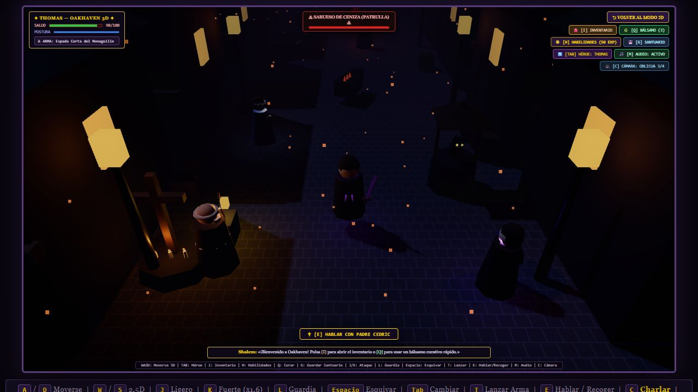
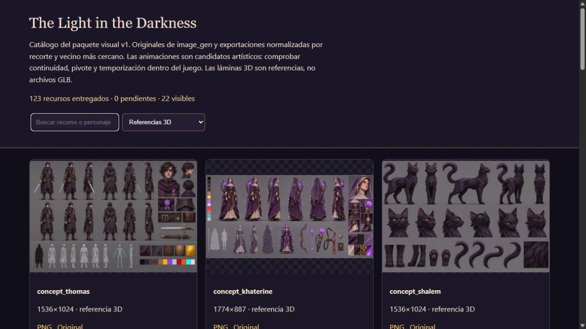

# The Light in the Darkness — revisión técnica y plan de mejora

Fecha: 17 de noviembre de 2026. Base revisada: commit 5a5f3ca, rama main de AI-Innovation-op/DEMO-L-D.

Esta entrega responde al pedido de Kevin: feedback crítico con soluciones implementables, documentación técnica del proyecto actual y un paquete de sprites y diseños de referencia basado en la carpeta «Mejoras a futuro/Mejoras visuales».

## Mi dictamen

Hay una base de prototipo aprovechable: identidad narrativa propia, dos héroes de combate distintos, desarme, enemigos con anticipación, Morwenna con dos fases, inventario y una expansión del espacio hacia el cementerio. La siguiente mejora de mayor valor es hacer fiables esos sistemas y darles una presentación coherente. Añadir más contenido sobre un guardado incompleto y un estado de héroes compartido multiplica el trabajo de corrección.

Recomiendo mantener Three.js como implementación de referencia del prototipo 3D mientras se valida una sección de Oakhaven. Una migración a Godot merece una decisión de producción separada, con una prueba comparable y costes de conversión. El motor por sí solo no corrige la lógica duplicada, la dirección de arte o el diseño de encuentros.

La entrega artística conserva los originales y produce exportaciones normalizadas. Las láminas 3D son referencias para modelado: no son archivos GLB, mallas con UV, rigs ni animaciones esqueléticas. Ese alcance fue confirmado por Kevin.

## Cómo leer esta entrega

| Documento | Para qué sirve |
|---|---|
| [01 — Feedback y hallazgos](01-FEEDBACK-Y-HALLAZGOS.md) | Crítica, evidencia, impacto, solución y criterio de aceptación por problema. |
| [02 — Arquitectura DDD propuesta](02-ARQUITECTURA-DDD.md) | Límites de módulos, contratos, flujos y orden seguro de extracción. |
| [03 — Sistemas y contratos](03-SISTEMAS-Y-CONTRATOS.md) | Combate, héroes, guardado, mundo, narrativa y entradas. |
| [04 — Dirección de arte e integración](04-ARTE-E-INTEGRACION.md) | Uso de PNG, referencias 3D, materiales, pivotes y carga en Phaser/Three.js. |
| [05 — Plan de implementación](05-PLAN-DE-IMPLEMENTACION.md) | Entregas ordenadas con dependencias y definición de terminado. |
| [06 — Pruebas y rendimiento](06-PRUEBAS-Y-RENDIMIENTO.md) | Cobertura real, pruebas necesarias, protocolo de juego y medición. |
| [07 — Catálogo y cobertura visual](07-CATALOGO-Y-COBERTURA.md) | Qué pidió la guía y dónde está cada recurso generado. |
| [09 — Mapa del proyecto actual](09-MAPA-DEL-PROYECTO-ACTUAL.md) | Arranque, versiones, módulos, controles, datos y persistencia existentes. |
| [08 — Decisiones y fuentes](08-DECISIONES-Y-FUENTES.md) | Acuerdos, conflictos entre documentos y referencias técnicas. |

## Qué comprobé

- Actualicé la copia local desde 8183950 a 5a5f3ca por avance rápido; los dos commits nuevos añaden fase 2/cementerio y actualizan las especificaciones artísticas.
- Ejecuté las 38 pruebas de Vitest: 8 archivos aprobados.
- Ejecuté TypeScript y la compilación de Vite: completados. El JS principal mide 2.404,50 kB sin comprimir y 574,33 kB con gzip, según la salida de esa compilación.
- Abrí el prototipo 3D del commit actual. Observé la escena, el HUD y el inventario; reproduje la pérdida de salud al cambiar Thomas → Khaterine → Thomas sin combatir. La consola no registró errores durante ese recorrido breve.
- Revisé el código de los sistemas principales y contrasté las dos conversaciones compartidas. No certifico la campaña completa ni el rendimiento de 60 FPS con este recorrido.

## Entregables visuales

Se entregan los 123 recursos previstos: 65 hojas de animación, 14 iconos, 11 hojas de efectos, 11 hojas de props y 22 láminas de referencia 3D. Los recursos 2D suman 463 frames exportados. El validador final no registra recursos pendientes, errores ni avisos automáticos. Esta comprobación mecánica no sustituye la aprobación artística dentro del juego.

Carpeta del paquete: [art/pack-v1](../../). El inventario completo se encuentra en [asset-plan.json](../../plan-recursos.json).

[Abrir el catálogo con animaciones](../../catalogo.html) · [Ver el manifiesto de exportación](../../manifiesto.json) · [Leer los prompts y ediciones](../../prompts.json).

El catálogo fue comprobado en navegador: 123 recursos, búsqueda de khaterine_run con su GIF cargado y filtro de 22 referencias 3D. No se registraron errores de consola durante esa comprobación.

## Regla de lectura de los estados

«Confirmado en ejecución» identifica una observación directa. «Confirmado en código» identifica una ruta concreta revisada. «Riesgo» necesita una prueba adicional. «Propuesta» es una recomendación de diseño o implementación y no cambia el canon de la obra. Pasar pruebas unitarias no convierte una propuesta en una función verificada del juego.

