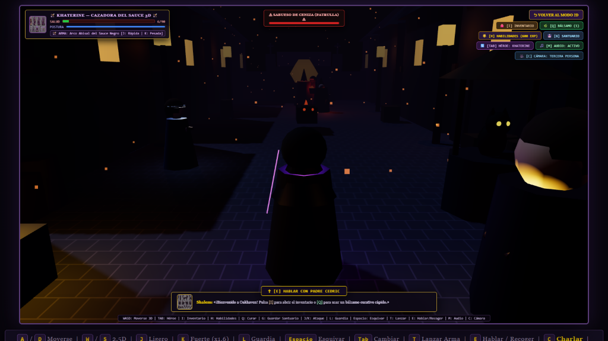

# Reporte de Entrega — Cámara en Tercera Persona e Input por Contexto

Fecha: 20 de noviembre de 2026  
Proyecto: The Light in the Darkness / DEMO-L-D  
Arquitectura de referencia: Vice City (port web) + OpenLara (Tomb Raider)

---

## 1. Resumen Ejecutivo

Siguiendo los hallazgos y propuestas técnicas de las investigaciones de **Vice City REA** y **OpenLara**, se implementó la refactorización completa de la **cámara en tercera persona** y el **sistema de input por contexto** en `src/presentation/three/Oakhaven3DExperience.ts`.

Se resolvieron los problemas críticos diagnosticados en las auditorías:
1. **Inconsistencia de ejes y direcciones**: Se unificó la convención de frente local en `-Z` para los modelos visuales (`thomasModelGroup`, `khaterineModelGroup`), el vector de esquiva (`executeDodge`), lanzamiento de arma (`executeThrowWeapon`) y disparo de flechas abisales (`shootAbyssalArrow`).
2. **Cámara soldada al cuerpo**: La cámara en tercera persona ya no está pegada de forma rígida a la rotación instantánea del cuerpo. Ahora posee un `cameraYaw` independiente con amortiguación suave y recentrado automático al correr.
3. **Interpolación dependiente del framerate**: Se reemplazó el factor fijo `0.08` por suavizado exponencial invariante al paso de tiempo: `alpha = 1 - Math.exp(-k * delta)`.
4. **Colisión contra muros / fachadas (`traceClip`)**: Se incorporó un sistema de retrotracción analítica a lo largo del rayo cámara-objetivo que impide que la cámara atraviese las fachadas de las casas al acercarse a los laterales de la calle.
5. **Aislamiento de contextos de Input**: Se implementó `InputContext` (`'gameplay' | 'dialogue' | 'inventory' | 'skillTree' | 'defeated'`), filtrado de repetición de teclas (`!e.repeat` para pulsos únicos como Tab, C, M, I, H, G, Q, E, Space, J, K), liberación total de teclas (`releaseAllInputs()`) al abrir modales, perder foco (`blur`) o cambiar de pestaña (`visibilitychange`).

---

## 2. Detalles Técnicos de la Implementación

### A. Sistema de Contextos de Entrada (`InputContext`)
- **Tipo de contexto**: `export type InputContext = 'gameplay' | 'dialogue' | 'inventory' | 'skillTree' | 'defeated'`.
- **Detección reactiva**: `getInputContext()` evalúa el estado actual (`isDialogueOpen`, `isInventoryOpen`, `isSkillTreeOpen`, `isPlayerDefeated`).
- **`releaseAllInputs()`**: Limpia inmediatamente el buffer de teclas `this.keys = {}`, cancela guardia activa (`playerStats.isGuarding = false`) y oculta la barrera abisal de Khaterine (`wardBarrierMesh.visible = false`).
- **Pérdida de foco y cambio de visibilidad**: Listeners globales en `window.addEventListener('blur')` y `document.addEventListener('visibilitychange')` para evitar que el personaje quede corriendo o defendiendo indefinidamente al cambiar de ventana.
- **Acciones discretas vs continuas**:
  - `e.repeat` ignorado para cambios de héroe (evita parpadeo con `Tab`), cámara (`C`), audio (`M`), interacción (`E`), esquiva (`Space`), ataque (`J`/`K`) y apertura de menús (`I`/`H`).
  - Cuando un modal está abierto, las acciones de combate y movimiento quedan completamente aisladas.

### B. Locomoción y Ejes Unificados
- Los modelos de Thomas y Khaterine fueron orientados con `rotation.y = Math.PI` dentro del grupo del jugador para que su frente visual coincida exactamente con el frente del controlador `(0, 0, -1)`.
- El ángulo de giro hacia la dirección de movimiento se calcula mediante `Math.atan2(-inputDir.x, -inputDir.z)`.
- **Giro por el arco angular más corto**:
  ```ts
  const angleDiff = Math.atan2(Math.sin(targetAngle - currentAngle), Math.cos(targetAngle - currentAngle));
  const turnAlpha = 1 - Math.exp(-14.0 * delta);
  this.playerGroup.rotation.y = currentAngle + angleDiff * turnAlpha;
  ```
  Esto elimina el bug donde el héroe daba giros de 360 grados al cruzar la frontera $-\pi / +\pi$.
- **Frenada independiente del framerate**: `friction = Math.exp(-12.0 * delta)`.

### C. Cámara en Tercera Persona con Amortiguación Exponencial
- **Movimiento relativo a la cámara**: En modo tercera persona, `W` avanza en la dirección a la que mira la cámara horizontalmente, `S` retrocede hacia la cámara, y `A`/`D` realizan desplazamiento lateral.
- **Anticipación de mirada (*look-ahead*)**: El punto de mira anticipa suavemente la velocidad del jugador en X/Z hasta `0.5m`, regresando a la posición base al frenar.
- **Órbita manual con puntero**: Permite arrastrar en el lienzo 3D para rotar la cámara (`this.cameraYaw -= deltaX * 0.005`). Tras 0.9 segundos de inactividad de órbita y al desplazarse, la cámara se recentra suavemente detrás de la trayectoria del héroe.
- **Resolución de obstáculos en calle (`traceClip`)**: Si la cámara deseada sobrepasa $|x| > 4.75$ o los límites en Z, se calcula la intersección $t$ y se retrae la cámara hacia el objetivo a lo largo del rayo, evitando recortes con los muros góticos.
- **Corte instantáneo en Respawn**: Al revivir en el santuario, la cámara se sitúa inmediatamente detrás del héroe sin desplazarse lentamente por todo el mapa.

---

## 3. Pruebas y Verificación

### A. Pruebas Unitarias Automatizadas
Se creó una nueva suite de pruebas en `tests/presentation/CameraAndInputContext.test.ts`:
- ✅ Giro suave por el arco angular más corto cruzando la frontera $-\pi / +\pi$.
- ✅ Giros de 90° y 180° calculados con precisión.
- ✅ Movimiento WASD relativo a la cámara en tercera persona (Norte, Este, Sur, diagonales).
- ✅ Alineación del vector frontal de combate con la dirección de movimiento.
- ✅ Retrotracción analítica ante obstáculos laterales (`traceClip`) manteniendo la cámara dentro de la calle.
- ✅ Invarianza del paso de tiempo en la amortiguación exponencial continua ($dt/2 \times 2 = dt$).

**Resultado global:** 10 suites de prueba, **55/55 tests aprobados** (`vitest run`).  
**Compilación:** `npm run build` ejecutado con éxito, 0 errores de TypeScript.

### B. Verificación Visual en Navegador
Comprobado en vivo en `http://localhost:3000/`:
- Transición fluida entre cámara oblicua 3/4 e isométrica y cámara en tercera persona mediante la tecla `[C]`.
- Cámara posicionada a la espalda del personaje mostrando el camino por delante hacia el cementerio y la cripta.
- Alternancia de héroes con `[Tab]` respetando orientación y posición sin saltos de cámara.
- Bloqueo de controles de movimiento al abrir el modal de inventario con `[I]`.


