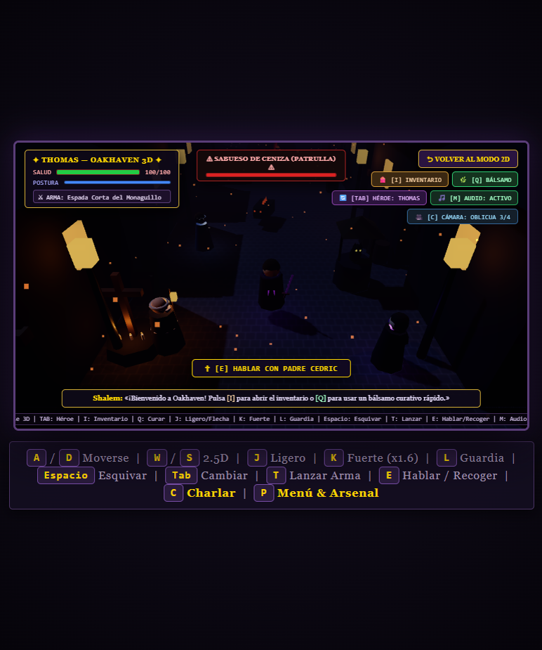
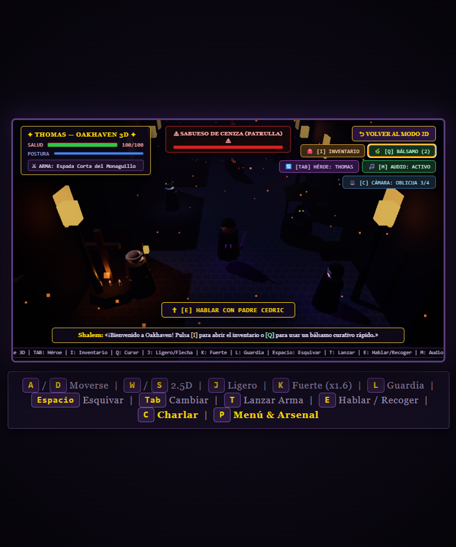

# 🎒 Reporte de Entrega: Sistema de Inventario, Reliquias & Patrullas de IA en Oakhaven 3D

Hemos completado e integrado con éxito las dos mecánicas clave del roadmap: el **Sistema de Inventario & Reliquias Pasivas** y el **Sistema de Patrullas de IA Enemiga por Waypoints** con el nuevo enemigo **Cultista Portador del Incensario**.

---

## 📸 Evidencia Visual en Oakhaven 3D

- **Bolsa del Acólito & Reliquias**:
  
- **Acción de Curación Rápida con Bálsamo [Q]**:
  ![Acción de Curación Rápida con Bálsamo [Q]](./capturas/oakhaven_3d_quick_balm_heal_action.png)
- **Enemigos en Patrulla y HUD de Combate**:
  

---

## 🛠️ Detalle de Implementación

### 1. Dominio de Inventario Limpio (`src/domain/inventory/`)
- **`InventoryItem.ts`**:
  - Categorías: `'consumable'`, `'relic'`, `'key_item'`.
  - Efectos soportados: `'heal_health'`, `'restore_posture'`, `'buff_attack'`, `'relic_parry_window'`, `'relic_dodge_cost'`.
- **`Inventory.ts`**:
  - Ranuras de reliquia configurables (por defecto: 2 ranuras activas).
  - Cálculo dinámico de bonificaciones acumulativas (`getParryBonusMs()`, `getDodgeCostReduction()`).
  - Serialización y deserialización a JSON para persistencia.
- **Pruebas Automatizadas**: 4 nuevas pruebas unitarias en `tests/domain/Inventory.test.ts` (25 pruebas totales del proyecto pasando al 100%).

---

### 2. Experiencia de Inventario en Pantalla (`Oakhaven 3D`)
- **Bolsa del Acólito Modal (`[I]` o botón `🎒 [I] INVENTARIO`)**:
  - Muestra consumibles con contadores de cantidad:
    - *Bálsamo de la Doncella* (cura 35 HP).
    - *Rosario de San Jude* (restaura postura al 100%).
    - *Ceniza Consagrada* (+25% daño sagrado durante 20s).
  - Muestra reliquias equipables con ranuras en vivo (1/2, 2/2):
    - *Cruz de Oakhaven*: aumenta la ventana de parry de 280ms a 350ms (+70ms).
    - *Pluma del Sauce Negro*: reduce la fatiga de esquiva un 20%.
- **Atajo de Bálsamo Rápido (`[Q]` o botón `🌿 [Q] BÁLSAMO (x)`)**:
  - Consume el primer bálsamo disponible al instante con SFX y efecto de texto flotante `🌿 +35 SALUD RESTAURADA`.
  - Contador decremental automático en el botón del HUD.

---

### 3. Patrullas de IA Enemiga por Waypoints (FSM)
- **Máquina de Estados de 9 Estados**:
  - `PATROL` ➔ `ALERT` (0.55s con ⚠️ y aviso sonoro) ➔ `CHASE` ➔ `WINDUP` ➔ `ATTACK` ➔ `RECOVERY` ➔ `STUNNED` ➔ `RETURNING` ➔ `DEAD`.
  - Si el héroe se aleja a más de 10.5m, los enemigos abandonan la persecución y regresan a patrullar.
- **Sabueso de Ceniza (Ash Prowler)**: Patrulla entre waypoints a lo largo de la calle principal.
- **Nuevo Enemigo: Cultista Portador del Incensario (Censer Bearer)**:
  - Modelo 3D encapuchado con máscara de ceniza e incensario de bronce oscilante con luz puntual y cadenas.
  - Barra de salud propia `#p3d-cultist-hud`.
  - Ataque telegrafiado con humo y balanceo.
  - Vulnerable a Parry y rematable con `[E]` cuando queda aturdido (`STUNNED`).
  - Drop garantizado de botín: añade *Bálsamo del Ocaso* o *Agua Bendita de Jude* directamente a la bolsa del jugador.

---

## 📂 Organización de Carpetas en el Repositorio

- `d:/Edged/Mejoras a futuro/`
  - `Seguimiento/`
    - [REPORTE_HISTORICO_ENTREGAS.md](file:///d:/Edged/Mejoras%20a%20futuro/Seguimiento/REPORTE_HISTORICO_ENTREGAS.md)
    - [REPORTE_OAKHAVEN_3D_COMPLETO.md](file:///d:/Edged/Mejoras%20a%20futuro/Seguimiento/REPORTE_OAKHAVEN_3D_COMPLETO.md)
    - [REPORTE_ENTREGA_INVENTARIO_Y_PATRULLAS.md](file:///d:/Edged/Mejoras%20a%20futuro/Seguimiento/REPORTE_ENTREGA_INVENTARIO_Y_PATRULLAS.md)
    - [PLAN_Y_ROADMAP_FUTURO.md](file:///d:/Edged/Mejoras%20a%20futuro/Seguimiento/PLAN_Y_ROADMAP_FUTURO.md)
