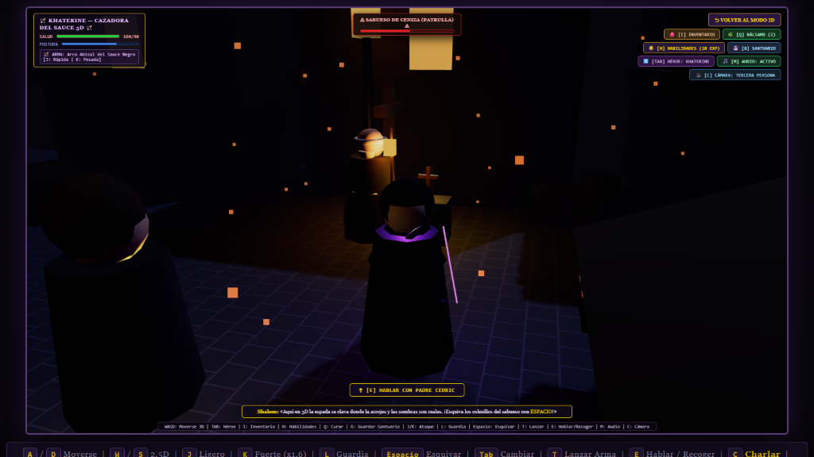
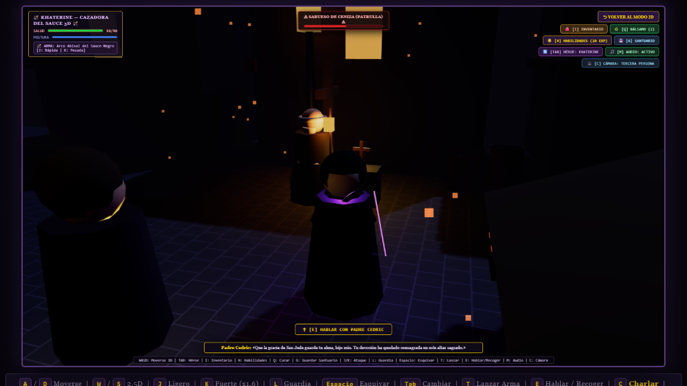
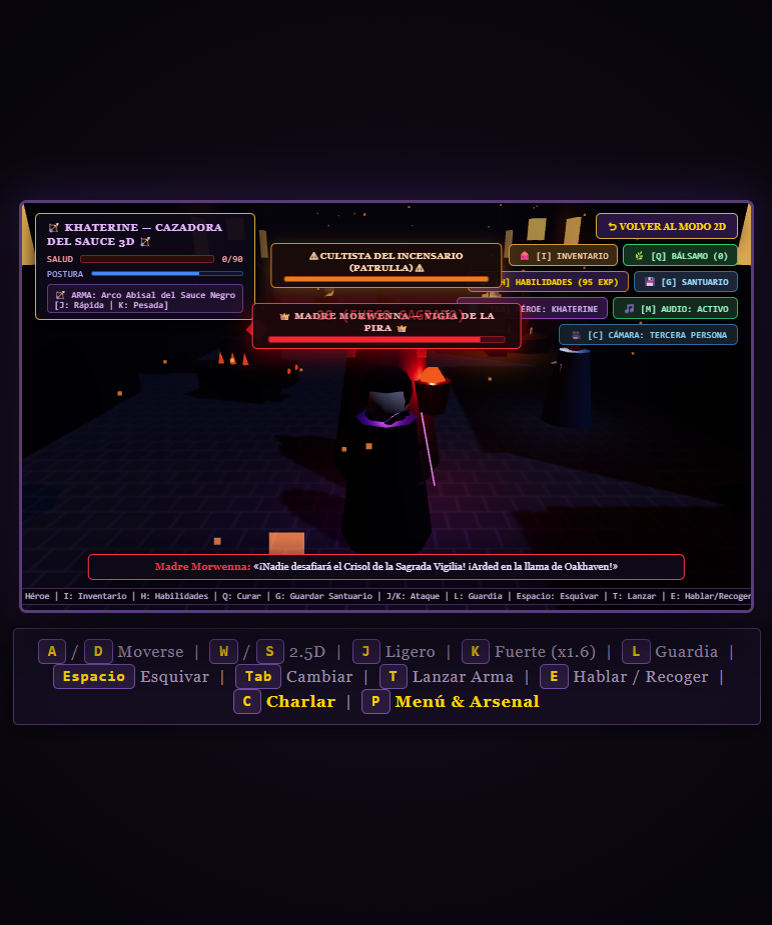

# 🛡️ Reporte de Entrega: Flagelante con Cadena, Árbol de Habilidades & Guardado en el Santuario

**Fecha**: 17 de Noviembre de 2026  
**Proyecto**: *The Light in the Darkness* (Basado en la novela de 20 capítulos de Kevin)  
**Estado**: Completado, probado y verificado en 3D (`http://localhost:3000/`)  
**Batería de Pruebas**: 35/35 pruebas unitarias Vitest aprobadas al 100%  

---

## 🌟 Resumen de la Entrega

En esta sesión se han materializado tres sistemas nucleares de la hoja de ruta que expanden profundamente la jugabilidad RPG y táctica de *The Light in the Darkness*:

1. **Flagelante con Cadena (`Chain Zealot`)**: Nuevo enemigo de rango medio con túnica carmesí, capucha de penitente con vendas en los ojos, mangual de eslabones de hierro y bola con púas. Posee un ataque de barrido en abanico horizontal de 4.2 metros de alcance, barra de vida dedicada `#p3d-zealot-hud`, y recompensa de `+150 EXP` y botín de *Ceniza Consagrada*.
2. **Códice del Alma: Árbol de Habilidades de EXP (`Progression`)**: Dominio limpio y modal interactivo accesible con la tecla `[H]` o botón superior, con acumulación de puntos de EXP en tiempo real (+15 por barril roto, +40 a +250 por enemigos) y ramas de habilidades exclusivas para **Thomas** y **Khaterine**.
3. **Sistema de Guardado en el Santuario (`GameSaveManager`)**: Sistema de persistencia en `localStorage` (con fallback transparente en memoria para testing) que permite guardar con la tecla `[G]` o botón de HUD. Al consagrar en el altar del Padre Cedric (`x: -8, z: 2`), se desencadena un pulso luminoso sagrado en la cruz monumental, se restaura la Salud y Postura al 100%, y se recibe la bendición pastoral.

---

## 📸 Evidencia Visual Capturada en el Entorno 3D

### 1. Códice del Alma y Árbol de Habilidades Consagrado (`[H]`)
Modal gótico interactivo con las ramas de talentos de Thomas y Khaterine. Se observa el desbloqueo exitoso de la habilidad *Golpe de Escudo Santo* (coste 40 EXP) pasando a estado `✓ ACTIVA` y reduciendo el balance de EXP de 50 a 10 EXP.



---

### 2. Guardado en el Altar del Santuario con el Padre Cedric (`[G]`)
Consagración en el altar de piedra de San Jude con la cruz dorada luminosa. Se aprecia el texto flotante `💾 ¡SANTUARIO CONSAGRADO! Partida Guardada & Salud Restaurada`, la restauración completa de la barra de vida y el mensaje litúrgico del Padre Cedric.



---

### 3. Combate contra el Flagelante con Cadena y Disparo Abisal de Khaterine (`[J]`)
Encuentro en el cruce norte de Oakhaven con el Flagelante con Cadena y Sabuesos de Ceniza. Barra de vida superior activa `⚠ FLAGELANTE CON CADENA (PATRULLA) ⚠` e impacto balístico de flecha abisal con números de daño flotantes `-28 (DISPARO ABISAL)`.



---

## 🧩 Arquitectura e Implementación Técnica

### 1. Dominio de Progresión (`src/domain/progression/`)
- `Skill.ts`: Definición de la entidad `SkillNode`, tipos de héroe (`thomas`, `khaterine`, `shared`), y 6 habilidades iniciales con prerrequisitos:
  - **Thomas**:
    - *Golpe de Escudo Santo* (+35% impacto en postura).
    - *Filo Consagrado* (+20% daño de espada). Requiere *Golpe de Escudo Santo*.
    - *Tenacidad Inquebrantable* (+25 Max HP a 125). Requiere *Filo Consagrado*.
  - **Khaterine**:
    - *Disparo Abisal Perforante* (+25% daño de flechas).
    - *Paso Espectral* (+30% distancia y velocidad de esquiva). Requiere *Disparo Abisal Perforante*.
    - *Sagrario del Sauce* (reduce daño de guardia al 50%). Requiere *Paso Espectral*.
- `Progression.ts`: Gestión de balance de EXP, métodos de desbloqueo `unlockSkill(id)` con validación de costes y árbol de prerrequisitos, cálculo de bonificadores acumulativos (`getDamageBonusPct`, `getMaxHealthBonus`, `getArrowDamageBonusPct`, `getDodgeDistanceBonusPct`), y serialización JSON.
- `tests/domain/Progression.test.ts`: 7 pruebas unitarias aprobadas al 100%.

### 2. Almacenamiento y Guardado (`src/infrastructure/storage/GameSaveManager.ts`)
- Serializador seguro para `localStorage` con estructura `GameSaveData`:
  - `activeHero`, `health`, `maxHealth`, `posture`, `maxPosture`.
  - Serialización de la `Inventory` (objetos, consumibles y reliquias equipadas).
  - Serialización de la `Progression` (EXP acumulada y habilidades consagradas).
  - Registro de visita al santuario y marca de tiempo legible.
  - Implementación con respaldo transparente en memoria (`memoryStore`) para pruebas automatizadas bajo Node.js / Vitest.
- `tests/infrastructure/GameSaveManager.test.ts`: 3 pruebas unitarias aprobadas al 100%.

### 3. Integración en `Oakhaven3DExperience.ts`
- **Flagelante con Cadena (`createZealotEnemy`)**:
  - Modelo 3D artesanal con malla compuesta: cuerpo cónico en carmesí, capucha negra con vendas en los ojos, mangual con cadena de eslabones y esfera con 6 púas piramidales.
  - Sistema de patrulla con 3 waypoints en el cuadrante norte (`z: -16` a `-19.5`).
  - Animación física de balanceo pendular del mangual en reposo y rotación en abanico horizontal durante el ataque.
  - Sincronización con el sistema de combate: daño afectado por buffs, detección de parry y remate cinemático `[E]`.
- **Integración del Árbol de Habilidades**:
  - Atajo de teclado `[H]` y botón superior `🌟 [H] HABILIDADES (${exp} EXP)`.
  - Renderizado dinámico de tarjetas con estado bloqueado, coste en EXP y estado activo.
  - Sinergia en tiempo real: al desbloquear *Tenacidad Inquebrantable*, la barra de HP de Thomas salta a 125 puntos; con *Paso Espectral*, la rodada de Khaterine se extiende +30%.
- **Integración del Santuario**:
  - Altar de piedra y cruz dorada junto al Padre Cedric con luz puntual `sanctuaryCrossLight`.
  - Atajo `[G]` y botón `💾 [G] SANTUARIO`.
  - Guardado persistente y recarga automática al iniciar el juego mediante `loadSavedSanctuaryState()`.

---

## 📊 Estado de Pruebas Unitarias

```
 ✓ tests/domain/Inventory.test.ts (4 tests)
 ✓ tests/domain/StoryProgress.test.ts (3 tests)
 ✓ tests/infrastructure/GameSaveManager.test.ts (3 tests)
 ✓ tests/domain/Progression.test.ts (7 tests)
 ✓ tests/domain/SessionStateStore.test.ts (3 tests)
 ✓ tests/domain/Shalem.test.ts (3 tests)
 ✓ tests/domain/Combat.test.ts (12 tests)

 Test Files  7 passed (7)
      Tests  35 passed (35)
   Duration  1.27s
```

---

## 🎮 Controles Actualizados en Oakhaven 3D

| Tecla / Acción | Descripción |
| :--- | :--- |
| **W, A, S, D** | Movimiento 3D fluido en 8 direcciones |
| **TAB** | Conmutar héroe activo (**Thomas** ⚔ / **Khaterine** 🏹) |
| **H** | Abrir Códice del Alma / **Árbol de Habilidades & EXP** |
| **I** | Abrir Bolsa del Acólito / **Inventario y Reliquias** |
| **G** | **Guardar partida en el Santuario** / Restaurar Salud y Postura |
| **Q** | **Consumo rápido de Bálsamo Curativo** |
| **J** | Ataque ligero / Flecha abisal rápida |
| **K** | Ataque pesado cargado / Flecha abisal cargada |
| **L** | Guardia de espada (Thomas) / **Sagrario del Sauce** (Khaterine) |
| **Espacio** | Esquiva con invulnerabilidad (**Paso Espectral**) |
| **T** | Lanzar espada clavable en el suelo (Thomas) |
| **E** | Interactuar / Hablar con NPCs / Recoger espada / **Rematar aturdidos** |
| **C** | Alternar vista de cámara (Isométrica 3/4 ↔ Tercera Persona) |
| **M** | Silenciar / Activar música litúrgica |
