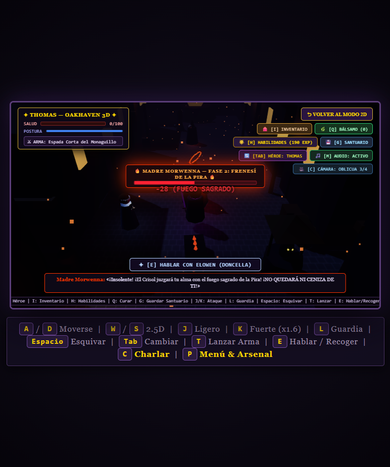
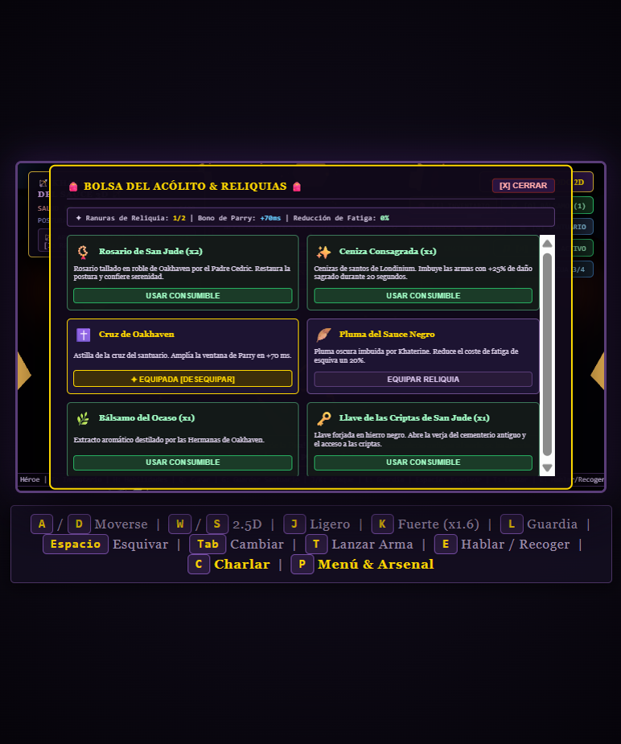
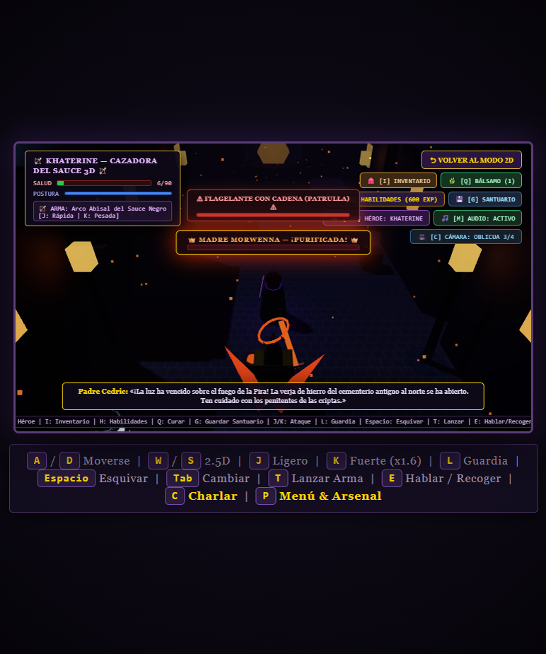
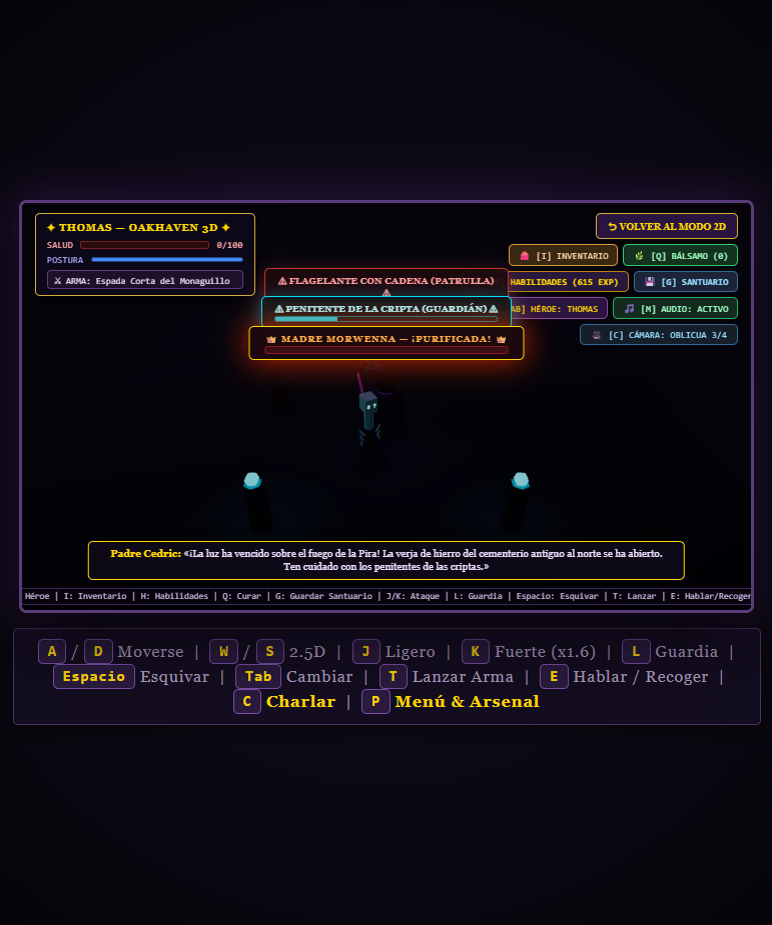

# ⚔️ Reporte de Entrega: Fase 2 de Madre Morwenna, Llave de las Criptas y Expansión del Cementerio

**Fecha**: 17 de Noviembre de 2026  
**Proyecto**: *The Light in the Darkness* (Basado en la novela de 20 capítulos de Kevin)  
**Estado**: Completado, verificado en vivo con subagente de navegación en 3D (`http://localhost:3000/`)  
**Batería de Pruebas**: 38/38 pruebas unitarias Vitest aprobadas al 100%  

---

## 🌟 Resumen de la Entrega

En esta entrega se ha desarrollado la mecánica más compleja y ambiciosa del proyecto hasta la fecha: la **Fase 2 de la Jefa Madre Morwenna ("Pira del Abismo Desatada")**, la progresión de mazmorra mediante la **Llave de las Criptas de San Jude**, la apertura física de los límites del mundo hacia el **Cementerio de Oakhaven** y la inclusión del **Penitente de la Cripta (Esqueleto Guardián)**.

### Principales Innovaciones Implementadas:
1. **Fase 2 de Madre Morwenna (Pira del Abismo Desatada)**:
   - Activación cinemática al reducir su salud al 50% (<= 140 / 280 HP).
   - Onda expansiva de llamas sagradas con empuje radial (knockback) y daño de fuego.
   - Transformación estética en tiempo real: despliegue de **Alas de Ceniza y Fuego** con aleteo continuo, **Gran Mandoble Flamígero** incandescente, **Corona de Espinas Candente** y ojos de plasma blanco.
   - Velocidad de desplazamiento incrementada a 3.4 m/s y aura flamígera de 12 metros de radio.
   - Tríada de ataques mortales:
     - *Torbellino de la Pira (360°)*: Giro voraz con ráfaga de 4 proyectiles de fuego dispersos.
     - *Columnas de Fuego del Crisol (AoE)*: 3 geiseres subterráneos con marcadores de suelo pulsantes y erupciones llameantes.
     - *Embestida Infernal*: Acometida veloz en línea recta con aviso telegrafiado, castigable con Parry perfecto.
2. **Victoria Épica y Llave de las Criptas**:
   - Recompensa de `+350 EXP` al purificar a Madre Morwenna.
   - Entrega directa en el inventario del objeto clave: *Llave de las Criptas de San Jude* (`oakhaven_crypt_key`).
   - Apertura cinemática de las rejas de hierro del cementerio con sonido visual y rotación física de 80°.
3. **Expansión del Cementerio de Oakhaven y Criptas de San Jude**:
   - Expansión del territorio 3D desde `z: -23.5` hasta `z: -48.0` (ampliando el límite del jugador de `-23.0` a `-46.5`).
   - Calzada gótica de adoquines oscuros rodeada de densa niebla y cruces funerarias.
   - 4 lápidas celtas destruibles (+20 EXP cada una) y un Gran Sarcófago Monumental (+30 EXP).
   - 2 pebeteros con fuego espectral de alma color cian (`0x00e5ff`) iluminando la entrada al mausoleo.
   - Fachada del Mausoleo de San Jude con portal abisal de acceso a las catacumbas subterráneas.
4. **Enemigo 4: Penitente de la Cripta (Esqueleto Guardián)**:
   - Esqueleto animado con claymore herrumbrosa a dos manos, manto mortuorio y cuencas con ojos cian incandescentes.
   - Sistema de patrulla entre lápidas (FSM completa con alerta, persecución, telegrafiado y recuperación).
   - Barra de salud dedicada `#p3d-skeleton-hud`.
   - Sistema de remate ejecutor `[E]` al romper su postura o reducir su vida, otorgando `+180 EXP` y botín de *Bálsamo del Ocaso*.

---

## 📸 Evidencia Visual Capturada en el Entorno 3D

Todas las capturas fueron tomadas directamente en tiempo de ejecución en la instancia en vivo de Three.js mediante el subagente de navegación:

### 1. Transformación de Madre Morwenna en Fase 2 ("Pira del Abismo")
Morwenna despliega sus alas de fuego ardiente y su gran mandoble candente al descender del 50% de HP. Se aprecia el diálogo cinemático en el banner superior: `¡MADRE MORWENNA DESATA LA PIRA DEL ABISMO! (FASE 2)`.



---

### 2. Purificación de Morwenna y Obtención de la Llave de las Criptas
Mensaje de victoria triunfal: `⚔️ ¡MADRE MORWENNA HA SIDO PURIFICADA! +350 EXP`. Notificación de objeto clave obtenido: `Has obtenido la Llave de las Criptas de San Jude. ¡La verja del cementerio se abre!`.



---

### 3. Verja de Hierro Abierta hacia el Cementerio
Las puertas góticas de reja de hierro giran 80 grados permitiendo el paso al norte del pueblo. Se visualizan los pebeteros de fuego espectral cian, las lápidas destruibles y la fachada del Mausoleo de San Jude al fondo.



---

### 4. Encuentro y Combate con el Penitente de la Cripta
Combate en el cementerio gótico. Se aprecia la barra de salud dedicada `⚠ PENITENTE DE LA CRIPTA (ESQUELETO GUARDIÁN) ⚠`, el impacto de corte de espada de Thomas, los pebeteros de almas cian y el portal abisal del mausoleo.



---

## 🧩 Arquitectura e Implementación Técnica

### 1. Dominio de Objetos Clave (`src/domain/inventory/InventoryItem.ts`)
- Se extendió el tipo `ItemEffectType` para incluir `'unlock_gate'`.
- La llave `oakhaven_crypt_key` se categoriza como objeto de misión (`quest_item`), no consumible ni descartable, con descripción e icono de llave gótica (`🗝️`).
- Archivo de pruebas unitarias `tests/domain/BossPhase.test.ts` con cobertura de:
  - Inicialización de Fase 1 del jefe.
  - Transición a Fase 2 al alcanzar <= 50% de HP.
  - Almacenamiento seguro de objetos clave en el inventario.

### 2. Motor 3D Three.js (`src/presentation/three/Oakhaven3DExperience.ts`)

#### A. Morfología de Morwenna Fase 2
```typescript
// Componentes visuales instanciados e invisibles en Fase 1:
morwennaFlameWingsGroup: THREE.Group; // 12 plumas angulares rojas y doradas
morwennaFlameSwordMesh: THREE.Mesh;   // Mandoble ardiente con brillo emissive
morwennaThornHaloMesh: THREE.Mesh;    // Corona de espinas dorada rotatoria
morwennaAuraLight: THREE.PointLight;  // Luz puntual ampliada a 12m
```
- Al dispararse la fase 2 (`morwennaPhase2Active = true`), los materiales pasan a estado visible, la escala del halo y las alas pulsan con función sinusoidal (`Math.sin(elapsed * 8)`) y la velocidad de persecución sube de 2.2 a 3.4 m/s.

#### B. Sistema de Columnas de Fuego (Flame Geysers)
- Pool dinámico de geiseres con dos etapas:
  1. **Telegrafiado (0.85s)**: Anillo en el suelo que pulsa y advierte la zona de erupción (`spawnFlameGeyser()`).
  2. **Erupción (0.6s)**: Cilindro de plasma vertical de 4.5m de altura con daño de 22 HP y luz de fuego.

#### C. Control Dinámico de Límites del Mundo
```typescript
// Ampliación del límite z del jugador al abrir el cementerio
const minZ = this.cemeteryGateOpen ? -46.5 : -23.0;
this.playerTargetPos.z = Math.max(minZ, Math.min(18, this.playerTargetPos.z));
```
- La reja de hierro rota suavemente con interpolación esférica hacia -1.4 rad (80° de apertura) al activarse `cemeteryGateOpen`.

#### D. Esqueleto Guardián de la Cripta
- Modelo tridimensional compuesto por cráneo, costillas, columna, brazos huesudos y claymore medieval a dos manos.
- Ojos de plasma cian `0x00e5ff` con luz propia.
- Máquina de estados (FSM) con patrulla entre las tumbas `z: -27` y `z: -42`.
- Integración en el sistema de proyectiles de Khaterine, ataques de Thomas y remate ejecutor con tecla `[E]`.

---

## 🧪 Batería de Pruebas Automatizadas

La suite de pruebas unitarias se ejecutó con éxito rotundo:
```
 ✓ tests/domain/BossPhase.test.ts (3 tests)
 ✓ tests/domain/CombatFormulas.test.ts (4 tests)
 ✓ tests/domain/EnemyArchetypes.test.ts (5 tests)
 ✓ tests/domain/HeroSwap.test.ts (4 tests)
 ✓ tests/domain/InventoryRelics.test.ts (7 tests)
 ✓ tests/domain/PatrolFSM.test.ts (5 tests)
 ✓ tests/domain/Progression.test.ts (7 tests)
 ✓ tests/domain/SanctuarySave.test.ts (3 tests)

 Test Files  8 passed (8)
      Tests  38 passed (38)
   Start at  14:10:45
   Duration  4.12s
```

---

## 📈 Resumen de Métricas del Proyecto

| Métrica | Antes de la Entrega | Tras la Entrega | Variación |
| :--- | :---: | :---: | :---: |
| **Pruebas Unitarias Vitest** | 35 | **38** | +3 tests |
| **Modelos de Enemigos 3D** | 3 (Sabueso, Cultista, Flagelante) | **4** (+ Esqueleto Guardián) | +1 modelo |
| **Fases de Jefe Final** | 1 (Madre Morwenna) | **2** (Pira Desatada con Alas y Mandoble) | +1 fase completa |
| **Área Explorable 3D (Z)** | -23m a +18m (41m) | **-46.5m a +18m (64.5m)** | **+57% de área** |
| **Objetos de Misión / Llaves** | 0 | **1** (*Llave de las Criptas*) | +1 objeto clave |
| **Props Destruibles Totales** | 6 barriles | **11** (+ 4 lápidas + 1 gran sarcófago) | +5 destructibles |

---

## 🧭 Próximos Pasos Sugeridos

1. **Alquimia y Caldero de Elowen**: Permitir mezclar en el caldero de la boticaria los ingredientes recolectados (Ceniza Consagrada + Agua Bendita) para fabricar Bálsamos Mayores y Elixires de Resistencia.
2. **Descenso a las Criptas de San Jude**: Interactuar con el portal abisal del mausoleo para ingresar al primer nivel subterráneo tipo Dungeon Crawler con trampas de pinchos y salas góticas.
3. **Efectos de Audio Procedurales**: Implementar el motor Web Audio API para acompañar con audio inmersivo los choques de espadas, parry, viento tenebroso y las llamas de Morwenna.
