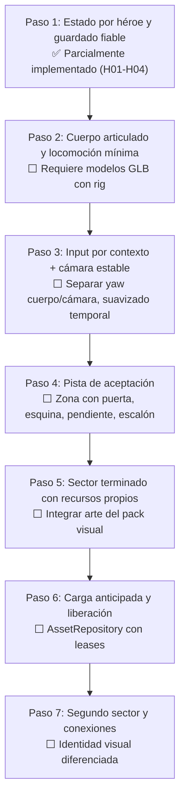

# Resumen de Investigaciones de Referencia — Oakhaven / DEMO-L-D

Fecha de consolidación: 20 de noviembre de 2026.

Dos revisiones independientes realizadas el 18 de noviembre de 2026, con el propósito de extraer principios de diseño y arquitectura aplicables al modo 3D de *The Light in the Darkness*.

---

## 1. Vice City (port web) — Revisión jugable y técnica

**Fuente:** versión web de GTA: Vice City en Minijuegos.com (build `796678be`).

### Hallazgos clave

| Área | Lección para Oakhaven |
|---|---|
| **Estructura del mapa** | Dividir en sectores reconocibles con identidad propia (silueta, paleta, sonido). Conectar mediante accesos legibles, no solo superficie. |
| **Actividad ambiental** | Pocas rutinas comprensibles bastan: un NPC que camina, una criatura en un borde. No hace falta simular una ciudad. |
| **Cámara 3ª persona** | Cuerpo completo visible, espacio por delante, cámara cercana. Separar yaw de cámara del yaw del cuerpo. |
| **Carga de recursos** | Manifiesto versionado, cola con prioridades (`required` → `next-zone` → `optional`), deduplicación, SHA-256. |
| **Guardado vs. caché** | Separar archivos de progreso (IDBFS) de recursos descargables (IndexedDB). Validar antes de anunciar éxito. |
| **Input y foco** | Liberar teclas al perder foco / ocultar página / abrir modal. |

### Propuestas de implementación documentadas

- **Contrato `AssetRepository`** con `acquire<T>(id, {priority, signal}): Promise<AssetLease<T>>`.
- **Contrato `CharacterPresentationState`** y `FollowCameraSettings` para locomoción y cámara.
- **Interpolación temporal:** `alpha = 1 − exp(−k × dt)` en vez de factor fijo por frame.
- **Convención de ejes:** fijar `−Z` como frente del controlador.

### Evidencias

- 8 capturas de observación del usuario + 7 de personaje/cámara a pie.
- Análisis estático del cargador (`launcher.js`, `index.js`, `GamepadEmulator.js`) con SHA-256 verificados.
- NO se decompiló el WASM ni se miden FPS, memoria o tráfico real.

📂 Documentación completa: [`vice-city-rea/`](vice-city-rea/)

---

## 2. OpenLara (Tomb Raider open-source) — Código fuente y comparativa

**Fuente:** `XProger/OpenLara`, commit `3b268ca4bf986c380f44a26ffd9218bf6d376249`.

### Hallazgos clave

| Área | Lección para Oakhaven |
|---|---|
| **Locomoción corporal** | Velocidad del clip (`speed + accel × time`) controla el desplazamiento. La zancada se calibra contra distancia real. |
| **Transiciones temporales** | Las acciones tienen ventanas de frames permitidas. Propuesta: `aplicado / diferido / rechazado` con buffer de input. |
| **Pie conductor** | `getLeadingFoot()` selecciona variantes de animación por fase de apoyo. |
| **Cámara por contextos** | 6 modos (seguimiento, estática, mirada, combate, cinemática, heavy). Objetivo visual separado de posición de autoridad. |
| **Corrección espacial** | `traceClip()` resuelve obstáculos antes de mover el ojo. Rooms + portales para visibilidad. |
| **Articulación por capas** | Máscaras de cuerpo superior/inferior. Thomas puede mantener piernas de locomoción + torso para arma. |

### Bug encontrado en OpenLara

- **`onLoadAndStore()` pasa `NULL` como contexto a `emscripten_idb_async_store`** — el handler de error lo dereferencía como `Stream*`. Ruta estática de crash si falla IndexedDB.
- **Recentrado asimétrico de yaw** — `lookAngle.y < EPS` trata asimétricamente valores positivos vs. negativos.

### Propuestas de implementación documentadas

- **Contrato `CharacterMotionView`** con `heroId`, `velocity`, `support`, `locomotion`, `action`, `actionInstanceId`.
- **Contrato `ClipEvent`** con eventos nombrados (`footLeft`, `footRight`, `weaponContact`, `interactionDone`).
- **Perfil de desplazamiento:** cápsula, pendiente max, escalón, caída, agarre, margen — separado del modelo visual.

### Evidencias

- Inventario de hashes de 15 archivos fuente relevantes.
- Prueba aritmética del recentrado asimétrico.
- Intento fallido de REA sobre la demo web (bloqueado por SSL).
- NO se ejecutó la demo ni se produjeron capturas jugables.

📂 Documentación completa: [`openlara-comparativa/`](openlara-comparativa/)

---

## 3. Síntesis: Plan unificado para Oakhaven 3D

Combinando las dos investigaciones, el orden de trabajo recomendado es:

### Lo que ya está hecho (de sesiones anteriores)

- ✅ Estado desacoplado por héroe (Party, HeroCombatState)
- ✅ GameSaveDataV2 con heroes/world
- ✅ MorwennaEncounter como máquina de estados
- ✅ Skill modifiers, defeat & respawn centralizado
- ✅ Zona segura del santuario
- ✅ Assets visuales integrados (sprites, icons, concepts)
- ✅ Retratos en HUD 3D y diálogos

### Lo que falta (bloqueadores del próximo paso)

1. **Modelos GLB articulados** de Thomas y Khaterine con rig, clips de locomoción y puntos de arma.
2. **Refactor de cámara** con suavizado temporal (`exp(-k*dt)`), separación yaw cuerpo/cámara, y resolución de obstáculos.
3. **Input por contexto** con `releaseAll()` al perder foco y consumo de acciones por estado (juego/diálogo/inventario/pausa).
4. **Pista de prueba** interior/exterior para validar locomoción, giro, obstáculos y cambio de héroe.

---

*Las capturas y recursos de las investigaciones son material de referencia. No se integran como sprites, modelos ni texturas al paquete artístico del proyecto.*
