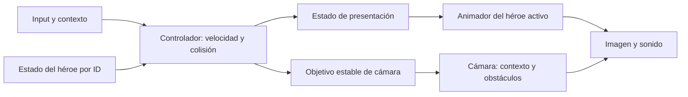

# Documentación completa — OpenLara como referencia para Oakhaven

18 de noviembre de 2026. Incluye comparación con Vice City, plan de adaptación, personaje, animación, cámara, arquitectura y límites de la prueba en navegador.

# OpenLara como segunda referencia para Oakhaven

18 de noviembre de 2026, America/Lima. Repositorio revisado: [XProger/OpenLara](https://github.com/XProger/OpenLara/tree/3b268ca4bf986c380f44a26ffd9218bf6d376249), commit `3b268ca4bf986c380f44a26ffd9218bf6d376249`. Se estudió principalmente el motor normal de `src/`, no la variante `src/fixed/`. DEMO-L-D no se modificó.

## Conclusión y dirección propuesta

OpenLara es una referencia especialmente útil para construir un personaje que **apoya, gira y actúa según el terreno y su estado corporal**. El código permite seguir cómo los datos de animación participan en el desplazamiento, cómo se eligen transiciones y cómo cámara y colisiones responden al contexto.

Mi propuesta para el modo 3D de Oakhaven es combinar la lectura espacial y el encuadre que observamos en Vice City con la disciplina de locomoción de OpenLara: cuerpo articulado, acciones con condiciones claras, contacto con el suelo, eventos temporales y cámara con corrección espacial. Esa combinación es una decisión de diseño para tu juego; no es una característica que se haya medido en una compilación conjunta.

El primer objetivo debería ser un tramo corto donde Thomas y Khaterine puedan avanzar, girar, detenerse, interactuar y combatir de forma legible. Esa prueba aporta más información que ampliar el mapa antes de resolver cómo se mueve y se ve el héroe.

## 1. Alcance: fuente disponible y demo pendiente

| Área | Qué se comprobó | Qué permanece sin comprobar |
|---|---|---|
| Identidad | Checkout fijado al commit indicado, con inventario y hashes de fuentes relevantes. | Correspondencia entre ese checkout y el ejecutable publicado en la web. |
| Personaje | Flujo de estados, muestreo de animación, velocidad del clip, colisión, fases de pie, salto y agarre en fuente. | Sensación de control, calidad visual de cada transición y ausencia de deslizamiento en una partida. |
| Cámara | Modos, objetivo del cuerpo, suavizado, trazado espacial, correcciones de altura y cinemáticas en fuente. | Encuadre real, fluidez, latencia y clipping de la demo servida. |
| Web | Código Emscripten, selección WASM/JavaScript, WebGL y callbacks de almacenamiento. | Arranque completo, rendimiento, guardado y recuperación probados en navegador. |
| REA | Intento de escenario sobre la URL oficial, con log de navegación y limpieza del proceso temporal. | No se llegó a capturar el juego ni se produjo un análisis de su runtime. |

El README enlaza `http://xproger.info/projects/OpenLara/`. El intento con REA registró un cambio a HTTPS y terminó con `net::ERR_BLOCKED_BY_CLIENT`, antes del estado inicial. El navegador integrado devolvió `net::ERR_SSL_VERSION_OR_CIPHER_MISMATCH` al abrir HTTPS. Estos resultados describen el acceso desde este entorno; no demuestran que el juego falle en todos los navegadores ni explican por sí solos la causa del servidor. No se modificaron protecciones del navegador.

Los registros están en [alcance-runtime.json](evidencias/alcance-runtime.json) y [rea-intento-demo.json](evidencias/rea-intento-demo.json). El segundo es el resultado fallido completo de la herramienta, con observación parcial de navegación; no se presenta como captura jugable ni como Evidence de un motor analizado.

La revisión ordinaria del repositorio se realizó con herramientas de lectura de código. REA se reservó para la pregunta de ejecución. No se ejecutaron los binarios incluidos ni se compiló el motor. Los archivos de datos que el build WASM pide precargar, como `level/1/TITLE.PSX`, no están en las rutas consultadas del checkout; el script por sí solo no constituye una demo autosuficiente.

## 2. Lo más valioso del personaje

### Movimiento y pose tienen una relación explícita

`Animation::getSpeed()` calcula una velocidad usando los datos `speed`, `accel` y el tiempo de la animación. Lara la utiliza en varias ramas de locomoción y después resuelve desplazamiento y colisión. Hay caminos especiales para otros medios, como el agua. [Velocidad del clip](https://github.com/XProger/OpenLara/blob/3b268ca4bf986c380f44a26ffd9218bf6d376249/src/animation.h#L202-L205), [velocidad de Lara](https://github.com/XProger/OpenLara/blob/3b268ca4bf986c380f44a26ffd9218bf6d376249/src/lara.h#L3455), [movimiento](https://github.com/XProger/OpenLara/blob/3b268ca4bf986c380f44a26ffd9218bf6d376249/src/lara.h#L3635).

Para Oakhaven, la lección es calibrar zancada, velocidad y apoyo como un conjunto. Con un controlador que sea la autoridad de desplazamiento, el animador puede recibir la velocidad real y ajustar su ritmo. Si una interacción usa desplazamiento conducido por animación, debe delimitarse para no sumar movimiento dos veces.

### Las transiciones tienen condiciones temporales

La animación consulta rangos de frames para cambiar de estado. Eso expresa una continuidad corporal deliberada, pero las ventanas deben diseñarse según el juego: exploración, ataque y esquiva no requieren necesariamente la misma capacidad de interrupción. Además, `setState()` puede devolver que el estado existe sin haber aplicado todavía una transición en esa llamada. [Transiciones](https://github.com/XProger/OpenLara/blob/3b268ca4bf986c380f44a26ffd9218bf6d376249/src/animation.h#L154-L199).

Propongo expresar para tus héroes un resultado `aplicado`, `diferido` o `rechazado`, con ventanas nombradas y un buffer de input cuando sea adecuado. El dominio debe validar la acción; el animador presenta su estado y emite eventos con identidad, sin otorgar daño o cambiar misiones por sí solo.

### El terreno y los pies participan en la decisión

El código distingue pie conductor y selecciona variantes para ciertos escalones e impactos. También condiciona salto y agarre a pose, espacio, apoyo y acciones. No se ha establecido un sistema IK universal ni apoyos perfectos en todos los casos. [Fase del pie](https://github.com/XProger/OpenLara/blob/3b268ca4bf986c380f44a26ffd9218bf6d376249/src/lara.h#L2814), [variantes de movimiento](https://github.com/XProger/OpenLara/blob/3b268ca4bf986c380f44a26ffd9218bf6d376249/src/lara.h#L3687).

Para el proyecto conviene definir una cápsula/controlador coherente, altura máxima de escalón, límites de pendiente y política de caída. Estos parámetros pertenecen al controlador, no deben deducirse accidentalmente de la ropa o del tamaño de una espada.

El detalle está en [PERSONAJE_Y_ANIMACION.md](PERSONAJE_Y_ANIMACION.md).

## 3. Lo más valioso de la cámara y del espacio

OpenLara distingue seguimiento, mirada, combate, cámara estática y cinemática. Calcula el punto observado a partir del cuerpo o la cabeza y corrige la posición respecto al espacio del nivel. Las cinemáticas pueden conservar cortes en lugar de interpolar indiscriminadamente entre encuadres distantes. [Interfaz](https://github.com/XProger/OpenLara/blob/3b268ca4bf986c380f44a26ffd9218bf6d376249/src/controller.h#L18-L46), [objetivo](https://github.com/XProger/OpenLara/blob/3b268ca4bf986c380f44a26ffd9218bf6d376249/src/camera.h#L127-L167), [corrección espacial](https://github.com/XProger/OpenLara/blob/3b268ca4bf986c380f44a26ffd9218bf6d376249/src/camera.h#L248-L353).

Para Oakhaven propongo un objetivo visual estable por héroe y perfiles de cámara por contexto. La posición del cuerpo, su orientación y la orientación de cámara deben conservar responsabilidades separadas. Un respawn o un cambio de plano necesita su propia política, distinta del seguimiento durante una carrera.

El motor organiza visibilidad mediante rooms y portales, con recortes de pantalla. Esto no equivale a descargar recursos según la distancia. Culling, simulación y carga/liberación de recursos deben tratarse por separado. Para una capilla, cripta o vivienda de Oakhaven, un grafo sencillo de espacios y accesos puede resultar suficiente antes de introducir un sistema completo de portales. [Visibilidad por portales](https://github.com/XProger/OpenLara/blob/3b268ca4bf986c380f44a26ffd9218bf6d376249/src/level.h#L2495-L2589).

El detalle está en [CAMARA_Y_ARQUITECTURA.md](CAMARA_Y_ARQUITECTURA.md).

## 4. Comparación con la referencia de Vice City

| Aspecto | Vice City: alcance de nuestra revisión anterior | OpenLara: alcance de esta revisión | Decisión propuesta para Oakhaven |
|---|---|---|---|
| Encuadre | Se observaron cuerpo completo, espacio por delante y cambios de cámara según contexto. | Se pudo seguir el cálculo de objetivo, modos y corrección espacial en fuente. | Mantener un héroe legible en pantalla y resolver explícitamente seguimiento, combate e interacción. |
| Locomoción | Se observaron poses y desplazamiento; no se recuperó el algoritmo interno del WASM. | Se siguió la cadena entre datos de animación, velocidad, estados y colisión. | Calibrar locomoción contra velocidad y terreno mediante recursos propios. |
| Controles | Se observó al usuario desplazándose y conduciendo. | El camino clásico de teclado está orientado por el personaje, con giros y ramas por contexto. | Decidir la política de input del proyecto antes de adoptar mecanismos. La tercera persona relativa a cámara es una propuesta para Oakhaven, no una descripción del control clásico de OpenLara. |
| Espacio | Se revisaron calles, costa, tráfico y el plano general. | El código establece rooms, sectores, portales y una carga de nivel separada. | Diseñar sectores reconocibles y conexiones útiles, con una pista de prueba interior/exterior. |
| Entrega web | Se estudió el cargador servido, con hashes contrastados para dos JavaScript y guardados separados de caché. | Se revisó la plataforma web en fuente; no se identificó el build público ejecutado. | Dar identidad a los builds, separar estados de caché/descarga/guardado y comunicar fallos recuperables. |

La primera revisión está en `C:/Kevin/investigaciones/gta-vice-city-web/`. Este documento resume sus conclusiones; las capturas de Vice City no se presentan como imágenes de OpenLara.

## 5. Críticas concretas y sus mejoras

### A. Error de caché con contexto nulo

En `onLoadAndStore()`, el código inicia `emscripten_idb_async_store()` pasando `NULL` como contexto, pero usa `onError`, que interpreta su argumento como `Stream*` y accede a él. El contrato oficial reenvía ese contexto al callback de error. Existe por tanto una ruta estática de desreferencia nula si falla esa escritura; no se reprodujo en una partida. [Código](https://github.com/XProger/OpenLara/blob/3b268ca4bf986c380f44a26ffd9218bf6d376249/src/platform/web/main.cpp#L19-L40), [contrato oficial de Emscripten](https://emscripten.org/docs/api_reference/emscripten.h.html#c.emscripten_idb_async_store).

**Mejora:** un error al persistir una descarga recuperable necesita un handler propio. Pasar el mismo `stream` tampoco sería una solución suficiente: `onLoad()` lo destruye tras iniciar la operación asíncrona. Usar un contexto independiente con vida útil explícita o un callback de error sin dependencia de ese objeto. Probar rechazo de IndexedDB con la red disponible.

**Aplicación:** en Oakhaven, distinguir «recurso descargado», «caché persistida» y «partida guardada». Un mensaje de éxito debe corresponder a la operación que realmente terminó.

### B. Recentrado asimétrico de mirada

El yaw que vuelve a cero usa la condición `lookAngle.y < EPS`. Un valor negativo la satisface incluso lejos de cero; uno positivo continúa interpolando. Para ±0,5 rad y dt de 1/30, la fórmula deja ±1/3 antes de aplicar ese umbral: el negativo pasa a cero. [Código](https://github.com/XProger/OpenLara/blob/3b268ca4bf986c380f44a26ffd9218bf6d376249/src/camera.h#L440-L445), [prueba aritmética guardada](evidencias/prueba-aritmetica-recentrado.json).

**Mejora:** comparar el valor absoluto, respetar el arco angular corto y ensayar ambos sentidos de giro. La prueba guardada evalúa esa fórmula; no ejecuta el motor ni mide la cámara de la demo.

**Aplicación:** comprobar giros izquierda/derecha y la frontera −π/π en tu cámara y en el cuerpo. Una única prueba de caminar hacia delante no detecta estas diferencias.

### C. Acoplamiento y contenido legado

Hay reglas ligadas a índices de animación, ventanas concretas y unidades del formato de nivel. Eso sirve al propósito de este motor, pero introducirlo directamente en Oakhaven trasladaría también esas dependencias.

**Mejora:** metadata semántica por clip y perfiles de movimiento en unidades documentadas. Mantener estado del héroe, controlador, animador y cámara con contratos explícitos. Traducir los principios al motor del proyecto y validar una zona propia.

### D. Reproducibilidad y verificación visual

Los scripts revisados no fijan por sí solos una versión del SDK y no establecen la identidad del ejecutable servido. Los archivos de datos precargados no están en las rutas comprobadas del checkout.

**Mejora:** para un producto propio, registrar commit, toolchain y hashes de entrega; probar arranque y persistencia del paquete publicado. En esta revisión, la sensación jugable de OpenLara permanece pendiente por el bloqueo de acceso a la demo. No se atribuyen al juego FPS, fluidez o ausencia de clipping sin esa evidencia.

## 6. Implementación propuesta en DEMO-L-D

El plan mantiene TypeScript, Phaser y Three.js como base actual. Son propuestas documentadas; no se instalaron motores ni se integró código o contenido del juego de referencia.

### Paso 1: identidad y estado por héroe

Consolidar el estado de Thomas y Khaterine por ID, separado de las mallas visibles. Guardar los cambios del mundo, validar el snapshot y comprobar persistencia antes de anunciar éxito. Resolver primero los problemas ya documentados en la revisión del proyecto evita que un cambio de personaje parezca funcionar visualmente mientras comparte vida o arma por accidente.

### Paso 2: cuerpo articulado y locomoción mínima

Preparar un modelo propio por héroe con escala, frente local, origen en pies, rig y puntos de arma coherentes. Empezar por reposo, caminar, correr, inicio/parada, giro, daño y las acciones de arma necesarias. Los PNG y láminas 3D entregados previamente no contienen un esqueleto ni estos clips.

El controlador resuelve desplazamiento y colisión; el animador recibe velocidad real, apoyo y acción. Ajustar el ritmo de los clips contra una distancia conocida. Añadir eventos de pie, contacto y fin de acción con identidad de instancia para evitar duplicados.

Flujo propuesto para Oakhaven, distinto de una reproducción literal del motor de OpenLara:



### Paso 3: cámara por contextos

Aplicar seguimiento, combate, interacción y cinemática con parámetros explícitos. Separar orientación del cuerpo y cámara, suavizar por tiempo y resolver obstáculos. El encuadre y los valores iniciales propuestos a partir de la observación de Vice City siguen documentados en el informe anterior; no son constantes recuperadas de OpenLara.

### Paso 4: pista de aceptación antes de ampliar contenido

Construir una zona con suelo plano, esquina, puerta, pendiente, escalón y un objetivo visible. Repetir con ambos héroes:

- Avanzar, girar 90°/180°, cruzar −π/π y detenerse.
- Cambiar orientación de cámara y comprobar la política de input elegida.
- Pasar por puerta/esquina sin que la cámara atraviese la pared.
- Atacar y recibir daño sin perder la pose base o duplicar eventos.
- Abrir un modal mientras se mantiene una tecla y soltarla fuera de la pestaña.
- Guardar y recargar después de una interacción y un cambio de héroe.
- Comparar el mismo input con pasos de 30, 60 y 120 Hz.

Solo después integrar más sectores y recursos. El objetivo de aceptación es una ruta completa y coherente, no una cifra de tamaño de mapa.

## 7. Documentos y evidencias

- [Personaje, locomoción y animación](PERSONAJE_Y_ANIMACION.md).
- [Cámara, arquitectura espacial y plataforma web](CAMARA_Y_ARQUITECTURA.md).
- [Identidad de las fuentes](evidencias/identidad-fuentes.json).
- [Resultado fallido del intento REA sobre la demo](evidencias/rea-intento-demo.json).
- [Límites de la comprobación en navegador](evidencias/alcance-runtime.json).
- [Prueba aritmética de recentrado](evidencias/prueba-aritmetica-recentrado.json).

Los enlaces a código fijan el commit revisado. La licencia de código declarada por el repositorio está copiada como [LICENSE_OpenLara.txt](LICENSE_OpenLara.txt). Esta revisión no incorpora modelos, texturas o niveles de Tomb Raider al paquete artístico propio.


---

# OpenLara: personaje, locomoción y animación

18 de noviembre de 2026, America/Lima. Análisis estático del checkout `3b268ca4bf986c380f44a26ffd9218bf6d376249` de [XProger/OpenLara](https://github.com/XProger/OpenLara/tree/3b268ca4bf986c380f44a26ffd9218bf6d376249). No se ejecutó el motor en esta parte de la investigación ni se modificaron su código o DEMO-L-D.

## 1. Qué aporta esta referencia

OpenLara vincula el movimiento al estado del cuerpo, a los datos temporales de la animación y a las condiciones del suelo. Las transiciones válidas, el pie que conduce una zancada, el espacio para saltar y la altura de un escalón tienen funciones explícitas. Ese vínculo es una referencia valiosa para que Thomas y Khaterine parezcan personajes que pisan y actúan dentro del mundo.

Esto es una conclusión sobre el código examinado. La sensación real de peso, latencia, precisión, fluidez y cámara necesita observación de una compilación ejecutada. Tampoco se ha establecido que la demo web pública contenga exactamente este commit.

## 2. Separación de responsabilidades que expresa el código

| Capa | Responsabilidad observada | Fuente fijada al commit |
|---|---|---|
| `Controller` | Pose global, animación, referencia al estado de animación, comandos y articulaciones. | [controller.h, línea 107](https://github.com/XProger/OpenLara/blob/3b268ca4bf986c380f44a26ffd9218bf6d376249/src/controller.h#L107) |
| `Character` | Salud, velocidades, input semántico y relación con suelo/aire/agua/agarre. Selecciona estado y ordena la actualización. | [character.h, línea 8](https://github.com/XProger/OpenLara/blob/3b268ca4bf986c380f44a26ffd9218bf6d376249/src/character.h#L8), [línea 203](https://github.com/XProger/OpenLara/blob/3b268ca4bf986c380f44a26ffd9218bf6d376249/src/character.h#L203) |
| `Lara` | Reglas concretas de acciones, salto, escalada, armas, colisiones, desplazamiento y selección de modo de cámara. | [lara.h, línea 69](https://github.com/XProger/OpenLara/blob/3b268ca4bf986c380f44a26ffd9218bf6d376249/src/lara.h#L69) |
| `Animation` | Tiempo, frames de referencia, estado, transición, velocidad, comandos y pose articulada. | [animation.h, línea 7](https://github.com/XProger/OpenLara/blob/3b268ca4bf986c380f44a26ffd9218bf6d376249/src/animation.h#L7) |

`Controller::state` es una referencia al estado de `Animation`, no un estado de gameplay completamente independiente ([controller.h, línea 116](https://github.com/XProger/OpenLara/blob/3b268ca4bf986c380f44a26ffd9218bf6d376249/src/controller.h#L116), [constructor en línea 160](https://github.com/XProger/OpenLara/blob/3b268ca4bf986c380f44a26ffd9218bf6d376249/src/controller.h#L160)). Esto explica parte del acoplamiento entre reglas y animaciones.

Para un personaje normal, `Character::update` recoge input, determina el tipo de apoyo, intenta el estado, actualiza el controlador/animación y después velocidad y posición. Si el nuevo lugar no produce una zona válida, puede restaurar la posición anterior. Esta lectura se limita a ese flujo; las cinemáticas tienen otro camino en `Lara::update` ([character.h, línea 203](https://github.com/XProger/OpenLara/blob/3b268ca4bf986c380f44a26ffd9218bf6d376249/src/character.h#L203), [lara.h, línea 3252](https://github.com/XProger/OpenLara/blob/3b268ca4bf986c380f44a26ffd9218bf6d376249/src/lara.h#L3252)).

## 3. Estados: la postura física importa

### Apoyo o medio

`Character::Stand` distingue aire, suelo, deslizamiento, agarre, bajo el agua, superficie y vadeo. `getNextState` deriva las reglas de acción según ese tipo de apoyo. No equivale simplemente a elegir entre un clip de reposo y uno de carrera. [character.h, línea 13](https://github.com/XProger/OpenLara/blob/3b268ca4bf986c380f44a26ffd9218bf6d376249/src/character.h#L13), [línea 149](https://github.com/XProger/OpenLara/blob/3b268ca4bf986c380f44a26ffd9218bf6d376249/src/character.h#L149).

La lista de Lara incluye caminar, correr, detenerse, giros, saltos direccionales, caída, agarre, pasos laterales, empujar/tirar, recoger, usar llave y estados de agua, entre otros. Su presencia en el enum no prueba por sí sola que toda acción funcione en toda versión del juego; deben seguirse sus reglas. [lara.h, línea 158](https://github.com/XProger/OpenLara/blob/3b268ca4bf986c380f44a26ffd9218bf6d376249/src/lara.h#L158).

### Transiciones permitidas en momentos concretos

`Animation::canSetState` y `setState` consultan estados y rangos de frames de los datos del nivel. Una transición puede existir y todavía no estar dentro de su intervalo permitido. Además, el retorno `true` de `setState` puede indicar que existe el estado solicitado, aunque en esa llamada no se haya cambiado de clip. Conviene distinguir esa semántica de «la transición ya terminó». [animation.h, línea 154](https://github.com/XProger/OpenLara/blob/3b268ca4bf986c380f44a26ffd9218bf6d376249/src/animation.h#L154), [línea 173](https://github.com/XProger/OpenLara/blob/3b268ca4bf986c380f44a26ffd9218bf6d376249/src/animation.h#L173).

**Lectura de diseño:** estas ventanas pueden conservar una continuidad corporal deliberada. También pueden introducir espera percibida si se trasladan sin ajuste a un combate que exige otra respuesta. El código no mide esa percepción. Para Oakhaven habría que elegir qué acciones esperan a una fase y cuáles admiten interrupción inmediata.

### Dirección y giro

En el camino de teclado terrestre examinado, `FORTH` solicita carrera; izquierda/derecha solas solicitan giro; con caminar aparecen pasos laterales y retroceso. El giro depende del estado y, durante carrera, de la inclinación del cuerpo. Es un control orientado por la dirección del personaje en ese camino de input, no una demostración de WASD relativo a la cámara. Hay ramas separadas para analógico y VR. [lara.h, línea 2525](https://github.com/XProger/OpenLara/blob/3b268ca4bf986c380f44a26ffd9218bf6d376249/src/lara.h#L2525), [línea 2628](https://github.com/XProger/OpenLara/blob/3b268ca4bf986c380f44a26ffd9218bf6d376249/src/lara.h#L2628), [línea 2671](https://github.com/XProger/OpenLara/blob/3b268ca4bf986c380f44a26ffd9218bf6d376249/src/lara.h#L2671), [línea 3384](https://github.com/XProger/OpenLara/blob/3b268ca4bf986c380f44a26ffd9218bf6d376249/src/lara.h#L3384).

Para Oakhaven, la continuidad de las poses se puede adoptar conservando la política de movimiento elegida para su tercera persona. Copiar directamente este controlador cambiaría también el diseño de los controles y la relación con los niveles.

## 4. Cómo se relacionan animación y desplazamiento

### Reloj y muestreo de pose

`Animation::update` incrementa tiempo mediante `Core::deltaTime`. La duración y el índice de frame se expresan usando una base lógica de 30 unidades por segundo. El `frameRate` del dato controla cómo se espacian las muestras de pose. Eso no establece que la imagen se renderice a 30 FPS. [animation.h, línea 68](https://github.com/XProger/OpenLara/blob/3b268ca4bf986c380f44a26ffd9218bf6d376249/src/animation.h#L68), [línea 77](https://github.com/XProger/OpenLara/blob/3b268ca4bf986c380f44a26ffd9218bf6d376249/src/animation.h#L77), [línea 112](https://github.com/XProger/OpenLara/blob/3b268ca4bf986c380f44a26ffd9218bf6d376249/src/animation.h#L112).

El sistema selecciona `frameA`, `frameB` y un factor `delta`. Si está activado `smooth`, usa la muestra siguiente, y puede prepararse para la siguiente animación; si no, repite la misma muestra. La posición local y las rotaciones de articulaciones se interpolan antes de componer la jerarquía. La función denominada `lerpAngle` para ángulos articulares convierte las rotaciones a cuaterniones y usa su `lerp`; no debe describirse automáticamente como un `slerp` de todo el esqueleto. [animation.h, línea 128](https://github.com/XProger/OpenLara/blob/3b268ca4bf986c380f44a26ffd9218bf6d376249/src/animation.h#L128), [línea 250](https://github.com/XProger/OpenLara/blob/3b268ca4bf986c380f44a26ffd9218bf6d376249/src/animation.h#L250), [utils.h, línea 1204](https://github.com/XProger/OpenLara/blob/3b268ca4bf986c380f44a26ffd9218bf6d376249/src/utils.h#L1204).

Este camino identifica interpolación entre muestras y preparación del siguiente clip. No demuestra un árbol genérico de mezcla continua entre cualquier par de animaciones.

### Velocidad definida en los datos de animación

La cadena estática más útil es:

```text
Datos del clip: speed y accel
    → Animation::getSpeed()
    → Lara::updateVelocity(): velocidad y dirección según apoyo/estado
    → Lara::move(): desplazamiento con deltaTime × 30 y colisiones
```

`getSpeed` calcula `speed + accel × time × 30`. Para varios estados de suelo y apoyo, Lara toma esa velocidad del clip; otras ramas, como la natación, usan reglas de aceleración propias. `move` combina velocidad, flujo y corrección de colisión. [animation.h, línea 202](https://github.com/XProger/OpenLara/blob/3b268ca4bf986c380f44a26ffd9218bf6d376249/src/animation.h#L202), [lara.h, línea 3455](https://github.com/XProger/OpenLara/blob/3b268ca4bf986c380f44a26ffd9218bf6d376249/src/lara.h#L3455), [línea 3635](https://github.com/XProger/OpenLara/blob/3b268ca4bf986c380f44a26ffd9218bf6d376249/src/lara.h#L3635).

No se debe resumir toda esta solución como «root motion moderno»: hay velocidad y aceleración en los datos, posición local de pose, offsets de fin de animación, comandos de salto y resolución de colisión. La autoridad del movimiento depende del camino concreto.

### Eventos ligados al avance temporal

`isFrameActive` comprueba si se ha cruzado un frame desde la actualización anterior. El controlador usa ese mecanismo para sonidos y efectos; al terminar un clip aplica offsets y salto antes de encadenar la siguiente animación. [animation.h, línea 150](https://github.com/XProger/OpenLara/blob/3b268ca4bf986c380f44a26ffd9218bf6d376249/src/animation.h#L150), [controller.h, línea 1136](https://github.com/XProger/OpenLara/blob/3b268ca4bf986c380f44a26ffd9218bf6d376249/src/controller.h#L1136), [línea 1193](https://github.com/XProger/OpenLara/blob/3b268ca4bf986c380f44a26ffd9218bf6d376249/src/controller.h#L1193).

Esto permite coordinar una acción con su presentación. No prueba que cualquier salto de tiempo, evento repetido o cancelación esté libre de errores; esos casos requieren ensayo.

## 5. Articulación y capas del cuerpo

Lara declara articulaciones de cadera, tres segmentos por pierna, pecho, brazos y cabeza, con máscaras de cuerpo superior e inferior. `Animation::getJoints` recorre nodos jerárquicos, compone transformaciones y admite rotaciones sobrescritas por máscara. [lara.h, línea 239](https://github.com/XProger/OpenLara/blob/3b268ca4bf986c380f44a26ffd9218bf6d376249/src/lara.h#L239), [animation.h, línea 254](https://github.com/XProger/OpenLara/blob/3b268ca4bf986c380f44a26ffd9218bf6d376249/src/animation.h#L254).

El camino `updateOverrides` copia la pose base, puede sustituirla por una reacción direccional de golpe, y aplica animaciones de los brazos al portar armas. También se ven correcciones para cabeza y pecho al mirar un objetivo. [lara.h, línea 1230](https://github.com/XProger/OpenLara/blob/3b268ca4bf986c380f44a26ffd9218bf6d376249/src/lara.h#L1230), [character.h, línea 250](https://github.com/XProger/OpenLara/blob/3b268ca4bf986c380f44a26ffd9218bf6d376249/src/character.h#L250).

**Aplicación:** Thomas puede conservar locomoción de piernas y orientar el torso para su arma, y Khaterine puede preparar/apuntar con el arco sin reemplazar indiscriminadamente todas las poses del cuerpo. Esto exige definir máscaras, prioridades y estados permitidos; no basta con superponer clips arbitrariamente.

## 6. Colisión, escalones, salto y agarre

### El pie conductor elige variantes

`getLeadingFoot` infiere la fase de apoyo a partir del estado y el frame. Al colisionar de frente y al ascender o descender, el código selecciona clips de izquierda o derecha. Se identifica una solución explícita de variantes por pie; eso no prueba que haya un solucionador IK universal ni que todo escalón produzca un apoyo perfecto. [lara.h, línea 2814](https://github.com/XProger/OpenLara/blob/3b268ca4bf986c380f44a26ffd9218bf6d376249/src/lara.h#L2814), [línea 3687](https://github.com/XProger/OpenLara/blob/3b268ca4bf986c380f44a26ffd9218bf6d376249/src/lara.h#L3687), [línea 3726](https://github.com/XProger/OpenLara/blob/3b268ca4bf986c380f44a26ffd9218bf6d376249/src/lara.h#L3726), [línea 3750](https://github.com/XProger/OpenLara/blob/3b268ca4bf986c380f44a26ffd9218bf6d376249/src/lara.h#L3750).

### El tipo de movimiento limita la altura permitida

`checkMove` hace una consulta de colisión antes de iniciar ciertos movimientos. En `move`, caminar y retroceder limitan el descenso; los pasos laterales tienen límites más pequeños; agua y agarre cambian radio, altura y offsets de consulta. Los valores pertenecen a la escala y formato de este motor. [lara.h, línea 2822](https://github.com/XProger/OpenLara/blob/3b268ca4bf986c380f44a26ffd9218bf6d376249/src/lara.h#L2822), [línea 3635](https://github.com/XProger/OpenLara/blob/3b268ca4bf986c380f44a26ffd9218bf6d376249/src/lara.h#L3635).

Hay consultas para mallas estáticas de la habitación y colisionadores de entidades, además de correcciones de posición y respuestas de impacto. Los comentarios del código señalan trabajo pendiente, por ejemplo colisiones entre habitaciones enlazadas y ciertas pruebas de cajas. No se presentan esos TODO como errores reproducidos. [lara.h, línea 3540](https://github.com/XProger/OpenLara/blob/3b268ca4bf986c380f44a26ffd9218bf6d376249/src/lara.h#L3540).

### Saltar y agarrarse son acciones con condiciones

El salto desde carrera usa una condición `canJump` ligada al estado y a una ventana de frames. La preparación de un salto direccional comprueba espacio frontal. El agarre en aire necesita determinadas poses, acción pulsada, manos libres, colisión frontal y coincidencia entre la altura de las manos y la superficie; después alinea el personaje. [lara.h, línea 2582](https://github.com/XProger/OpenLara/blob/3b268ca4bf986c380f44a26ffd9218bf6d376249/src/lara.h#L2582), [línea 2605](https://github.com/XProger/OpenLara/blob/3b268ca4bf986c380f44a26ffd9218bf6d376249/src/lara.h#L2605), [línea 2430](https://github.com/XProger/OpenLara/blob/3b268ca4bf986c380f44a26ffd9218bf6d376249/src/lara.h#L2430).

Al recuperar suelo se identifica una rama de daño por caída y selección de aterrizaje. [lara.h, línea 2380](https://github.com/XProger/OpenLara/blob/3b268ca4bf986c380f44a26ffd9218bf6d376249/src/lara.h#L2380).

**Aplicación:** si Oakhaven incorpora escalada, debe existir una prueba espacial y una acción corporal coherente. La propuesta no exige añadir escalada, agua o saltos a un diseño que no los necesita.

## 7. Críticas con mejoras aplicables

Son decisiones de adaptación y mantenimiento observadas en fuente, no fallos jugables reproducidos del port.

| Punto a revisar | Fundamento | Mejora propuesta para Oakhaven | Verificación útil |
|---|---|---|---|
| Reglas muy ligadas a índices y frames concretos. | Ventanas de salto, pie conductor y elección de clips usan IDs y números de frame. | Metadata semántica por clip: fase de apoyo, ventanas de interrupción y eventos nombrados; validar que existen al importar. | Cambiar la duración de un clip sin mover accidentalmente la ventana de golpe, apoyo o interacción. |
| Estado de acción y estado del animador comparten identidad. | `Controller::state` referencia `Animation::state`. | Mantener estado de juego por héroe y un estado de presentación derivado; que una malla oculta no conserve la autoridad de la acción del héroe activo. | Alternar Thomas/Khaterine en reposo, carrera, daño y menú sin transferir salud/arma ni ejecutar eventos duplicados. |
| Esperas de transición pueden tener una intención distinta del combate de Oakhaven. | Los rangos de `setState` difieren de un cambio inmediato. | Decidir por acción qué se cancela, qué espera y qué se almacena en un buffer corto de input. Nombrar el resultado como aplicado/diferido/rechazado. | Pulsar justo antes de una ventana y durante una cancelación; verificar una sola acción y la respuesta deseada. |
| Escala y colisión dependen del formato de salas/suelo clásico. | Límites en unidades como 64, 128, 256 y valores propios de la malla/nivel. | Perfil de desplazamiento en unidades documentadas: cápsula, pendiente, escalón, caída, agarre y margen. Mantenerlo separado del modelo visual. | Repetir una pequeña pista con pendientes, peldaños y puertas con ambos héroes y pasos temporales distintos. |
| Capas de armas y reacciones tienen prioridades codificadas directamente. | `updateOverrides` reemplaza articulaciones y modifica máscaras. | Una política explícita de capas: locomoción base, arma, mirada y reacción, con interrupciones y máscaras por héroe. | Apuntar caminando, recibir daño, abrir diálogo y cambiar de arma sin brazos rígidos o pose residual. |

## 8. Implementación mínima recomendada para Thomas y Khaterine

1. **Definir un eje frontal, escala y origen comunes.** Cada modelo se adapta dentro de un nodo visual propio; el controlador conserva la convención de movimiento, ataque y cámara.
2. **Crear un conjunto pequeño de clips propios.** Reposo, caminar, correr, inicio/parada, giro, daño y acciones del arma que realmente utiliza cada héroe. No producir decenas de clips antes de validar la locomoción básica.
3. **Elegir una autoridad de movimiento.** Empezar con controlador que resuelve intención, velocidad y colisión; alimentar el animador con velocidad real y fase. Si se usa desplazamiento conducido por animación en una interacción, delimitarlo como una acción y no sumar dos movimientos independientes.
4. **Separar presentación por héroe.** Un adaptador resuelve malla activa, rig, clips, máscaras y puntos de arma. El dominio conserva estadísticas e inventario por ID.
5. **Añadir eventos temporales con identidad.** Apoyo, sonido, contacto de arma y fin de interacción deben poder emitirse una sola vez al cruzar su instante, incluso si el frame salta. Un evento visual no autoriza por sí mismo daño o cambio de misión: debe validarlo el estado de juego.
6. **Calibrar con una pista corta.** Suelo, una esquina, una puerta, una pendiente y un escalón. Probar avance, parada, giro, golpe y cambio de héroe; medir distancia y comprobar pose con una observación continua.

Contrato de diseño orientativo, no implementado:

```ts
interface CharacterMotionView {
  heroId: string;
  velocity: { x: number; y: number; z: number };
  facingYaw: number;
  support: 'ground' | 'air';
  locomotion: 'idle' | 'walk' | 'run' | 'start' | 'stop' | 'turn';
  action: 'none' | 'attack' | 'dodge' | 'hit' | 'interact';
  actionInstanceId: number;
}

interface ClipEvent {
  name: 'footLeft' | 'footRight' | 'weaponContact' | 'interactionDone';
  timeSeconds: number;
}
```

El conjunto final depende del diseño. Este contrato no se deduce como API existente en OpenLara y no copia su código. Los PNG y láminas de referencia 3D ya entregados no son un rig con animaciones; el modo 3D necesita recursos articulados propios para lograr locomoción corporal comparable.

## 9. Ensayos que faltan para afirmar cómo se siente

- Caminar/correr, girar 90° y 180° y parar con una misma versión ejecutable; comprobar retraso, apoyos y encuadre.
- Saltar y agarrarse, si esa es la característica que se desea evaluar; verificar los límites de altura y dirección de forma reproducible.
- Comparar animación con desplazamiento a distintas tasas de actualización, sin confundir el reloj lógico de 30 unidades con FPS de render.
- Revisar impactos, pisadas y transiciones en una captura continua para detectar duplicados, pies que deslizan o cambios bruscos.
- Contrastar identidad del build web con el source antes de atribuir a ese binario los detalles exactos del checkout.

## 10. Puntos clave

OpenLara aporta una referencia especialmente fuerte para **acciones corporales con condiciones**, **zancada relacionada con movimiento**, **variantes por pie al cambiar de altura** y **articulación por capas**. Para Oakhaven conviene trasladar esos principios mediante contratos y recursos propios, manteniendo su política de controles y cámara. El análisis de fuente no sustituye observar la demo ni establece que todas sus funciones estén presentes en ella.


---

# OpenLara: cámara, organización espacial y entrega web

Revisión estática del 18 de noviembre de 2026, America/Lima. Repositorio: `XProger/OpenLara`, commit `3b268ca4bf986c380f44a26ffd9218bf6d376249`. Se examinó el código normal de `src/`, principalmente `camera.h`, `controller.h`, `level.h`, `game.h` y `platform/web/`. La variante `src/fixed/` no se utilizó para describir estos mecanismos.

El objetivo es extraer decisiones útiles para el modo 3D de Oakhaven. Este documento no afirma que el ejecutable de la demo web coincida con ese commit ni que estos mecanismos hayan sido observados en una partida de la demo. Las observaciones de navegador y REA, si se consiguen, deben añadirse con identidad y límites propios.

## 1. Qué ofrece esta cámara

La cámara es un sistema de estados con reglas de composición, seguimiento y corrección espacial. No consiste únicamente en colocar un punto detrás del personaje. La interfaz declara seis modos: seguimiento, estática, mirada, combate, cinemática y `heavy`; además conserva posición/room del ojo y objetivo, ángulos, sacudida, primera persona y reflexión. [Interfaz `ICamera`, líneas 18–46][ol-camera-interface]

| Estado o variante | Mecanismo que aparece en el código | Alcance |
|---|---|---|
| Seguimiento | Distancia base de 1.536 unidades del nivel; parámetro de velocidad 12. | Valores del código TR, no metros ni valores recomendados para Three.js. |
| Combate | Distancia base de 2.048 unidades salvo ciertas plataformas; parámetro de velocidad 8. | En la fórmula de seguimiento, el parámetro menor genera mayor factor de aproximación por paso. No equivale a una medición de sensación o latencia. |
| Mirada | Distancia 512, input para orientar la vista y límites angulares. | Las teclas de dirección y stick se interpretan según este contexto. |
| Estática | Usa una cámara declarada en el nivel y mira a un objetivo o al dueño. | No es una cámara libre genérica que el jugador coloca en cualquier sitio. |
| `Heavy` | Comparte tratamiento de objetivo estático y temporizador; puede conservarse hasta agotar su tiempo. | No se atribuye aquí un significado narrativo concreto a todos los triggers que lo activan. |
| Cinemática | Recorre frames de cámara y transforma posición/objetivo mediante una matriz de secuencia. | Puede interpolar o cortar entre encuadres. |
| Primera persona | Obtiene la articulación de cabeza y ajusta posición y rotación de cámara. | Rama distinta del seguimiento exterior, con excepciones para animación de cabeza y VR. |

Los valores y ramas están en [constantes y estado de cámara][ol-camera-constants], [actualización de modos][ol-camera-update] y [primera persona][ol-camera-firstperson].

`changeView` asigna FOV 65 para la vista exterior y 90 para primera persona, con planos de recorte propios; son argumentos de esta implementación, no una medición del FOV servido en la web. [camera.h:711–719][ol-camera-fov]

## 2. Cómo elige el punto que sigue

`getViewPoint()` parte de la posición y bounding box del dueño. En modo de mirada puede seguir la articulación de cabeza; en seguimiento calcula una altura basada en los límites del cuerpo y la ajusta según el estado bajo el agua. Para otras entidades emplea el centro. `centerView` decide además si X/Z siguen el centro de la caja. [camera.h:127–167][ol-camera-target]

La consecuencia de diseño es importante: **el objetivo visual de una cámara puede variar por postura y contexto sin cambiar la posición de autoridad del personaje**. Para Oakhaven conviene exponer un punto de seguimiento estable por héroe, junto a la altura de pie/agachado y las condiciones de combate. Eso evita que cada modelo nuevo obligue a reescribir la cámara.

En el seguimiento normal, X/Z del objetivo se actualizan directamente, mientras Y se aproxima con `deltaTime × 5`. La orientación deseada combina ángulo del dueño, mirada y stick de vista. Las ramas de mirada y seguimiento mantienen reglas diferentes. [camera.h:419–528][ol-camera-update]

## 3. Seguimiento y tiempo

`move()` aproxima la posición del ojo con un factor proporcional a `Core::deltaTime`: `30 / speed × deltaTime`, o `20 × deltaTime` en mirada. Después vuelve a consultar sector, suelo y techo y corrige la altura del ojo. La cámara tiene una bandera `smooth`; tras un reset o determinadas transiciones puede aplicar directamente el destino. [camera.h:330–353][ol-camera-move]

La aplicación no entrega sin más todo el delta del frame a esta fórmula. Fuera de niveles de cinemática limita el delta acumulado a 0,2 segundos y luego lo consume en subpasos de, como máximo, 1/30 de segundo. El último subpaso puede ser menor. Esto no significa que el render funcione a 30 FPS. [game.h:271–325][ol-game-timestep]

Para trasladar la idea a Oakhaven:

- Definir respuestas por contexto y expresarlas por tiempo.
- Separar la respuesta de posición, punto de mirada y giro.
- Decidir cuándo interpolar y cuándo cortar: respawn, teleport, cinemática y cambio de objetivo requieren políticas explícitas.
- Probar varios pasos temporales y un frame largo. La misma fórmula puede sentirse distinta si el bucle de actualización cambia.

Una propuesta para el proyecto es usar amortiguación exponencial `alpha = 1 − exp(−k × dt)` y diferencia angular corta al orientar. Es una decisión de reconstrucción, no el algoritmo literal de OpenLara.

## 4. Paredes, sectores y oclusión

La cámara calcula una posición deseada detrás del objetivo y llama a `traceClip()` antes de mover el ojo. Ese método hace un trazado del dueño, identifica cajas del sector, ajusta límites con información de bloqueo, deja margen y corrige la posición mediante deslizamiento. [camera.h:248–328][ol-camera-clip]

El trazado del controlador recorre fronteras X/Z y usa suelo/techo para acotar la línea. La corrección de cámara vuelve a comprobar altura después de interpolar. Es un mecanismo adaptado a rooms, sectores y cajas del formato del nivel. **No se establece aquí una solución universal contra todo mesh dinámico ni una política general de transparencia para objetos que tapan al personaje.** [controller.h:1054–1086][ol-controller-trace], [camera.h:330–353][ol-camera-move]

Para una escena propia de Three.js, tomar la responsabilidad del sistema, sin copiar sus supuestos geométricos: calcular destino, comprobar el volumen de la cámara frente a colisionadores relevantes, retraer al encontrar un obstáculo y recuperar distancia al despejarse. Una hoja, una partícula, un enemigo y una pared pueden pertenecer a capas de oclusión distintas. La revisión del port no demuestra cuál será el radio correcto para los héroes de Oakhaven.

## 5. Cinemáticas, agua y sonido

Las cinemáticas avanzan sobre una secuencia de frames de cámara. Cuando la distancia entre frames de posición o de objetivo excede un umbral, el código usa directamente el frame A; en los demás casos interpola ojo, objetivo y FOV. Esto permite preservar cortes en lugar de convertirlos todos en movimientos largos. [camera.h:372–417][ol-camera-cinematic]

La condición submarina de la cámara procede de la bandera de la room del ojo. El listener de sonido utiliza la matriz de cámara y calcula reverberación del espacio principal a partir del tamaño de room. En la actualización del nivel, la condición submarina activa el ambiente y el estado correspondiente del listener. [camera.h:113–124][ol-camera-audio], [level.h:2320–2332][ol-level-audio]

La preparación del render contempla un plano de reflexión, transformación de la matriz y proyección oblicua. Es una rama de render, no prueba de que todos los materiales de agua tengan exactamente el mismo efecto. [camera.h:634–681][ol-camera-render]

Aplicación a Oakhaven: una transición de zona puede coordinar luz, niebla, sonido y cámara a partir de un estado compartido. La cámara y el audio no deberían deducir por separado, con criterios incompatibles, si el jugador está en un interior o bajo agua.

## 6. Cómo organiza lo visible

El nivel usa rooms conectadas mediante portales. `checkPortal()` comprueba la orientación del portal, proyecta sus cuatro vértices, trata los cruces del plano y calcula un rectángulo recortado contra el viewport recibido. `getVisibleRooms()` propaga ese rectángulo a rooms conectadas. Hay límites de 255 entradas y profundidad de recorrido 16. [level.h:2495–2589][ol-level-portals]

En la vista ordinaria se inicia el recorrido desde la room de la cámara. En niveles de cinemática existe una rama que incorpora otras rooms no alternativas. El render de rooms aplica scissor según el rectángulo de portal y separa pasadas de geometría. El render de entidades recibe el frustum de cámara. [level.h:2619–2657][ol-level-view], [level.h:2004–2059][ol-level-rooms], [level.h:2131–2170][ol-level-entities]

Esto es **selección de geometría visible**, no una prueba de streaming de recursos por proximidad. La carga de un nivel siguiente es otra operación: se pide un `Stream`, su callback deja el dato en `Game::nextLevel`, y después `startLevel()` reemplaza la instancia de nivel. [level.h:2173–2178][ol-level-loading], [game.h:60–95][ol-game-loading]

Para Oakhaven, un grafo sencillo de sectores y accesos puede ayudar a organizar visibilidad, sonido y carga anticipada. No hace falta implementar un sistema de portales completo antes de medir una zona propia. La selección de render y la carga/liberación de recursos deben conservar interfaces separadas: ocultar un mesh no necesariamente descarga su textura ni detiene su simulación.

## 7. Plataforma web del repositorio

La plataforma normal está escrita en C++ y utiliza Emscripten. Los scripts de build generan JavaScript y paquetes de datos; existe una variante explícita WASM. El HTML/PHP comprueba `WebAssembly` y elige `OpenLara_wasm.js`; si no está disponible, solicita `OpenLara.js` y un inicializador de memoria. [build.bat][ol-web-build], [build_wasm.bat][ol-web-wasm], [index.php:198–221][ol-web-selection]

El código de plataforma intenta WebGL 2 y, si no consigue contexto, WebGL 1. Registra teclado, ratón, toque, redimensionado y loop principal mediante callbacks de Emscripten. [main.cpp:161–200][ol-web-gl], [main.cpp:281–348][ol-web-input]

El cargador declara memoria inicial en `Module`, estado de descargas y tratamiento de pérdida de contexto WebGL. No se infiere de ello memoria real de una partida, tamaño total descargado ni compatibilidad probada en un navegador concreto. Los scripts contienen opciones de toolchain de época y este examen no los ejecutó con un SDK moderno. [index.php:60–90][ol-web-shell]

### Descarga y persistencia

`osDownload()` consulta si el nombre está en IndexedDB; si existe lo carga, y si no existe lo descarga. El resultado se escribe a fichero virtual y se entrega como `Stream`. Guardados y caché de plataforma usan funciones de IndexedDB con callbacks. [main.cpp:16–92][ol-web-storage]

En estas funciones se observó una ruta de fallo concreta, descrita abajo. No se probó guardar, recargar ni agotar cuota en la demo.

## 8. Críticas con mejora y prueba concreta

| Prioridad | Hallazgo respaldado | Mejora | Verificación necesaria |
|---|---|---|---|
| Alta para robustez web | `onLoadAndStore()` pasa `NULL` como argumento de callback a `emscripten_idb_async_store`, con `onError`; ese handler interpreta su argumento como `Stream*` y accede a `stream->name`. Según el contrato oficial, el callback recibe el argumento sin modificar. Hay una ruta estática de desreferencia nula si falla esa escritura. | Separar el error de caché del error de descarga. Un fallo de persistencia de un recurso recuperable no debe usar un handler que exige un `Stream` válido. Usar un contexto propio con vida útil explícita si hace falta identidad de la solicitud. | Forzar rechazo de escritura/cuota y comprobar que el nivel descargado se puede usar y que se comunica el fallo. No se reprodujo un crash durante esta revisión. |
| Media para cámara | Al salir de mirada, X usa `fabsf` para decidir si llegó a cero, pero yaw usa `lookAngle.y < EPS`. Todo yaw negativo satisface esa condición tras el primer paso de aproximación, mientras el positivo normalmente continúa interpolando. | Comparar el valor absoluto y conservar una política simétrica por dirección, junto a diferencia angular corta. | Liberar mirada desde ±0,5 rad con el mismo dt y comparar el recorrido de recentrado. La asimetría procede del código, no de una observación de la demo. |
| Media para recuperación | El fallo al consultar/cargar IndexedDB va al mismo handler de error que entrega `NULL` al consumidor; en la ruta examinada no hay un fallback explícito a descarga de red cuando falla la caché. | Clasificar caché no disponible, archivo ausente y fallo real de descarga; permitir red cuando sea apropiado y distinguir la disponibilidad del guardado. | Probar red disponible con IndexedDB rechazado, y después red ausente con recurso ya guardado. |
| Media para mantenibilidad | Cámara y render conocen rooms, sectores, boxes y unidades específicas del nivel. | En un juego nuevo, poner la consulta de cámara detrás de una interfaz de colisión/visibilidad y usar perfiles por héroe/contexto. | Sustituir una zona de prueba por otra geometría sin reescribir el controlador de cámara. |
| Media para evolución de contenido | La visibilidad tiene límites explícitos de profundidad y cantidad de rooms. No se ha demostrado aquí que un nivel válido los alcance. | Validar esos límites en el pipeline y emitir diagnósticos si se exceden; elegir presupuestos según contenido medido. | Un nivel de prueba que sobrepasa el límite debe fallar de forma explicable o degradarse con una política definida. |
| Media para reproducibilidad | Los builds web revisados no expresan en esos scripts una versión fijada del SDK ni aportan por sí mismos identidad verificable del ejecutable servido. | Fijar toolchain y dependencias; generar metadata de commit y hashes del bundle; conservar un ensayo de arranque del paquete publicado. | Reconstruir en un entorno limpio y comparar la identidad de los archivos o documentar las fuentes de no determinismo. |

La documentación oficial de Emscripten confirma que `arg` se reenvía a `onerror`; esta combinación con el código local sustenta el primer hallazgo. Es análisis de una ruta de fallo, no un resultado de ejecución del sitio. [Contrato de IndexedDB de Emscripten][ol-emscripten-idb]

**Cuidado con la corrección del primer hallazgo:** sustituir `NULL` por `stream` sin más tampoco resuelve la vida útil, porque `onLoad()` borra ese stream inmediatamente después de iniciar el almacenamiento asíncrono. La corrección debe separar callbacks o mantener un contexto independiente hasta terminar la operación. [main.cpp:27–40][ol-web-storage]

La asimetría de mirada se ve en [camera.h:440–445][ol-camera-recenter]. `clampAngle` conserva negativos del intervalo normal, y `EPS` es `FLT_EPSILON`; no hay una conversión que vuelva siempre positivo ese yaw. Para ±0,5 y un paso de 1/30, la aproximación produce ±1/3 antes del umbral: el negativo pasa directamente a cero con esa condición. [utils.h:93][ol-utils-eps], [utils.h:174–180][ol-utils-angle]

Se conserva una [prueba aritmética de esa condición](evidencias/prueba-aritmetica-recentrado.json), que evalúa la fórmula sin ejecutar el motor ni la demo. Es evidencia de la asimetría matemática del fragmento, no una medida de la cámara en pantalla.

## 9. Decisiones recomendadas para Oakhaven

1. **Cámara por contextos:** seguimiento, combate, interacción y cinemática con perfiles explícitos de distancia, altura, objetivo y transición.
2. **Objetivo visual por héroe:** exponer un punto estable y una altura de referencia; no acoplar toda la cámara a una malla concreta ni al seno usado para simular carrera.
3. **Colisión antes de pulir números:** un seguimiento agradable en una plaza necesita conservar legibilidad en puertas, esquinas y desniveles.
4. **Sectores con propósito:** usar conexiones de zonas para orientar, anticipar contenido y variar ambiente; introducir culling o portales más complejos cuando una medición lo justifique.
5. **Errores recuperables separados:** caché, descarga, guardado y parsing de recursos son fronteras diferentes, con estados y mensajes propios.
6. **Identidad de la versión visible:** mostrar o exportar build/commit permite conectar una observación de la web con el código que se revisa.

La comparación con Vice City debe conservar una diferencia: allí se estudiaron un port y escenas de una partida; aquí el código permite seguir mecanismos concretos, pero el comportamiento de la demo todavía requiere su propia comprobación. No se atribuyen FPS, sensación de control ni ausencia de clipping al repositorio por leer sus funciones.

## Fuentes fijadas y límites

Todos los enlaces de OpenLara siguientes fijan el commit revisado. No se compilaron ni ejecutaron sus binarios, no se alteró el repositorio y no se modificó el ledger REA. Las mejoras son propuestas de diseño e implementación para el proyecto del usuario.

[ol-camera-interface]: https://github.com/XProger/OpenLara/blob/3b268ca4bf986c380f44a26ffd9218bf6d376249/src/controller.h#L18-L46
[ol-camera-constants]: https://github.com/XProger/OpenLara/blob/3b268ca4bf986c380f44a26ffd9218bf6d376249/src/camera.h#L9-L98
[ol-camera-target]: https://github.com/XProger/OpenLara/blob/3b268ca4bf986c380f44a26ffd9218bf6d376249/src/camera.h#L127-L167
[ol-camera-firstperson]: https://github.com/XProger/OpenLara/blob/3b268ca4bf986c380f44a26ffd9218bf6d376249/src/camera.h#L179-L208
[ol-camera-clip]: https://github.com/XProger/OpenLara/blob/3b268ca4bf986c380f44a26ffd9218bf6d376249/src/camera.h#L248-L328
[ol-camera-move]: https://github.com/XProger/OpenLara/blob/3b268ca4bf986c380f44a26ffd9218bf6d376249/src/camera.h#L330-L353
[ol-camera-update]: https://github.com/XProger/OpenLara/blob/3b268ca4bf986c380f44a26ffd9218bf6d376249/src/camera.h#L419-L557
[ol-camera-cinematic]: https://github.com/XProger/OpenLara/blob/3b268ca4bf986c380f44a26ffd9218bf6d376249/src/camera.h#L372-L417
[ol-camera-fov]: https://github.com/XProger/OpenLara/blob/3b268ca4bf986c380f44a26ffd9218bf6d376249/src/camera.h#L711-L719
[ol-camera-audio]: https://github.com/XProger/OpenLara/blob/3b268ca4bf986c380f44a26ffd9218bf6d376249/src/camera.h#L113-L124
[ol-camera-render]: https://github.com/XProger/OpenLara/blob/3b268ca4bf986c380f44a26ffd9218bf6d376249/src/camera.h#L634-L681
[ol-camera-recenter]: https://github.com/XProger/OpenLara/blob/3b268ca4bf986c380f44a26ffd9218bf6d376249/src/camera.h#L440-L445
[ol-controller-trace]: https://github.com/XProger/OpenLara/blob/3b268ca4bf986c380f44a26ffd9218bf6d376249/src/controller.h#L1054-L1086
[ol-game-timestep]: https://github.com/XProger/OpenLara/blob/3b268ca4bf986c380f44a26ffd9218bf6d376249/src/game.h#L271-L325
[ol-game-loading]: https://github.com/XProger/OpenLara/blob/3b268ca4bf986c380f44a26ffd9218bf6d376249/src/game.h#L60-L95
[ol-level-loading]: https://github.com/XProger/OpenLara/blob/3b268ca4bf986c380f44a26ffd9218bf6d376249/src/level.h#L2173-L2178
[ol-level-audio]: https://github.com/XProger/OpenLara/blob/3b268ca4bf986c380f44a26ffd9218bf6d376249/src/level.h#L2320-L2332
[ol-level-portals]: https://github.com/XProger/OpenLara/blob/3b268ca4bf986c380f44a26ffd9218bf6d376249/src/level.h#L2495-L2589
[ol-level-view]: https://github.com/XProger/OpenLara/blob/3b268ca4bf986c380f44a26ffd9218bf6d376249/src/level.h#L2619-L2657
[ol-level-rooms]: https://github.com/XProger/OpenLara/blob/3b268ca4bf986c380f44a26ffd9218bf6d376249/src/level.h#L2004-L2059
[ol-level-entities]: https://github.com/XProger/OpenLara/blob/3b268ca4bf986c380f44a26ffd9218bf6d376249/src/level.h#L2131-L2170
[ol-web-build]: https://github.com/XProger/OpenLara/blob/3b268ca4bf986c380f44a26ffd9218bf6d376249/src/platform/web/build.bat
[ol-web-wasm]: https://github.com/XProger/OpenLara/blob/3b268ca4bf986c380f44a26ffd9218bf6d376249/src/platform/web/build_wasm.bat
[ol-web-selection]: https://github.com/XProger/OpenLara/blob/3b268ca4bf986c380f44a26ffd9218bf6d376249/src/platform/web/index.php#L198-L221
[ol-web-shell]: https://github.com/XProger/OpenLara/blob/3b268ca4bf986c380f44a26ffd9218bf6d376249/src/platform/web/index.php#L60-L90
[ol-web-gl]: https://github.com/XProger/OpenLara/blob/3b268ca4bf986c380f44a26ffd9218bf6d376249/src/platform/web/main.cpp#L161-L200
[ol-web-input]: https://github.com/XProger/OpenLara/blob/3b268ca4bf986c380f44a26ffd9218bf6d376249/src/platform/web/main.cpp#L281-L348
[ol-web-storage]: https://github.com/XProger/OpenLara/blob/3b268ca4bf986c380f44a26ffd9218bf6d376249/src/platform/web/main.cpp#L16-L92
[ol-utils-eps]: https://github.com/XProger/OpenLara/blob/3b268ca4bf986c380f44a26ffd9218bf6d376249/src/utils.h#L93
[ol-utils-angle]: https://github.com/XProger/OpenLara/blob/3b268ca4bf986c380f44a26ffd9218bf6d376249/src/utils.h#L174-L180
[ol-emscripten-idb]: https://emscripten.org/docs/api_reference/emscripten.h.html#c.emscripten_idb_async_store

