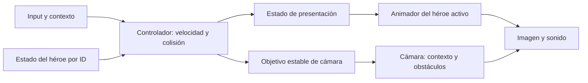

# OpenLara como segunda referencia para Oakhaven

18 de noviembre de 2026, America/Lima. Repositorio revisado: [XProger/OpenLara](https://github.com/XProger/OpenLara/tree/3b268ca4bf986c380f44a26ffd9218bf6d376249), commit `3b268ca4bf986c380f44a26ffd9218bf6d376249`. Se estudió principalmente el motor normal de `src/`, no la variante `src/fixed/`. DEMO-L-D no se modificó.

## Conclusión y dirección propuesta

OpenLara es una referencia especialmente útil para construir un personaje que **apoya, gira y actúa según el terreno y su estado corporal**. El código permite seguir cómo los datos de animación participan en el desplazamiento, cómo se eligen transiciones y cómo cámara y colisiones responden al contexto.

Mi propuesta para el modo 3D de Oakhaven es combinar la lectura espacial y el encuadre que observamos en Vice City con la disciplina de locomoción de OpenLara: cuerpo articulado, acciones con condiciones claras, contacto con el suelo, eventos temporales y cámara con corrección espacial. Esa combinación es una decisión de diseño para tu juego; no es una característica que se haya medido en una compilación conjunta.

El primer objetivo debería ser un tramo corto donde Thomas y Khaterine puedan avanzar, girar, detenerse, interactuar y combatir de forma legible. Esa prueba aporta más información que ampliar el mapa antes de resolver cómo se mueve y se ve el héroe.

## 1. Alcance: fuente disponible y demo pendiente

| Área | Qué se comprobó | Qué permanece sin comprobar |
|---|---|---|
| Identidad | Checkout fijado al commit indicado, con inventario y hashes de fuentes relevantes. | Correspondencia entre ese checkout y el ejecutable publicado en la web. |
| Personaje | Flujo de estados, muestreo de animación, velocidad del clip, colisión, fases de pie, salto y agarre en fuente. | Sensación de control, calidad visual de cada transición y ausencia de deslizamiento en una partida. |
| Cámara | Modos, objetivo del cuerpo, suavizado, trazado espacial, correcciones de altura y cinemáticas en fuente. | Encuadre real, fluidez, latencia y clipping de la demo servida. |
| Web | Código Emscripten, selección WASM/JavaScript, WebGL y callbacks de almacenamiento. | Arranque completo, rendimiento, guardado y recuperación probados en navegador. |
| REA | Intento de escenario sobre la URL oficial, con log de navegación y limpieza del proceso temporal. | No se llegó a capturar el juego ni se produjo un análisis de su runtime. |

El README enlaza `http://xproger.info/projects/OpenLara/`. El intento con REA registró un cambio a HTTPS y terminó con `net::ERR_BLOCKED_BY_CLIENT`, antes del estado inicial. El navegador integrado devolvió `net::ERR_SSL_VERSION_OR_CIPHER_MISMATCH` al abrir HTTPS. Estos resultados describen el acceso desde este entorno; no demuestran que el juego falle en todos los navegadores ni explican por sí solos la causa del servidor. No se modificaron protecciones del navegador.

Los registros están en [alcance-runtime.json](evidencias/alcance-runtime.json) y [rea-intento-demo.json](evidencias/rea-intento-demo.json). El segundo es el resultado fallido completo de la herramienta, con observación parcial de navegación; no se presenta como captura jugable ni como Evidence de un motor analizado.

La revisión ordinaria del repositorio se realizó con herramientas de lectura de código. REA se reservó para la pregunta de ejecución. No se ejecutaron los binarios incluidos ni se compiló el motor. Los archivos de datos que el build WASM pide precargar, como `level/1/TITLE.PSX`, no están en las rutas consultadas del checkout; el script por sí solo no constituye una demo autosuficiente.

## 2. Lo más valioso del personaje

### Movimiento y pose tienen una relación explícita

`Animation::getSpeed()` calcula una velocidad usando los datos `speed`, `accel` y el tiempo de la animación. Lara la utiliza en varias ramas de locomoción y después resuelve desplazamiento y colisión. Hay caminos especiales para otros medios, como el agua. [Velocidad del clip](https://github.com/XProger/OpenLara/blob/3b268ca4bf986c380f44a26ffd9218bf6d376249/src/animation.h#L202-L205), [velocidad de Lara](https://github.com/XProger/OpenLara/blob/3b268ca4bf986c380f44a26ffd9218bf6d376249/src/lara.h#L3455), [movimiento](https://github.com/XProger/OpenLara/blob/3b268ca4bf986c380f44a26ffd9218bf6d376249/src/lara.h#L3635).

Para Oakhaven, la lección es calibrar zancada, velocidad y apoyo como un conjunto. Con un controlador que sea la autoridad de desplazamiento, el animador puede recibir la velocidad real y ajustar su ritmo. Si una interacción usa desplazamiento conducido por animación, debe delimitarse para no sumar movimiento dos veces.

### Las transiciones tienen condiciones temporales

La animación consulta rangos de frames para cambiar de estado. Eso expresa una continuidad corporal deliberada, pero las ventanas deben diseñarse según el juego: exploración, ataque y esquiva no requieren necesariamente la misma capacidad de interrupción. Además, `setState()` puede devolver que el estado existe sin haber aplicado todavía una transición en esa llamada. [Transiciones](https://github.com/XProger/OpenLara/blob/3b268ca4bf986c380f44a26ffd9218bf6d376249/src/animation.h#L154-L199).

Propongo expresar para tus héroes un resultado `aplicado`, `diferido` o `rechazado`, con ventanas nombradas y un buffer de input cuando sea adecuado. El dominio debe validar la acción; el animador presenta su estado y emite eventos con identidad, sin otorgar daño o cambiar misiones por sí solo.

### El terreno y los pies participan en la decisión

El código distingue pie conductor y selecciona variantes para ciertos escalones e impactos. También condiciona salto y agarre a pose, espacio, apoyo y acciones. No se ha establecido un sistema IK universal ni apoyos perfectos en todos los casos. [Fase del pie](https://github.com/XProger/OpenLara/blob/3b268ca4bf986c380f44a26ffd9218bf6d376249/src/lara.h#L2814), [variantes de movimiento](https://github.com/XProger/OpenLara/blob/3b268ca4bf986c380f44a26ffd9218bf6d376249/src/lara.h#L3687).

Para el proyecto conviene definir una cápsula/controlador coherente, altura máxima de escalón, límites de pendiente y política de caída. Estos parámetros pertenecen al controlador, no deben deducirse accidentalmente de la ropa o del tamaño de una espada.

El detalle está en [PERSONAJE_Y_ANIMACION.md](PERSONAJE_Y_ANIMACION.md).

## 3. Lo más valioso de la cámara y del espacio

OpenLara distingue seguimiento, mirada, combate, cámara estática y cinemática. Calcula el punto observado a partir del cuerpo o la cabeza y corrige la posición respecto al espacio del nivel. Las cinemáticas pueden conservar cortes en lugar de interpolar indiscriminadamente entre encuadres distantes. [Interfaz](https://github.com/XProger/OpenLara/blob/3b268ca4bf986c380f44a26ffd9218bf6d376249/src/controller.h#L18-L46), [objetivo](https://github.com/XProger/OpenLara/blob/3b268ca4bf986c380f44a26ffd9218bf6d376249/src/camera.h#L127-L167), [corrección espacial](https://github.com/XProger/OpenLara/blob/3b268ca4bf986c380f44a26ffd9218bf6d376249/src/camera.h#L248-L353).

Para Oakhaven propongo un objetivo visual estable por héroe y perfiles de cámara por contexto. La posición del cuerpo, su orientación y la orientación de cámara deben conservar responsabilidades separadas. Un respawn o un cambio de plano necesita su propia política, distinta del seguimiento durante una carrera.

El motor organiza visibilidad mediante rooms y portales, con recortes de pantalla. Esto no equivale a descargar recursos según la distancia. Culling, simulación y carga/liberación de recursos deben tratarse por separado. Para una capilla, cripta o vivienda de Oakhaven, un grafo sencillo de espacios y accesos puede resultar suficiente antes de introducir un sistema completo de portales. [Visibilidad por portales](https://github.com/XProger/OpenLara/blob/3b268ca4bf986c380f44a26ffd9218bf6d376249/src/level.h#L2495-L2589).

El detalle está en [CAMARA_Y_ARQUITECTURA.md](CAMARA_Y_ARQUITECTURA.md).

## 4. Comparación con la referencia de Vice City

| Aspecto | Vice City: alcance de nuestra revisión anterior | OpenLara: alcance de esta revisión | Decisión propuesta para Oakhaven |
|---|---|---|---|
| Encuadre | Se observaron cuerpo completo, espacio por delante y cambios de cámara según contexto. | Se pudo seguir el cálculo de objetivo, modos y corrección espacial en fuente. | Mantener un héroe legible en pantalla y resolver explícitamente seguimiento, combate e interacción. |
| Locomoción | Se observaron poses y desplazamiento; no se recuperó el algoritmo interno del WASM. | Se siguió la cadena entre datos de animación, velocidad, estados y colisión. | Calibrar locomoción contra velocidad y terreno mediante recursos propios. |
| Controles | Se observó al usuario desplazándose y conduciendo. | El camino clásico de teclado está orientado por el personaje, con giros y ramas por contexto. | Decidir la política de input del proyecto antes de adoptar mecanismos. La tercera persona relativa a cámara es una propuesta para Oakhaven, no una descripción del control clásico de OpenLara. |
| Espacio | Se revisaron calles, costa, tráfico y el plano general. | El código establece rooms, sectores, portales y una carga de nivel separada. | Diseñar sectores reconocibles y conexiones útiles, con una pista de prueba interior/exterior. |
| Entrega web | Se estudió el cargador servido, con hashes contrastados para dos JavaScript y guardados separados de caché. | Se revisó la plataforma web en fuente; no se identificó el build público ejecutado. | Dar identidad a los builds, separar estados de caché/descarga/guardado y comunicar fallos recuperables. |

La primera revisión está en `C:/Kevin/investigaciones/gta-vice-city-web/`. Este documento resume sus conclusiones; las capturas de Vice City no se presentan como imágenes de OpenLara.

## 5. Críticas concretas y sus mejoras

### A. Error de caché con contexto nulo

En `onLoadAndStore()`, el código inicia `emscripten_idb_async_store()` pasando `NULL` como contexto, pero usa `onError`, que interpreta su argumento como `Stream*` y accede a él. El contrato oficial reenvía ese contexto al callback de error. Existe por tanto una ruta estática de desreferencia nula si falla esa escritura; no se reprodujo en una partida. [Código](https://github.com/XProger/OpenLara/blob/3b268ca4bf986c380f44a26ffd9218bf6d376249/src/platform/web/main.cpp#L19-L40), [contrato oficial de Emscripten](https://emscripten.org/docs/api_reference/emscripten.h.html#c.emscripten_idb_async_store).

**Mejora:** un error al persistir una descarga recuperable necesita un handler propio. Pasar el mismo `stream` tampoco sería una solución suficiente: `onLoad()` lo destruye tras iniciar la operación asíncrona. Usar un contexto independiente con vida útil explícita o un callback de error sin dependencia de ese objeto. Probar rechazo de IndexedDB con la red disponible.

**Aplicación:** en Oakhaven, distinguir «recurso descargado», «caché persistida» y «partida guardada». Un mensaje de éxito debe corresponder a la operación que realmente terminó.

### B. Recentrado asimétrico de mirada

El yaw que vuelve a cero usa la condición `lookAngle.y < EPS`. Un valor negativo la satisface incluso lejos de cero; uno positivo continúa interpolando. Para ±0,5 rad y dt de 1/30, la fórmula deja ±1/3 antes de aplicar ese umbral: el negativo pasa a cero. [Código](https://github.com/XProger/OpenLara/blob/3b268ca4bf986c380f44a26ffd9218bf6d376249/src/camera.h#L440-L445), [prueba aritmética guardada](evidencias/prueba-aritmetica-recentrado.json).

**Mejora:** comparar el valor absoluto, respetar el arco angular corto y ensayar ambos sentidos de giro. La prueba guardada evalúa esa fórmula; no ejecuta el motor ni mide la cámara de la demo.

**Aplicación:** comprobar giros izquierda/derecha y la frontera −π/π en tu cámara y en el cuerpo. Una única prueba de caminar hacia delante no detecta estas diferencias.

### C. Acoplamiento y contenido legado

Hay reglas ligadas a índices de animación, ventanas concretas y unidades del formato de nivel. Eso sirve al propósito de este motor, pero introducirlo directamente en Oakhaven trasladaría también esas dependencias.

**Mejora:** metadata semántica por clip y perfiles de movimiento en unidades documentadas. Mantener estado del héroe, controlador, animador y cámara con contratos explícitos. Traducir los principios al motor del proyecto y validar una zona propia.

### D. Reproducibilidad y verificación visual

Los scripts revisados no fijan por sí solos una versión del SDK y no establecen la identidad del ejecutable servido. Los archivos de datos precargados no están en las rutas comprobadas del checkout.

**Mejora:** para un producto propio, registrar commit, toolchain y hashes de entrega; probar arranque y persistencia del paquete publicado. En esta revisión, la sensación jugable de OpenLara permanece pendiente por el bloqueo de acceso a la demo. No se atribuyen al juego FPS, fluidez o ausencia de clipping sin esa evidencia.

## 6. Implementación propuesta en DEMO-L-D

El plan mantiene TypeScript, Phaser y Three.js como base actual. Son propuestas documentadas; no se instalaron motores ni se integró código o contenido del juego de referencia.

### Paso 1: identidad y estado por héroe

Consolidar el estado de Thomas y Khaterine por ID, separado de las mallas visibles. Guardar los cambios del mundo, validar el snapshot y comprobar persistencia antes de anunciar éxito. Resolver primero los problemas ya documentados en la revisión del proyecto evita que un cambio de personaje parezca funcionar visualmente mientras comparte vida o arma por accidente.

### Paso 2: cuerpo articulado y locomoción mínima

Preparar un modelo propio por héroe con escala, frente local, origen en pies, rig y puntos de arma coherentes. Empezar por reposo, caminar, correr, inicio/parada, giro, daño y las acciones de arma necesarias. Los PNG y láminas 3D entregados previamente no contienen un esqueleto ni estos clips.

El controlador resuelve desplazamiento y colisión; el animador recibe velocidad real, apoyo y acción. Ajustar el ritmo de los clips contra una distancia conocida. Añadir eventos de pie, contacto y fin de acción con identidad de instancia para evitar duplicados.

Flujo propuesto para Oakhaven, distinto de una reproducción literal del motor de OpenLara:

### Paso 3: cámara por contextos

Aplicar seguimiento, combate, interacción y cinemática con parámetros explícitos. Separar orientación del cuerpo y cámara, suavizar por tiempo y resolver obstáculos. El encuadre y los valores iniciales propuestos a partir de la observación de Vice City siguen documentados en el informe anterior; no son constantes recuperadas de OpenLara.

### Paso 4: pista de aceptación antes de ampliar contenido

Construir una zona con suelo plano, esquina, puerta, pendiente, escalón y un objetivo visible. Repetir con ambos héroes:

- Avanzar, girar 90°/180°, cruzar −π/π y detenerse.
- Cambiar orientación de cámara y comprobar la política de input elegida.
- Pasar por puerta/esquina sin que la cámara atraviese la pared.
- Atacar y recibir daño sin perder la pose base o duplicar eventos.
- Abrir un modal mientras se mantiene una tecla y soltarla fuera de la pestaña.
- Guardar y recargar después de una interacción y un cambio de héroe.
- Comparar el mismo input con pasos de 30, 60 y 120 Hz.

Solo después integrar más sectores y recursos. El objetivo de aceptación es una ruta completa y coherente, no una cifra de tamaño de mapa.

## 7. Documentos y evidencias

- [Personaje, locomoción y animación](PERSONAJE_Y_ANIMACION.md).
- [Cámara, arquitectura espacial y plataforma web](CAMARA_Y_ARQUITECTURA.md).
- [Identidad de las fuentes](evidencias/identidad-fuentes.json).
- [Resultado fallido del intento REA sobre la demo](evidencias/rea-intento-demo.json).
- [Límites de la comprobación en navegador](evidencias/alcance-runtime.json).
- [Prueba aritmética de recentrado](evidencias/prueba-aritmetica-recentrado.json).

Los enlaces a código fijan el commit revisado. La licencia de código declarada por el repositorio está copiada como [LICENSE_OpenLara.txt](LICENSE_OpenLara.txt). Esta revisión no incorpora modelos, texturas o niveles de Tomb Raider al paquete artístico propio.
