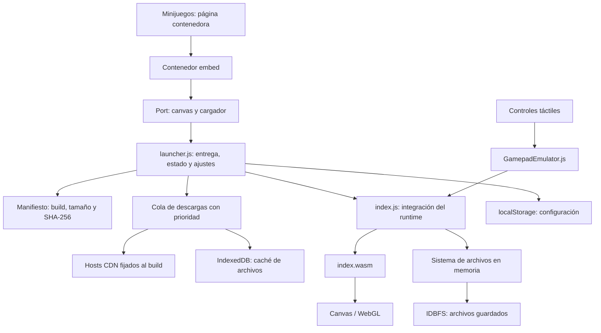

# GTA: Vice City en navegador — análisis técnico del port y aplicación a DEMO-L-D

Fecha: 18 de noviembre de 2026 (America/Lima).

Este documento examina el cargador y dos JavaScript públicos asociados a la versión abierta en Minijuegos. Es una revisión estática de los artefactos servidos. El recorrido jugable, las capturas del mapa y la comprobación del truco se documentan por separado. No se ha modificado DEMO-L-D.

La observación final del personaje a pie y la propuesta específica de locomoción/cámara están en [PERSONAJE_Y_CAMARA.md](PERSONAJE_Y_CAMARA.md). El registro distingue la partida del usuario de las pruebas del agente.

## 1. Qué sabemos y con qué grado de certeza

| Afirmación | Evidencia y alcance |
|---|---|
| La página declara la versión `1.1.3`. | `captura/release-metadata.json`, leído del DOM de la pestaña. Es una declaración del distribuidor. |
| La página enlaza `hackz00/gta_vicecity-webport-FIXED`. | Mismo JSON. El enlace no demuestra por sí solo que cada archivo de ese repositorio coincida con la versión ejecutada. No se ha auditado ese repositorio. |
| El manifiesto fija el build `796678be4ed26a13c1256be98781ca9b90beb981`. | `captura/manifest-resumen.json` y `launcher.js:11`. |
| `index.js` y `GamepadEmulator.js` descargados coinciden con el manifiesto. | Tamaño y SHA-256 calculados localmente; valores completos abajo. Esta comprobación vincula estos dos archivos al manifiesto observado, no verifica todos los recursos del catálogo. |
| Existe código de integración WebAssembly, WebGL, SDL y sistemas de archivos MEMFS/IDBFS. | Inspección del JavaScript entregado, más las funciones del cargador que lo configuran. Esto no equivale a decompilar el motor WebAssembly. |
| Hay separación explícita entre caché de recursos y archivos guardados. | Bases de datos y rutas distintas en `launcher.js:86`, `:325`, `:380`. Es un diseño observado en código; no se ha probado aquí la recuperación tras cerrar o recargar. |
| El catálogo declara 9.403 entradas y suma 1.005.369.603 bytes. | Agregado del manifiesto capturado. No es una medida de tráfico real, memoria necesaria, tamaño inicial obligatorio ni recursos únicos utilizados en una partida. |

### Identidad de los archivos capturados

| Archivo | Bytes | SHA-256 |
|---|---:|---|
| `captura/launcher.js` | 62.915 | `555c520634fc80341006f29a336a469ae7f126e415909e1f22db0dbe256f29ce` |
| `runtime/index.js` | 677.387 | `f0c3415357ead8705a464651e6a0d2c47e5667d573e3262cbacdc21004a5f331` |
| `runtime/GamepadEmulator.js` | 26.445 | `a30ae5c40b388892a3fd514ff6216ed46355ecc958cbdc8b2e267667ecc2e633` |

El manifiesto declara `index.wasm` de 7.625.729 bytes y SHA-256 `43bc3a05e12fe0b40049f0b3f8d6b05c9dc16bf84c856d03b0892ae7aaa87a99`. No se descargó ni decompiló ese archivo en esta revisión. El paquete inicial `index.data` está dividido en siete partes que suman 135.355.111 bytes según ese manifiesto; esa cifra tampoco representa el pico de memoria.

### Evidencia REA reutilizable

| ID de evidencia padre | Resultado |
|---|---|
| `ev_3e3e088a92b8157cc720b784f1218d339d8c1bee94a8c091d592be7952b53d5c` | Análisis estático del cargador, metadata y resumen del manifiesto, recuperado el 18 de noviembre. Un JavaScript parseado, cero fallos de parseo. Las relaciones semánticas conservan desconocidos; no prueba ejecución de cada rama. |
| `ev_959e20b972391cc269630aa0460a2ac07b4f337e8a7d2c5f6c4382d809694b1d` | Análisis estático seleccionado de `GamepadEmulator.js`; `index.js` quedó fuera de esa selección. |

Los dos registros padre y sus proyecciones se exportaron a `evidencias/rea-evidence-2026-11-18.json`. El cargador de la pestaña del día 18 conserva el mismo SHA-256 que la captura local; la comparación está en `evidencias/identidad-2026-11-18.json`. Un intento anterior de analizar el runtime completo se interrumpió por el límite de 30 segundos del proveedor, sin fuentes parseadas. La conexión se reinició entre días y ese registro parcial histórico no está en el bundle actual; no se usa para afirmar que REA comprendió el runtime completo.

Las referencias de línea siguientes corresponden a los archivos locales capturados. El cargador se extrajo de un script inline; sus líneas son las del archivo exportado, no números de línea del HTML original.

## 2. Arquitectura observada



La página anfitriona y el juego tienen responsabilidades distintas. Los menús, el mundo y el HUD que dibuja el canvas pertenecen al juego. El cargador web gestiona la entrega de archivos, los ajustes exteriores, el respaldo de guardados y la adaptación al navegador. No encontramos evidencia de que esta versión sea una escena hecha con Phaser o Three.js. El uso de WebAssembly y la integración generada son visibles en los artefactos; el lenguaje fuente y la implementación interna exacta del motor no se establecen mediante este análisis.

`configureModule()` proporciona el canvas, un paquete ya descargado, la localización de archivos, callbacks de inicialización, sincronización de configuración y una implementación propia de `instantiateWasm` (`launcher.js:456–477`). La integración cargada acepta esa implementación y utiliza los exports del módulo (`runtime/index.js:10241–10264`).

Los nombres `revc.ini`, los comentarios sobre reVCDOS y la ruta del repositorio aportan pistas de procedencia. No bastan para afirmar qué revisión de todo el motor original está dentro del WASM ni para reconstruir sus subsistemas de física, cámara, IA o streaming espacial.

## 3. Cómo carga y entrega los recursos

### Flujo de arranque

`play()` comprueba contexto seguro, WebAssembly y WebGL 2; carga estilo, `index.data` y `index.wasm`; prepara determinados recursos de introducción; configura el módulo; crea los controles táctiles y finalmente carga el runtime transformado (`launcher.js:502–523`). La pantalla de carga tiene estados explícitos. La condición de disponibilidad también contempla que los guardados hayan sido restaurados o que se haya comunicado su fallo (`:447–454`).

El estado `ready` del cargador indica que su runtime está listo. No debe confundirse con «todo el mapa, todos los sonidos y todas las misiones ya están descargados».

### Descargas verificadas y prioridades

El código establece:

- Cuatro trabajos simultáneos en la cola (`:87–93`).
- Cinco hosts configurados y URLs fijadas al build, con la forma `/gh/web-ports/vice-city@BUILD/ruta` (`:105–115`). No se verificó aquí la disponibilidad de cada host.
- Comprobación de respuesta HTTP, rechazo de HTML inesperado, tamaño exacto y SHA-256 antes de aceptar una descarga (`:157–182`).
- Clave de caché `BUILD/ruta` y validación de los blobs reutilizados (`:105`, `:116`, `:131–140`).
- Deduplicación de trabajos en curso y promoción de prioridades (`:184–210`).
- Interrupción de transferencias opcionales cuando un recurso de primer plano necesita el ancho de banda (`:98–104`, `:195–206`).
- Precarga de radios solo durante juego estable y sin tráfico prioritario reciente (`:217–224`, `:433–445`).

Esta es una buena lección para DEMO-L-D: la carga debe atender primero lo que permite jugar, después lo necesario para la siguiente zona, y finalmente lo opcional. Mostrar una barra mientras se descarga todo de una vez no sustituye esa planificación.

### Adaptación al runtime heredado

`AssetXHR` conserva XHR nativo para la entrega final de blobs, registra solicitudes pendientes y traduce errores. Solo interviene en ciertos GET de recursos reconocidos; solicitudes con credenciales, autorización, rangos u otros casos pasan al XHR nativo (`:263–317`). Una solicitud síncrona no preparada falla explícitamente (`:302`).

El cargador adapta una frontera concreta de `index.js` usando sustituciones de texto (`:479–498`). Verifica que cada marcador esperado aparezca exactamente una vez. Esto reduce el riesgo de aplicar silenciosamente un parche al archivo equivocado, pero hace frágil una actualización del runtime.

## 4. Guardado, caché y recuperación

Los recursos descargables se guardan en `vc-port-assets-v1`; los archivos de usuario viven bajo `/vc-assets/local/userfiles`. Borrar la caché usa exclusivamente la base de recursos (`:575`). La separación es correcta: liberar descargas recuperables no debería borrar el progreso.

`window.syncfs` serializa trabajos del montaje de guardados y comunica «restaurando», «guardando» y errores (`:380–397`). La observación de escrituras marca archivos sucios al cerrar, así como operaciones de renombrado o borrado (`:404–408`). El debounce de 500 ms y los reintentos cuando hay una sincronización activa evitan depender solo del momento de cierre (`:398–403`). También se intenta vaciar en `visibilitychange` y `pagehide` (`:620–621`). Su presencia en código no demuestra que un corte de proceso o un navegador que rechace almacenamiento preserve toda escritura.

La copia exportable contiene archivos guardados y configuración, con un formato y versión propios (`:353–359`, `:415–417`). La importación valida raíz de rutas, directorios, duplicados, codificación, tamaños, fechas y permisos de archivo (`:332–335`, `:360–377`). Exige el mismo build. Es una frontera de compatibilidad estricta, no una política de migración.

El propio mensaje de exportación habla de *saved slots*. No se ha establecido que la exportación guarde el instante completo de una sesión que aún no se haya escrito en un slot del juego.

## 5. Entrada, foco y controles

El cargador conserva las teclas y botones pulsados, los libera al perder el foco, al ocultarse la página y al abrir ajustes (`:547`, `:599–613`). Gestiona la promesa de pointer lock y comunica rechazos (`:616–618`). El objetivo visible en el código es evitar entradas atascadas y fallos silenciosos de captura del ratón.

Las teclas por defecto incluyen WASD/flechas, F o Enter para entrar/salir, V/Home para cámara, y bindings diferentes según acción (`:431`). Esto describe la configuración por defecto; el usuario puede tener otra configuración guardada. No constituye una prueba de que el control automatizado consiga enviar una tecla a través de los iframes.

La capa táctil crea un mando emulado con dos sticks y botones contextuales (`:631–735`). `GamepadEmulator.js` modifica la lectura de mandos para combinar estados; incluye umbral de botón y bucle basado en `requestAnimationFrame` (`runtime/GamepadEmulator.js:72`, `:124–127`, `:206–217`, `:558` en adelante). No hemos probado esa capa en un móvil ni la coexistencia con mandos físicos.

La dificultad del control automatizado en esta sesión es una limitación del ensayo. No demuestra por sí sola que el teclado de una persona falle en el port, ni identifica la causa en el código del juego.

## 6. Críticas con mejoras concretas

Las siguientes son revisiones de diseño respaldadas por el código. No se presentan como fallos observados durante el recorrido.

| Prioridad | Hallazgo y fundamento | Mejora de implementación | Cómo verificarla |
|---|---|---|---|
| Alta para mantenimiento | El runtime se transforma por cadenas exactas (`launcher.js:479–498`). Una modificación legítima del generador puede romper el arranque. | Llevar las adaptaciones a una API explícita o a un paso de build versionado. Mientras tanto, mantener fixtures del runtime fijado y verificar todos los marcadores antes de publicar. | El build rechaza un runtime incompatible; una prueba de arranque del archivo publicado confirma pantalla inicial, descarga y guardado. |
| Media para sesiones largas | `state.urls` retiene las Blob URLs de los recursos solicitados; `fileURL` las reutiliza sin liberación por zona (`:253–258`). No se prueba una fuga, pero no hay política de liberación visible en esa caché. | Definir propiedad y vida útil de recursos: núcleo permanente, zona activa, zonas vecinas y opcionales. Añadir leases/referencias y revocar una URL solo cuando ningún consumidor la usa. Coordinarlo con la caché y memoria propias del motor. | Recorrer varias zonas y volver al origen; la memoria llega a una meseta bajo un presupuesto, sin texturas ni audio rotos. |
| Media para almacenamiento | La expulsión recorre claves de IndexedDB y borra hasta liberar una cantidad; no clasifica por último uso ni prioridad (`:142–155`). | Guardar `lastUsedAt`, build, categoría y coste; expulsar primero versiones antiguas y opcionales sin uso. Proteger el núcleo y los recursos en uso. | Con cuota pequeña se liberan datos recuperables y el progreso sigue intacto; no se repite continuamente la descarga de un mismo recurso crítico. |
| Media para recuperación | Un fallo de un archivo penaliza un host durante 60 s y un error de ruta se conserva otros 60 s (`:157–210`). No se separan claramente HTTP 404, límite 429, timeout e integridad en la política de reintento. | Clasificar errores; aplicar tiempos según el tipo, atender `Retry-After` cuando proceda y permitir reintentar el recurso crítico desde la pantalla de recuperación. No concluir que todo el host está mal por una ruta ausente. | Simular por separado archivo inexistente, timeout, respuesta corrupta y caída de un host; cada uno termina o se recupera sin bucles excesivos. |
| Media para evolución | `validateBackup` exige igualdad de build (`:360–361`). Un cambio de distribución podría impedir importar una copia aunque el formato real del guardado siga siendo compatible. | Separar `saveSchemaVersion`, versión de contenido y build; mantener migraciones explícitas y rechazo claro para casos incompatibles. | Importar copias representativas de cada versión compatible y rechazar las incompatibles sin sobrescribir las actuales. |
| Media para experiencia | El código adapta el blur del runtime y permite ignorar su reacción a visibilidad cuando está listo (`:487–491`, `:610–611`). Libera entradas y difiere descargas, pero no expresa por sí mismo una política única de pausa de simulación/audio. | Documentar y aplicar una política de pausa a nivel de juego, distinta de liberar input. Menú, cambio de pestaña y pérdida de pointer lock deben tener una respuesta deliberada. | Cambiar de pestaña en conducción, combate y cinemática; verificar qué avanza, qué se pausa y qué ocurre al volver. |

También hay decisiones positivas que conviene conservar: errores de recursos críticos detienen la carga en vez de sustituir silenciosamente modelos o colisiones; el fallback de sonido se restringe a ciertos efectos/ambientes (`:30–37`, `:226–236`); y el intento de persistencia del navegador no bloquea la entrada al juego (`:502–513`). La ejecución de cada rama sigue pendiente de ensayo específico.

## 7. Qué debe adoptar DEMO-L-D y cómo

El valor de esta referencia es la organización de una experiencia espacial y su entrega robusta en navegador. Reutilizar su arquitectura de port no es una condición para lograrlo. DEMO-L-D ya utiliza TypeScript, Phaser y Three.js; conviene trabajar sobre esos límites existentes.

### A. Carga y propiedad de recursos

Crear un servicio de recursos que sea compartido por las presentaciones 2D y 3D. El manifiesto debería expresar ID estable, URL, tipo, versión, bytes y pertenencia a zona. El cargador debe distinguir `required`, `next-zone` y `optional`, deduplicar solicitudes y comunicar errores por recurso.

Propuesta de contrato, aún no implementada:

```ts
type AssetPriority = 'required' | 'next-zone' | 'optional';

interface AssetLease<T> {
  value: T;
  release(): void;
}

interface AssetRepository {
  acquire<T>(id: string, options: {
    priority: AssetPriority;
    signal?: AbortSignal;
  }): Promise<AssetLease<T>>;
}
```

Una instancia de escena adquiere y libera sus recursos; los compartidos duran mientras haya consumidores. Para Three.js la liberación debe alcanzar geometrías, materiales, texturas y audio propios cuando corresponda. Definir este contrato antes de introducir más GLB evita que cada objeto tenga una política distinta. Empezar con núcleo y una zona, sin añadir infraestructura de mundo abierto que todavía no se necesite.

### B. Input con contexto

La presentación 3D registra input global en `src/presentation/three/Oakhaven3DExperience.ts:1888–1895`, y las acciones de alternar héroe/cámara se procesan antes de ciertas guardas de modal (`:1897–1927`). Un servicio de input debe decidir primero el contexto: juego, diálogo, inventario, pausa o controles desactivados. Después traduce teclado, táctil o mando a acciones, sin escribir directamente en el dominio.

Implementar `releaseAll()` al perder foco, ocultarse la página, destruir la experiencia y abrir un modal bloqueante. Separar acciones continuas (`move`, `aim`) de acciones de un solo pulso (`interact`, `toggleCamera`); para estas últimas ignorar `KeyboardEvent.repeat`. Verificar mantener una tecla mientras se abre un modal y soltarla fuera de la pestaña, además de mantener Tab/C sin provocar alternancias repetidas.

### C. Guardado con esquema del juego

La experiencia 3D guarda héroe activo, estadísticas, inventario, progresión y visita al santuario (`Oakhaven3DExperience.ts:4670–4679`). `GameSaveManager.loadGame()` transforma el JSON por aserción de tipo sin validar su estructura (`src/infrastructure/storage/GameSaveManager.ts:56–63`). Su fallback de almacenamiento puede ser solo memoria (`:20–38`); `saveGame()` devuelve un booleano, pero el flujo 3D mostrado ya emite un mensaje de guardado antes de evaluar ese resultado (`Oakhaven3DExperience.ts:4658–4679`).

Tomar del port la separación entre recursos recuperables, ajustes y progreso. Mantener para DEMO-L-D un snapshot semántico propio con `schemaVersion`, héroes por ID, posición/checkpoint, estado del mundo, misiones, objetos recogidos, inventarios y progresión. No guardar objetos Three.js ni rutas internas de recursos como identidad del progreso. Validar, migrar y confirmar persistencia antes de anunciar éxito. Si se utiliza memoria temporal, mostrarlo como estado distinto.

Un pequeño guardado JSON no exige migrar inmediatamente a IndexedDB: el problema prioritario es completar y validar el estado. Unificar los escritores actuales y después elegir el adaptador de almacenamiento según los datos reales.

Prueba de aceptación: cambiar héroe, recoger un objeto, alterar una misión, guardar, recargar y comprobar tanto el personaje como el mundo; repetir con almacenamiento rechazado y con una copia de una versión anterior.

### D. Cámara y exploración

La cámara actual interpola con un factor fijo `0.08` y no utiliza el delta recibido (`Oakhaven3DExperience.ts:4716–4740`). Como mejora concreta, conservar una respuesta parecida a 60 Hz usando `alpha = 1 - Math.exp(-5 * deltaSeconds)` para la interpolación. Esta es una propuesta matemática de interpolación independiente del paso temporal, no una reproducción del algoritmo de Vice City.

Separar seguimiento, orientación del jugador, look-ahead y resolución de obstáculos. Antes de interpolar hacia una posición detrás del personaje, comprobar la trayectoria desde el punto de mirada y acercar la cámara ante una pared. Ensayar esquinas, puertas, pendientes y cambios de héroe. Comparar el mismo recorrido con pasos de 30, 60 y 120 Hz. El comportamiento de la cámara del port durante el vuelo debe añadirse solo cuando se observe.

### E. Mapa y dirección artística

Antes de ampliar el mapa, construir una zona compacta con un centro reconocible, caminos legibles, un hito visible desde lejos y transiciones de combate/exploración. Dar identidad a cada sector mediante siluetas, materiales, luz y sonido. Esta es una recomendación de diseño para el proyecto, no un resultado medido del recorrido aún pendiente.

El siguiente prototipo debería demostrar una ruta completa: aparecer, orientarse, llegar a un objetivo, combatir o interactuar, obtener una consecuencia persistente y regresar. Después medir si necesita más extensión. El modo de vuelo es útil para descubrir fronteras, vacíos y carga tardía; no sustituye comprobar la legibilidad desde la cámara habitual del jugador.

## 8. Orden recomendado de implementación

1. **Estado y guardado fiables.** Un único snapshot validado y mensajes de persistencia correctos. La salud por héroe y el estado del mundo siguen siendo requisitos previos a ampliar contenido.
2. **Input por contexto y cámara estable.** Evitar acciones detrás de modales y entradas atascadas; resolver obstáculos y suavizado temporal.
3. **Una zona terminada.** Integrar recursos propios y el paquete artístico ya entregado, con escala, colisiones, animaciones y navegación coherentes.
4. **Carga con prioridades y liberación.** Introducir leases, progresión de carga y límites de memoria según mediciones de esa zona.
5. **Ampliar con evidencia.** Crecer por zonas tras probar tiempos de entrada, memoria, estabilidad del guardado y claridad del recorrido.

Este orden no requiere cambiar de motor ni copiar recursos comerciales. No se ha iniciado ninguna de estas modificaciones en el repositorio.

## 9. Límites y ensayos pendientes

- El algoritmo interno de streaming espacial, LOD, física, cámara e IA permanece desconocido: no se inspeccionó el WASM ni se infiere a partir del nombre de un archivo.
- No se han medido FPS, tiempo de frame, consumo máximo de memoria, número de draw calls ni transferencia de la partida.
- Las cantidades del manifiesto son declarativas; el tráfico real puede reutilizar caché y pedir solo una parte del contenido.
- No se probó guardar, recargar, exportar/importar ni cambiar de build. El informe describe sus implementaciones estáticas.
- No se ensayaron táctil, mandos físicos, condiciones de cuota ni pérdida de WebGL.
- La activación y el vuelo con `COMEFLYWITHME`, el mapa recorrido y los efectos de cámara deben contrastarse con las capturas y observaciones jugables del informe principal.
- No se entregan recursos del juego como parte del paquete artístico propio. Los JavaScript guardados aquí son evidencia local de la revisión, no una recomendación de redistribución.

