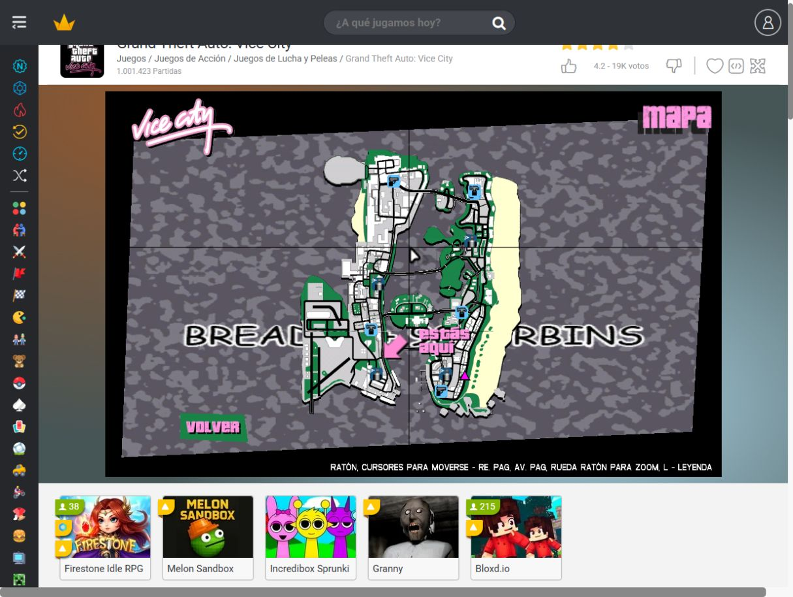
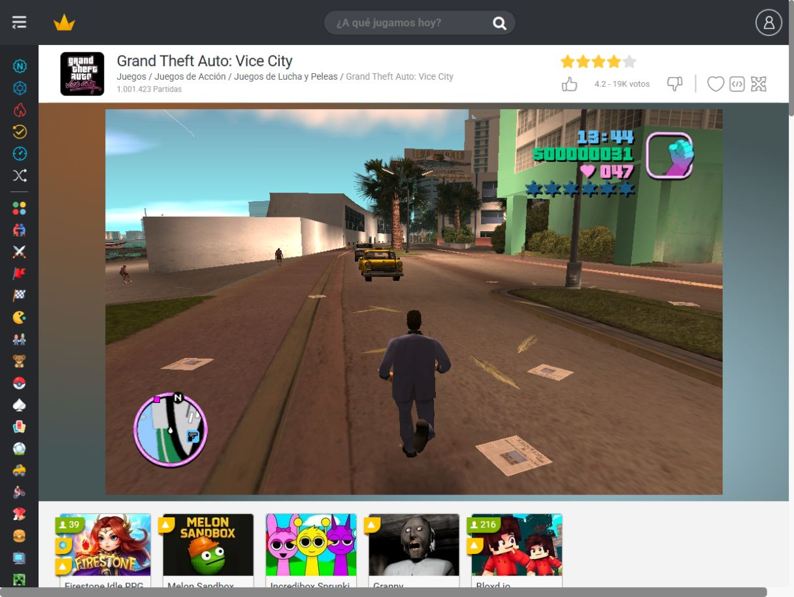
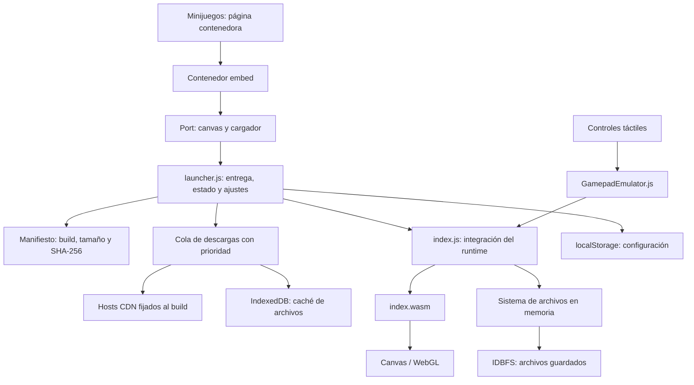

# Documentación completa — Vice City como referencia para Oakhaven

18 de noviembre de 2026. Revisión jugable, personaje y cámara, análisis técnico y registro de evidencias. Las propuestas están documentadas y no se aplicaron al código de DEMO-L-D.

# Vice City como referencia para The Light in the Darkness

Revisión del 18 de noviembre de 2026, America/Lima. Juego observado: [versión de Minijuegos](https://www.minijuegos.com/juego/gta-vice-city). El proyecto DEMO-L-D sigue en pausa y no se modificó su implementación.

## Conclusión

**Cierre de la revisión:** el usuario añadió un recorrido propio y una última prueba centrada en el personaje a pie. El resultado específico y su propuesta de implementación están en [Personaje, movimiento y cámara](PERSONAJE_Y_CAMARA.md); el registro cronológico está en [Observación de la partida](OBSERVACION_USUARIO.md).

La referencia aporta más por cómo organiza el espacio, la orientación y la actividad alrededor del jugador que por la extensión de su mapa. Para Oakhaven, propongo empezar por un sector compacto y reconocible, con cámara estable, acciones claras y consecuencias que se conserven al guardar. La extensión debe venir después de comprobar ese recorrido completo.

La parte técnica muestra una adaptación de un runtime WebAssembly al navegador, con carga verificada, prioridades y guardados separados de la caché. Es una referencia útil de entrega y recuperación; no establece que DEMO-L-D deba adoptar el motor ni la arquitectura interna de este port.

## Qué se probó realmente

| Pregunta | Resultado y límite |
|---|---|
| ¿Se abrió una partida? | Sí. Se observaron menú, introducción, personaje a pie, vehículos y HUD. |
| ¿Se jugó con controles automatizados? | Sí. Se envió aceleración, marcha atrás, dirección y pausa al canvas; el vehículo respondió una vez resuelto el problema de geometría de la entrada automatizada. |
| ¿Se activó `COMEFLYWITHME`? | El usuario informó que lo había introducido. No se conservó una confirmación visual del mensaje de activación. |
| ¿Se verificó el vuelo? | Parcial. Se observó un levantamiento bajo del carro durante el desplazamiento. No se consiguió un vuelo sostenido ni un recorrido aéreo de todo el mapa. No se puede atribuir ese movimiento de forma exclusiva al truco sin una comprobación adicional. |
| ¿Qué zonas se observaron? | Calle urbana con tráfico y peatones, entorno identificado en pantalla como Ocean Beach, frente de agua con muros, embarcaciones, puentes y siluetas de edificios. Esto no equivale a explorar todos los distritos. |
| ¿Se revisó todo el mapa? | Se abrió la vista general completa del mapa de pausa y se revisaron sus conexiones. Ver el plano completo no equivale a recorrerlo entero. |
| ¿Qué pasó durante las pruebas? | Hubo colisiones y una transición al hospital; después se observó un vehículo sobre el agua y finalmente su inmersión. Parte de los cambios iniciales ocurrió mientras había control compartido, por lo que no se atribuyen todos a las acciones del agente. |
| ¿Hubo carga durante el recorrido? | Sí. Dos capturas muestran pantallas negras con barra de progreso y rutas de modelos/texturas. No se midió cuánto duró cada interrupción ni la tasa de fallos del streaming. |
| ¿Se probaron misiones, combate o guardados? | No de forma sistemática. El informe técnico de guardado se basa en código, no en una prueba de guardar y recargar. |

La entrada automatizada tuvo dificultades con el foco y las coordenadas fraccionarias de los iframes. Una vista temporal de 1280 × 900 permitió sostener teclas; se restauró el tamaño normal al finalizar. Esta dificultad pertenece al ensayo y no demuestra un defecto del teclado usado por una persona.

Al concluir la fase de control del agente, la pestaña se dejó en el mapa de pausa. Antes de pausar, el último vehículo estaba sumergiéndose. No se escribió un slot de guardado manual durante esa prueba. Después el usuario retomó la partida para una fase adicional de observación sin controles del agente, recogida en [OBSERVACION_USUARIO.md](OBSERVACION_USUARIO.md).

## Lectura del diseño y mejoras para tu proyecto

### 1. El mapa tiene estructura, no solo superficie

En el plano general se distinguen dos grandes masas urbanas alargadas, islas intermedias, varias conexiones por puentes y una franja de playa continua en un borde. Las calles forman redes y bucles. El agua separa zonas y vuelve reconocibles los pasos entre ellas.

**Aplicación propuesta:** dividir Oakhaven en tres sectores iniciales con identidad propia y conectarlos mediante accesos legibles. Por ejemplo: plaza/santuario, barrio de viviendas y borde de bosque. Cada sector necesita un punto reconocible, una ruta principal, una alternativa y una razón jugable para visitarlo. Los nombres son una propuesta para diseñar el prototipo, no lugares observados en Vice City.

**Cómo implementarlo:** definir IDs de zona y una lista explícita de conexiones; construir un recorrido cerrado de ida y vuelta; colocar un hito visible antes de decorar caminos secundarios. Mostrar en el mapa el objetivo activo, el jugador y los accesos conocidos con símbolos distintos.

**Cómo evaluarlo:** hacer el recorrido desde la cámara habitual, sin mapa al principio, y registrar dónde se pierde la orientación. La vista aérea sirve para detectar vacíos, pero la legibilidad debe comprobarse a nivel del personaje.

### 2. La identidad visual se construye con varias capas

En las escenas observadas se combinan fachadas, palmeras, farolas, luces de vehículos, agua y edificios al fondo. Las vistas de noche y atardecer cambian la lectura del mismo entorno. La distancia se reconoce por siluetas y masas de color sin que cada objeto lejano necesite detalle fino.

**Aplicación propuesta:** escoger para cada sector de Oakhaven una combinación de silueta, material dominante, luz y ambiente sonoro. Una plaza puede leerse por un volumen central; un bosque, por copas y claros; una zona hostil, por formas y contraste propios. El objetivo es que el jugador reconozca dónde está antes de leer una etiqueta.

**Cómo implementarlo:** fijar escala y paleta por sector; limitar la cantidad de materiales; reservar el mayor contraste para rutas, amenazas y objetos interactivos. Integrar los recursos artísticos propios ya entregados en una zona de prueba antes de producir más contenido.

**Crítica:** más detalle no resuelve una composición confusa. Mantener un presupuesto de objetos y elegir qué debe dominar cada vista.

### 3. La actividad ambiental sostiene la sensación de lugar

Se observaron peatones y tráfico mientras el vehículo estaba detenido. Hay movimiento independiente del protagonista, y los faros y personajes aportan referencias de escala.

**Aplicación propuesta:** añadir pocas rutinas ambientales comprensibles: un habitante que recorre la plaza, una criatura en un borde de camino o un objeto que reacciona a una interacción. No hace falta simular una ciudad entera para que Oakhaven parezca habitado.

**Cómo implementarlo:** separar entidades ambientales de enemigos y objetivos de misión; activar su simulación por distancia/zona; reutilizar estados simples como reposo, desplazamiento y reacción. Guardar únicamente los cambios que deban tener consecuencias persistentes.

**Cómo evaluarlo:** detener al jugador y comprobar si el lugar conserva actividad; verificar que esa actividad no tape amenazas ni objetivos. No se infiere del port qué algoritmo usa su IA.

### 4. La cámara y el HUD forman parte de la navegación

La conducción ofrece una vista detrás del vehículo, con cambios de encuadre durante marcha atrás, giros y colisiones. El radar conserva referencias de calles, agua e iconos. El HUD agrupa tiempo, dinero, salud y otros estados en una esquina, dejando el centro para el mundo.

**Aplicación propuesta:** dar a Oakhaven modos explícitos de cámara para exploración, combate, interacción y pausa. Mantener una representación estable del héroe activo, su vida y el objetivo. Una cámara que funciona al caminar también debe probarse cerca de paredes, puertas y obstáculos.

**Cómo implementarlo:** usar suavizado dependiente del delta, resolver obstáculos entre el objetivo y la posición de cámara y decidir qué contexto consume cada acción. Los puntos concretos del código actual están en el [análisis técnico](ANALISIS_TECNICO.md), apartados 7B y 7D.

**Crítica:** un plano de mapa lleno de iconos no garantiza orientación. Priorizar los símbolos útiles para la tarea actual y ofrecer una leyenda legible. En esta sesión se observó el mapa general, pero no se confirmó que la tecla de leyenda cambiara su presentación.

### 5. La carga de recursos puede interrumpir la exploración

Las capturas guardadas muestran una pantalla de carga con rutas como `MODELS/GTA3.IMG/LOD_beacon2_dy.dff` y otra con `MODELS/GTA3.IMG/predator.txd`. Esto confirma interrupciones visibles en esta sesión. El nombre `LOD` por sí solo no establece cómo decide el motor cargar o simplificar la geometría.

**Aplicación propuesta:** anticipar los recursos de la zona siguiente y mantener disponible el sector actual hasta completar la transición. Si falta un recurso crítico, comunicar qué ocurre y ofrecer recuperación. Separar los recursos necesarios para jugar de audio y decoración opcionales.

**Cómo implementarlo:** manifiesto versionado, cola con prioridades, deduplicación, cancelación y propietario de cada recurso. Medir la ruta real de entrada a una zona antes de elegir tamaños de paquetes o radios de precarga. El contrato propuesto está en el apartado 7A del documento técnico.

**Crítica:** el catálogo declara aproximadamente 1 GB de archivos, pero esa suma no describe la descarga inicial, la memoria ni el tráfico observado. No trasladar esa magnitud a Oakhaven como objetivo.

### 6. Las consecuencias deben sobrevivir al guardado

La sesión mostró daño, colisión, hospital y cambio de ubicación. No se investigó la máquina de estados interna que produce esas transiciones. La lección de diseño para tu juego es que el mundo debe responder de forma coherente y conservar las consecuencias que importan.

**Aplicación propuesta:** antes de ampliar el mapa, unificar el snapshot de héroes, inventario, misiones y cambios del mundo. Mostrar «guardado» después de comprobar la persistencia. El estado de cada héroe debe pertenecer a su ID, y cambiar de presentación no debe reconstruir el progreso con valores por defecto.

**Cómo evaluarlo:** recoger un objeto, cambiar de héroe, resolver una interacción, guardar y recargar; comprobar personaje y mundo. Repetir con el almacenamiento rechazado. Las limitaciones encontradas en DEMO-L-D se explican con líneas de código en el documento técnico.

## Prioridad de trabajo propuesta

| Orden | Entregable verificable |
|---|---|
| 1 | Estado por héroe y guardado completo, validado y con errores visibles. |
| 2 | Cámara estable e input por contexto, con liberación de teclas al perder foco. |
| 3 | Un sector de Oakhaven terminado: escala, colisiones, animaciones, orientación y una interacción completa. |
| 4 | Carga anticipada y liberación de recursos medidas sobre ese recorrido. |
| 5 | Segundo sector con identidad distinta y una conexión significativa al primero. |

Esta propuesta está documentada; no se ha empezado a implementarla. La comparación con el segundo juego todavía puede cambiar las decisiones de diseño.

## Evidencias y documentación

- [Análisis técnico, contratos y críticas con mejoras](ANALISIS_TECNICO.md).
- [Personaje, movimiento y cámara: especificación para Oakhaven](PERSONAJE_Y_CAMARA.md).
- [Observación posterior de la partida del usuario](OBSERVACION_USUARIO.md).
- [Mapa general observado](evidencias/mapa-revisado.jpg).
- [Primera pantalla de carga intermedia](evidencias/carga-intermedia-01.jpg).
- [Segunda pantalla de carga intermedia](evidencias/carga-intermedia-02.jpg).
- [Personaje junto a vehículo](evidencias/personaje-junto-vehiculo.jpg).
- `evidencias/identidad-2026-11-18.json`: comparación del cargador vivo con la captura local.
- `evidencias/rea-evidence-2026-11-18.json`: registros estáticos exportados de REA y sus límites.

Las capturas registran la versión comercial alojada en la web como material de revisión. No son sprites, texturas ni modelos para integrar en el paquete artístico propio del proyecto.




---

# Personaje, movimiento y cámara: referencia para el modo 3D de Oakhaven

18 de noviembre de 2026, America/Lima. Este documento cierra la observación solicitada del personaje a pie. Describe las imágenes de la partida del usuario y las convierte en una propuesta de implementación para DEMO-L-D. Las decisiones propuestas no se han aplicado al código.

## 1. La referencia que conviene conservar

La impresión visual es de una cámara cercana que acompaña al personaje desde atrás. El cuerpo completo permanece visible en la zona baja del encuadre y queda espacio por delante para leer el camino. La orientación del cuerpo y las poses de las piernas permiten distinguir el avance del reposo. El personaje conserva una escala reconocible frente a peatones, vehículos, aceras y puertas.

Para el modo 3D de Oakhaven, el objetivo sería esa relación entre cuerpo y entorno: un héroe con volumen y una locomoción legible, seguido por una cámara que ayuda a avanzar y girar. El estilo gótico, las proporciones de Thomas y Khaterine y sus animaciones deben seguir siendo propios del proyecto.

### Qué muestran las capturas finales

| Evidencia | Observación | Límite |
|---|---|---|
| [Personaje 01](evidencias/personaje-camara-01.jpg) | Presentación del traje con plano bajo y franjas negras. | Es un encuadre de secuencia, no la cámara habitual de desplazamiento. |
| [Personaje 02](evidencias/personaje-camara-02.jpg) | Cuerpo entero visto desde atrás en la calle; texto de objetivo y HUD visibles. | Una pose aislada no establece la transición de parada. |
| [Personaje 04](evidencias/personaje-camara-04.jpg) | Pose inclinada, extremidades extendidas y una pierna elevada. | No se identifica con certeza si procede de salto, impacto u otra acción; no se usa como ejemplo de carrera normal. |
| [Personaje 05](evidencias/personaje-camara-05.jpg) | Pose con rodilla elevada durante el recorrido; el espacio delante del personaje sigue visible. | No se determina la fase exacta de la animación ni su duración. |
| [Personaje 06](evidencias/personaje-camara-06.jpg) | Pose de carrera legible, brazos flexionados y una pierna atrás; cuerpo en el tercio inferior/central. | No se midieron velocidad, latencia ni contacto de pie frame a frame. |
| [Personaje 07](evidencias/personaje-camara-07.jpg) | Carrera con cambio de orientación junto al borde de césped y costa; se ve la silueta completa y el camino. | No permite recuperar el algoritmo ni el tiempo de reacción de la cámara. |

En las dos últimas imágenes, la altura aparente del personaje ronda dos quintos de la altura del área jugable. Es una estimación visual del encuadre, no una medición del FOV o de la distancia del motor.

### Cómo se siente visualmente la cámara

- **Cercana:** el héroe tiene suficiente tamaño para reconocer ropa, postura y dirección.
- **Orientada al recorrido:** el personaje queda por debajo del centro y el escenario conserva profundidad por delante.
- **Contextual:** los encuadres observados de cinemática, desplazamiento a pie y vehículo son diferentes.
- **Anclada al cuerpo:** durante las capturas del avance, la escala del personaje cambia poco aunque cambie el entorno.

La revisión usa capturas puntuales, no vídeo continuo. Por eso esta lectura de composición no confirma fluidez, latencia, microvibraciones, deslizamiento de pies ni el comportamiento ante todas las paredes. Tampoco establece cómo decide el port recentrar la cámara.

## 2. Qué mejoraría al trasladarlo a Oakhaven

La prioridad es lograr una locomoción corporal convincente y una relación clara entre dirección, cámara y controles. Añadir detalle al modelo sin resolver esos tres aspectos mantendría la sensación de un objeto que se desplaza por el suelo.

### Locomoción con estados y apoyos

Usar estados de presentación explícitos: `idle`, `walk`, `run`, `start`, `stop`, `turn`, `attack`, `dodge` y `hit`. Añadir salto/caída solo si el diseño realmente incluye esas acciones. Las poses deben comunicar qué está haciendo el héroe y qué acciones siguen disponibles.

Para Thomas, la espada, la túnica y el torso deberían acompañar el cambio de peso sin ocultar las piernas o la dirección de ataque. Para Khaterine, el arco y la ropa pueden dar otra silueta, manteniendo la misma claridad de apoyo y desplazamiento. Las diferencias de personalidad no deben alterar accidentalmente escala, colisión o estado del héroe.

El controlador de movimiento debe ser la autoridad del desplazamiento inicial. La animación recibe la velocidad real y ajusta su ritmo; así se puede calibrar una zancada contra una distancia conocida. Si más adelante se adopta root motion, debe existir una sola autoridad de movimiento y una política definida para colisiones y combate.

No se necesita copiar la rigidez visual de una animación antigua. Propondría transiciones cortas y legibles, giro de torso/cadera coherente y frenadas con apoyo visible. No se afirma que estos defectos se hayan medido en Vice City; son objetivos de calidad para el proyecto.

### Dirección del jugador y orientación de cámara independientes

En tercera persona, mantener separados:

1. La intención de movimiento del input.
2. La dirección de desplazamiento permitida por el mundo.
3. La orientación del cuerpo.
4. La orientación de la cámara.

Para el modo de exploración propuesto, WASD se convierte a una dirección sobre el plano del suelo usando la orientación de la cámara. El personaje gira hacia el movimiento; la cámara puede acompañarlo con una política de recentrado deliberada. En combate puede haber una política distinta de orientación o fijación de objetivo.

Evitar que cada giro de cuerpo fuerce de inmediato una órbita completa de cámara. También evitar mover al héroe antes de comprobar qué contexto consume el input: diálogo, menú, pausa o juego.

### Seguimiento de posición, mirada y obstáculos

Suavizar de forma independiente la posición y el punto de mirada. Incorporar una pequeña anticipación en la dirección de avance, que vuelva suavemente a cero al detenerse. Esa anticipación debe ayudar a ver el camino sin sacar al personaje del encuadre.

Para paredes, comprobar el volumen entre el punto de mirada y la posición deseada de cámara; un barrido con volumen es más robusto que un único rayo central. Acercar la cámara al encontrar un obstáculo y recuperar la distancia de forma gradual al despejarse. Definir qué capas bloquean cámara: una pared, un personaje, una hoja o un efecto no tienen necesariamente la misma función.

Los cambios de héroe, teleport, respawn y cinemática necesitan una política propia. Un teleport no debe obligar a la cámara a recorrer el mapa lentamente para alcanzar al personaje.

## 3. Puntos concretos del código actual

Fuente local: `C:/Kevin/DEMO-L-D/src/presentation/three/Oakhaven3DExperience.ts`, checkout con HEAD `5a5f3ca970e24ad47f453b0d1d52105d6d8f5817`. Las referencias se revisaron durante la redacción; no constituyen una prueba de comportamiento de una compilación nueva.

| Punto | Lo que expresa el código | Cambio propuesto |
|---|---|---|
| `createPlayer`, desde línea 660 | Construye los héroes con grupos y mallas primitivas; el torso de Thomas se asigna a `playerBody`. | Introducir un adaptador de presentación por héroe para modelo, rig, clips, puntos de arma y altura de referencia. |
| `updatePlayer`, línea 3722 | WASD produce un vector en ejes globales X/Z. | En el modo de tercera persona, convertir la intención a ejes de la cámara proyectados al suelo. Conservar una política separada para la vista oblicua. |
| `updatePlayer`, línea 3728 | La velocidad planar se asigna directamente según el estado armado. | Definir aceleración y frenada como parámetros del controlador y entregar la velocidad real al animador. Mantener la respuesta del combate como restricción de diseño. |
| `updatePlayer`, línea 3736 | Interpola ángulos con un factor fijo `0.2`. | Interpolar por el arco angular más corto y con respuesta dependiente del delta; comprobar la frontera entre −π y π. |
| `updatePlayer`, línea 3739 | La señal de carrera inclina el torso con un seno. | Sustituir esa señal principal por locomoción con piernas y brazos animados. Aplicar la presentación al héroe activo, sin animar por accidente una malla oculta. |
| `updatePlayer`, línea 3741 | La frenada multiplica la velocidad por `0.7` cada frame. | Expresar la pérdida de velocidad por tiempo; comprobar la misma distancia de frenada con distintos pasos de simulación. |
| `updateCamera`, línea 4730 | El offset detrás de la cámara se rota con `playerGroup.rotation`. | Separar el yaw de cámara del yaw del cuerpo y definir cuándo se recentra. |
| `updateCamera`, línea 4739 | La posición usa `lerp(..., 0.08)` y la mirada se aplica directamente. | Usar suavizado temporal para posición y objetivo, más resolución de obstáculos. |

### Convención de ejes que hay que verificar primero

El movimiento calcula `atan2(inputDir.x, inputDir.z)`, mientras varias acciones usan un vector local frontal `(0, 0, -1)` y la cámara usa un offset con Z positivo. El modelo primitivo también coloca detalles en Z positivo. Estas expresiones requieren una convención coherente antes de calibrar la cámara o integrar un GLB; no se afirma aquí haber reproducido en ejecución una inversión concreta.

Propuesta: fijar `−Z` como frente del controlador y adaptar cada modelo dentro de un nodo visual hijo. Así, corregir el eje de un archivo importado no cambia la dirección de ataque ni la cámara. La orientación del controlador para una dirección planar `(x, z)` debe respetar esa convención; para frente local `−Z`, el yaw objetivo corresponde a `atan2(-x, -z)`.

## 4. Contrato de implementación propuesto

```ts
type LocomotionState = 'idle' | 'walk' | 'run' | 'start' | 'stop' | 'turn';

interface CharacterPresentationState {
  heroId: string;
  speed: number;
  grounded: boolean;
  facingYaw: number;
  locomotion: LocomotionState;
  action: 'none' | 'attack' | 'dodge' | 'hit';
}

interface FollowCameraSettings {
  distance: number;
  height: number;
  targetHeight: number;
  positionResponse: number;
  lookResponse: number;
  recenterResponse: number;
  lookAhead: number;
}
```

Son contratos de diseño, no interfaces ya añadidas al repositorio. El dominio conserva estadísticas e identidad; el controlador resuelve movimiento; el animador presenta el resultado; la cámara observa un objetivo estable. El animador no debe guardar vida o inventario ni decidir por sí mismo la posición del héroe.

Orden de actualización propuesto:

```text
Input y contexto
  → intención de movimiento relativa a cámara
  → aceleración, desplazamiento y colisiones
  → orientación del controlador por el arco corto
  → estado de presentación y mezcla de animaciones
  → objetivo de cámara, obstáculos y suavizado
  → render y HUD
```

Para suavizar una magnitud con una respuesta `k` por segundo:

```text
alpha = 1 − exp(−k × deltaSeconds)
valor = valor + (objetivo − valor) × alpha
```

En un ángulo, primero obtener la diferencia corta con `atan2(sin(diferencia), cos(diferencia))`. Esta fórmula no sustituye el tratamiento de teleport, colisiones o límites de cámara.

### Valores iniciales para un prototipo

Estos valores son propuestas propias para probar, no parámetros recuperados de Vice City. La altura `H` corresponde al héroe de pie.

| Parámetro | Punto de partida |
|---|---|
| Altura aparente del cuerpo | Aproximadamente 35–45 % de la altura jugable, con pies y cabeza visibles en movimiento normal. |
| Distancia de cámara | Alrededor de `2.6 × H`, ajustada según el FOV y el encuadre real. |
| Altura de cámara sobre los pies | Alrededor de `1.45 × H`. |
| Altura del punto de mirada | Alrededor de `0.65 × H`. |
| FOV vertical | Probar cerca de 48–55°; el proyecto ya crea una cámara con 48° en línea 249. |
| Respuesta de posición | Empezar en `5 s⁻¹`, cercana a la respuesta del factor 0.08 a 60 Hz, y ajustar con el recorrido. |
| Anticipación de mirada | Probar `0.3–0.6 × H` en avance, reduciéndola al parar. |

Calibrar primero en un espacio con suelo, una puerta, un peatón de referencia y una esquina. Después comprobar combate y zonas estrechas. Un valor que se ve bien en una plaza puede fallar junto a una pared.

## 5. Qué recursos hacen falta

Los PNG, iconos, sprites y láminas 3D entregados anteriormente siguen siendo recursos para sus usos previstos. Las láminas de referencia 3D no contienen malla, esqueleto ni clips de animación.

Para el resultado de cuerpo completo observado en esta referencia, el modo 3D necesita un modelo propio articulado y animaciones de locomoción. Un siguiente paquete de modelado debería especificar: escala, frente local, punto de origen en los pies, esqueleto consistente, clips necesarios y puntos de sujeción de espada/arco. Los modelos de Thomas y Khaterine pueden compartir convenciones sin perder su silueta.

Para el modo 2D, la misma lógica de estado y velocidad puede conducir los sprites. La perspectiva y el volumen vistos en la referencia pertenecen a su presentación 3D y requieren una solución visual correspondiente.

## 6. Cómo aceptar el cambio antes de ampliar el mapa

1. **Avance y parada:** caminar, correr y detenerse en una distancia conocida; comprobar apoyo, escala y que el ritmo de animación corresponde al desplazamiento.
2. **Giros:** hacer giros de 90° y 180°, además de cruzar −π/π; el personaje no da una vuelta larga por la interpolación y la cámara conserva orientación útil.
3. **Cámara y control:** orientar la cámara y repetir WASD; la dirección sigue la política elegida, sin confundir ejes globales con ejes de cámara.
4. **Obstáculos:** acercarse a una esquina y pasar por una puerta; la cámara evita atravesar paredes y recupera su distancia sin un salto brusco.
5. **Héroes y contextos:** repetir con ambos héroes, diálogo, inventario, daño y esquiva; no se alteran vida, arma o identidad al cambiar de presentación.
6. **Paso temporal:** repetir el mismo input con pasos de 30, 60 y 120 Hz; comparar recorrido, giro y frenada, en lugar de juzgar solo una grabación a una tasa.

La observación de Vice City terminó después del tramo a pie solicitado por el usuario. Quedan documentados tanto el objetivo visual como los límites de la evidencia. No se implementaron cambios, no se midió rendimiento del port y no se presenta el vuelo completo como verificado.




---

# GTA: Vice City en navegador — análisis técnico del port y aplicación a DEMO-L-D

Fecha: 18 de noviembre de 2026 (America/Lima).

Este documento examina el cargador y dos JavaScript públicos asociados a la versión abierta en Minijuegos. Es una revisión estática de los artefactos servidos. El recorrido jugable, las capturas del mapa y la comprobación del truco se documentan por separado. No se ha modificado DEMO-L-D.

La observación final del personaje a pie y la propuesta específica de locomoción/cámara están en [PERSONAJE_Y_CAMARA.md](PERSONAJE_Y_CAMARA.md). El registro distingue la partida del usuario de las pruebas del agente.

## 1. Qué sabemos y con qué grado de certeza

| Afirmación | Evidencia y alcance |
|---|---|
| La página declara la versión `1.1.3`. | `captura/release-metadata.json`, leído del DOM de la pestaña. Es una declaración del distribuidor. |
| La página enlaza `hackz00/gta_vicecity-webport-FIXED`. | Mismo JSON. El enlace no demuestra por sí solo que cada archivo de ese repositorio coincida con la versión ejecutada. No se ha auditado ese repositorio. |
| El manifiesto fija el build `796678be4ed26a13c1256be98781ca9b90beb981`. | `captura/manifest-resumen.json` y `launcher.js:11`. |
| `index.js` y `GamepadEmulator.js` descargados coinciden con el manifiesto. | Tamaño y SHA-256 calculados localmente; valores completos abajo. Esta comprobación vincula estos dos archivos al manifiesto observado, no verifica todos los recursos del catálogo. |
| Existe código de integración WebAssembly, WebGL, SDL y sistemas de archivos MEMFS/IDBFS. | Inspección del JavaScript entregado, más las funciones del cargador que lo configuran. Esto no equivale a decompilar el motor WebAssembly. |
| Hay separación explícita entre caché de recursos y archivos guardados. | Bases de datos y rutas distintas en `launcher.js:86`, `:325`, `:380`. Es un diseño observado en código; no se ha probado aquí la recuperación tras cerrar o recargar. |
| El catálogo declara 9.403 entradas y suma 1.005.369.603 bytes. | Agregado del manifiesto capturado. No es una medida de tráfico real, memoria necesaria, tamaño inicial obligatorio ni recursos únicos utilizados en una partida. |

### Identidad de los archivos capturados

| Archivo | Bytes | SHA-256 |
|---|---:|---|
| `captura/launcher.js` | 62.915 | `555c520634fc80341006f29a336a469ae7f126e415909e1f22db0dbe256f29ce` |
| `runtime/index.js` | 677.387 | `f0c3415357ead8705a464651e6a0d2c47e5667d573e3262cbacdc21004a5f331` |
| `runtime/GamepadEmulator.js` | 26.445 | `a30ae5c40b388892a3fd514ff6216ed46355ecc958cbdc8b2e267667ecc2e633` |

El manifiesto declara `index.wasm` de 7.625.729 bytes y SHA-256 `43bc3a05e12fe0b40049f0b3f8d6b05c9dc16bf84c856d03b0892ae7aaa87a99`. No se descargó ni decompiló ese archivo en esta revisión. El paquete inicial `index.data` está dividido en siete partes que suman 135.355.111 bytes según ese manifiesto; esa cifra tampoco representa el pico de memoria.

### Evidencia REA reutilizable

| ID de evidencia padre | Resultado |
|---|---|
| `ev_3e3e088a92b8157cc720b784f1218d339d8c1bee94a8c091d592be7952b53d5c` | Análisis estático del cargador, metadata y resumen del manifiesto, recuperado el 18 de noviembre. Un JavaScript parseado, cero fallos de parseo. Las relaciones semánticas conservan desconocidos; no prueba ejecución de cada rama. |
| `ev_959e20b972391cc269630aa0460a2ac07b4f337e8a7d2c5f6c4382d809694b1d` | Análisis estático seleccionado de `GamepadEmulator.js`; `index.js` quedó fuera de esa selección. |

Los dos registros padre y sus proyecciones se exportaron a `evidencias/rea-evidence-2026-11-18.json`. El cargador de la pestaña del día 18 conserva el mismo SHA-256 que la captura local; la comparación está en `evidencias/identidad-2026-11-18.json`. Un intento anterior de analizar el runtime completo se interrumpió por el límite de 30 segundos del proveedor, sin fuentes parseadas. La conexión se reinició entre días y ese registro parcial histórico no está en el bundle actual; no se usa para afirmar que REA comprendió el runtime completo.

Las referencias de línea siguientes corresponden a los archivos locales capturados. El cargador se extrajo de un script inline; sus líneas son las del archivo exportado, no números de línea del HTML original.

## 2. Arquitectura observada



La página anfitriona y el juego tienen responsabilidades distintas. Los menús, el mundo y el HUD que dibuja el canvas pertenecen al juego. El cargador web gestiona la entrega de archivos, los ajustes exteriores, el respaldo de guardados y la adaptación al navegador. No encontramos evidencia de que esta versión sea una escena hecha con Phaser o Three.js. El uso de WebAssembly y la integración generada son visibles en los artefactos; el lenguaje fuente y la implementación interna exacta del motor no se establecen mediante este análisis.

`configureModule()` proporciona el canvas, un paquete ya descargado, la localización de archivos, callbacks de inicialización, sincronización de configuración y una implementación propia de `instantiateWasm` (`launcher.js:456–477`). La integración cargada acepta esa implementación y utiliza los exports del módulo (`runtime/index.js:10241–10264`).

Los nombres `revc.ini`, los comentarios sobre reVCDOS y la ruta del repositorio aportan pistas de procedencia. No bastan para afirmar qué revisión de todo el motor original está dentro del WASM ni para reconstruir sus subsistemas de física, cámara, IA o streaming espacial.

## 3. Cómo carga y entrega los recursos

### Flujo de arranque

`play()` comprueba contexto seguro, WebAssembly y WebGL 2; carga estilo, `index.data` y `index.wasm`; prepara determinados recursos de introducción; configura el módulo; crea los controles táctiles y finalmente carga el runtime transformado (`launcher.js:502–523`). La pantalla de carga tiene estados explícitos. La condición de disponibilidad también contempla que los guardados hayan sido restaurados o que se haya comunicado su fallo (`:447–454`).

El estado `ready` del cargador indica que su runtime está listo. No debe confundirse con «todo el mapa, todos los sonidos y todas las misiones ya están descargados».

### Descargas verificadas y prioridades

El código establece:

- Cuatro trabajos simultáneos en la cola (`:87–93`).
- Cinco hosts configurados y URLs fijadas al build, con la forma `/gh/web-ports/vice-city@BUILD/ruta` (`:105–115`). No se verificó aquí la disponibilidad de cada host.
- Comprobación de respuesta HTTP, rechazo de HTML inesperado, tamaño exacto y SHA-256 antes de aceptar una descarga (`:157–182`).
- Clave de caché `BUILD/ruta` y validación de los blobs reutilizados (`:105`, `:116`, `:131–140`).
- Deduplicación de trabajos en curso y promoción de prioridades (`:184–210`).
- Interrupción de transferencias opcionales cuando un recurso de primer plano necesita el ancho de banda (`:98–104`, `:195–206`).
- Precarga de radios solo durante juego estable y sin tráfico prioritario reciente (`:217–224`, `:433–445`).

Esta es una buena lección para DEMO-L-D: la carga debe atender primero lo que permite jugar, después lo necesario para la siguiente zona, y finalmente lo opcional. Mostrar una barra mientras se descarga todo de una vez no sustituye esa planificación.

### Adaptación al runtime heredado

`AssetXHR` conserva XHR nativo para la entrega final de blobs, registra solicitudes pendientes y traduce errores. Solo interviene en ciertos GET de recursos reconocidos; solicitudes con credenciales, autorización, rangos u otros casos pasan al XHR nativo (`:263–317`). Una solicitud síncrona no preparada falla explícitamente (`:302`).

El cargador adapta una frontera concreta de `index.js` usando sustituciones de texto (`:479–498`). Verifica que cada marcador esperado aparezca exactamente una vez. Esto reduce el riesgo de aplicar silenciosamente un parche al archivo equivocado, pero hace frágil una actualización del runtime.

## 4. Guardado, caché y recuperación

Los recursos descargables se guardan en `vc-port-assets-v1`; los archivos de usuario viven bajo `/vc-assets/local/userfiles`. Borrar la caché usa exclusivamente la base de recursos (`:575`). La separación es correcta: liberar descargas recuperables no debería borrar el progreso.

`window.syncfs` serializa trabajos del montaje de guardados y comunica «restaurando», «guardando» y errores (`:380–397`). La observación de escrituras marca archivos sucios al cerrar, así como operaciones de renombrado o borrado (`:404–408`). El debounce de 500 ms y los reintentos cuando hay una sincronización activa evitan depender solo del momento de cierre (`:398–403`). También se intenta vaciar en `visibilitychange` y `pagehide` (`:620–621`). Su presencia en código no demuestra que un corte de proceso o un navegador que rechace almacenamiento preserve toda escritura.

La copia exportable contiene archivos guardados y configuración, con un formato y versión propios (`:353–359`, `:415–417`). La importación valida raíz de rutas, directorios, duplicados, codificación, tamaños, fechas y permisos de archivo (`:332–335`, `:360–377`). Exige el mismo build. Es una frontera de compatibilidad estricta, no una política de migración.

El propio mensaje de exportación habla de *saved slots*. No se ha establecido que la exportación guarde el instante completo de una sesión que aún no se haya escrito en un slot del juego.

## 5. Entrada, foco y controles

El cargador conserva las teclas y botones pulsados, los libera al perder el foco, al ocultarse la página y al abrir ajustes (`:547`, `:599–613`). Gestiona la promesa de pointer lock y comunica rechazos (`:616–618`). El objetivo visible en el código es evitar entradas atascadas y fallos silenciosos de captura del ratón.

Las teclas por defecto incluyen WASD/flechas, F o Enter para entrar/salir, V/Home para cámara, y bindings diferentes según acción (`:431`). Esto describe la configuración por defecto; el usuario puede tener otra configuración guardada. No constituye una prueba de que el control automatizado consiga enviar una tecla a través de los iframes.

La capa táctil crea un mando emulado con dos sticks y botones contextuales (`:631–735`). `GamepadEmulator.js` modifica la lectura de mandos para combinar estados; incluye umbral de botón y bucle basado en `requestAnimationFrame` (`runtime/GamepadEmulator.js:72`, `:124–127`, `:206–217`, `:558` en adelante). No hemos probado esa capa en un móvil ni la coexistencia con mandos físicos.

La dificultad del control automatizado en esta sesión es una limitación del ensayo. No demuestra por sí sola que el teclado de una persona falle en el port, ni identifica la causa en el código del juego.

## 6. Críticas con mejoras concretas

Las siguientes son revisiones de diseño respaldadas por el código. No se presentan como fallos observados durante el recorrido.

| Prioridad | Hallazgo y fundamento | Mejora de implementación | Cómo verificarla |
|---|---|---|---|
| Alta para mantenimiento | El runtime se transforma por cadenas exactas (`launcher.js:479–498`). Una modificación legítima del generador puede romper el arranque. | Llevar las adaptaciones a una API explícita o a un paso de build versionado. Mientras tanto, mantener fixtures del runtime fijado y verificar todos los marcadores antes de publicar. | El build rechaza un runtime incompatible; una prueba de arranque del archivo publicado confirma pantalla inicial, descarga y guardado. |
| Media para sesiones largas | `state.urls` retiene las Blob URLs de los recursos solicitados; `fileURL` las reutiliza sin liberación por zona (`:253–258`). No se prueba una fuga, pero no hay política de liberación visible en esa caché. | Definir propiedad y vida útil de recursos: núcleo permanente, zona activa, zonas vecinas y opcionales. Añadir leases/referencias y revocar una URL solo cuando ningún consumidor la usa. Coordinarlo con la caché y memoria propias del motor. | Recorrer varias zonas y volver al origen; la memoria llega a una meseta bajo un presupuesto, sin texturas ni audio rotos. |
| Media para almacenamiento | La expulsión recorre claves de IndexedDB y borra hasta liberar una cantidad; no clasifica por último uso ni prioridad (`:142–155`). | Guardar `lastUsedAt`, build, categoría y coste; expulsar primero versiones antiguas y opcionales sin uso. Proteger el núcleo y los recursos en uso. | Con cuota pequeña se liberan datos recuperables y el progreso sigue intacto; no se repite continuamente la descarga de un mismo recurso crítico. |
| Media para recuperación | Un fallo de un archivo penaliza un host durante 60 s y un error de ruta se conserva otros 60 s (`:157–210`). No se separan claramente HTTP 404, límite 429, timeout e integridad en la política de reintento. | Clasificar errores; aplicar tiempos según el tipo, atender `Retry-After` cuando proceda y permitir reintentar el recurso crítico desde la pantalla de recuperación. No concluir que todo el host está mal por una ruta ausente. | Simular por separado archivo inexistente, timeout, respuesta corrupta y caída de un host; cada uno termina o se recupera sin bucles excesivos. |
| Media para evolución | `validateBackup` exige igualdad de build (`:360–361`). Un cambio de distribución podría impedir importar una copia aunque el formato real del guardado siga siendo compatible. | Separar `saveSchemaVersion`, versión de contenido y build; mantener migraciones explícitas y rechazo claro para casos incompatibles. | Importar copias representativas de cada versión compatible y rechazar las incompatibles sin sobrescribir las actuales. |
| Media para experiencia | El código adapta el blur del runtime y permite ignorar su reacción a visibilidad cuando está listo (`:487–491`, `:610–611`). Libera entradas y difiere descargas, pero no expresa por sí mismo una política única de pausa de simulación/audio. | Documentar y aplicar una política de pausa a nivel de juego, distinta de liberar input. Menú, cambio de pestaña y pérdida de pointer lock deben tener una respuesta deliberada. | Cambiar de pestaña en conducción, combate y cinemática; verificar qué avanza, qué se pausa y qué ocurre al volver. |

También hay decisiones positivas que conviene conservar: errores de recursos críticos detienen la carga en vez de sustituir silenciosamente modelos o colisiones; el fallback de sonido se restringe a ciertos efectos/ambientes (`:30–37`, `:226–236`); y el intento de persistencia del navegador no bloquea la entrada al juego (`:502–513`). La ejecución de cada rama sigue pendiente de ensayo específico.

## 7. Qué debe adoptar DEMO-L-D y cómo

El valor de esta referencia es la organización de una experiencia espacial y su entrega robusta en navegador. Reutilizar su arquitectura de port no es una condición para lograrlo. DEMO-L-D ya utiliza TypeScript, Phaser y Three.js; conviene trabajar sobre esos límites existentes.

### A. Carga y propiedad de recursos

Crear un servicio de recursos que sea compartido por las presentaciones 2D y 3D. El manifiesto debería expresar ID estable, URL, tipo, versión, bytes y pertenencia a zona. El cargador debe distinguir `required`, `next-zone` y `optional`, deduplicar solicitudes y comunicar errores por recurso.

Propuesta de contrato, aún no implementada:

```ts
type AssetPriority = 'required' | 'next-zone' | 'optional';

interface AssetLease<T> {
  value: T;
  release(): void;
}

interface AssetRepository {
  acquire<T>(id: string, options: {
    priority: AssetPriority;
    signal?: AbortSignal;
  }): Promise<AssetLease<T>>;
}
```

Una instancia de escena adquiere y libera sus recursos; los compartidos duran mientras haya consumidores. Para Three.js la liberación debe alcanzar geometrías, materiales, texturas y audio propios cuando corresponda. Definir este contrato antes de introducir más GLB evita que cada objeto tenga una política distinta. Empezar con núcleo y una zona, sin añadir infraestructura de mundo abierto que todavía no se necesite.

### B. Input con contexto

La presentación 3D registra input global en `src/presentation/three/Oakhaven3DExperience.ts:1888–1895`, y las acciones de alternar héroe/cámara se procesan antes de ciertas guardas de modal (`:1897–1927`). Un servicio de input debe decidir primero el contexto: juego, diálogo, inventario, pausa o controles desactivados. Después traduce teclado, táctil o mando a acciones, sin escribir directamente en el dominio.

Implementar `releaseAll()` al perder foco, ocultarse la página, destruir la experiencia y abrir un modal bloqueante. Separar acciones continuas (`move`, `aim`) de acciones de un solo pulso (`interact`, `toggleCamera`); para estas últimas ignorar `KeyboardEvent.repeat`. Verificar mantener una tecla mientras se abre un modal y soltarla fuera de la pestaña, además de mantener Tab/C sin provocar alternancias repetidas.

### C. Guardado con esquema del juego

La experiencia 3D guarda héroe activo, estadísticas, inventario, progresión y visita al santuario (`Oakhaven3DExperience.ts:4670–4679`). `GameSaveManager.loadGame()` transforma el JSON por aserción de tipo sin validar su estructura (`src/infrastructure/storage/GameSaveManager.ts:56–63`). Su fallback de almacenamiento puede ser solo memoria (`:20–38`); `saveGame()` devuelve un booleano, pero el flujo 3D mostrado ya emite un mensaje de guardado antes de evaluar ese resultado (`Oakhaven3DExperience.ts:4658–4679`).

Tomar del port la separación entre recursos recuperables, ajustes y progreso. Mantener para DEMO-L-D un snapshot semántico propio con `schemaVersion`, héroes por ID, posición/checkpoint, estado del mundo, misiones, objetos recogidos, inventarios y progresión. No guardar objetos Three.js ni rutas internas de recursos como identidad del progreso. Validar, migrar y confirmar persistencia antes de anunciar éxito. Si se utiliza memoria temporal, mostrarlo como estado distinto.

Un pequeño guardado JSON no exige migrar inmediatamente a IndexedDB: el problema prioritario es completar y validar el estado. Unificar los escritores actuales y después elegir el adaptador de almacenamiento según los datos reales.

Prueba de aceptación: cambiar héroe, recoger un objeto, alterar una misión, guardar, recargar y comprobar tanto el personaje como el mundo; repetir con almacenamiento rechazado y con una copia de una versión anterior.

### D. Cámara y exploración

La cámara actual interpola con un factor fijo `0.08` y no utiliza el delta recibido (`Oakhaven3DExperience.ts:4716–4740`). Como mejora concreta, conservar una respuesta parecida a 60 Hz usando `alpha = 1 - Math.exp(-5 * deltaSeconds)` para la interpolación. Esta es una propuesta matemática de interpolación independiente del paso temporal, no una reproducción del algoritmo de Vice City.

Separar seguimiento, orientación del jugador, look-ahead y resolución de obstáculos. Antes de interpolar hacia una posición detrás del personaje, comprobar la trayectoria desde el punto de mirada y acercar la cámara ante una pared. Ensayar esquinas, puertas, pendientes y cambios de héroe. Comparar el mismo recorrido con pasos de 30, 60 y 120 Hz. El comportamiento de la cámara del port durante el vuelo debe añadirse solo cuando se observe.

### E. Mapa y dirección artística

Antes de ampliar el mapa, construir una zona compacta con un centro reconocible, caminos legibles, un hito visible desde lejos y transiciones de combate/exploración. Dar identidad a cada sector mediante siluetas, materiales, luz y sonido. Esta es una recomendación de diseño para el proyecto, no un resultado medido del recorrido aún pendiente.

El siguiente prototipo debería demostrar una ruta completa: aparecer, orientarse, llegar a un objetivo, combatir o interactuar, obtener una consecuencia persistente y regresar. Después medir si necesita más extensión. El modo de vuelo es útil para descubrir fronteras, vacíos y carga tardía; no sustituye comprobar la legibilidad desde la cámara habitual del jugador.

## 8. Orden recomendado de implementación

1. **Estado y guardado fiables.** Un único snapshot validado y mensajes de persistencia correctos. La salud por héroe y el estado del mundo siguen siendo requisitos previos a ampliar contenido.
2. **Input por contexto y cámara estable.** Evitar acciones detrás de modales y entradas atascadas; resolver obstáculos y suavizado temporal.
3. **Una zona terminada.** Integrar recursos propios y el paquete artístico ya entregado, con escala, colisiones, animaciones y navegación coherentes.
4. **Carga con prioridades y liberación.** Introducir leases, progresión de carga y límites de memoria según mediciones de esa zona.
5. **Ampliar con evidencia.** Crecer por zonas tras probar tiempos de entrada, memoria, estabilidad del guardado y claridad del recorrido.

Este orden no requiere cambiar de motor ni copiar recursos comerciales. No se ha iniciado ninguna de estas modificaciones en el repositorio.

## 9. Límites y ensayos pendientes

- El algoritmo interno de streaming espacial, LOD, física, cámara e IA permanece desconocido: no se inspeccionó el WASM ni se infiere a partir del nombre de un archivo.
- No se han medido FPS, tiempo de frame, consumo máximo de memoria, número de draw calls ni transferencia de la partida.
- Las cantidades del manifiesto son declarativas; el tráfico real puede reutilizar caché y pedir solo una parte del contenido.
- No se probó guardar, recargar, exportar/importar ni cambiar de build. El informe describe sus implementaciones estáticas.
- No se ensayaron táctil, mandos físicos, condiciones de cuota ni pérdida de WebGL.
- La activación y el vuelo con `COMEFLYWITHME`, el mapa recorrido y los efectos de cámara deben contrastarse con las capturas y observaciones jugables del informe principal.
- No se entregan recursos del juego como parte del paquete artístico propio. Los JavaScript guardados aquí son evidencia local de la revisión, no una recomendación de redistribución.


---

# Observación de la partida del usuario

18 de noviembre de 2026, America/Lima. En esta fase el usuario conduce la partida y el agente solo toma capturas; no envía teclas, clics ni cambios de vista. La observación se realiza con imágenes puntuales, no con una grabación continua ni mediciones de rendimiento.

## Registro de imágenes

| Hora local | Captura | Observación directa |
|---|---|---|
| 14:24:50 | [01](evidencias/observacion-usuario-01.jpg) | Cinemática interior, encuadre dirigido y franjas negras; el HUD jugable no aparece. |
| 14:25:51 | [02](evidencias/observacion-usuario-02.jpg) | Personaje a pie sobre una acera, peatones cercanos y cámara elevada oblicua; aparecen radar y HUD. La salud visible es 94. |
| 14:26:35 | [03](evidencias/observacion-usuario-03.jpg) | Personaje muy próximo a otro peatón, junto a una señal de parada; la pose de brazos y el encuadre cambian. Una imagen aislada no establece el instante de impacto ni la reacción completa del otro personaje. |
| 14:27:35 | [04](evidencias/observacion-usuario-04.jpg) | Interior del hotel con marcador rosa, el mismo color en el radar y texto «Camina hasta el marcador rosa para continuar». Personaje en pose de desplazamiento. |
| 14:28:15 | [05](evidencias/observacion-usuario-05.jpg) | Personaje montado en scooter frente a una intersección, taxi y otros vehículos. La cámara está más baja y detrás del vehículo; aparece el rótulo de radio «FLASH FM». |
| 14:29:05 | [06](evidencias/observacion-usuario-06.jpg) | Conducción de un buggy identificado como «BF Injection», en avenida con palmeras y tráfico; la salud visible es 85. El intervalo entre imágenes no permite atribuir la pérdida de salud a una acción concreta. |
| 14:29:47 | [07](evidencias/observacion-usuario-07.jpg) | Buggy en otra calle con tráfico; aparece el rótulo «Washington Beach». Fachadas bajas de color y torres al fondo distinguen planos de profundidad. |
| 14:30:47 | [08](evidencias/observacion-usuario-08.jpg) | Personaje a pie junto a otro acceso con marcador rosa; el mismo lenguaje visual del hotel reaparece en la calle. |

## Última prueba: personaje a pie y cámara

El usuario pidió centrar el cierre en el aspecto del personaje al avanzar y en la cámara. Tras su confirmación, se observó el tramo a pie sin enviar controles.

| Hora local | Captura | Observación directa |
|---|---|---|
| 14:31:32 | [Personaje 01](evidencias/personaje-camara-01.jpg) | Secuencia de presentación del traje, con plano bajo y franjas negras. |
| 14:31:51 | [Personaje 02](evidencias/personaje-camara-02.jpg) | Personaje con traje, cuerpo completo desde atrás en la calle; objetivo «Ve al barco del Coronel». |
| 14:32:09 | [Personaje 03](evidencias/personaje-camara-03.jpg) | Conducción de moto; se registra como contexto distinto, no como prueba de caminar. |
| 14:33:00 | [Personaje 04](evidencias/personaje-camara-04.jpg) | Pose inclinada con extremidades extendidas; la imagen no permite asignar con certeza la acción que la causó. |
| 14:33:22 | [Personaje 05](evidencias/personaje-camara-05.jpg) | Desplazamiento a pie con rodilla elevada; se ve el espacio por delante del personaje. |
| 14:33:39 | [Personaje 06](evidencias/personaje-camara-06.jpg) | Pose legible de carrera, cuerpo completo y cámara detrás con espacio para leer la calle. |
| 14:34:10 | [Personaje 07](evidencias/personaje-camara-07.jpg) | Carrera y cambio de orientación junto a césped y costa; se conserva la silueta completa. |

La interpretación visual y la propuesta técnica completa están en [PERSONAJE_Y_CAMARA.md](PERSONAJE_Y_CAMARA.md). No se midió la continuidad de animación ni latencia mediante vídeo; las conclusiones distinguen composición observada y mejoras propuestas.

## Lectura para Oakhaven

1. **Separar presentación de cinemática y juego.** La desaparición del HUD y el encuadre dirigido distinguen la narración de la exploración. En Oakhaven conviene un estado explícito que controle cámara, HUD e input al entrar y salir de un diálogo o secuencia.
2. **Hacer legible el espacio cercano.** La cámara elevada permite leer acera, calzada y peatones. El personaje necesita un contacto de pies claro y una escala consistente con puertas y mobiliario; los recursos nuevos deben probarse dentro de ese entorno, no solo en láminas aisladas.
3. **Comprobar acciones con secuencias completas.** Las poses permiten reconocer cambios de acción, pero estas capturas no bastan para puntuar fluidez, latencia, anticipación o sincronización de un golpe. Para validar esos aspectos del proyecto hace falta una prueba continua que incluya inicio, contacto y recuperación.
4. **Repetir la señal del objetivo entre mundo y mapa.** El marcador rosa del hotel combina volumen visible, símbolo del radar y una instrucción corta. Oakhaven debería representar una interacción mediante un ID y derivar de él la señal del mundo, el icono y la ayuda; evitar tres estados independientes que puedan contradecirse. El color debe acompañarse de forma/símbolo y texto para no ser el único canal de identificación.
5. **Cambiar cámara y pose según el contexto.** La scooter tiene una pose de conducción y un punto de vista distinto del desplazamiento a pie. Para el proyecto, definir estados de presentación explícitos y sus transiciones, sin reconstruir la identidad ni las estadísticas del héroe. La pose en una captura no prueba la calidad de todas las transiciones de animación.
6. **Comunicar los cambios de zona sin exigir un menú.** El rótulo «Washington Beach» da un nombre al lugar durante el recorrido. Oakhaven puede mostrar una etiqueta breve al cruzar límites de sector y actualizar el mapa y la ambientación desde el mismo evento de entrada a zona. Las capturas no establecen si hubo o no una pausa de carga entre ellas.

Este registro amplía la revisión anterior. Los resultados nuevos deben conservar la distinción entre lo que juega el usuario y lo que ejecutó el agente.

