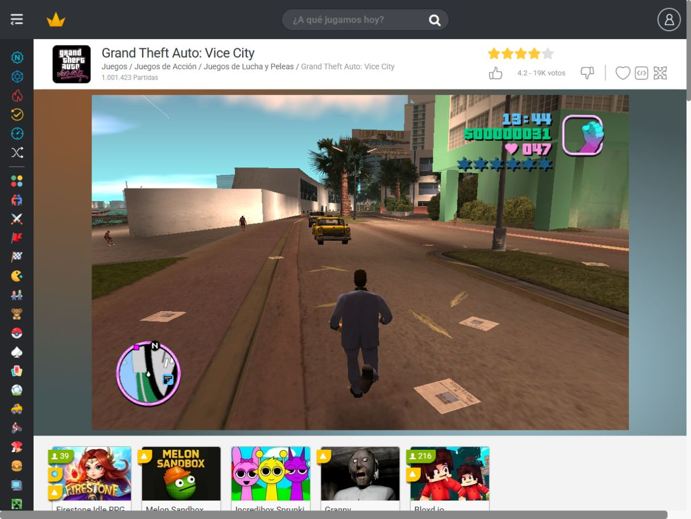

# Personaje, movimiento y cámara: referencia para el modo 3D de Oakhaven

18 de noviembre de 2026, America/Lima. Este documento cierra la observación solicitada del personaje a pie. Describe las imágenes de la partida del usuario y las convierte en una propuesta de implementación para DEMO-L-D. Las decisiones propuestas no se han aplicado al código.

## 1. La referencia que conviene conservar

La impresión visual es de una cámara cercana que acompaña al personaje desde atrás. El cuerpo completo permanece visible en la zona baja del encuadre y queda espacio por delante para leer el camino. La orientación del cuerpo y las poses de las piernas permiten distinguir el avance del reposo. El personaje conserva una escala reconocible frente a peatones, vehículos, aceras y puertas.

Para el modo 3D de Oakhaven, el objetivo sería esa relación entre cuerpo y entorno: un héroe con volumen y una locomoción legible, seguido por una cámara que ayuda a avanzar y girar. El estilo gótico, las proporciones de Thomas y Khaterine y sus animaciones deben seguir siendo propios del proyecto.

### Qué muestran las capturas finales

| Evidencia | Observación | Límite |
|---|---|---|
| [Personaje 01](evidencias/personaje-camara-01.jpg) | Presentación del traje con plano bajo y franjas negras. | Es un encuadre de secuencia, no la cámara habitual de desplazamiento. |
| [Personaje 02](evidencias/personaje-camara-02.jpg) | Cuerpo entero visto desde atrás en la calle; texto de objetivo y HUD visibles. | Una pose aislada no establece la transición de parada. |
| [Personaje 04](evidencias/personaje-camara-04.jpg) | Pose inclinada, extremidades extendidas y una pierna elevada. | No se identifica con certeza si procede de salto, impacto u otra acción; no se usa como ejemplo de carrera normal. |
| [Personaje 05](evidencias/personaje-camara-05.jpg) | Pose con rodilla elevada durante el recorrido; el espacio delante del personaje sigue visible. | No se determina la fase exacta de la animación ni su duración. |
| [Personaje 06](evidencias/personaje-camara-06.jpg) | Pose de carrera legible, brazos flexionados y una pierna atrás; cuerpo en el tercio inferior/central. | No se midieron velocidad, latencia ni contacto de pie frame a frame. |
| [Personaje 07](evidencias/personaje-camara-07.jpg) | Carrera con cambio de orientación junto al borde de césped y costa; se ve la silueta completa y el camino. | No permite recuperar el algoritmo ni el tiempo de reacción de la cámara. |

En las dos últimas imágenes, la altura aparente del personaje ronda dos quintos de la altura del área jugable. Es una estimación visual del encuadre, no una medición del FOV o de la distancia del motor.

### Cómo se siente visualmente la cámara

- **Cercana:** el héroe tiene suficiente tamaño para reconocer ropa, postura y dirección.
- **Orientada al recorrido:** el personaje queda por debajo del centro y el escenario conserva profundidad por delante.
- **Contextual:** los encuadres observados de cinemática, desplazamiento a pie y vehículo son diferentes.
- **Anclada al cuerpo:** durante las capturas del avance, la escala del personaje cambia poco aunque cambie el entorno.

La revisión usa capturas puntuales, no vídeo continuo. Por eso esta lectura de composición no confirma fluidez, latencia, microvibraciones, deslizamiento de pies ni el comportamiento ante todas las paredes. Tampoco establece cómo decide el port recentrar la cámara.

## 2. Qué mejoraría al trasladarlo a Oakhaven

La prioridad es lograr una locomoción corporal convincente y una relación clara entre dirección, cámara y controles. Añadir detalle al modelo sin resolver esos tres aspectos mantendría la sensación de un objeto que se desplaza por el suelo.

### Locomoción con estados y apoyos

Usar estados de presentación explícitos: `idle`, `walk`, `run`, `start`, `stop`, `turn`, `attack`, `dodge` y `hit`. Añadir salto/caída solo si el diseño realmente incluye esas acciones. Las poses deben comunicar qué está haciendo el héroe y qué acciones siguen disponibles.

Para Thomas, la espada, la túnica y el torso deberían acompañar el cambio de peso sin ocultar las piernas o la dirección de ataque. Para Khaterine, el arco y la ropa pueden dar otra silueta, manteniendo la misma claridad de apoyo y desplazamiento. Las diferencias de personalidad no deben alterar accidentalmente escala, colisión o estado del héroe.

El controlador de movimiento debe ser la autoridad del desplazamiento inicial. La animación recibe la velocidad real y ajusta su ritmo; así se puede calibrar una zancada contra una distancia conocida. Si más adelante se adopta root motion, debe existir una sola autoridad de movimiento y una política definida para colisiones y combate.

No se necesita copiar la rigidez visual de una animación antigua. Propondría transiciones cortas y legibles, giro de torso/cadera coherente y frenadas con apoyo visible. No se afirma que estos defectos se hayan medido en Vice City; son objetivos de calidad para el proyecto.

### Dirección del jugador y orientación de cámara independientes

En tercera persona, mantener separados:

1. La intención de movimiento del input.
2. La dirección de desplazamiento permitida por el mundo.
3. La orientación del cuerpo.
4. La orientación de la cámara.

Para el modo de exploración propuesto, WASD se convierte a una dirección sobre el plano del suelo usando la orientación de la cámara. El personaje gira hacia el movimiento; la cámara puede acompañarlo con una política de recentrado deliberada. En combate puede haber una política distinta de orientación o fijación de objetivo.

Evitar que cada giro de cuerpo fuerce de inmediato una órbita completa de cámara. También evitar mover al héroe antes de comprobar qué contexto consume el input: diálogo, menú, pausa o juego.

### Seguimiento de posición, mirada y obstáculos

Suavizar de forma independiente la posición y el punto de mirada. Incorporar una pequeña anticipación en la dirección de avance, que vuelva suavemente a cero al detenerse. Esa anticipación debe ayudar a ver el camino sin sacar al personaje del encuadre.

Para paredes, comprobar el volumen entre el punto de mirada y la posición deseada de cámara; un barrido con volumen es más robusto que un único rayo central. Acercar la cámara al encontrar un obstáculo y recuperar la distancia de forma gradual al despejarse. Definir qué capas bloquean cámara: una pared, un personaje, una hoja o un efecto no tienen necesariamente la misma función.

Los cambios de héroe, teleport, respawn y cinemática necesitan una política propia. Un teleport no debe obligar a la cámara a recorrer el mapa lentamente para alcanzar al personaje.

## 3. Puntos concretos del código actual

Fuente local: `C:/Kevin/DEMO-L-D/src/presentation/three/Oakhaven3DExperience.ts`, checkout con HEAD `5a5f3ca970e24ad47f453b0d1d52105d6d8f5817`. Las referencias se revisaron durante la redacción; no constituyen una prueba de comportamiento de una compilación nueva.

| Punto | Lo que expresa el código | Cambio propuesto |
|---|---|---|
| `createPlayer`, desde línea 660 | Construye los héroes con grupos y mallas primitivas; el torso de Thomas se asigna a `playerBody`. | Introducir un adaptador de presentación por héroe para modelo, rig, clips, puntos de arma y altura de referencia. |
| `updatePlayer`, línea 3722 | WASD produce un vector en ejes globales X/Z. | En el modo de tercera persona, convertir la intención a ejes de la cámara proyectados al suelo. Conservar una política separada para la vista oblicua. |
| `updatePlayer`, línea 3728 | La velocidad planar se asigna directamente según el estado armado. | Definir aceleración y frenada como parámetros del controlador y entregar la velocidad real al animador. Mantener la respuesta del combate como restricción de diseño. |
| `updatePlayer`, línea 3736 | Interpola ángulos con un factor fijo `0.2`. | Interpolar por el arco angular más corto y con respuesta dependiente del delta; comprobar la frontera entre −π y π. |
| `updatePlayer`, línea 3739 | La señal de carrera inclina el torso con un seno. | Sustituir esa señal principal por locomoción con piernas y brazos animados. Aplicar la presentación al héroe activo, sin animar por accidente una malla oculta. |
| `updatePlayer`, línea 3741 | La frenada multiplica la velocidad por `0.7` cada frame. | Expresar la pérdida de velocidad por tiempo; comprobar la misma distancia de frenada con distintos pasos de simulación. |
| `updateCamera`, línea 4730 | El offset detrás de la cámara se rota con `playerGroup.rotation`. | Separar el yaw de cámara del yaw del cuerpo y definir cuándo se recentra. |
| `updateCamera`, línea 4739 | La posición usa `lerp(..., 0.08)` y la mirada se aplica directamente. | Usar suavizado temporal para posición y objetivo, más resolución de obstáculos. |

### Convención de ejes que hay que verificar primero

El movimiento calcula `atan2(inputDir.x, inputDir.z)`, mientras varias acciones usan un vector local frontal `(0, 0, -1)` y la cámara usa un offset con Z positivo. El modelo primitivo también coloca detalles en Z positivo. Estas expresiones requieren una convención coherente antes de calibrar la cámara o integrar un GLB; no se afirma aquí haber reproducido en ejecución una inversión concreta.

Propuesta: fijar `−Z` como frente del controlador y adaptar cada modelo dentro de un nodo visual hijo. Así, corregir el eje de un archivo importado no cambia la dirección de ataque ni la cámara. La orientación del controlador para una dirección planar `(x, z)` debe respetar esa convención; para frente local `−Z`, el yaw objetivo corresponde a `atan2(-x, -z)`.

## 4. Contrato de implementación propuesto

```ts
type LocomotionState = 'idle' | 'walk' | 'run' | 'start' | 'stop' | 'turn';

interface CharacterPresentationState {
  heroId: string;
  speed: number;
  grounded: boolean;
  facingYaw: number;
  locomotion: LocomotionState;
  action: 'none' | 'attack' | 'dodge' | 'hit';
}

interface FollowCameraSettings {
  distance: number;
  height: number;
  targetHeight: number;
  positionResponse: number;
  lookResponse: number;
  recenterResponse: number;
  lookAhead: number;
}
```

Son contratos de diseño, no interfaces ya añadidas al repositorio. El dominio conserva estadísticas e identidad; el controlador resuelve movimiento; el animador presenta el resultado; la cámara observa un objetivo estable. El animador no debe guardar vida o inventario ni decidir por sí mismo la posición del héroe.

Orden de actualización propuesto:

```text
Input y contexto
  → intención de movimiento relativa a cámara
  → aceleración, desplazamiento y colisiones
  → orientación del controlador por el arco corto
  → estado de presentación y mezcla de animaciones
  → objetivo de cámara, obstáculos y suavizado
  → render y HUD
```

Para suavizar una magnitud con una respuesta `k` por segundo:

```text
alpha = 1 − exp(−k × deltaSeconds)
valor = valor + (objetivo − valor) × alpha
```

En un ángulo, primero obtener la diferencia corta con `atan2(sin(diferencia), cos(diferencia))`. Esta fórmula no sustituye el tratamiento de teleport, colisiones o límites de cámara.

### Valores iniciales para un prototipo

Estos valores son propuestas propias para probar, no parámetros recuperados de Vice City. La altura `H` corresponde al héroe de pie.

| Parámetro | Punto de partida |
|---|---|
| Altura aparente del cuerpo | Aproximadamente 35–45 % de la altura jugable, con pies y cabeza visibles en movimiento normal. |
| Distancia de cámara | Alrededor de `2.6 × H`, ajustada según el FOV y el encuadre real. |
| Altura de cámara sobre los pies | Alrededor de `1.45 × H`. |
| Altura del punto de mirada | Alrededor de `0.65 × H`. |
| FOV vertical | Probar cerca de 48–55°; el proyecto ya crea una cámara con 48° en línea 249. |
| Respuesta de posición | Empezar en `5 s⁻¹`, cercana a la respuesta del factor 0.08 a 60 Hz, y ajustar con el recorrido. |
| Anticipación de mirada | Probar `0.3–0.6 × H` en avance, reduciéndola al parar. |

Calibrar primero en un espacio con suelo, una puerta, un peatón de referencia y una esquina. Después comprobar combate y zonas estrechas. Un valor que se ve bien en una plaza puede fallar junto a una pared.

## 5. Qué recursos hacen falta

Los PNG, iconos, sprites y láminas 3D entregados anteriormente siguen siendo recursos para sus usos previstos. Las láminas de referencia 3D no contienen malla, esqueleto ni clips de animación.

Para el resultado de cuerpo completo observado en esta referencia, el modo 3D necesita un modelo propio articulado y animaciones de locomoción. Un siguiente paquete de modelado debería especificar: escala, frente local, punto de origen en los pies, esqueleto consistente, clips necesarios y puntos de sujeción de espada/arco. Los modelos de Thomas y Khaterine pueden compartir convenciones sin perder su silueta.

Para el modo 2D, la misma lógica de estado y velocidad puede conducir los sprites. La perspectiva y el volumen vistos en la referencia pertenecen a su presentación 3D y requieren una solución visual correspondiente.

## 6. Cómo aceptar el cambio antes de ampliar el mapa

1. **Avance y parada:** caminar, correr y detenerse en una distancia conocida; comprobar apoyo, escala y que el ritmo de animación corresponde al desplazamiento.
2. **Giros:** hacer giros de 90° y 180°, además de cruzar −π/π; el personaje no da una vuelta larga por la interpolación y la cámara conserva orientación útil.
3. **Cámara y control:** orientar la cámara y repetir WASD; la dirección sigue la política elegida, sin confundir ejes globales con ejes de cámara.
4. **Obstáculos:** acercarse a una esquina y pasar por una puerta; la cámara evita atravesar paredes y recupera su distancia sin un salto brusco.
5. **Héroes y contextos:** repetir con ambos héroes, diálogo, inventario, daño y esquiva; no se alteran vida, arma o identidad al cambiar de presentación.
6. **Paso temporal:** repetir el mismo input con pasos de 30, 60 y 120 Hz; comparar recorrido, giro y frenada, en lugar de juzgar solo una grabación a una tasa.

La observación de Vice City terminó después del tramo a pie solicitado por el usuario. Quedan documentados tanto el objetivo visual como los límites de la evidencia. No se implementaron cambios, no se midió rendimiento del port y no se presenta el vuelo completo como verificado.


