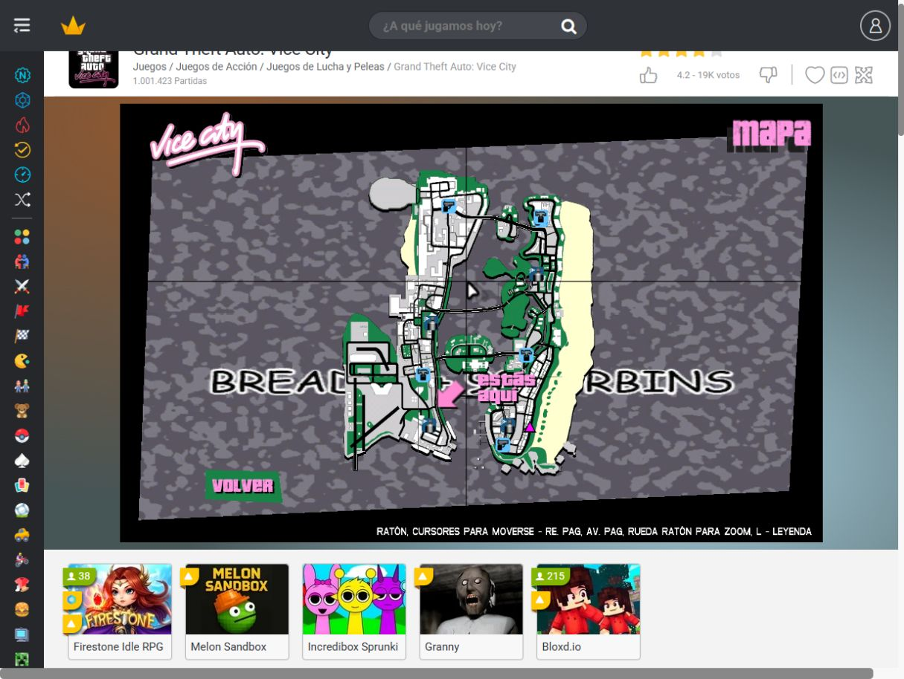

# Vice City como referencia para The Light in the Darkness

Revisión del 18 de noviembre de 2026, America/Lima. Juego observado: [versión de Minijuegos](https://www.minijuegos.com/juego/gta-vice-city). El proyecto DEMO-L-D sigue en pausa y no se modificó su implementación.

## Conclusión

**Cierre de la revisión:** el usuario añadió un recorrido propio y una última prueba centrada en el personaje a pie. El resultado específico y su propuesta de implementación están en [Personaje, movimiento y cámara](PERSONAJE_Y_CAMARA.md); el registro cronológico está en [Observación de la partida](OBSERVACION_USUARIO.md).

La referencia aporta más por cómo organiza el espacio, la orientación y la actividad alrededor del jugador que por la extensión de su mapa. Para Oakhaven, propongo empezar por un sector compacto y reconocible, con cámara estable, acciones claras y consecuencias que se conserven al guardar. La extensión debe venir después de comprobar ese recorrido completo.

La parte técnica muestra una adaptación de un runtime WebAssembly al navegador, con carga verificada, prioridades y guardados separados de la caché. Es una referencia útil de entrega y recuperación; no establece que DEMO-L-D deba adoptar el motor ni la arquitectura interna de este port.

## Qué se probó realmente

| Pregunta | Resultado y límite |
|---|---|
| ¿Se abrió una partida? | Sí. Se observaron menú, introducción, personaje a pie, vehículos y HUD. |
| ¿Se jugó con controles automatizados? | Sí. Se envió aceleración, marcha atrás, dirección y pausa al canvas; el vehículo respondió una vez resuelto el problema de geometría de la entrada automatizada. |
| ¿Se activó `COMEFLYWITHME`? | El usuario informó que lo había introducido. No se conservó una confirmación visual del mensaje de activación. |
| ¿Se verificó el vuelo? | Parcial. Se observó un levantamiento bajo del carro durante el desplazamiento. No se consiguió un vuelo sostenido ni un recorrido aéreo de todo el mapa. No se puede atribuir ese movimiento de forma exclusiva al truco sin una comprobación adicional. |
| ¿Qué zonas se observaron? | Calle urbana con tráfico y peatones, entorno identificado en pantalla como Ocean Beach, frente de agua con muros, embarcaciones, puentes y siluetas de edificios. Esto no equivale a explorar todos los distritos. |
| ¿Se revisó todo el mapa? | Se abrió la vista general completa del mapa de pausa y se revisaron sus conexiones. Ver el plano completo no equivale a recorrerlo entero. |
| ¿Qué pasó durante las pruebas? | Hubo colisiones y una transición al hospital; después se observó un vehículo sobre el agua y finalmente su inmersión. Parte de los cambios iniciales ocurrió mientras había control compartido, por lo que no se atribuyen todos a las acciones del agente. |
| ¿Hubo carga durante el recorrido? | Sí. Dos capturas muestran pantallas negras con barra de progreso y rutas de modelos/texturas. No se midió cuánto duró cada interrupción ni la tasa de fallos del streaming. |
| ¿Se probaron misiones, combate o guardados? | No de forma sistemática. El informe técnico de guardado se basa en código, no en una prueba de guardar y recargar. |

La entrada automatizada tuvo dificultades con el foco y las coordenadas fraccionarias de los iframes. Una vista temporal de 1280 × 900 permitió sostener teclas; se restauró el tamaño normal al finalizar. Esta dificultad pertenece al ensayo y no demuestra un defecto del teclado usado por una persona.

Al concluir la fase de control del agente, la pestaña se dejó en el mapa de pausa. Antes de pausar, el último vehículo estaba sumergiéndose. No se escribió un slot de guardado manual durante esa prueba. Después el usuario retomó la partida para una fase adicional de observación sin controles del agente, recogida en [OBSERVACION_USUARIO.md](OBSERVACION_USUARIO.md).

## Lectura del diseño y mejoras para tu proyecto

### 1. El mapa tiene estructura, no solo superficie

En el plano general se distinguen dos grandes masas urbanas alargadas, islas intermedias, varias conexiones por puentes y una franja de playa continua en un borde. Las calles forman redes y bucles. El agua separa zonas y vuelve reconocibles los pasos entre ellas.

**Aplicación propuesta:** dividir Oakhaven en tres sectores iniciales con identidad propia y conectarlos mediante accesos legibles. Por ejemplo: plaza/santuario, barrio de viviendas y borde de bosque. Cada sector necesita un punto reconocible, una ruta principal, una alternativa y una razón jugable para visitarlo. Los nombres son una propuesta para diseñar el prototipo, no lugares observados en Vice City.

**Cómo implementarlo:** definir IDs de zona y una lista explícita de conexiones; construir un recorrido cerrado de ida y vuelta; colocar un hito visible antes de decorar caminos secundarios. Mostrar en el mapa el objetivo activo, el jugador y los accesos conocidos con símbolos distintos.

**Cómo evaluarlo:** hacer el recorrido desde la cámara habitual, sin mapa al principio, y registrar dónde se pierde la orientación. La vista aérea sirve para detectar vacíos, pero la legibilidad debe comprobarse a nivel del personaje.

### 2. La identidad visual se construye con varias capas

En las escenas observadas se combinan fachadas, palmeras, farolas, luces de vehículos, agua y edificios al fondo. Las vistas de noche y atardecer cambian la lectura del mismo entorno. La distancia se reconoce por siluetas y masas de color sin que cada objeto lejano necesite detalle fino.

**Aplicación propuesta:** escoger para cada sector de Oakhaven una combinación de silueta, material dominante, luz y ambiente sonoro. Una plaza puede leerse por un volumen central; un bosque, por copas y claros; una zona hostil, por formas y contraste propios. El objetivo es que el jugador reconozca dónde está antes de leer una etiqueta.

**Cómo implementarlo:** fijar escala y paleta por sector; limitar la cantidad de materiales; reservar el mayor contraste para rutas, amenazas y objetos interactivos. Integrar los recursos artísticos propios ya entregados en una zona de prueba antes de producir más contenido.

**Crítica:** más detalle no resuelve una composición confusa. Mantener un presupuesto de objetos y elegir qué debe dominar cada vista.

### 3. La actividad ambiental sostiene la sensación de lugar

Se observaron peatones y tráfico mientras el vehículo estaba detenido. Hay movimiento independiente del protagonista, y los faros y personajes aportan referencias de escala.

**Aplicación propuesta:** añadir pocas rutinas ambientales comprensibles: un habitante que recorre la plaza, una criatura en un borde de camino o un objeto que reacciona a una interacción. No hace falta simular una ciudad entera para que Oakhaven parezca habitado.

**Cómo implementarlo:** separar entidades ambientales de enemigos y objetivos de misión; activar su simulación por distancia/zona; reutilizar estados simples como reposo, desplazamiento y reacción. Guardar únicamente los cambios que deban tener consecuencias persistentes.

**Cómo evaluarlo:** detener al jugador y comprobar si el lugar conserva actividad; verificar que esa actividad no tape amenazas ni objetivos. No se infiere del port qué algoritmo usa su IA.

### 4. La cámara y el HUD forman parte de la navegación

La conducción ofrece una vista detrás del vehículo, con cambios de encuadre durante marcha atrás, giros y colisiones. El radar conserva referencias de calles, agua e iconos. El HUD agrupa tiempo, dinero, salud y otros estados en una esquina, dejando el centro para el mundo.

**Aplicación propuesta:** dar a Oakhaven modos explícitos de cámara para exploración, combate, interacción y pausa. Mantener una representación estable del héroe activo, su vida y el objetivo. Una cámara que funciona al caminar también debe probarse cerca de paredes, puertas y obstáculos.

**Cómo implementarlo:** usar suavizado dependiente del delta, resolver obstáculos entre el objetivo y la posición de cámara y decidir qué contexto consume cada acción. Los puntos concretos del código actual están en el [análisis técnico](ANALISIS_TECNICO.md), apartados 7B y 7D.

**Crítica:** un plano de mapa lleno de iconos no garantiza orientación. Priorizar los símbolos útiles para la tarea actual y ofrecer una leyenda legible. En esta sesión se observó el mapa general, pero no se confirmó que la tecla de leyenda cambiara su presentación.

### 5. La carga de recursos puede interrumpir la exploración

Las capturas guardadas muestran una pantalla de carga con rutas como `MODELS/GTA3.IMG/LOD_beacon2_dy.dff` y otra con `MODELS/GTA3.IMG/predator.txd`. Esto confirma interrupciones visibles en esta sesión. El nombre `LOD` por sí solo no establece cómo decide el motor cargar o simplificar la geometría.

**Aplicación propuesta:** anticipar los recursos de la zona siguiente y mantener disponible el sector actual hasta completar la transición. Si falta un recurso crítico, comunicar qué ocurre y ofrecer recuperación. Separar los recursos necesarios para jugar de audio y decoración opcionales.

**Cómo implementarlo:** manifiesto versionado, cola con prioridades, deduplicación, cancelación y propietario de cada recurso. Medir la ruta real de entrada a una zona antes de elegir tamaños de paquetes o radios de precarga. El contrato propuesto está en el apartado 7A del documento técnico.

**Crítica:** el catálogo declara aproximadamente 1 GB de archivos, pero esa suma no describe la descarga inicial, la memoria ni el tráfico observado. No trasladar esa magnitud a Oakhaven como objetivo.

### 6. Las consecuencias deben sobrevivir al guardado

La sesión mostró daño, colisión, hospital y cambio de ubicación. No se investigó la máquina de estados interna que produce esas transiciones. La lección de diseño para tu juego es que el mundo debe responder de forma coherente y conservar las consecuencias que importan.

**Aplicación propuesta:** antes de ampliar el mapa, unificar el snapshot de héroes, inventario, misiones y cambios del mundo. Mostrar «guardado» después de comprobar la persistencia. El estado de cada héroe debe pertenecer a su ID, y cambiar de presentación no debe reconstruir el progreso con valores por defecto.

**Cómo evaluarlo:** recoger un objeto, cambiar de héroe, resolver una interacción, guardar y recargar; comprobar personaje y mundo. Repetir con el almacenamiento rechazado. Las limitaciones encontradas en DEMO-L-D se explican con líneas de código en el documento técnico.

## Prioridad de trabajo propuesta

| Orden | Entregable verificable |
|---|---|
| 1 | Estado por héroe y guardado completo, validado y con errores visibles. |
| 2 | Cámara estable e input por contexto, con liberación de teclas al perder foco. |
| 3 | Un sector de Oakhaven terminado: escala, colisiones, animaciones, orientación y una interacción completa. |
| 4 | Carga anticipada y liberación de recursos medidas sobre ese recorrido. |
| 5 | Segundo sector con identidad distinta y una conexión significativa al primero. |

Esta propuesta está documentada; no se ha empezado a implementarla. La comparación con el segundo juego todavía puede cambiar las decisiones de diseño.

## Evidencias y documentación

- [Análisis técnico, contratos y críticas con mejoras](ANALISIS_TECNICO.md).
- [Personaje, movimiento y cámara: especificación para Oakhaven](PERSONAJE_Y_CAMARA.md).
- [Observación posterior de la partida del usuario](OBSERVACION_USUARIO.md).
- [Mapa general observado](evidencias/mapa-revisado.jpg).
- [Primera pantalla de carga intermedia](evidencias/carga-intermedia-01.jpg).
- [Segunda pantalla de carga intermedia](evidencias/carga-intermedia-02.jpg).
- [Personaje junto a vehículo](evidencias/personaje-junto-vehiculo.jpg).
- `evidencias/identidad-2026-11-18.json`: comparación del cargador vivo con la captura local.
- `evidencias/rea-evidence-2026-11-18.json`: registros estáticos exportados de REA y sus límites.

Las capturas registran la versión comercial alojada en la web como material de revisión. No son sprites, texturas ni modelos para integrar en el paquete artístico propio del proyecto.

